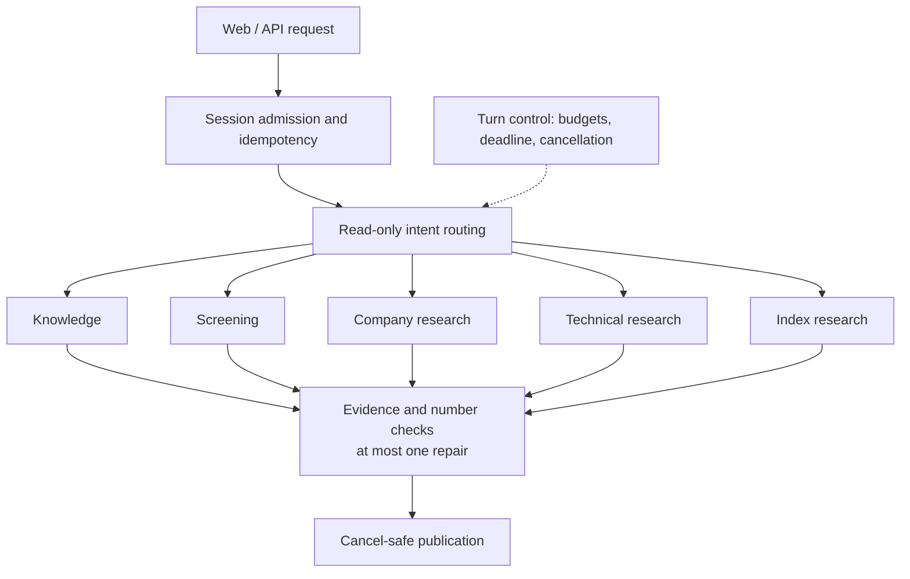

# Trading Companion

A Chinese-language research assistant for China's A-share market. You ask questions in plain language; the application collects public market, company and news data through controlled read-only tools, has a language model write the analysis, and checks the answer against the collected evidence before showing it. All trading decisions stay with you.


*Offline demo with a fixed fake model and five artificial daily bars; no live data or model calls.*

## What it does

- **Stock research**: trend, technical indicators (SMA, EMA, MACD, RSI, BOLL, ATR, ADX, OBV, VWMA, volume), company profile, financials, news and announcements, and comparisons of up to three named stocks.
- **Index research**: daily and complete-week analysis of five major A-share indices, with point-based levels.
- **Decision answers**: for buy/sell questions, a model verdict with direction and conviction, plus a program-calculated ATR plan (entry, stop, two targets, reward/risk). The app asks for a short, medium or long holding horizon before computing levels.
- **Screening**: numeric filters (price, PE, PB and similar) over a bounded quote sample, with coverage gaps shown.
- **Knowledge questions**: indicator definitions and general finance concepts, answered from local notes with citations.
- **Conversation**: follow-ups on the same stock, condition edits, history recall, and an interactive K-line chart (daily, weekly, and 1h/2h for Tencent data).

## Safety boundaries

- No brokerage connection, orders, position sizing or fund management. The application never trades.
- Price levels are computed by the program from historical evidence; the model cannot invent them. They are conditional references, not predictions.
- Model verdicts are self-assessed and not historically calibrated. Probabilities are never invented.
- Missing data and rejected model output are shown explicitly rather than hidden.

See [decision contracts and calculation limits](docs/research-decision-plan-design.md).

## Architecture

A modular Python backend (FastAPI) with a React/TypeScript workspace. A read-only router picks one controlled handler per message; every handler keeps its own identity, date, parameter and evidence checks.



Key design points:

- **Model proposals pass application gates.** Tool calls use a project-owned protocol with DeepSeek and OpenAI adapters; no agent framework.
- **Answers carry checked evidence.** Citations, numbers and company attribution are verified; these checks do not prove all prose correct.
- **Turns are bounded and inspectable.** Shared call, time and token budgets; idempotent requests; optional trace metadata without questions or answers.
- **Collection is bounded.** Company evidence and quote batches share at most three concurrent tasks with per-source request and byte limits.

More detail: [architecture](docs/architecture.md) · [request routing](docs/request-routing-design.md) · [company research](docs/company-research-design.md) · [turn control](docs/turn-control-design.md)

## Quick start (offline demo)

Windows is the supported platform. In PowerShell, from a checkout with dependencies installed:

```powershell
.\start.cmd --demo
```

The demo needs no API key, ignores `.env`, and opens the browser when the server is ready. Ask the demo to analyze Ping An Bank (the Chinese name) and request a trade plan to see a full answer with a verdict card and ATR table. Press Ctrl+C to stop.

## Setup

Requirements: Python 3.11+, Node 22.12+ and the pnpm version pinned in `frontend/package.json`.

```powershell
py -3.11 -m venv .venv
.\.venv\Scripts\python.exe -m pip install -e ".[api,model,data]"
pnpm.cmd --dir frontend install --frozen-lockfile
pnpm.cmd --dir frontend build
```

Create a `.env` file in the project root (it stays local and is git-ignored):

```dotenv
DEEPSEEK_API_KEY=replace_with_your_key
DEEPSEEK_MODEL=replace_with_your_model_id

# Optional: OpenAI as a second provider
OPENAI_API_KEY=replace_with_your_openai_key
OPENAI_MODEL=replace_with_your_openai_model_id
```

Then start normal mode:

```powershell
.\start.cmd
```

`start.cmd` builds missing frontend assets, refreshes a missing or expired security-name directory from the public SSE/SZSE lists, enables local tracing in `data/traces/`, and opens <http://127.0.0.1:8765/>. It never installs packages or overwrites configuration. Normal questions can call paid model APIs and public data sources.

Useful options (also accepted by `python -m trading_companion.api_server`):

| Option | Effect |
| --- | --- |
| `--port 8767` | Use another port |
| `--no-open-browser` | Do not open a browser |
| `--provider openai` | Default to OpenAI when only it is configured |
| `--snapshot-db PATH` | Keep a local SQLite archive of research evidence |
| `--trace-dir PATH` / `--no-trace` | Change or disable trace metadata |
| `--screening-coverage expanded` | Larger, slower screening sample |

When both providers are configured, the web model selector offers each; a session keeps its provider. The **Dev Mode** button switches the page to a separate fake-model, synthetic-data backend. See the [configuration guide](docs/local-environment.md) and [Dev Mode design](docs/dev-mode-design.md).

## Development

Run the same gates as CI (Windows, no API key or live data needed):

```powershell
.\.venv\Scripts\python.exe -m pip install -e ".[api,model,data,dev]"
.\.venv\Scripts\python.exe -X utf8 -B scripts/verify.py all
```

Individual gates are `python`, `web` and `bundle` (run `web` before `bundle`). They fail on skipped or empty tests. The Python gate runs about 3,100 unit tests, 244 pytest cases, fixed agent scenarios, repeated MVP scenarios, company workflows and an API walkthrough. GitHub Actions runs one Windows job on pushes and pull requests. See the [CI design](docs/ci-design.md).

Inspect trace metadata without starting the server:

```powershell
.\.venv\Scripts\python.exe -m trading_companion.trace_cli --trace-dir ".\data\traces"
```

## Current work

- **Research intent v2.** A candidate that lets the model interpret the whole request (task, subject, horizon, price-plan intent, exclusions, references) while the program only guards actions that would expand authority. It is evaluated on frozen development, regression and sealed holdout sets with full denominators. Production chat still uses the existing router. See [v2.6 guard principles](docs/research-intent-v2.6-guard-principles.md) and [plan](docs/research-intent-v2.6-plan.md).
- **Headline triage.** A low-cost classifier (Jev) is being measured against DeepSeek on news and announcement titles; it is not yet used in answers. See [news triage evaluation](docs/news-triage-design.md).

Not in scope yet: full article and filing understanding, whole-market completeness, calibrated forecasts, strategy backtesting and public deployment.

## Project layout

```
src/trading_companion/   Backend: data adapters, indicators, research workflows, routing, API
frontend/                React/TypeScript workspace
evaluation_tools/        Offline and bounded live evaluation tooling
data/evaluation/         Frozen evaluation corpora, manifests and locks
docs/                    Design documents (mostly in Chinese)
scripts/verify.py        Local and CI acceptance gates
tests/                   Offline regression tests
```

## Documentation

Most design documents are written in Chinese.

- [Project handoff](docs/agent-handoff.md): requirements, working preferences, current capabilities and coordination rules
- [Architecture and roadmap](docs/architecture.md)
- [Company research workflow](docs/company-research-design.md)
- [Index research](docs/index-research-design.md)
- [Holding-horizon rules](docs/holding-horizon-design.md)
- [Technical analysis and timeframes](docs/technical-analysis-design.md)
- [Screening](docs/screening-design.md)
- [Conversation memory](docs/conversation-memory-design.md)
- [Local API](docs/local-api-design.md) and [web workspace](docs/web-workspace-design.md)
- [Chart workspace](docs/chart-workspace-design.md)
- [Turn tracing](docs/turn-tracing-design.md)
- [Tool-model protocol](docs/tool-model-design.md)
- [Current module status](docs/module-progress-2026-10-26.md)
