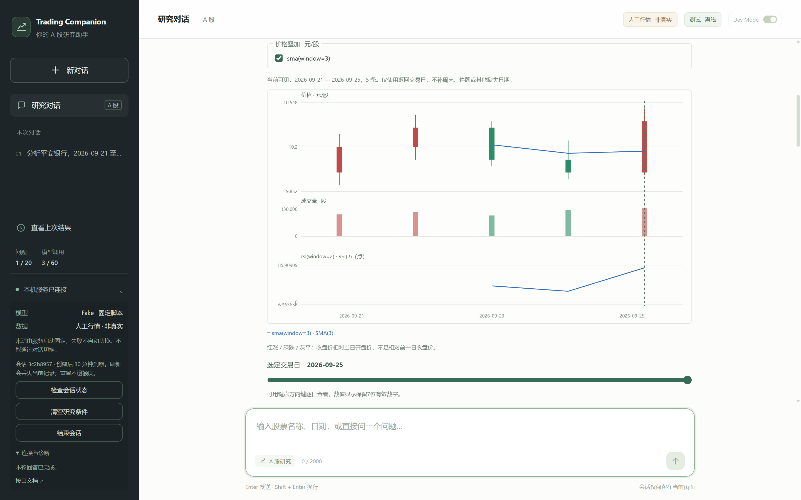
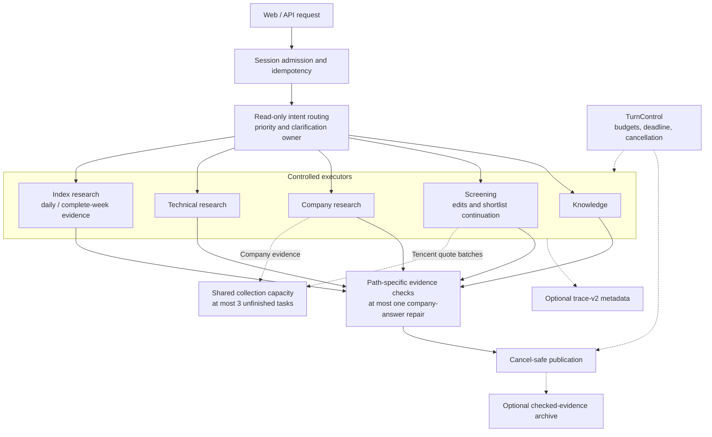
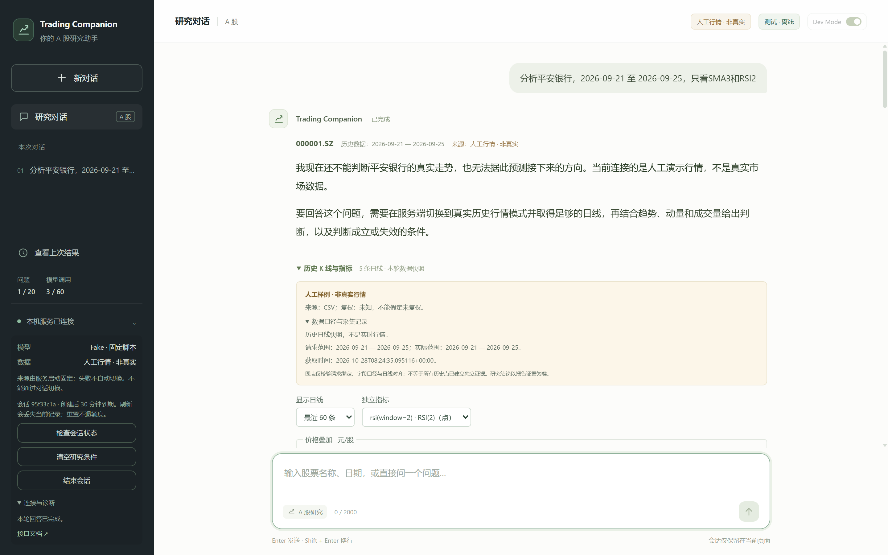

# Trading Companion

A Chinese-language research agent for China's A-share market, with application-controlled tools, checked evidence, and trading decisions kept with the human.

The independent research-intent v2.5.2 candidate is being checked with public development and exposed regression cases. It adds bounded, opt-in JSON diagnostics and repairs, explicit technical cues, conflict clarification and checked references to recent comparison members. Production chat continues to use the existing router. [Candidate behavior, offline replay and evaluation commands (Chinese)](docs/research-intent-v2.5-implementation.md)

Index trend research has an independent daily/weekly workflow for 上证指数、深证成指、沪深300、创业板指 and 科创50. “大盘” uses an explicitly labelled 上证 benchmark; ambiguous “科创板指数” asks for the exact identity. Index prices use points, and unverified quantities remain unavailable. Index stop/target requests now ask for an observation horizon before any data/model call; click 短线、中线 or 长线 to continue. Plain text and index plan cards show a direction-matched scenario: conditional entry for bullish, observation bounds for neutral, and a conditional downside watch for bearish; an unformed direction has no plan. Cards retain exact point strings, distinguish daily-close and complete-week ATR dates, and locally reject damaged plans while preserving the trend and chart. Hourly charts remain a later batch. [Index scope, evidence and compatibility (Chinese)](docs/index-research-design.md)

Price-plan questions now ask for a holding horizon before collecting data: choose 短线（1-2周）, 中线（1-3个月） or 长线（半年以上）. Clicking a choice continues the original question. Explicit horizons such as “未来4个月” are retained; long-term plans use complete-week ATR14 and require approximately one year of history. Direction-only research and excluded price plans do not ask. [Holding-horizon rules (Chinese)](docs/holding-horizon-design.md) · [117-turn v7 comparison](docs/request-routing-horizon-deltas.md)

Natural technical questions now share the checked v3 narrative workflow, including shortlist research and indicator edits. “只看SMA3” keeps that exact indicator set: no implicit ATR or extra MA20/MA60. Excluded domains display “按要求未研究”; an unavailable reference plan does not discard a valid answer. Legacy tasks and structured entry points remain available. [Scope and compatibility](docs/technical-shared-narrative-design.md) · [117-turn v6 comparison](docs/request-routing-technical-deltas.md)

Answer validation now tolerates recoverable ordinary numeric annotations and retains independently valid clauses. Plan prices, cross-stock references, false RSI relations and excluded indicators remain checked. Valid same-stock prices require a model rating; limited indicator research has low conviction, with the plan unavailable when ATR was not requested. Sentence deletion statistics changed from v1 to v2: reports also show clause deletions and partially retained sentences. Historical **17.5% / 26.9%** deletion rates cannot be directly compared with v2. [Validation rules (Chinese)](docs/technical-numeric-grounding-design.md) · [117-turn validation deltas](docs/answer-validation-routing-deltas.md)



**Offline demo with synthetic data.** This earlier interface capture uses a fixed fake model and five artificial daily bars; no live market data or model API calls. Reproduce with `.\start.cmd --demo` and send `分析平安银行，2026-09-21 至 2026-09-25，只看SMA3和RSI2`. The current interface shows **历史 K 线与指标** directly below the answer: move the mouse, drag horizontally by touch, or focus the chart and use the arrow keys to read a candle. Daily is the default; weekly bars use the saved daily snapshot, and Tencent sessions can load 1-hour/2-hour charts on demand. AKShare and CSV/demo hourly charts are disabled. Hourly data never changes research conclusions or price plans. The extra evidence table, global source list, security calendar and full-report attachments have been removed; paragraph sources and research decisions remain in the answer. See the [chart design](docs/chart-workspace-design.md). First-time setup is below.

## Architecture

One controlled research agent in a modular Python backend, with a React/TypeScript workspace. Routing chooses the handler; each handler retains its own authorization and evidence checks.



Executors use controlled models and read-only tools as needed. Dashed arrows show shared controls or optional facilities. The collection pool serves company evidence and Tencent screening batches; Eastmoney pagination stays sequential, as do technical calculations and model calls. Fixed knowledge answers can use zero model calls and zero data reads. Company and index answers allow at most one model repair. Traces store bounded metadata; the optional archive stores evidence, without chat or model answers. Local clarification/conflict replies and the full flow are covered in the [current architecture](docs/architecture.md#2026-10-28当前已实现的处理链路) and [routing design](docs/request-routing-design.md).

DeepSeek structured answers have a 4,096-token output allowance; requests declaring tools keep a 1,500-token cap. Length-limited answers get a distinct diagnostic and at most one concise rewrite. Small JSON punctuation errors can be repaired locally before the existing evidence checks. Technical research accepts multiple proposals in one response and executes them in order within the unchanged six-tool and six-model-attempt limits, recording rejected and unexecuted calls. [Answer boundaries](docs/natural-research-narrative-design.md) · [Batch execution](docs/bounded-research-workflow-design.md)

## Quick start

Windows is the supported runtime and acceptance platform. From PowerShell in a checkout with local dependencies prepared:

```powershell
.\start.cmd --demo
```

The fixed demo runs offline, needs no model key, ignores `.env`, and opens the default browser after the local server is ready. Send the question above to reproduce the screenshots. Press Ctrl+C in the server window to stop; `--no-open-browser` suppresses browser launch.

For a fresh checkout, follow [Setup](#setup-windows-powershell--vs-code) and the [dependency/build steps](#start-the-product) first: Python 3.11+, Node 22.12+ and pnpm 11.25.0 are required. Normal mode uses `.\start.cmd` after configuring a supported model and a current real security directory; see [Start the product](#start-the-product). Normal questions can call paid model APIs and public market sources.

## Engineering highlights

- **Model proposals pass application gates.** The program checks identity, dates, parameters and tool permissions before execution. [Controlled tools](docs/research-tool-design.md) · [Research loop](docs/bounded-research-workflow-design.md)
- **Answers carry checked evidence.** Paths check citations, numeric claims and company attribution, with explicit missing data and fallbacks. These checks do not prove all prose correct. [Company answers](docs/company-research-design.md) · [Indicator claims](docs/grounded-explanation-design.md)
- **Intent and clarification have explicit owners.** A read-only priority table chooses among existing handlers; routing v1/v2 records protect 35 scenarios and 105 turns. [Routing and characterization tests](docs/request-routing-design.md)
- **Each turn can be inspected.** Trace-v2 records routing, model attempts, tools, sources, checks and repairs; `start.cmd` enables it by default, and a read-only CLI reports coverage and timing. [Tracing and viewer](docs/turn-tracing-design.md)
- **Company answers retain useful analysis.** The v3 view shows a conclusion, supporting evidence, program price ranges and conditional scenarios. Invalid sentences and verdicts are handled separately, with one bounded repair and factual fallback. [Natural narratives (Chinese)](docs/natural-research-narrative-design.md)
- **Collection has shared capacity and separate budgets.** Company evidence and Tencent batches share at most three unfinished tasks; request and byte ledgers enforce business limits. [Concurrent collection](docs/collection-concurrency-design.md)
- **Retries and cancellation preserve session boundaries.** Idempotent request IDs prevent repeated execution; cancelled or late work cannot publish new results. [Local API](docs/local-api-design.md) · [Turn control](docs/turn-control-design.md)
- **Tool calls use a project-owned protocol.** DeepSeek and OpenAI adapters share message and result contracts, without an Agent orchestration framework. [Tool protocol](docs/tool-model-design.md) · [Provider selection](docs/company-research-design.md)
- **A cheap classifier is measured before it is trusted.** Jev (TypeSafe's hosted "System One" decision model) and DeepSeek label the same reviewed synthetic headlines. Reports cover accuracy, calibration, latency, cost and a confidence-gated cascade that sends uncertain titles to DeepSeek. Nothing is wired into answers yet. [News triage evaluation](docs/news-triage-design.md)



**Offline demo with synthetic data.** The same fixed question displays the artificial-data warning, answer limits and collection record. Captured from the running app at 1440 × 900 with 2× pixels; timestamps and temporary session identifiers vary between runs.

## Verified facts

Local offline evidence for this revision, dated 2026-10-28. Tests verify program contracts and constructed scenarios; live quality and source performance require separate evaluation.

| Fact | Reproduction / evidence |
| --- | --- |
| Offline Python tests | **2,337 unittest + 244 pytest cases**, no skips or xfails; also 4 Agent scenarios, 90 MVP repeats, 5 company workflows and the API walkthrough. [Acceptance command](#full-acceptance-and-ci) |
| Frontend tests, type checking and build | **633 Vitest tests across 20 files**, TypeScript `--noEmit` and Vite production build pass; the bundle gate confirms served and wheel assets. Vitest, tsc and Vite were invoked directly with Node because pnpm was unavailable; `verify.py web` requires pnpm. [Acceptance gates](docs/ci-design.md) |
| Characterization baseline: 35 scenarios / 105 turns (routing v1/v2) | [Frozen observations and reviewed behavior changes](docs/request-routing-design.md) |
| Windows CI configured | [One Windows Actions job](.github/workflows/ci.yml) runs the same Python, web and bundle gates; remote run status is separate from local results. |
| Offline fixed-delay collection timing | 15 Tencent batches, artificial 100 ms/request, 5 runs per mode: median **1,643 ms serial → 555 ms with 3 slots**; results, coverage, requests and bytes match. Structural, not live. [Method and boundaries](docs/collection-concurrency-design.md) |
| Offline workflow contracts (corpus v1, 40 scenarios / 59 steps) | **59/59 steps passed** at workers 1 and 3; hard/range/quality failures all 0. Uses artificial data and scripted models, with JSON/Markdown reports and a human-review queue. [Evaluation boundaries](docs/workflow-evaluation-design.md) |
| Live headline triage, synthetic set (72 reviewed headlines × 3 questions, 2026-10-28) | Combined accuracy: rules **50.9%**, Jev **87.0%**, DeepSeek **88.0%**. Median latency: Jev **375 ms**, DeepSeek **1,172 ms**. Jev calibration error (ECE) **0.066**. A cascade at confidence 0.65 reaches **89.4%** and sends **26/72** titles to DeepSeek. Real model calls on synthetic data; small sample, not production traffic. [Results and limits](#headline-triage-live-results) |
| Live decision answers after A4, fixed 20 questions (2026-10-29) | **19/20**, meeting the target of at least 18; **73/675** sentences deleted (10.8%), **4/15** repairs succeeded, **0** output truncations; **¥0.570522**, **57** calls. The metrics meet the target; all 20 verdicts still require manual review. [Evaluator and history](docs/decision-answer-evaluation-design.md) |
| Real-model answer quality and live-source performance | **Pending.** Offline results do not establish investment quality or live latency/coverage. |

Reproduce the fixed-delay comparison locally, with generated responses and network access blocked:

```powershell
.\.venv\Scripts\python.exe -X utf8 -B scripts/benchmark_screening_collection.py --coverage expanded --batch-size 80 --repeat 5 --delay-ms 100
```

The [workflow evaluation corpus and runner](docs/workflow-evaluation-design.md) exercise the actual chat entry. Offline is the default; use reports for metrics, tag groups and a reproducible human-review queue. Real modes are implemented and tested with simulated transports only; real-model quality remains pending:

```powershell
.\.venv\Scripts\python.exe -X utf8 -B scripts/evaluate_research_workflows.py
.\.venv\Scripts\python.exe -X utf8 -B scripts/evaluate_research_workflows.py --collection-workers 1 --report-dir .agentbus/tmp/eval-workers1
.\.venv\Scripts\python.exe -X utf8 -B scripts/evaluate_research_workflows.py --collection-workers 3 --report-dir .agentbus/tmp/eval-workers3
```

Use each run's printed `artifacts.json` path with `scripts/compare_research_workflows.py --left LEFT/report.json --right RIGHT/report.json`. The comparison preserves failures and missing steps and rejects incompatible conditions. `--plan-only` previews without credentials or requests. Real modes require an explicit provider, model, price file and whole-run call limit; their default compatible sets are 39 scenarios / 57 steps for `live-model` and 30 / 44 for `live`, with public exclusion reasons. The checked-in [price file](data/evaluation/model-prices.json) records verified Jev and DeepSeek evaluation rates; the DeepSeek rates estimate an upper bound using peak, uncached pricing. Unknown prices, usage or mismatched model identities remain unknown. No live research-workflow evaluation has been run yet.

The [20-question decision answer evaluator](docs/decision-answer-evaluation-design.md) fixes five questions each for buying, selling, outlook and stops. It keeps failures and context questions in the denominator of 20, with a predeclared target of 18 valid model verdicts; prose deletion, repair and structure failures are reported separately. Run `scripts/evaluate_decision_answers.py` for offline contracts or add `--plan-only` to preview. Live runs require explicit model, prices, source configuration and call allowance; preparation turns share the six-call-per-question and 120-call total limits. The first live run formed 2/20 valid verdicts; the A2 diagnostic rerun formed 16/20 under `decision-acceptance-v2` (at least one valid reason), with 343/805 sentences deleted. A3 checks optional model number-to-source bindings and falls back to all supplied same-stock evidence, while preserving units, tolerances and explicit stop/target fields. Replaying the same 36 saved drafts offline formed 18/20 (18/18 outside the two unresolved context questions), with 61/810 sentences deleted; [the A3 results](docs/answer-numeric-a3-results.md) explain the denominator change. A live rerun with the A3 prompt (deepseek-flash, real Tencent/Eastmoney/Sina data, 2026-10-29) then formed **18/20** valid verdicts (18/18 outside the two context questions) and deleted **100/748** sentences (13.4%), with 58 model calls, about ¥0.65 at peak uncached rates and a 17.7 s median end-to-end latency. The model bound 222 of 1,236 numeric tokens to sources (18%); 207 of those passed and 940 unbound tokens matched supplied same-stock evidence. Verdicts have not been manually reviewed for investment merit, and the two context misses belong to the A3 rule version. Program checks do not prove the prose names the correct metric or reporting period. Batch B now hands the latest checked research identity between technical and company workflows, accepts complete new tasks during clarification and rebuilds expired research without reusing old values. Its fixed offline contract run forms **20/20**, including D05/D20, in 46 model forwards; its subsequent B live run formed 17/20 before A4, separately from the A3 live result. The [B change record](docs/request-routing-b-deltas.md) lists all seven changed baseline turns and the deferred items. Raw diagnostics are off by default; explicitly add `--diagnostics-dir .agentbus/tmp/decision-diagnostics` to retain bounded local drafts, actual supplied context and numeric rejection details. These raw records never enter product answers, ordinary traces or formal reports; `--plan-only` validates this option without creating files.

After A4 (`6f1087c`), a new live run with the same fixed 20 questions formed **19/20**, meeting the target of at least 18. It used **57 calls**, cost **¥0.570522** at the configured rates, recorded **0 output truncations**, deleted **73/675 sentences (10.8%)** and completed **4/15** automatic repairs. **The metrics meet the target; all 20 verdicts still require manual review** (指标达成仍需人工复核20条研判). D20's preparation turn missed “最近” and requested a date range; B2 now recognizes a single supported historical date expression from the original question when the model omits or shortens it. Future horizons remain separate, and ambiguous or unsupported dates still require clarification. [B2 scope and baseline comparison](docs/request-routing-b2-dates-deltas.md)

The separate [technical answer evaluator](docs/technical-answer-evaluation-design.md) fixes 10 draft conversations / 14 turns, including four follow-ups, with a target of at least 9 formed v3 narratives and zero scope violations. It audits source requests before execution, including failed attempts, and reports sentence deletion, per-draft error counts, truncations, calls and cost. Run `scripts/evaluate_technical_answers.py` offline or with `--plan-only`; each turn allows six model calls, with 84 for the suite (`--model-call-limit 90` is accepted and capped at 84). **Draft corpus; manual review required. Offline contracts do not establish live answer quality.** Same-stock duplicate drivers are removed with separate quality counters, and indicator edits preserve the distinction between an explicitly requested ATR and a temporary plan dependency.

### Headline triage: live results

A 72-headline set covers fictional issuers. Each headline is labelled for three questions, and Claude reviewed every label (the user decided two ambiguous ones):

- **relevance**: is the headline mainly about the issuer, a passing mention, or a name collision?
- **event type**: one of eight classes.
- **tone toward the issuer**: describes wording, not a trading signal.

Each model sees only the title, company name and code. The set deliberately includes name collisions (a shop or association whose name contains the issuer's), denials of rumours, multi-event and mixed-tone titles. One live run on 2026-10-28 made 144 real calls with no failures:

| | relevance | event type | tone | all three questions | all three correct | p50 / p95 latency |
| --- | ---: | ---: | ---: | ---: | ---: | ---: |
| Keyword rules (frozen baseline) | 66.7% | 40.3% | 45.8% | 50.9% | 19.4% | <1 ms |
| Jev (`jev-latest`, served `jev-1.14.0`) | 76.4% | 94.4% | 90.3% | 87.0% | 68.1% | 375 / 515 ms |
| DeepSeek (`deepseek-flash`, JSON labels) | 75.0% | 97.2% | 91.7% | 88.0% | 66.7% | 1,172 / 1,422 ms |
| Cascade at Jev confidence ≥ 0.65 | | | | 89.4% | 70.8% | DeepSeek on 26/72 titles |

- **Different weaknesses on relevance.** Jev labelled none of the 12 name collisions as unrelated. DeepSeek caught 9 of 12, but recognised only 1 of the 16 passing mentions.
- **Jev's confidence is broadly informative.** Expected calibration error is 0.066. In 145 answers at or above 0.9 confidence, 96.6% were correct. Relevance is overconfident (ECE 0.16).
- **Cascade.** When Jev's minimum confidence across the three questions meets a threshold, its labels are used; otherwise DeepSeek's saved labels are. Ten thresholds (0.50–0.95) were fixed in advance and all are reported. 0.65 and 0.70 both give 89.4%.
- **How much the comparison shows.** 89.4% vs 88.0% is 3 of 216 answers; it is not a significant difference.
- **Cost of this run.**
  - DeepSeek: at most **¥0.16** (73,799 input / 1,542 output tokens at peak, uncached rates).
  - Jev: about **$0.0047**, computed by hand from 111,163 input tokens at $0.042/1M. The report leaves Jev cost unknown because the served model differs from the requested alias.
  - DeepSeek's repeated instructions are likely cache hits, so this run does not show that Jev is cheaper. Its measured advantages are latency and calibrated confidence.

The labels and the keyword rules share an author, so the rule score may be optimistic. Results on fictional headlines do not establish accuracy on real news flow. Jev is not connected to research answers. Reproduce offline, or preview the live plan without credentials or requests:

```powershell
.\.venv\Scripts\python.exe -X utf8 -B scripts/evaluate_news_triage.py
.\.venv\Scripts\python.exe -X utf8 -B scripts/evaluate_news_triage.py --mode live --classifier jev --classifier deepseek --deepseek-model deepseek-flash --call-limit 144 --prices data/evaluation/model-prices.json --plan-only
```

A live run reads only the selected `TYPESAFE_API_KEY` / `DEEPSEEK_API_KEY`, and only after the plan is printed and the label review check passes. See the [design, metrics and authorization rules](docs/news-triage-design.md).

### Intent paraphrases: offline evaluation

An independent [intent evaluation](docs/intent-router-evaluation-design.md) compares the frozen product router, Jev and optional DeepSeek on 240 synthetic semantic questions, plus 64 protected requests that never enter a model. Eight labels include an explicit clarification option; reports show both the full set and the seven-class subset excluding clarification gold labels, since the product router delegates clarification to its executors.

The 144-question development set selects a confidence threshold, which is exported and reviewed before the 96-question holdout run. A preselected 48-case ablation separates six pairs whose labels depend on the latest research category from 18 pairs whose labels should stay unchanged. Trading decisions and future direction always belong to company research; ambiguous issuer names go to its identity clarification. **Labels are draft, pending individual review; only simulated transports have run for this task.** Product routing is unchanged. The older 59-step / 105-turn agreement suite is deferred and explicitly unavailable.

```powershell
.\.venv\Scripts\python.exe -X utf8 -B scripts/evaluate_intent_router.py --plan-only
.\.venv\Scripts\python.exe -X utf8 -B scripts/evaluate_intent_router.py --split dev --report-dir .agentbus/tmp/intent-dev
.\.venv\Scripts\python.exe -X utf8 -B scripts/evaluate_intent_router.py --annotation-review
```

Offline runs and previews read no credentials and make no network requests. Live evaluation requires reviewed labels, explicit classifiers, a call limit and a price file; holdout also requires a reviewed development threshold lock. Live calls require separate user authorization and are run by Claude. See the design for lock export, holdout, ablation, cost assumptions and the fixed evidence gates for proposing a future product integration.

### Research intent v2: reviewed corpus and separate development experiment

The separate [v2 evaluation](docs/research-intent-evaluation-v2-design.md) adds 240 reviewed cases (155 development / 85 holdout), including disclosed failures and multi-turn state. Stocks share one research task; ratings and direction remain separate from authorization for price plans. It also checks trusted subjects, horizons and exclusions; protocol faults have separate execution assertions and do not alter normal intent labels. The [review checklist](docs/research-intent-v2-annotation-review.md) records individual Claude approval. Existing 304-case data and historical results remain unchanged.

```powershell
.\.venv\Scripts\python.exe -X utf8 -B scripts/evaluate_research_intents.py --plan-only
.\.venv\Scripts\python.exe -X utf8 -B scripts/evaluate_research_intents.py --annotation-review
```

The original baseline observes production rules and a limited set of existing scripted sessions offline. Missing observations count as incomplete; scripted execution is not real-model quality. Default evaluation remains offline; product routing is unchanged and holdout runs remain disabled.

The [reviewed-corpus development baseline](docs/research-intent-v2-rule-baseline.md) records 155 cases: rule task accuracy is 119/155; fixed execution has 42 observed, 5 failed and 108 unmeasured cases, including 5 strict-scope violations. Both layers have unobserved intent fields, so all-field joint accuracy is 0/155; this report does not approve a product switch. Full per-case data and the evaluator entry-point fix are documented with source fingerprints; no holdout or live evaluation was run.

The separate [v2.4 intent contract](docs/research-intent-v2-contract.md) adds grounded interpretation and trusted subject binding without changing product routing. Its live development run on `2563e9d` scored **151/155 (97.42%)**, after v2.3's 141/155, v2.2's 130/155 and v2.1's 70/155. Raw/original, normalized/original and normalized/revised scores were 129/155, 148/155 and 151/155, with the same three reviewed development amendments. It made 124 attempts with 327,252 known tokens, explicitly using **temperature=0** and a 1500-token output limit. One case was unmeasured, one response failed, and two scored cases had semantic errors. Missing outputs still reduce accuracy: the common horizon field is 135/137 versus the rule baseline's 137/137, so reaching the joint threshold does not establish parity on every common field.

The [v2.4 holdout plan](docs/research-intent-v2.4-holdout-plan.md) and its [source lock](data/evaluation/research-intent-v2.4-lock.json) bind an independent runner, command and synthetic tests. Implementation awaits code review; no live holdout has run. `scripts/evaluate_research_intents_holdout.py` defaults to a read-only context precheck of all 85 cases, without target interpretation or scoring. Decision #383 excludes two architecture-inapplicable descriptors before any holdout results: the 83 applicable cases need at least 79 correct, and the 82 unseen cases need at least 78 correct; both groups must also match or exceed the frozen rule's observable fields. Previously exposed V2203 stays in the full group. Reports list the two exclusions with reasons and also show the original 85/84 denominators as non-gating references. Clock faults adjust real pending objects; multiple pending objects are explicitly labeled injected faults. The original unrun candidate is archived as superseded; protocol, prompt and tool structure remain unchanged. Only explicit `--live` on a clean reviewed commit, with all 83 contexts buildable, can claim the fixed version directory. Repeat and interrupted runs are refused. Ignored local usage records prevent accidental reuse; they are not tamper-proof evidence. Reports include the runtime commit, lock digest and start/end times. No holdout model outputs were inspected or replayed during implementation. Candidate local paths preserve education, recall, order-submission and saved-explanation guards; decision questions misrouted as education can add one intent call. Zero intent calls do not mean zero answer calls. Execution safety, end-to-end acceptance and a product switch still require separate review.

## Scope & limits

- No brokerage connection, orders or fund management. Trading remains with the user.
- Screening covers a bounded quote sample, with explicit gaps; it does not establish whole-market completeness or rankings. [Screening scope](docs/screening-design.md)
- Optional evidence snapshots are not a point-in-time database of historical revisions. The fixed SMA exposure replay is not an order-fill strategy backtest. [Archive and replay limits](docs/historical-replay-design.md)
- Citation and numeric checks have defined limits. Real-model quality acceptance, full filing/article retrieval and production deployment remain separate work. [Company research boundaries](docs/company-research-design.md) · [Acceptance checklist](docs/mvp-completion.md)

The detailed startup, configuration, module commands and [documentation index](#documentation) follow.

## Start the product

For an already configured Windows checkout, double-click [`start.cmd`](start.cmd), or run `.\start.cmd` from PowerShell. It uses the project virtual environment and the existing root `.env` through the normal server entry point, then opens the frontend in your default browser after the server successfully binds its port (default: <http://127.0.0.1:8765/>). Press Ctrl+C in the server window to stop. Arguments are forwarded, for example `.\start.cmd --port 8767` or `.\start.cmd --demo` for the fixed offline demonstration; `--no-open-browser` suppresses browser launch. An occupied port or configuration failure does not open a page. The script does not terminate another process or change ports automatically. If browser launch fails, open the printed URL manually; the service keeps running. The Python server entry point also accepts `--open-browser` but does not open a browser by default.

The script builds missing frontend assets using already installed local dependencies. It also enables `--refresh-stale-directory`: in normal real-data mode, a missing, expired or future-dated default `data/security_directory_live.json` is refreshed from the public SSE/SZSE lists before model configuration is read. A usable directory needs no refresh. The window shows progress, then the record count and retrieval date; refresh failure stops startup and preserves the old snapshot. `--demo`, `--data synthetic` and any explicit `--directory` skip automatic refresh. Refresh happens only during startup; if the directory expires while the server runs, the existing research checks still reject it until it is updated. Direct `python -m trading_companion.api_server` startup keeps strict local checks unless this flag is explicitly supplied.

The script does not install packages or overwrite configuration. The API extra includes the Excel parser needed for directory refresh; existing environments can rerun the backend installation command below. If assets already exist, the script reuses them: after changing frontend source, run `pnpm.cmd --dir frontend build` before restarting. Startup errors keep the window open; automation can set `TRADING_COMPANION_NO_PAUSE=1` to suppress the pause. A fresh checkout still needs the preparation steps below.

In Windows PowerShell, install the backend extras and build the frontend from the project root (Python 3.11+, Node 22.12+ and the project's pnpm version are required):

```powershell
.\.venv\Scripts\python.exe -m pip install -e ".[api,model]"
pnpm.cmd --dir frontend install --frozen-lockfile
pnpm.cmd --dir frontend build
```

Set these values in the project-root `.env`, replacing the placeholders with credentials and model IDs available to your account:

```dotenv
DEEPSEEK_API_KEY=replace_with_your_key
DEEPSEEK_MODEL=replace_with_your_model_id

# Optional: only configure these when using the OpenAI API.
OPENAI_API_KEY=replace_with_your_openai_key
OPENAI_MODEL=replace_with_your_openai_model_id
```

The program reads the file at startup, after the directory check and any enabled refresh; no activation script or repeated terminal key assignment is needed. Existing terminal values take precedence, including empty values. Keep `.env` local. `start.cmd` handles a missing or expired default directory automatically. For direct Python startup, or a custom directory (add `--output` with that path), refresh explicitly before starting:

```powershell
.\.venv\Scripts\python.exe -m trading_companion.security_directory_refresh --live
```

That command reads public exchange lists; it does not call a model. Start normal mode with:

```powershell
.\.venv\Scripts\python.exe -m trading_companion.api_server
```

Open <http://127.0.0.1:8765/> and send a message to start a chat. No arguments mean **DeepSeek + Tencent historical daily bars**, with public company/financial/news/announcement sources available for broader research. Direct Python startup checks local configuration, dependencies and the existing real security directory; it does not call a model, fetch market bars or refresh the directory by default. `start.cmd` enables only the conditional directory refresh described above; neither entry calls a model or fetches market bars at startup. Startup errors distinguish missing/stale, invalid or unreadable directories, refresh failure, invalid model configuration and an unavailable snapshot archive, without printing configuration values or silently switching to artificial data. Submitted questions can call the selected model and applicable public data sources.

To explicitly expand numeric screening beyond the standard sample (currently 50 IDs per covered board, usually 200 across the SSE/SZSE directory), start with:

```powershell
.\.venv\Scripts\python.exe -m trading_companion.api_server --screening-data tencent --screening-coverage expanded --port 8765
```

Expanded Tencent sampling sorts each board's entire trusted directory by code, then selects positions `floor(i * board size / q)` for `i = 0..q-1`, where `q = min(200, board size)`. It deterministically fills all available slots, taking every ID when a board has fewer than 200. The hard limit is 1000 sampled IDs and 20 requests (normally at most 15 with 80-ID batches), with the existing 25-second collection deadline. This increases requests, latency and exposure to rate limits. Real expanded-mode speed and source stability have **not** been verified online. It remains a bounded sample, with no claim of whole-market rankings or statistically representative coverage. The default profile stays unchanged. Explicit `--screening-data eastmoney --screening-coverage expanded` reads up to two vendor pages per board instead of interval sampling; failures never switch providers. Dev Mode stays isolated. See the [screening design](docs/screening-design.md) for coverage gaps and CLI options.

When both model configurations are valid, the Web model selector offers DeepSeek and OpenAI. Selection starts a separate session; an existing session's provider is fixed. `GET /health` exposes `available_providers` as names only, and `POST /v1/sessions` can select a configured provider by name. Keys and endpoint configuration remain server-side, with no silent provider fallback. OpenAI uses the API, so the selected model must support the configured Chat Completions/tool interface. If only OpenAI is configured, choose it as the startup default:

```powershell
.\.venv\Scripts\python.exe -m trading_companion.api_server --provider openai
```

To opt into a local evidence archive:

```powershell
.\.venv\Scripts\python.exe -m trading_companion.api_server --snapshot-db ".\data\research_snapshots.sqlite3"
```

The SQLite archive stores company-research evidence, technical snapshots and derived technical observations with their raw dependencies, alongside local observation and source retrieval times. It excludes original questions, chat and model answers. Saving problems do not discard the research reply. This is an evidence store, without a chat-restoration interface or a strict historical-version/backtesting system; omitting the flag creates no archive.

To explicitly enable local run metadata for Web/API messages:

```powershell
.\.venv\Scripts\python.exe -m trading_companion.api_server --trace-dir ".\data\traces"
```

Direct Python startup leaves tracing off by default. `start.cmd` enables `data/traces/`; use `start.cmd --no-trace` to disable it or `--trace-dir PATH` to change the directory. The ignored directory holds bounded JSONL metadata for routing, model attempts, HTTP sends, usage, timing and answer validation. It excludes questions, prompts, answers, rejected sentences, raw tool data and credentials; write failures preserve research replies. Limits remain 64 events and 64 KiB per turn, and four files of at most 5 MiB each. Normal mode, isolated Dev Mode and offline demo can use the same writer. See the [tracing design](docs/turn-tracing-design.md) for retention and unknown usage.

Inspect existing traces without starting a service, reading `.env`, or requesting a model or market data:

```powershell
.\.venv\Scripts\python.exe -m trading_companion.trace_cli --trace-dir ".\data\traces"
.\.venv\Scripts\python.exe -m trading_companion.trace_cli --trace-dir ".\data\traces" --since 2026-10-27T00:00:00Z --until 2026-10-28T00:00:00Z --route technical_research --code research_completed --list 10
.\.venv\Scripts\python.exe -m trading_companion.trace_cli --trace-dir ".\data\traces" --executed-only --format json
```

The default table includes failures, cancellations, admission rejections and replays. `--executed-only` selects turns that entered controlled execution, including failed execution. Time bounds require a timezone and include the start but exclude the end; `--code` filters the whole turn outcome. Each path reports sample counts and total/execution p50/p95 with valid `n`, using nearest-rank (sorted sample at `ceil(p × n)`). Missing durations and usage stay unknown. Mixed v1/v2 files are supported; v1 tool/source/check/repair counts are unrecorded, with coverage shown. Detailed event distributions describe retained details, with truncation and missing-parent counts.

The viewer reads only the four fixed filenames in a directory, or up to four repeated `--file` inputs. It reads at most 20 MiB total, 5 MiB per file and 64 KiB per line, without recursion or following symlinks/junctions. Inputs remain unchanged. Exit codes are `0` for successful reading, `1` for partial reading (valid results are still printed, with separate diagnostics), and `2` for invalid arguments. Active writes or rotation can make the result incomplete; stop writing or inspect a copy for stable comparisons. Demo timing is an offline observation, not production performance.

The Web **Dev Mode** button switches an idle page to a separate, server-configured `fake + synthetic` service. It does not change normal-mode configuration or let a client choose arbitrary providers, data sources or paths. Once old-session cleanup succeeds, the page selects the target and clears its chat/draft before checking target health. If that check fails, it stays disconnected in the selected target; the discarded chat is not restored and no automatic fallback occurs. Cleanup failure preserves the old chat, and unresolved requests prevent switching. Reloading returns to normal mode. The fixed demo only has four directory entries and five artificial daily bars, not a full market.

For an entirely offline launch, use `--demo`; it never reads `.env` and cannot switch back to normal mode. `--provider`, `--data` and `--port` remain explicit overrides for the normal backend. These new defaults apply to **`api_server` only**: `agent_cli` and evaluation/demo CLIs retain their existing explicit modes. See the [configuration guide](docs/local-environment.md) and [mode design](docs/dev-mode-design.md).

## Ask naturally

In normal mode, a single-stock request does not need dates, a ticker or indicator parameters. For example:

- `分析一下中际旭创`
- `结合财报和新闻，分析平安银行接下来一个月的走势`
- `比较平安银行、浦发银行和招商银行的营收增长、利润增长和ROE`
- `分析平安银行，给出基于ATR的止盈止损参考情景`
- `结合量价分析平安银行，看看放量是否配合上涨`
- `分析平安银行是否出现背离，关注哪些支撑和压力区域？`
- `比较平安银行的日线与已完成周线方向，有没有分歧？`
- `PE和PB有什么区别，为什么不能只看PE选股？`
- After a company-research answer: `为什么这么判断？` or `那新闻呢？`

The Agent resolves names against the security directory and uses bounded historical-date/indicator defaults when omitted. A future horizon such as next week, next month or the next N days is an **outlook objective**, not a request for future market bars. It produces conditional scenarios and confirmation/invalidation criteria from available historical evidence, not guaranteed direction, invented future prices or calibrated forecast probabilities.

An implicit same-stock continuation requires unexpired, directory-rechecked conditions (15-minute lifetime). Saved-result explanations can reuse existing evidence; a new domain performs new research while retaining the historical window, historical/current scope and future horizon unless explicitly changed. “Latest/refresh” or a new date window can replace those conditions. A missing, ambiguous or expired identity still needs clarification. The offline Dev Mode remains a fixed artificial example, not a real-market research substitute. See the [scope design](docs/natural-research-scope-design.md) and [company workflow](docs/company-research-design.md).

Broad research can combine company background, current vendor financial records, bounded news/announcement titles or excerpts, and historical technical evidence. Comparisons cover at most three explicitly named stocks and rank compatible financial metrics separately; this is not whole-market screening. ATR levels are calculated hypothetical references, not orders. Missing domains remain visible and do not erase available evidence. Full article/filing understanding, strict historical versions, using Jev headline triage inside research answers, whole-market discovery and strategy backtesting remain future work.

## Current status

The original bounded daily-research MVP, the 2026-10-25 company-research extensions and the 2026-10-26 technical-analysis expansion have code; live-model, real-market and browser acceptance remain separate. The [company design](docs/company-research-design.md) and [technical design](docs/technical-analysis-design.md) describe the current extensions; the earlier [delivery checklist](docs/mvp-completion.md) records the daily-research milestone. Implemented capabilities include:

- Company research planning, directory-grounded identities and bounded multi-domain collection, followed by model-written natural Chinese answers with source/number checks.
- Separate same-period financial-metric comparisons for up to three named candidates, plus deterministic ATR reference scenarios.
- Server-configured DeepSeek/OpenAI model factories and fixed-per-session provider choice, without cross-provider fallback.
- An optional SQLite evidence archive with integrity checks, idempotent writes and observation/retrieval time queries; no stored chat or model answers.
- ADX with Wilder smoothing, exact-integer snapshot-anchored OBV, and volume-weighted VWMA, with explicit warmup and zero-volume states; the original indicator formulas and eight default instances remain unchanged.
- Application-owned complementary indicator profiles for momentum, volume/price, trend strength and structure/volatility questions when explicit indicator conditions are absent. Explicit parameters and exclusions take precedence; this is rule-based selection rather than a trained market-regime model.
- Confirmed-pivot RSI/MACD divergence and clustered support/resistance candidates, plus completed-calendar-week OHLCV aggregation, same-parameter weekly indicators and bounded daily/weekly direction checks. Missing history remains missing; these observations are not validated reversal or return predictions.
- Derived technical facts with raw-data dependencies, bounded evidence sent to the answer model, optional dependency archival and separate daily/weekly source dates in the interface.
- A fixed SMA historical exposure replay in company research, with next-open timing, explicit turnover cost, same-period buy-and-hold comparison and drawdown. Full paths can be archived and inspected offline; this does not model broker order fills or optimize a strategy.

- Validated daily OHLCV records and local CSV loading.
- A Tencent adapter and an optional AKShare/Eastmoney adapter for historical, unadjusted daily bars.
- Trade-date filtering and deterministic closing-price simple moving averages (SMA).
- A standalone SMA-seeded closing-price EMA calculation with date-aligned result points; not yet integrated into the analysis CLI.
- A standalone MACD calculation with SMA-seeded DEA, aligned DIF/DEA/histogram fields, and date/period result points.
- Standalone Wilder RSI/ATR, population-standard-deviation Bollinger bands, and volume MA/prior-window activity ratios, all with date-aligned result points and explicit zero-baseline handling.
- A reusable analysis function with structured results, provenance, and explicit failure states.
- A separate multi-indicator research service with one source read, aligned field-level availability, initialization metadata, deterministic relations, and query-scoped evidence.
- A CLI with table and JSON output, plus offline tests.
- A separate text-model interface, offline fake model, and DeepSeek HTTP adapter with configuration and response validation.
- A separate tool-message model protocol and scripted offline fake with JSON/sequence validation and a fixed-result round-trip demonstration.
- A controlled daily-indicator tool executor connecting validated proposals to the research service, with one analysis per turn and a compact, traceable model view.
- A separate DeepSeek tool-capable adapter with strict response parsing and shared HTTP transport, tested offline with mocked provider responses and actual synthetic CSV calculations.
- An offline-by-default tool smoke-test CLI with explicit DeepSeek opt-in, a fixed synthetic task, at most two model calls, and no retries or market requests.
- A reusable bounded single-turn runner with conservative explicit-format Chinese input, clarification before any calls, request-bound tool proposals, and separate research facts and unchecked model drafts.
- A separate model-first natural-input runner, validating verbatim mentions against an injected security directory and applying visible date/indicator defaults before reusing the research flow.
- Natural single-stock analysis and conditional outlook objectives, keeping the authorized historical data window separate from the requested future horizon. A bounded same-stock continuation rechecks saved conditions and performs a fresh research request; it is not unrestricted conversation memory or a future-price data source.
- An opt-in SSE/SZSE directory-refresh CLI with bounded requests, required-fragment validation and atomic local snapshots; one live refresh returned 5,224 identities, without changing supported market-analysis prefixes.
- Optional per-conversation identity clarification: preserve validated dates and indicators while waiting for a stock selection, recheck the current directory and source configuration, and consume the pending request before execution.
- An application-generated `safe_answer` report with checked request/evidence alignment, explicit missing values, and no model prose; existing model drafts remain debug-only and unchecked.
- A separate web `conversation` response: the model receives the original question and tool results and writes a direct answer, conditional outlook and observation criteria. Relation claims and citations are checked; prose semantics and predictive accuracy are not. Synthetic or insufficient data produces a short application-owned explanation instead of an indicator dump.
- A bounded technical-research loop enabled by the Web/API and live terminal entry: the model can choose daily analysis, local indicator definitions, snapshot inspection and one supplementary calculation of up to three indicators on the same frozen bars. The original report/chart stays primary; supplementary claims have an independent evidence namespace. The broader company-research path adds domain collection separately; this technical loop does not grant realtime data or unrestricted browsing.
- Structured indicator-relation claims checked against this request's evidence, exact operands and full-precision comparisons; default `display_answer` includes application-rendered relations only when all selected claims pass.
- A fixed four-scenario contract-evaluation CLI reusing those flows: one offline case by default, explicit DeepSeek selection, pinned synthetic data only, independent call counting and no retries.
- A thin terminal entry reusing the natural-input Agent and identity session: no arguments only show help, a fixed offline demo, explicit DeepSeek plus synthetic/Tencent selection, and safe answers without raw drafts.
- Bounded indicator edits within the same session: replace one existing instance while retaining checked stock/date/source conditions, revalidate current authority, and run a fresh analysis without reusing old results. This uses a small explicit grammar, not arbitrary conversational rewriting.
- One detached, checked successful-result snapshot per session, valid for 15 minutes: bounded follow-ups reuse saved fields and rechecked relations without fetching bars; explicit history viewing stays separate from a failed new query.
- Application-maintained definitions for the original seven indicator families, ADX/OBV/VWMA and MACD components, recognized through finite whole-question patterns without model or market calls; not a general knowledge or RAG system.
- Explicit single-dimension session updates: change a directory-verified stock, edit an ISO date range or one boundary, add one fully specified indicator, or remove one unambiguous existing instance. Other checked conditions are retained; every valid update is a fresh analysis, not an edit to old report text.
- Shared one-shot turn control across understanding, research and result publication: a 90-second cooperative deadline and 24,000 observed-token stopping threshold, thread-safe cancellation and rejection of late results. Web/API and live terminal research allow at most six model attempts (including intent), six tools and two calculations per turn; legacy low-level paths retain their narrower limits. The terminal also keeps its separate 15-model-call per-launch allowance. Neither deadlines nor token accounting are hard interruption or billing guarantees.
- A single-process loopback FastAPI service reusing that Agent: per-session bearer capabilities, strict Pydantic input, bounded memory/work, idempotent messages, request-specific cooperative cancellation, reset/delete/history endpoints and allowlisted public output. The Web launcher defaults to DeepSeek/Tencent with a separate fixed offline Dev Mode service; it is not a public deployment or account system.
- A minimal React/TypeScript research workspace served by that same FastAPI process: safe answers and evidence, explicit candidate selection, history, session controls, request cancellation and same-id recovery after a lost response. No client-side model credentials, external CDN or additional server is needed. Conversation history is kept only in an opt-in local SQLite file (enabled by `start.cmd`); see [conversation memory](docs/conversation-memory-design.md).
- A shared Python/frontend/build acceptance entry and Windows GitHub Actions workflow, rejecting empty or skipped suites and checking actual compiled resources through ASGI and inside a cleanly built wheel; no model credentials or deployment.
- A bounded historical candlestick/volume/indicator view in the same workspace, projected from the current or explicitly checked saved analysis: native SVG, price overlays, separate indicator axes, date selection, missing-value gaps and explicit provenance. It makes no additional model/market calls; invalid charts do not discard confirmed text. Browser acceptance of this increment remains pending because local browser access was denied by policy.
- Optional local security-state and exchange-calendar context beside that research: explicit effective/publication/retrieval times, unknown states, listing age in calendar days, and non-destructive bar/calendar conflicts. It is frozen by research ID for history, is not sent to models, and is explicitly not point-in-time proof or trading-rule evaluation. Demo properties/calendar are deliberately artificial, not facts about the named stocks. See the [context design](docs/market-context-design.md).
- Deterministic four-dimension synthesis from rechecked numeric facts, independent of model prose: explicit unknowns, cross-reference alignment/conflict and conditional observations, without voting, forecasts or trade targets. Normal answers and historical overviews share this implementation; stopping suppresses synthesis.
- Resumable ambiguous window edits (`改成5日` then `SMA3`), explicit relative-range updates and bounded historical refresh (`看最新的`), preserving checked scope and expiry. Synthetic refresh only reruns the fixed sample.
- Explicit `--data akshare_eastmoney` for Web/API and terminal launchers, alongside synthetic/Tencent modes. Each backend's source is fixed at startup; Web Dev Mode selects a separate fixed offline backend, not a source override within an existing session. Missing optional dependencies fail before model configuration, with no automatic fallback.
- A 30-scenario MVP evaluation catalogue with up to three independent repeats, whole-run call allowance checks, checked explanation/synthesis expectations and fail-fast reports. CI executes 90 offline scenario instances, not paid model calls or investment benchmarks.

The original explicit and natural-input paths retain bounded identity clarification, explicit edits and result follow-ups. The company path adds its own checked plan and saved research, without claiming unrestricted conversation memory or arbitrary prose validation. Model transports are tested offline with mocked HTTP. Historical verification records remain separate: the user supplied one passing live `deepseek-flash` `complete` synthetic contract report with two model calls, one analysis, 3,520 ms and 5,873 provider-reported tokens (recorded 2026-10-20); see the [evaluation record](docs/agent-evaluation-design.md#8-用户回传一次完整指标场景通过). Earlier text/tool feedback and the independently checked directory refresh do not prove the expanded workflow's real-market quality. Repeated real-model evaluation, human review of answer relevance and browser acceptance are still required. Preference/holding memory and decision review (only short-term digests and local conversation history exist), product use of Jev (only the standalone headline-triage evaluation exists), whole-market screening, DuckDB, production multi-user deployment and historical strategy evaluation are not implemented.

Technical observations do not yet provide a complete candlestick/chart-pattern library, exchange-calendar proof of weekly completeness or validated forecast performance.

The intended product scope includes main-board, STAR Market, ST, and newly listed stocks. Local background snapshots can now report dated board/listing/ST/full-day-suspension states, but no real master/calendar adapter or historical version store is implemented. Unknown is not normal; missing bars do not establish suspension. Board/listing-specific trading rules are not evaluated.

## Safety boundaries

For decision questions, the application provides a reference model verdict and an ATR-based conditional plan with entry, stop, two targets and rounded reward/risk ratios. The verdict can be wrong; its conviction is self-assessed and has not been historically calibrated. Calculated target levels are conditional references, not predicted future prices. Missing data or rejected model output is shown explicitly.

The application does not connect to brokerage accounts, place/modify/cancel orders, manage funds, recommend position sizes, or guarantee returns. Bearish plans describe hypothetical existing-position exits and observation while uninvested; they do not authorize short selling. Users decide whether to trade. See [decision contracts and calculation limits](docs/research-decision-plan-design.md).

In offline `--demo` or Dev Mode, ask **平安银行现在能买吗** to see a complete narrative, three price levels and conditional scenarios alongside the verdict card and ATR table, without credentials. The answer passes the production checks; “部分可用” identifies the unavailable company, financial, news and announcement data. Both the bullish verdict and market data in this example are artificial; the verdict is a fixed demonstration, not evidence of prediction quality. See [demo fixture maintenance](docs/natural-research-narrative-design.md#验收范围).

## Setup: Windows PowerShell / VS Code

Open the project folder in VS Code and open its PowerShell terminal. Commands below assume the terminal is in the project root.

Python 3.11 or newer is required. Create the virtual environment only if it does not already exist:

```powershell
py -3.11 -m venv .venv
```

You do not need to activate the environment or change PowerShell's execution policy. Use its Python executable directly.

For a source-tree session:

```powershell
$env:PYTHONPATH='src'
```

This setting applies to the current terminal. Alternatively, install the package in editable mode to avoid setting PYTHONPATH in later terminals:

```powershell
.\.venv\Scripts\python.exe -m pip install -e .
```

For online data sources, install the optional data dependencies:

```powershell
.\.venv\Scripts\python.exe -m pip install -e ".[data]"
```

AKShare is pinned to 1.19.1. Tencent uses requests directly, with an explicit dependency of `requests>=2.31,<3`; it does not call the AKShare Tencent wrapper. The CSV runtime itself needs no third-party packages. In VS Code, use **Python: Select Interpreter** and select the project's `.venv\Scripts\python.exe`.

## Full acceptance and CI

Install test/API dependencies and the locked frontend dependencies, then run the same gates as CI:

```powershell
.\.venv\Scripts\python.exe -m pip install -e ".[api,model,dev]"
pnpm.cmd --dir frontend install --frozen-lockfile
.\.venv\Scripts\python.exe -X utf8 -B scripts/verify.py all
```

Use Windows, Python 3.11 and Node 24 for the CI baseline; pnpm is pinned in `frontend/package.json`. No environment activation, `PYTHONPATH`, model key or live data is required. Individual gates are `python`, `web` and `bundle` (build with `web` first). They fail on skipped/empty tests and propagate subprocess failures. The workflow runs one `windows-latest` job in PowerShell on pushes and pull requests with read-only permissions, without deployment. Python dependency ranges are not a complete lock; dependency installation/build isolation can access package services. See the [CI design](docs/ci-design.md) for scope and limitations.

## Run with synthetic data

```powershell
.\.venv\Scripts\python.exe -m trading_companion data\sample_daily_bars_synthetic.csv --as-of 2026-09-23 --window 3
```

The sample is artificial and must not be used for investment decisions. This query uses only the first three sample records, with closing prices 10.20, 10.35, and 10.10. SMA3 is approximately 10.2167, displayed as 10.22 in the table. Earlier rows show N/A until enough observations are available.

For machine-readable output:

```powershell
.\.venv\Scripts\python.exe -m trading_companion data\sample_daily_bars_synthetic.csv --as-of 2026-09-25 --window 20 --format json
```

This returns `insufficient_history`: five bars are available, 15 more are needed, and SMA values are `null`.

Optional `--symbol` selects one stock from a multi-stock CSV. Optional `--start` excludes earlier records. Without `--symbol`, all selected records must belong to one stock.

## Try the standalone EMA calculation

The existing market CLI still outputs SMA only. To try the new pure calculation, set `PYTHONPATH` as above, start Python with `.\.venv\Scripts\python.exe`, then enter:

```python
from trading_companion.csv_loader import load_daily_bars
from trading_companion.indicators import ema_close
bars = load_daily_bars("data/sample_daily_bars_synthetic.csv")
print(ema_close(bars, window=3))
```

The values are approximately `[None, None, 10.216667, 10.108333, 10.254167]`. The function retains full calculation precision; these rounded values are for explanation only. This uses synthetic local data, not the model or a market request. Enter `exit()` to return to PowerShell.

EMA is initialized with the mean of the first `window` closes, followed by `alpha = 2 / (window + 1)` recursive updates. It returns one value per input record, leaving unavailable values as `None`. It rejects invalid periods, mixed instruments, and non-increasing dates rather than sorting silently. Its calculation start can affect the result; it does not fetch warm-up history automatically. See the [short EMA design](docs/ema-design.md).

## Try the standalone MACD calculation

MACD is also a pure calculation, not a model call or a trading signal. In the same Python session, use the five-row synthetic sample with deliberately shortened demonstration periods:

```python
from trading_companion.indicators import macd_close_points
points = macd_close_points(bars, fast=2, slow=3, signal=2)
print(points[-1])
```

Each `MacdPoint` records instrument, date, periods, DIF, DEA, and `histogram = 2 * (DIF - DEA)`. The default `(12, 26, 9)` needs 26 records for DIF and 34 for DEA/histogram; on this five-row sample, all default fields would be unavailable. Do not replace unavailable fields with zero or treat these demonstration periods as trading recommendations.

Both price EMAs reuse one validated closing-price list. An internal numeric EMA core also handles negative and zero DIF values, without disguising them as positive-price OHLC records. The original `ema_close` interface and SMA seed convention remain. The market CLI still outputs SMA only; the separate multi-indicator service below now adds field states, crossover facts, and initialization metadata. See the [short MACD design](docs/macd-design.md).

## Try RSI, Bollinger bands, ATR, and volume activity

These are pure calculations over the same validated `bars`; the market CLI still outputs SMA only. Using the five-row synthetic sample from above, try deliberately shortened demonstration windows:

```python
from trading_companion.indicators import (
    rsi_close_points, boll_close_points, atr_points, volume_activity_points,
)
print(rsi_close_points(bars, window=3)[-1])
print(boll_close_points(bars, window=3)[-1])
print(atr_points(bars, window=3)[-1])
print(volume_activity_points(bars, window=3)[-1])
```

The scalar/value-list counterparts are `rsi_close`, `boll_close`, `atr`, and `volume_activity`. Defaults are RSI14, BOLL(20,2), ATR14, and a 20-record volume window. Default RSI/ATR first become available at record 15; BOLL and inclusive volume MA at record 20; the prior-20-records volume ratio at record 21. Those default indicator fields remain unavailable on the five-row sample.

RSI/ATR use Wilder smoothing with an arithmetic-mean seed; BOLL uses population standard deviation (`ddof=0`). RSI is fixed at 50 for flat prices, 100 for gains without losses, and 0 for losses without gains. Flat prices can produce ATR=0 and coincident BOLL bands.

Volume fields are `volume_shares`, `volume_ma` (including today), `previous_volume_ma` (excluding today), `relative_volume`, and `relative_volume_status`. The ratio status distinguishes `insufficient_history` from `undefined` when the prior mean is zero. Zero current volume with a positive baseline gives an available ratio of 0. This is a historical volume multiple, not an intraday volume-ratio measure.

All functions retain input positions and full calculation precision, validate the complete ordered single-stock sequence, and do not fetch warm-up data. Pure functions accept positive integer periods; product request limits will be enforced separately. See the [calculation design and offline test commands (Chinese)](docs/indicators-design.md).

## Run the multi-indicator service offline

The new service is independent of the existing single-SMA CLI and `analyze_daily_bars`. It validates product request limits before reading, then calculates all requested indicators from one selected history. Run this in a source-tree Python session with `PYTHONPATH` configured as above:

```python
from datetime import date
from pathlib import Path
from trading_companion.data_source import CsvDailyBarSource
from trading_companion.multi_analysis import (
    IndicatorSpec, MultiIndicatorRequest, analyze_indicators,
)

source = CsvDailyBarSource(Path("data/sample_daily_bars_synthetic.csv"), is_synthetic=True)
request = MultiIndicatorRequest(
    instrument_id="000001.SZ",
    start_date=date(2026, 9, 21),
    as_of_date=date(2026, 9, 25),
    source="csv",
    indicators=(
        IndicatorSpec("sma", window=3),
        IndicatorSpec("ema", window=3),
        IndicatorSpec("macd", fast=2, slow=3, signal=2),
        IndicatorSpec("rsi", window=3),
        IndicatorSpec("boll", window=3),
        IndicatorSpec("atr", window=3),
        IndicatorSpec("volume", window=3),
    ),
)
result = analyze_indicators(source, request, allow_development_csv=True)
payload = result.to_dict()
print(payload["data_status"], payload["calculation_status"])
for indicator in result.indicators:
    print(indicator.indicator_id,
          {name: value.status for name, value in indicator.latest.items()})
```

This explicitly enables development CSV mode and uses artificial data with short demonstration periods. The result labels it as development/sample data and includes unknown authenticity/adjustment warnings; it is not real-market analysis. A production model tool must not expose this switch or a file path. No external market/model request is made by this example.

Omitting `indicators` uses eight instances: SMA20/60, EMA20, MACD(12,26,9), RSI14, BOLL(20,2), ATR14, and volume20. Explicit requests calculate only their selected instances and internal dependencies. Canonical duplicate instances are removed; more than 12 distinct instances or more than 366 inclusive calendar days are rejected.

Data status and calculation status are separate. Each numeric field and derived relation has an availability status and record requirements; the latest values always correspond to the actual latest selected date. Thirty records retain available indicators and MACD DIF while reporting SMA60 short by 30 records and MACD DEA/histogram short by 4. A ratio with a zero baseline is `undefined`, rather than a fabricated zero.

Results include seed/start information, per-component recursive-update counts, and project-defined initialization warnings. Evidence identifiers preserve the full indicator parameters; available relations reference the exact current and, where needed, previous-record facts. This supplies a basis for future answer checks; it does not yet validate model prose or call a model. See the [design and validation boundaries](docs/multi-indicator-design.md).

## Run with historical A-share data

Tencent is the recommended first online source:

```powershell
.\.venv\Scripts\python.exe -m trading_companion --source tencent --symbol 000001.SZ --start 2025-09-01 --as-of 2025-09-05 --window 3 --format json --timeout 15
```

The existing Eastmoney command is still available:

```powershell
.\.venv\Scripts\python.exe -m trading_companion --source akshare --symbol 000001.SZ --start 2025-09-01 --as-of 2025-09-05 --window 3 --format json --timeout 15
```

- Both online modes require `--symbol` and `--start`; neither takes a CSV path. The default remains CSV for backward compatibility.
- Source selection is explicit: `tencent` uses Tencent, `akshare` uses Eastmoney via AKShare. No automatic fallback occurs. JSON records the actual source as `tencent` or `akshare_eastmoney`.
- Identifiers use a six-digit code and exchange suffix, such as `000001.SZ` or `688001.SH`. Syntax validation does not establish that a stock exists.
- Both dates are inclusive. The SMA window counts available bar records, not calendar days. No earlier warm-up records are fetched automatically.
- Both sources request unadjusted daily prices. Tencent responses must contain the `day` series; adjusted `qfqday`/`hfqday` are never substituted.
- Eastmoney volume is converted from hands to shares (100 shares per hand); its amount is already in CNY.
- The end date must be **before today in Shanghai**. Current-day bars are deliberately excluded until exchange-session handling exists.
- The default timeout is 15 seconds for each connection/read wait, not a total deadline for the full analysis. Multi-year queries involve multiple requests.
- Public endpoints may fail, return empty data, or change their schema. Empty data alone does not establish that a stock is suspended.

### Tencent mapping and coverage

The Tencent adapter reads the public JSON endpoint directly. This avoids the installed AKShare Tencent wrapper's `sz000` volume conversion issue and its extra listing-history request without a timeout. It also avoids SDK progress output contaminating CLI JSON.

- Supported equity prefixes: SH `600/601/603/605/688`, SZ `000/001/002/003/300/301`. BJ, `689` CDRs, funds, and indices are explicitly rejected until their field/unit contracts are verified.
- ST and newly listed stocks within those prefixes are not intentionally excluded. Historical ST status, listing rules, and complete provider coverage are not yet verified.
- Raw Tencent main-board and ChiNext volume is in hands and is multiplied by 100; STAR (`688`) volume is already in shares. Amount is in ten-thousand CNY and is multiplied by 10,000. Decimal arithmetic is used before validating whole share counts.
- Upstream rounding remains: conversion to shares/CNY does not recover precision lost at the source. An independent Sina comparison for `000001.SZ` on 2025-09-01 yielded 185,845,902 shares and CNY 2,214,306,332 versus Tencent's normalized 185,845,900 shares and CNY 2,214,306,300. This is a spot check, not a comprehensive data-quality certification.
- Tencent may ignore the requested start date and return up to 640 records ending at the requested cutoff. The adapter requests each calendar-year slice separately, then keeps only its requested dates. One year's possible daily records fit below the cap. This does not prove that no trading days are missing.
- Duplicate dates, bars later than a slice's cutoff, invalid values, malformed JSON, and unexpected adjusted data are rejected. Earlier extra rows are excluded; their date/shape is checked but their unused numerical fields are not analyzed.
- If any slice fails, the entire query fails; partial history is never returned as a successful result. There are no automatic retries or source changes.

Live smoke checks passed for `000001.SZ`, `600000.SH`, and `688001.SH` over 2025-09-01 through 2025-09-05, and for `000001.SZ` across 2024-12-30 through 2025-01-03. These checks do not guarantee future availability.

## Text-model layer: offline first

The model-layer demo is separate from the market-data CLI. It does not fetch prices or run the product agent. Start with the offline fake model; no API key or paid request is involved:

```powershell
$env:PYTHONPATH='src'
.\.venv\Scripts\python.exe -m trading_companion.model_cli "Reply with OK."
```

The JSON explicitly reports `provider: "fake"`, `is_mock: true`, a fixed mock answer, and unknown (`null`) token usage. This checks the application interface, not real model quality.

To prepare a future DeepSeek connectivity test, install the optional dependency if needed:

```powershell
.\.venv\Scripts\python.exe -m pip install -e ".[model]"
```

The model extra installs `requests` and `python-dotenv`; no OpenAI SDK or agent framework is required for this small HTTP adapter. Configure `DEEPSEEK_API_KEY` and `DEEPSEEK_MODEL` either in the terminal environment or in the source project's root `.env`. Use a model identifier available to your account; none is guessed by the application. Do not paste credentials into chat or commit them.

For local development, copy `.env.example` to `.env` if it does not already exist, and fill in your own key in your editor:

```dotenv
DEEPSEEK_API_KEY=your_actual_api_key
DEEPSEEK_MODEL=deepseek-flash
```

Only explicitly selected DeepSeek startup paths read that fixed file. Existing terminal variables take precedence, including empty values; the loader does not modify the process environment, expand `${...}`, load unrelated settings or search parent directories. Demo/fake/help paths never read it. `.env` is Git-ignored plaintext, not encrypted storage; `.env.example` contains no credentials. Restart the server after editing. `PYTHON_DOTENV_DISABLED=1` disables file loading, including in offline verification. See [local configuration and startup](docs/local-environment.md).

Create an API key in the [DeepSeek API platform](https://platform.deepseek.com/). The [official getting-started guide](https://api-docs.deepseek.com/zh-cn/) listed `deepseek-flash` when checked on 2026-10-13; use a model supported by your account. Alternatively, keep configuration temporary by setting the values in the same PowerShell terminal that will run Python:

```powershell
$env:PYTHONPATH='src'
$env:DEEPSEEK_MODEL='deepseek-flash'
$deepSeekKeyInput = Read-Host -Prompt 'DeepSeek API key' -AsSecureString
$env:DEEPSEEK_API_KEY = [System.Net.NetworkCredential]::new('', $deepSeekKeyInput).Password
$deepSeekKeyInput.Dispose()
Remove-Variable deepSeekKeyInput
```

Paste the key only into the masked prompt, not as part of a shell command. This avoids recording the key in command history, but the resulting environment variable is plaintext in process memory, not a secret vault. It is inherited by Python launched from this terminal and is not saved permanently. Do not print it or share an environment dump.

**Only run the next command when you intend to send the test prompt and fixed system instruction to DeepSeek and incur any applicable API charges:**

```powershell
.\.venv\Scripts\python.exe -m trading_companion.model_cli "Reply with OK." --provider deepseek
```

Successful output has `status: "ok"`, `provider: "deepseek"`, `is_mock: false`, and a completed `text` answer. This verifies one text request, not trading analysis or tool execution. Remove a temporary terminal key with `Remove-Item Env:DEEPSEEK_API_KEY`; closing the terminal also ends that session configuration. This does not erase `.env`: if a key is saved there, subsequent explicit DeepSeek startups can still read it.

- The endpoint is fixed to `https://api.deepseek.com/chat/completions`. There is no custom URL from a prompt, no redirect, no automatic retry, and no provider fallback.
- The adapter implements only non-streaming text through a Chat Completions-compatible payload. Provider/model compatibility remains subject to a live test; OpenAI API examples do not establish DeepSeek account availability.
- Configuration is validated locally. Defaults are a 45-second connection/read wait and a 512-token output limit. This timeout is not a total wall-clock deadline; product Agent entries clamp it to the remaining shared 90-second cooperative turn time. Their shared controller retries a timeout or connection error at most once per model request if time and call allowance remain; each attempt is metered. This standalone text demo still sends one request.
- The adapter explicitly requests `thinking: {type: "disabled"}` for this small text-only layer. Current DeepSeek models enable thinking by default; thinking-mode budgeting and reasoning-history handling remain future work. The separate tool adapter below also disables thinking. See the [official thinking-mode guide](https://api-docs.deepseek.com/guides/thinking_mode/).
- Normal completed text is returned with the requested and returned model identifiers. Missing usage stays unknown. Reasoning fields are not exposed as final answers.
- Authentication, rate limits, timeouts, invalid JSON/schema, refusals, unsupported tool calls, and truncated output have explicit outcomes. A truncated answer is not printed as successful output.
- Exit codes: 0 for a complete response, 1 for a model-call failure, 2 for local configuration/input errors. The CLI emits sanitized errors rather than raw provider error bodies.
- Nothing in this demo checks financial claims or makes it suitable for trading recommendations. Evidence checks and agent orchestration are later modules.

See [the short design](docs/model-layer-design.md) and [the Chinese learning notes](docs/agent-learning-notes.md). Compatible response semantics were checked against [OpenAI's Chat Completions reference](https://developers.openai.com/api/reference/resources/chat/subresources/completions/methods/create); transport retry behavior is controlled by our own HTTP implementation, not the OpenAI SDK.

## Tool-model protocol: offline round trip

The tool-message protocol is independent of the old text-only API. It represents tool definitions, assistant call proposals, caller-supplied results, and complete/refused/incomplete response states. Try the offline demonstration:

```powershell
$env:PYTHONPATH='src'
.\.venv\Scripts\python.exe -m trading_companion.tool_model_demo
```

The script uses a `FakeToolModel`: it proposes a declared tool, the caller explicitly supplies a fixed artificial result with the matching call ID, and the fake returns a scripted final answer. It does not execute the tool, fetch prices, read credentials, or request a real model. This verifies protocol handling; it is not yet the research Agent.

The public types are `ToolDefinition`, `ToolCall`, `ToolMessage`, `ToolModelResponse`, and `ToolCapableModel`, alongside `FakeToolModel`. Parameters/results are validated JSON objects. Message history must match every tool result to an outstanding call, and all results in a batch must arrive before proceeding. Unknown tool names, duplicate/orphan/missing results, invalid JSON, and size-limit violations produce explicit sanitized errors. Contract storage isolates nested mutable values; explicit `to_dict()` returns protocol content and must not be treated as a sanitized production log.

Tool parameter schemas describe structure; this is not a full JSON Schema validator or a business authorization layer. The separate research executor below validates stock/date/indicator parameters, permissions, and its one-analysis budget before invoking the existing research service. `DeepSeekTextModel` still accepts text only; the separate `DeepSeekToolModel` adapts the tool protocol, with one developer-reported live synthetic task now verified. See the [protocol design](docs/tool-model-design.md).

## DeepSeek tool adapter: offline verification

`DeepSeekToolModel.complete(messages, tools=...)` converts internal declarations, assistant proposals and tool results to the provider's function-tool payload, and parses complete/tool-call/refused/incomplete responses. It does not execute tools or run an Agent loop. Truncated or refused responses never forward actionable calls. Text and tool adapters share fixed-endpoint HTTP transport, timeouts and sanitized errors; the old text CLI remains unchanged.

Both adapters explicitly disable thinking. The current tool protocol does not store the reasoning history required by thinking-mode tool calls; enabling that mode needs a separate design. Tool adapter coverage includes 24 offline tests. The complete suite had 946 passing tests at the earlier CI milestone; the current total is recorded in the Tests section:

```powershell
$env:PYTHONPATH='src'
.\.venv\Scripts\python.exe -B -m unittest discover -s tests -p test_deepseek_tool_model.py -v
```

All HTTP in these tests is mocked, including the round trip that actually computes indicators from trusted synthetic CSV. No real credentials, paid model request or market request is used. `is_mock=false` identifies the provider adapter path, not evidence that HTTP was live. See the [adapter design and verification limits](docs/deepseek-tool-model-design.md).

## Tool smoke test: offline default, explicit live opt-in

Start with the offline CLI; it does not read model credentials:

```powershell
$env:PYTHONPATH='src'
.\.venv\Scripts\python.exe -B -m trading_companion.tool_smoke
```

The fixed task requests SMA3, SMA20 and volume3 for `000001.SZ` on the trusted synthetic CSV. The program accepts exactly that task (indicator order may vary), actually calculates it once, returns the result under the original call ID, and requires a completed final response. It never repairs a proposal, uses live market data, resets execution allowance, or automatically retries. There are at most two model calls and one local analysis, not an unbounded Agent loop.

To test real provider compatibility, first configure the model and credentials in the same terminal using the text-model instructions above. **Only run this command when you intend to send the fixed instructions, tool definition and synthetic results to DeepSeek and incur up to two API requests:**

```powershell
.\.venv\Scripts\python.exe -B -m trading_companion.tool_smoke --provider deepseek
```

`status=ok` and `tool_round_trip_completed=true` mean the fixed protocol round trip completed. Inspect `provider`, `live_provider_selected`, per-response model metadata, `model_calls_attempted` and `analyses_used` as well. A successful default run is still offline Fake; `answer_validation=not_performed` explicitly means the model's claims have not been programmatically checked. The developer supplied one successful live `deepseek-flash` round trip with synthetic data; its manually reviewed explanation is not automated answer validation or a real-market test.

Exit codes are 0 for a completed round trip, 1 for nonverification/runtime failure, and 2 for configuration/argument errors. No proposal, mismatched arguments, unusable data, refusals, incomplete output or another proposal on the second call stops the test. See the [smoke-test design](docs/tool-smoke-design.md) for output fields, costs and limitations.

## Natural-language research: offline fixture demo

```powershell
$env:PYTHONPATH='src'
.\.venv\Scripts\python.exe -B -m trading_companion.natural_agent_demo
```

The demo includes `看看平安银行最近的走势，关注3日均线和量能` and the ambiguous `看看平安最近的走势`. A scripted model extracts verbatim phrases; a four-record fixture resolves the first and returns two candidates for the second. The program computes missing date defaults and standard indicator parameters, retaining the exact applied conditions. No credentials, provider, directory or market network requests are used; this is not evidence of real model language quality.

`run_natural_research_turn()` permits at most three model calls and one analysis for an initial request; the explicit-format entry below remains limited to two. Directory snapshots carry source/time/fixture metadata, reject stale or future data, and cannot use fixtures to authorize online research. The demo remains intentionally synthetic, using a fixed reference date of 2026-09-26. A separate real-directory refresher is available below. See the [natural-input design](docs/natural-input-design.md) for supported phrases, default policies and remaining limits.

## Continue stock-identity clarification: offline demo

```powershell
$env:PYTHONPATH='src'
.\.venv\Scripts\python.exe -B -m trading_companion.session_agent_demo
```

The first turn asks about the ambiguous `平安`, keeping the validated interval 2026-08-27 through 2026-09-25 and SMA3/RSI2. The reply `我指的是平安银行` selects its identity and reuses those conditions. The first turn uses one scripted model call and no analysis; selection uses two scripted calls and one real calculation on synthetic CSV data. Repeating the selection returns `no_pending_clarification` with no model or market calls. All dates, directory records and model replies in this demo are fixtures; this is not live research or a general interactive CLI.

To enable continuation, trusted application code must create a separate `ResearchSession()` per conversation and pass the same object as `session=` on each turn. Without it, earlier conditions/results are not available. Pending conditions expire after 15 minutes; cancellation, explicit new questions, current-directory checks, source changes and same-session concurrent access are handled without implicitly executing a stale selection. While stock selection is pending, other edits require cancellation or a complete `新问题：...`; after verified research, explicit indicator and stock/date updates are supported. See the [identity clarification design](docs/identity-clarification-design.md) and [condition-update design](docs/condition-update-design.md).

## Refresh the real security-name directory

Install `.[data]`, then explicitly opt in to public exchange requests:

```powershell
$env:PYTHONPATH='src'
.\.venv\Scripts\python.exe -B -m trading_companion.security_directory_refresh --live --timeout 15
```

Without `--live`, this command makes no requests or writes. A successful refresh saves `data/security_directory_live.json` (Git-ignored); all three required fragments must validate before replacement. Failures preserve an existing snapshot and its timestamp, without automatically authorizing stale data. `start.cmd` reuses this refresher only when the default real directory is missing, expired or future-dated; format/read errors and explicitly selected directories do not trigger refresh. It checks the fetched directory before replacement, reloads it afterward, and stops on failure before reading `.env`. No directory refresh runs during a research request or while the server is otherwise running.

Load it with `load_security_directory("data/security_directory_live.json")` and inject it as `directory=` into `run_natural_research_turn()`. Normal name lookup does not download lists. The offline demo still uses its four-record fixture.

One live refresh returned 1,700 SSE main-board entries, 618 STAR-list entries including CDRs, and 2,906 SZSE entries: 5,224 total. SSE declared totals are checked; SZSE export completeness cannot be independently proven. BSE and historical risk/name status are not covered. Some listed identities, including `689009.SH` and `302132.SZ`, remain unsupported by the current Tencent analysis contract; identity resolution does not broaden market-data authority. See the [refresh design](docs/security-directory-refresh-design.md).

## Bounded single-turn Agent: offline demo

```powershell
$env:PYTHONPATH='src'
.\.venv\Scripts\python.exe -B -m trading_companion.agent_demo
```

This default demo uses a scripted model and actual synthetic CSV calculations, with no credentials or network. It calls the reusable `run_research_turn()` rather than the fixed smoke-test runner. The current input grammar requires explicit stock, dates and indicator parameters, for example `分析 000001.SZ，2026-09-21 至 2026-09-25，指标：SMA3、SMA20、VOLUME3`. Ambiguous input returns clarification before calling any model or source; this is deliberately not arbitrary natural-language understanding.

The runner binds the model proposal to the parsed request, permits at most two model calls and one analysis, and never changes dates or sources to fill missing values. The demo returns `limited / partial_research`: SMA3 and volume3 are usable, while SMA20 lacks 15 records. Trusted research is retained if explanation fails. The final response now requires the bounded JSON contract below: full availability alone no longer makes arbitrary prose a `completed` result. `answer_validation=not_performed` refers to arbitrary free-text semantics; `explanation_validation` separately reports the limited relation checks. See the [single-turn design](docs/single-turn-agent-design.md) and [explanation design](docs/grounded-explanation-design.md).

## Safe answer display: offline fact report

```powershell
$env:PYTHONPATH='src'
.\.venv\Scripts\python.exe -X utf8 -B -m trading_companion.report_demo
```

This prints only the program-generated report for the fixed synthetic Agent task: conditions, latest price/volume, requested indicator fields, missing-history notices and limitations. It does not print the model draft or make network requests. It is a fixed demo, not an interactive conversational CLI.

Both reusable Agent entries now expose `result.safe_answer` and a `safe_answer` JSON field. A report uses this turn's structured facts only, checking request ID, stock, dates, indicator scope, units and evidence values. The runner passes its request ID through trusted executor configuration; the model still cannot select it. Rendering consumes no additional model or data requests, and remains available when explanation fails. With no research result, the report is `None`; with bad context/evidence, it is blocked rather than showing mixed numbers.

Use `safe_answer.text` when only facts are wanted, or `display_answer` for facts plus checked relations. Compatibility/debug JSON still includes original `model_draft`, labeled `model_draft_policy=debug_only_unchecked_not_for_default_display`. The fact report does not validate arbitrary prose. See the [report design](docs/safe-report-design.md).

## Checked indicator explanations: offline display

```powershell
$env:PYTHONPATH='src'
.\.venv\Scripts\python.exe -X utf8 -B -m trading_companion.explanation_demo
```

This prints the synthetic fact report followed by application-rendered relations such as price above SMA3 and a two-record cross. The finite demo model copies JSON claims from the already supplied tool result; it does not evaluate language understanding, fetch prices again, or act as a real LLM.

The runner requires `indicator-explanation-v1`: this request's ID, stock, actual latest trade date, and 1–8 distinct relation claims. The checker validates aliases, relation availability, exact operand fields/dates/units and numerical support. Wrong direction, old context, unknown citations or malformed JSON reject the entire explanation, with no repair call. `display_answer` then retains facts and a fixed fallback notice. All seven indicator families and exact named mean pairs are supported; ATR never implies price direction and RSI thresholds are not buy/sell signals.

`explanation_validation` is independent of the fact-report status and the unchanged free-text `answer_validation=not_performed` field. Passing it does not validate predictions, source authenticity, or general model prose. The model and analysis budgets are unchanged. See the [explanation design](docs/grounded-explanation-design.md) for the contract, state meanings and remaining scope.

## Terminal research: fixed demo and explicit interactive mode

No arguments only show help. First try the fixed offline two-turn demonstration:

```powershell
$env:PYTHONPATH='src'
.\.venv\Scripts\python.exe -X utf8 -B -m trading_companion.agent_cli --demo
```

This is a scripted ambiguity/selection example, not a fake model pretending to understand free-form input. It uses no credentials, model requests or market requests.

For a longer fixed demonstration covering research, a result follow-up, definitions, an indicator edit and history viewing:

```powershell
.\.venv\Scripts\python.exe -X utf8 -B -m trading_companion.followup_demo
```

This finite offline script performs two actual synthetic CSV analyses and six fake model calls; it does not accept arbitrary input or test real-provider language quality.

For fixed examples of stock/date changes and indicator addition/removal:

```powershell
.\.venv\Scripts\python.exe -X utf8 -B -m trading_companion.condition_update_demo
```

This separate teaching script includes an intentional rejection: the CSV contains only Ping An Bank, so switching to China Ping An must not relabel the old stock's bars. It then explicitly views the earlier successful result. Its ten fake model calls and five analysis attempts are offline, not real-provider verification or an increase to the interactive terminal's limits.

To type your own questions, explicitly choose DeepSeek and a data mode in a terminal with model configuration already set:

```powershell
.\.venv\Scripts\python.exe -X utf8 -B -m trading_companion.agent_cli --provider deepseek --data synthetic
```

At the prompt, try `分析平安银行，2026-09-21 至 2026-09-25，只看SMA3和RSI2`, or ask about `平安` and reply with the full name when prompted. This mode sends questions, checked parameters and compact evidence to DeepSeek and may incur charges, but uses only five artificial bars and a four-identity fixture. The date anchor stays 2026-09-26; pending-selection expiry uses the real clock.

After a research turn with verified facts, try `把SMA3改成5日，其他不变`. The same session retains checked conditions for 15 minutes, changes only that instance, and executes a fresh query with a new request ID (up to two model calls and one analysis). An ambiguous target, invalid parameter or extra requirement is rejected locally. If execution starts but yields no trustworthy facts, the old edit base is not restored. This is explicitly bounded editing, not arbitrary rewriting; see the [edit design](docs/indicator-edit-design.md).

The session separately saves one checked result for 15 minutes. Try `这里的RSI为什么偏高` for its definition, actual fields and checked reference zone (at most one model call, no new bars), or `查看上次结果` / `/last` for an explicit history view (no model call). Generic indicators matching multiple saved instances require clarification; uncomputed indicators are not silently calculated. A failed new query leaves the old successful result explicitly viewable, but cannot use it to answer an implicit current-result question or restore the old edit base. Views do not renew expiry. `RSI是什么` and `解释一下MACD里的DIF和DEA` use local definitions even before any research, with no model or market calls; this is a small finite knowledge entry, not open-ended financial Q&A. See the [follow-up design](docs/result-followup-design.md).

After a verified research turn, `换成中国平安`, `把截止日期改成2026-09-24`, `添加ATR2` and `删除RSI2` each change one dimension and retain everything else. An executable update uses a fresh request, at most two model calls and one analysis; ambiguity/invalid changes use no calls. Stock ambiguity reuses the existing name-selection gate. Addition requires explicit parameters; removal cannot empty the indicator set or silently choose between multiple instances. These are finite whole-message commands, not arbitrary conversational rewriting. Source changes, relative-date updates and “latest” remain unsupported. See the [update design](docs/condition-update-design.md).

`/help`, `/last`, `/reset` and `/exit` are local commands. Reset/exit clear pending identities/indicator edits, checked conditions and saved results; explicit `新问题：` also clears the old context. One launch accepts at most five nonempty questions, forwards at most fifteen model calls, and uses the original one-analysis-per-turn executor. Slash commands do not replenish those allowances. Display includes checked application answers and synthesis, never raw model drafts; no chat/report files are saved. Ambiguous window edits can resume after a short indicator selection; relative dates and previous-Shanghai-day refresh are bounded whole commands. Free-form compound editing remains unsupported. Shared per-turn deadlines and observed-token thresholds exist, but hard cost or launch-wide time/token guarantees do not.

Only after explicitly deciding to request real historical prices, with a current non-fixture local directory, select:

```powershell
.\.venv\Scripts\python.exe -X utf8 -B -m trading_companion.agent_cli --provider deepseek --data tencent
```

The default snapshot is `data/security_directory_live.json`; `--directory` may select another trusted local snapshot in either real-data mode. Use `--data akshare_eastmoney` after installing `.[data]` to explicitly select Eastmoney through AKShare. This terminal entry re-reads and checks the directory before each question and stops if it becomes unusable. It never refreshes directories or switches sources automatically; changing sources requires restarting. The Windows Web launcher `start.cmd` separately enables conditional refresh of the default directory during startup, while direct `api_server` startup defaults to no refresh; neither refreshes it during operation. The terminal entry is verified offline with mocked provider/market paths, not a newly verified live conversational flow. See the [source selection design](docs/source-selection-design.md).

## Fixed-scenario Agent contract evaluation

Start with the default offline case, or run all four offline scenarios:

```powershell
$env:PYTHONPATH='src'
.\.venv\Scripts\python.exe -X utf8 -B -m trading_companion.agent_evaluation
.\.venv\Scripts\python.exe -X utf8 -B -m trading_companion.agent_evaluation --case all
```

| Case | Expected behavior | Maximum model calls / analyses |
| --- | --- | --- |
| `complete` (default) | Explicit stock, seven short-period indicator families, complete facts and accepted relations | 2 / 1 |
| `partial` | Five synthetic bars leave SMA20 unavailable; `limited/partial_research` is the correct result | 2 / 1 |
| `natural` | Resolve the exact name against the fixed directory, preserve dates and indicators, accept checked relations | 3 / 1 |
| `clarification` | Ambiguous name keeps two candidates and the original conditions, without fetching bars | 1 / 0 |

Only explicit provider selection enables potentially paid model requests:

```powershell
.\.venv\Scripts\python.exe -X utf8 -B -m trading_companion.agent_evaluation --provider deepseek --case complete
```

This still uses pinned synthetic CSV and directory fixtures, never a market or directory request. It checks fixture hashes before reading model configuration. The default does not read credentials. A single complete case forwards at most two model calls; `--case all` allows at most eight calls and three analyses, stopping at the first failed case without retry. Reports go to stdout only, without raw model drafts or full tool payloads. Missing token usage stays `null`; reported values are not a cost estimate, and measured elapsed time is not a hard round deadline.

Read `checks` and `failed_checks`, not just HTTP success. A scenario can pass while its Agent result is correctly `limited` or `needs_clarification`. Exit code is 0 for all selected cases passing, 2 for model configuration or CLI-argument errors, and 1 for a failed scenario or unusable fixture. In addition to offline/mock verification, the user supplied one passing live `complete` report; `partial`, `natural` and `clarification` live reports are still pending. Even four one-off passes would not prove model stability, unrestricted language quality, prediction accuracy or the PRD's full evaluation criteria. See the [evaluation design and feedback record](docs/agent-evaluation-design.md).

## Repeated MVP evaluation

Run one offline case by default, or explicitly run the complete synthetic catalogue:

```powershell
.\.venv\Scripts\python.exe -X utf8 -B -m trading_companion.mvp_evaluation
.\.venv\Scripts\python.exe -X utf8 -B -m trading_companion.mvp_evaluation --case all --repeat 3 --model-call-limit 201
```

This executes 30 independent scenarios three times, with 201 fake model method calls and 72 synthetic analyses. It checks exact scope, model explanation acceptance, numeric synthesis, missing values, clarifications, updates, refresh and history; a correctly limited answer can pass its scenario. It stops at the first failure without retry and writes safe JSON to stdout only.

Adding `--provider deepseek` explicitly permits potentially paid requests; the whole-run allowance must cover the plan before credentials are read. No live run was performed for this code delivery. Reports record dates, model identities, system/tool fingerprints, known usage and step-wall-time percentiles, not production performance or costs. Even a live fixed run remains pending human quality review. See the [MVP checklist](docs/mvp-completion.md#5-新的30场景评估).

## Controlled research-tool execution

```powershell
$env:PYTHONPATH='src'
.\.venv\Scripts\python.exe -m trading_companion.research_tool_demo
```

This demonstration uses a scripted `FakeToolModel` and a trusted, fixed synthetic CSV. Unlike the fixed-result protocol demo, it actually runs the existing multi-indicator calculations and returns their evidence under the proposed call ID. It uses no network or credentials; the final model text is still scripted.

`ResearchToolExecutor` allows only `analyze_daily_indicators`. It validates explicit stock/date arguments and bounded indicator specifications before constructing a source. The model cannot select CSV files, paths, URLs, or request IDs. Online sources remain explicit Tencent/Eastmoney choices; development CSV is injected by trusted application code and stays labeled synthetic or unverified. Create one executor per user turn: its single analysis allowance is consumed before source construction, including attempts that fail. Multi-call batches are rejected before any analysis.

The full research result stays local. A versioned compact view carries latest fields, initialization metadata, relations and request-scoped evidence aliases, preserving unavailable states and calculation precision. Oversized results produce an explicit failure rather than truncated evidence. The executor retains its local one-attempt check and also consumes the shared allowance when called inside a controlled product turn. Standalone executor use does not acquire an Agent deadline automatically. See the [executor design](docs/research-tool-design.md) and [turn-control design](docs/turn-control-design.md).

## Analysis interface

The CLI and a future agent can share the same Python function:

```python
from datetime import date
from pathlib import Path

from trading_companion.analysis import analyze_daily_bars
from trading_companion.data_source import CsvDailyBarSource
from trading_companion.errors import InvalidRequestError

source = CsvDailyBarSource(Path("data/sample_daily_bars_synthetic.csv"))

try:
    result = analyze_daily_bars(
        source,
        instrument_id="000001.SZ",
        as_of_date=date(2026, 9, 23),
        window=3,
    )
except InvalidRequestError as error:
    print(f"Check the request: {error}")
else:
    payload = result.to_dict()
    print(payload["status"])
```

For a real source, import `TencentDailyBarSource` from `trading_companion.tencent_adapter`, or `AkshareDailyBarSource` from `trading_companion.akshare_adapter`. Construct either with `(instrument_id, start_date, end_date)` and pass it to the same analysis function. The configured range determines what is fetched; the analysis function filters those records and does not expand that range.

Result fields include requested dates, the actual latest trade date, source, price-adjustment convention, UTC retrieval time, OHLCV rows, SMA values, warnings, and missing observation count. JSON retains calculation precision and represents unavailable values as `null`.

| Status | Meaning | CLI exit code |
| --- | --- | --- |
| `ok` | The latest selected row has enough observations for SMA | 0 |
| `no_data` | Empty source or no records matching the request; see `reason` | 0 |
| `insufficient_history` | Valid records exist, but the SMA window is not filled | 0 |
| `source_error` | File access, missing optional dependency, or request failure | 1 |
| `invalid_data` | Invalid fields, malformed records, or invalid selected series | 1 |

Invalid requests raise `InvalidRequestError` in Python. The CLI reports them on stderr and exits with code 2, even in JSON mode. Unexpected programming errors are not swallowed. A future agent wrapper must handle both request exceptions and result statuses; exit code 0 alone does not mean an indicator is available.

## Data contract and limitations

CSV files must contain these unique columns:

```text
instrument_id,trade_date,open_price,high_price,low_price,close_price,volume_shares,amount_cny
```

Additional named columns are allowed. Rows must match the header width; malformed quoting and duplicate headers are rejected. Dates use ISO format. Prices must be finite, positive, and inside the daily high/low range; share volume must be a non-negative integer and amount must be finite and non-negative. The selected series must have unique, increasing trade dates.

CSV price adjustment and authenticity are unknown; the loader does not infer them. A header-only CSV is valid but empty. A missing/invalid header is a data error.

**Trade-date filtering is not strict point-in-time data availability.** `retrieved_at` records retrieval time, not original publication time. The pipeline does not yet track historical revisions or prove what was available on a past date. Unadjusted prices can jump around corporate actions, and neither SMA nor EMA alone accounts for those effects.

The requested cutoff and latest actual bar date are separate. An earlier last bar is reported explicitly; the application does not guess whether it reflects a holiday, suspension, stale data, or another cause.

## Local HTTP API

Install the optional API/runtime and test extras, then try the in-process offline walkthrough:

```powershell
.\.venv\Scripts\python.exe -m pip install -e ".[api,model,dev]"
$env:PYTHONPATH='src'
.\.venv\Scripts\python.exe -X utf8 -B -m trading_companion.api_demo
```

Start the actual local server in normal mode after configuring the root `.env` and an existing current real directory:

```powershell
.\.venv\Scripts\python.exe -X utf8 -B -m trading_companion.api_server
```

Open [local API docs](http://127.0.0.1:8765/docs). Create a session with `{}`, use its `access_token` in Swagger's Authorize/Bearer field, and POST a message with a unique 32-character lowercase hexadecimal `request_id` and `question`. Normal routes use the startup-pinned DeepSeek/Tencent backend. The separate fixed offline backend uses `/dev-api/health` and `/dev-api/v1/sessions...`; tokens and quotas are not shared between the two services. For a fully offline-only server, add `--demo`. Its first scripted question is `分析平安银行，2026-09-21 至 2026-09-25，只看SMA3和RSI2`; the next scripted follow-up is `这里的RSI为什么偏高`. This finite fake is not a general model. Stop with Ctrl+C.

The Web launcher defaults to potentially paid DeepSeek and Tencent. Explicit `--provider deepseek --data synthetic` still means a real model with artificial data, not Dev Mode; `--data akshare_eastmoney` requires `.[data]`. A current local real directory is required for Tencent/AKShare. Neither credentials nor source/path/budget overrides are accepted in HTTP bodies. The launcher binds only 127.0.0.1, one worker, without access logging; do not expose it publicly. Per-session tokens are capabilities, not account authentication. See the [mode design](docs/dev-mode-design.md) and [API design](docs/local-api-design.md) for switching, cancellation, idempotency, TTL and request limits.

## Local Web workspace

The current workspace has already been built. To reproduce a fresh clone or frontend changes, install Node.js 22.12+ and pnpm 11.25.0, then run from the repository root:

```powershell
pnpm.cmd --dir frontend install --frozen-lockfile
pnpm.cmd --dir frontend test
pnpm.cmd --dir frontend build
$env:PYTHONPATH='src'
.\.venv\Scripts\python.exe -X utf8 -B -m trading_companion.api_server
```

Open <http://127.0.0.1:8765/> and type directly into the composer: the first send creates the session automatically. The page starts in normal mode. Use Dev Mode only for fixed offline examples: the individual-stock example, RSI follow-up, optional knowledge question and indicator adjustment; the fake provider is a finite script, not arbitrary chat. A mode switch requires idle, confirmed request state and successful old-session cleanup before clearing chat/draft; it never copies results or credentials into the other backend. New Chat starts a new conversation and waits for the next message before creating another session. When started through `start.cmd`, conversations are saved in `data\conversations.sqlite3` and listed under 历史对话; opening one shows the earlier results read-only, and the next question continues it with fresh data. Use `--no-memory` to keep nothing. Viewing a saved result does not start another analysis. After any code/build change, reload only when no work is in flight: session credentials live in page memory and are lost on reload, and mode selection returns to normal. Stop the server with Ctrl+C.

The React build is served by FastAPI from generated, Git-ignored package assets; there is no second development server or wildcard CORS. Python alone is sufficient for runtime after building. Unbuilt checkouts show an actionable 503 at `/` while the API stays usable. Live-provider configuration remains server-side; a user's first send creates a session and submits the question without a separate permission card. Page loading, typing drafts and checking either backend's health do not call a model or fetch bars. Creation failures restore the draft without automatic retry; unresolved message responses retain the original request ID and block mode switching. No API key belongs in frontend source or `VITE_*` variables. See the [workspace design](docs/web-workspace-design.md).

The workspace also shows optional **security state and exchange calendar** context. Demo uses pinned, deliberately invented listing/ST/suspension properties and calendar dates, not real market facts. Tencent mode has no context by default; a trusted local `--market-context .\data\market_context_local.json` can be selected at server startup, never through chat or HTTP bodies. This file is not automatically downloaded or refreshed, and its source claims are not authenticated. History preserves the original context, including failure; it never silently loads today's file. See the [schema, limits and configuration](docs/market-context-design.md). Restart the Python service after backend changes and reload the page only when no request is in flight; old in-memory sessions will not survive a restart.

## Tests

Current local results appear in [Verified facts](#verified-facts); the dated runs below describe earlier revisions.

Windows local acceptance (2026-10-25): `scripts/verify.py all` passed 1,791 Python tests and 533 frontend tests, TypeScript checking, the Vite build, ASGI resource checks, clean wheel checks and `pip check`. This is offline engineering acceptance; the remote Windows Actions result remains separate.

Historical Windows acceptance (2026-10-24): 1,229 Python tests and 339 frontend tests, plus offline scenarios, TypeScript/build and ASGI/wheel checks. The new natural-language response protocol has fixture coverage, not a new real-DeepSeek quality evaluation. These are dated results, not acceptance of later changes. See the [response design](docs/natural-research-response-design.md).

Install `.[data]` first: adapter tests use the requests exception classes included with the data dependency. All tests stub the external provider; the suite does not require live market access.

```powershell
$env:PYTHONPATH='src'
.\.venv\Scripts\python.exe -m unittest discover -s tests -v
```

Tests cover data validation, units, historical date filtering, SMA, SMA-seeded EMA, MACD/DEA, Wilder RSI/ATR, BOLL population variance, volume window alignment and zero baselines, initialization and causal prefixes, negative/zero values, independent Decimal references, source selection, structured output, insufficient/empty data, malformed CSV and provider responses, failed requests, and request validation. Multi-indicator tests additionally check one source read, partial availability, request limits, component metadata, full-precision relations, evidence dependencies, isolated calculation failures, and development-only CSV access.

Historical Windows acceptance (2026-10-22) recorded 1172 Python tests and 269 frontend tests, including synthesis, resumable edits/refresh, source selection and evaluation checks. TypeScript checking, Vite build, actual ASGI asset responses and clean wheel asset inclusion also passed in that run. Install `.[api,model,dev]` for the full suite. Ordinary unittest discovery allows missing optional HTTP modules to skip; use `scripts/verify.py` for strict zero-skip acceptance, including the original 4 Agent cases and 90 MVP scenario instances. These verify contracts, request/evidence binding, budgets, saved-state isolation and safe default display, not real-model or investment quality. The current GitHub Actions workflow runs the same gates on Windows; inspect the run for its actual remote result.

Frontend cases cover lost responses, same-id recovery, gateway uncertainty, cancellation races, explicit paid-provider consent, escaped HTML, candidate confirmation, reset quotas, labelled history and Chinese IME input, plus chart/context binding and isolated failure. An earlier local browser walkthrough verified research, follow-up, knowledge, indicator replacement and history at desktop and mobile sizes with fake/synthetic data; chart and context browser increments remain unverified after the later policy denial. Component/build checks are not browser or live-model evaluations.

API coverage includes capability-token isolation, upload/DTO boundaries, host/origin guards, replay/conflict/retired IDs, quotas, responsive cooperative cancellation, expiry/shutdown and safe output. The in-process walkthrough passes eight checks; a separately launched loopback demo also returned HTTP 200/research_completed. No new external model or market requests were made.

New runtime cases use fake monotonic clocks and event signals, not real long waits: late understanding/proposals/analysis/explanations, cancellation during final staging, incomplete/inconsistent token usage, no budget refunds, nested transport timeout clamping, session publication and independent-process demo checks. No new paid or real-market calls were made. Run the five-case offline demonstration with:

```powershell
$env:PYTHONPATH='src'
.\.venv\Scripts\python.exe -X utf8 -B -m trading_companion.turn_control_demo
```

Fake-clock elapsed times are constructed conditions, not measured real latency. Synchronous requests may return after the deadline; their late content cannot start further work or publish new session results. Missing usage remains unknown, not zero spending. See the [runtime design](docs/turn-control-design.md).

New update cases cover exact stock identity/aliases, supported STAR/ST/new-listing samples, ambiguous-name continuation, atomic command parsing, retained fields, explicit dates, indicator limits and removal ambiguity, no-op rejection, malicious model proposals, cross-stock CSV rejection, stale contexts, cancellation and a standalone fixed demo. See the linked design documents for the individual boundaries, especially the [condition-update design](docs/condition-update-design.md). None of these tests is a new live-provider or real-market quality evaluation.

A successful test run does not guarantee that a public endpoint is reachable. The historical Tencent and AKShare CLI commands above are separate live smoke tests.

## Module map

- `daily_bar.py`: canonical validated records.
- `csv_loader.py` / `data_source.py`: CSV loading and the source interface.
- `akshare_adapter.py`: provider-specific request, mapping, and validation.
- `tencent_adapter.py`: Tencent JSON requests, yearly slices, unit conversion, and validation.
- `history.py` / `indicators.py`: date selection and numerical calculations.
- `errors.py`: request, source, and validation error types.
- `analysis.py`: reusable analysis function and structured result.
- `multi_contracts.py` / `multi_analysis.py`: validated multi-indicator requests, field states, initialization metadata, deterministic relations, and evidence.
- `__main__.py`: command-line input and output.
- `model.py` / `deepseek_model.py`: text model contracts, offline fake, and DeepSeek adapter.
- `local_env.py`: startup-only local `.env` loading; terminal settings take precedence without global environment mutation.
- `model_cli.py`: explicit offline/live model-layer demonstration.
- `tool_model.py` / `tool_model_demo.py`: tool-message contracts, scripted fake, and an offline fixed-result round trip.
- `deepseek_tool_model.py`: DeepSeek function-tool message conversion and bounded response parsing; no tool execution.
- `openai_tool_model.py` / `model_registry.py`: fixed-endpoint OpenAI adapter and explicitly configured model factories, preserving the shared tool protocol and server-only credentials.
- `open_knowledge.py`: tool-free financial teaching questions, separate from company data requests.
- `product_plan.py` / `product_agent.py` / `product_research.py` / `product_answer.py`: checked multi-domain plans, company evidence collection, saved research and natural answers with bounded citation/number validation.
- `company_research_contracts.py` / `company_research.py` / `company_news_sina.py`: fixed-endpoint company, financial, news and announcement adapters with time/source/content checks.
- `comparison_research.py` / `risk_research.py`: compatible financial-metric ranking and deterministic historical ATR scenarios.
- `snapshot_store.py`: opt-in local SQLite evidence snapshots with integrity, observation time, idempotency and concurrency checks.
- `tool_smoke.py`: fixed-task tool connectivity CLI; offline default, explicit DeepSeek opt-in, and bounded synthetic execution.
- `research_tool.py` / `research_tool_demo.py`: controlled analysis execution, compact evidence results, and an offline synthetic calculation round trip.
- `agent_input.py` / `agent.py` / `agent_demo.py`: conservative explicit-input parsing, shared bounded orchestration, optional identity/edit/follow-up session routing, checked structured relations, local knowledge and an offline demo; no full chat history.
- `research_response.py`: original-question natural responses, checked relation citations, explicit prose-validation limits and concise data-readiness fallbacks; no additional model call.
- `research_intent.py` / `security_directory.py` / `natural_agent_demo.py`: model-first intent candidates, grounded snapshot-based identity resolution, visible defaults and an offline fixture demo.
- `research_session.py` / `session_agent_demo.py`: per-conversation pending identity selection, revalidation, expiry/cancellation, and an offline two-turn demo; no persisted chat history.
- `research_report.py` / `report_demo.py`: application-generated latest-field reports, request/evidence alignment and a fact-only offline display; not model-prose validation.
- `relation_explanation.py` / `explanation_demo.py` / `explanation_demo_model.py`: strict relation claims, current-evidence/operand checks, application-rendered text, and an explicitly fake finite demonstration.
- `agent_evaluation.py`: fixed synthetic scenarios reusing the existing Agent, independent expectations/call caps, sanitized JSON reports, offline defaults and explicit DeepSeek selection.
- `research_edit.py`: bounded whole-message indicator replacements, unique instance matching, existing parameter checks and fresh research requests.
- `research_update.py` / `condition_update_demo.py`: finite stock/date/add/remove updates, unchanged-field inheritance, revalidated conditions and an offline failure-aware teaching script.
- `research_memory.py` / `research_followup.py`: detached successful snapshots, bounded metadata-only follow-up interpretation, saved-field rendering and rechecked evidence relations; no new market requests.
- `indicator_knowledge.py`: versioned application-maintained definitions and finite whole-question matching; no knowledge retrieval or model generation.
- `followup_demo.py`: a fixed offline research/follow-up/definition/edit/history conversation, not an interactive fake LLM.
- `agent_cli.py`: thin, explicitly enabled terminal interaction, current-directory checks, one identity/edit/result session per launch, safe display, `/last` and local call/input caps.
- `development_fixtures.py`: shared hash-pinned synthetic CSV/directory loading for evaluation and terminal entry points.
- `research_synthesis.py`: four-dimension reference comparisons and conditional observations from checked numeric dependencies, independent of model prose.
- `mvp_evaluation.py` / `mvp_evaluation_cases.py`: fixed 30-scenario catalogue, independent repeats, explicit global allowance and safe fail-fast reports.
- `turn_control.py` / `turn_control_demo.py`: shared one-shot cooperative limits, cancellation and safe-publication metadata, plus five fixed fake-clock scenarios.
- `api_service.py` / `api.py` / `api_server.py` / `api_demo.py`: framework-independent session service, strict local HTTP adapter, explicit loopback launcher and in-process offline walkthrough.
- `web_ui.py` / `frontend/`: bounded compiled-asset delivery and the same-origin React/TypeScript workspace, HTTP client, independent state machine and browser-interaction tests.
- `exchange_directory.py` / `security_directory_refresh.py`: explicit SSE/SZSE reads and atomic snapshot refresh, separate from conversations and market data.
- `tests/`: offline regression tests.
- `scripts/verify.py` / `.github/workflows/ci.yml`: strict local/CI acceptance, actual static-resource checks and clean wheel asset validation.

## Next milestone

The expanded product now also has numeric screening within bounded quote samples, retrieved educational explanations, current exchange listing context, dated rule explanations and a fixed next-open SMA exposure replay. These share the existing conversation service, identity checks and execution controls. See [current examples and boundaries](docs/module-progress-2026-10-26.md).

The next milestone is quality acceptance of these workflows: repeated real-model reviews, ambiguous follow-ups, multi-company evidence attribution, missing sources and provider switching. Full article/filing retrieval, proven whole-market completeness, Jev, strict historical versions, order-fill strategy simulation, US equities and public deployment remain later work. See the [company design](docs/company-research-design.md) and earlier [MVP checklist](docs/mvp-completion.md).

## Documentation

- [Project context and Agent collaboration handoff (Chinese)](docs/agent-handoff.md): user requirements, working preferences, current architecture and capabilities, verification boundaries, remaining work, and coordination rules for new collaborators.
- [Target architecture and implementation roadmap (Chinese)](docs/architecture.md): module responsibilities, data flow, safety boundaries, technology choices, and current-versus-planned capabilities.
- [Product agent PRD (Chinese)](docs/prd-agent-v0.1.md): first-agent scope, indicator conventions, and acceptance criteria.
- [Agent learning notes (Chinese)](docs/agent-learning-notes.md): project concepts and concise interview Q&A.
- [Multi-indicator service contract (Chinese)](docs/multi-indicator-design.md): request limits, field availability, initialization metadata, deterministic relations, and evidence identifiers.
- [Tool-model protocol and offline round trip (Chinese)](docs/tool-model-design.md): tool messages, call IDs, response states, scripted fake behavior, and validation boundaries.
- [Controlled research-tool executor (Chinese)](docs/research-tool-design.md): strict business validation, one execution per turn, trusted source configuration, and compact evidence results.
- [DeepSeek tool adapter (Chinese)](docs/deepseek-tool-model-design.md): provider message conversion, completion states, shared transport, and mocked HTTP verification.
- [Opt-in tool smoke test (Chinese)](docs/tool-smoke-design.md): a fixed synthetic task, offline default, explicit paid-provider selection, and stop conditions.
- [Bounded single-turn Agent (Chinese)](docs/single-turn-agent-design.md): explicit Chinese input, request-bound proposals, partial-result handling, and unchecked explanation drafts.
- [Natural-language research input (Chinese)](docs/natural-input-design.md): model-first interpretation, dated security snapshots, ambiguity gates, visible defaults, and an offline fixture demo.
- [Natural single-stock analysis and outlook scope (Chinese)](docs/natural-research-scope-design.md): date-free analysis requests, separate historical windows and future horizons, directory-checked continuation and fresh research rather than stale-snapshot forecasts.
- [Explicit exchange-directory refresh (Chinese)](docs/security-directory-refresh-design.md): real SSE/SZSE name lists, validation limits, atomic snapshots, and separate live verification.
- [Identity clarification continuation (Chinese)](docs/identity-clarification-design.md): per-session pending conditions, short stock-selection replies, expiry, cancellation, and replay protection.
- [Deterministic safe-answer reports (Chinese)](docs/safe-report-design.md): request-bound fact cards, evidence consistency, explicit missing fields, and separation from unchecked model prose.
- [Checked indicator explanations (Chinese)](docs/grounded-explanation-design.md): bounded JSON claims, current-request evidence and operand checks, application-rendered relations, and fact-only fallback.
- [Fixed-scenario Agent contract evaluation (Chinese)](docs/agent-evaluation-design.md): pinned synthetic fixtures, independent scenario expectations, bounded model calls, fail-fast reports, and explicit DeepSeek opt-in.
- [Terminal research entry (Chinese)](docs/terminal-agent-design.md): explicit model/data selection, safe display, per-launch session ownership, local commands, and bounded interactive input.
- [Bounded indicator edits (Chinese)](docs/indicator-edit-design.md): checked per-session conditions, whole-message single-instance replacement, fresh requests, and failure isolation.
- [Saved results, follow-ups and indicator knowledge (Chinese)](docs/result-followup-design.md): detached result snapshots, current/history separation, checked cached answers, local definitions, and a complete offline conversation demo.
- [Explicit session condition updates (Chinese)](docs/condition-update-design.md): directory-grounded stock changes, exact date updates, single-indicator addition/removal, atomic validation, and failure-safe history.
- [Shared turn control (Chinese)](docs/turn-control-design.md): cooperative deadlines, shared call/analysis allowances, observed-token thresholds, cancellation, and late-result-safe session publication.
- [Opt-in turn tracing (Chinese)](docs/turn-tracing-design.md): bounded local routing/model metadata, distinct send/response counts, replay links, privacy and failure isolation.
- [Local FastAPI service (Chinese)](docs/local-api-design.md): loopback startup, session tokens, idempotent requests, cancellation, safe HTTP projections, limits, and a hands-on PowerShell walkthrough.
- [Context handover and clarification changes (Chinese)](docs/request-routing-b-deltas.md): 117-turn comparison, explicit workflow delta and [completed/deferred dispositions](docs/request-routing-b-disposition.md).
- [Request intent routing (Chinese)](docs/request-routing-design.md): explicit priorities, clarification ownership, read-only decisions and frozen offline behavior records.
- [Routing conflict changes (Chinese)](docs/request-routing-1b-deltas.md): user-visible corrections and an exhaustive comparison of the old observations with the new targets.
- [Conversation memory (Chinese)](docs/conversation-memory-design.md): program-built earlier-turn digests without prices, the local SQLite history store and its API.
- [Local React research workspace (Chinese)](docs/web-workspace-design.md): build/start instructions, same-origin delivery, in-memory sessions, uncertainty-safe retries, evidence display and browser verification.
- [Conversation-first interface (Chinese)](docs/conversation-ui-design.md): compact checked answers, relevant follow-up metrics, collapsible sources, fixed composer, responsive navigation and compatibility boundaries.
- [Natural-language research responses (Chinese)](docs/natural-research-response-design.md): original-question context, model-written conditional analysis, checked relation references and concise data-readiness answers.
- [Bounded research workflow (Chinese)](docs/bounded-research-workflow-design.md): model-selected read-only tools, same-snapshot supplementary indicators, independently checked citations and a collapsible research trace.
- [Offline acceptance and CI (Chinese)](docs/ci-design.md): shared local/Actions gates, no-skip tests, compiled-resource/ASGI checks, clean wheel validation and explicit offline boundaries.
- [Historical chart workspace (Chinese)](docs/chart-workspace-design.md): same-analysis candlesticks and indicators, bounded chart DTOs, missing-value gaps, unit-separated axes, saved context and optional-view failure isolation.
- [MVP delivery and remaining acceptance (Chinese)](docs/mvp-completion.md): completed code, launch instructions, 30-scenario repeated evaluation, and the separate live/browser acceptance checklist.
- [Cross-indicator synthesis (Chinese)](docs/research-synthesis-design.md): request-bound trend/momentum/volatility/volume comparisons, evidence dependencies, unknowns and conditional observations, not predictions.
- [Resumable edits and bounded refresh (Chinese)](docs/mvp-conversation-design.md): pending window targets, short selections, relative dates and previous-Shanghai-day refresh.
- [Explicit product source selection (Chinese)](docs/source-selection-design.md): synthetic/Tencent/AKShare startup configuration, optional dependency checks and no silent fallback.
- [Local model configuration and startup (Chinese)](docs/local-environment.md): root `.env`, normal-mode defaults, local checks and explicit directory refresh.
- [Normal mode and Dev Mode (Chinese)](docs/dev-mode-design.md): normal-by-default Web startup, a separate fixed offline backend and safe in-page switching without shared sessions.
- [Company research workflow (Chinese)](docs/company-research-design.md): company/financial/news/announcement evidence, named-candidate comparisons, ATR scenarios, optional SQLite snapshots and explicit DeepSeek/OpenAI selection.
- [Technical analysis, signals and timeframes (Chinese)](docs/technical-analysis-design.md): ADX/OBV/VWMA conventions, complementary indicator profiles, confirmed-pivot candidates, completed weekly bars and traceable dependencies.
- [Historical replay and archive inspection (Chinese)](docs/historical-replay-design.md): a fixed SMA next-open exposure comparison, same-period benchmark, cost/drawdown metrics and offline archive commands.
- [Numeric candidate screening (Chinese)](docs/screening-design.md): explicit numeric filters, bounded Tencent/Eastmoney snapshots and sample coverage.
- [Retrieved knowledge answers (Chinese)](docs/knowledge-retrieval-design.md): local versioned notes, lexical retrieval and checked paragraph citations.
- [Current exchange context and dated rules (Chinese)](docs/market-rules-design.md): listing metadata, official references, effective dates and unknown historical states.
- [Current module status and examples (Chinese)](docs/module-progress-2026-10-26.md): completed basic modules, chat examples, data flow and remaining work.
- [Bounded concurrent collection (Chinese)](docs/collection-concurrency-design.md): shared company/Tencent capacity, per-business request/byte budgets, late-result isolation and offline timing.
