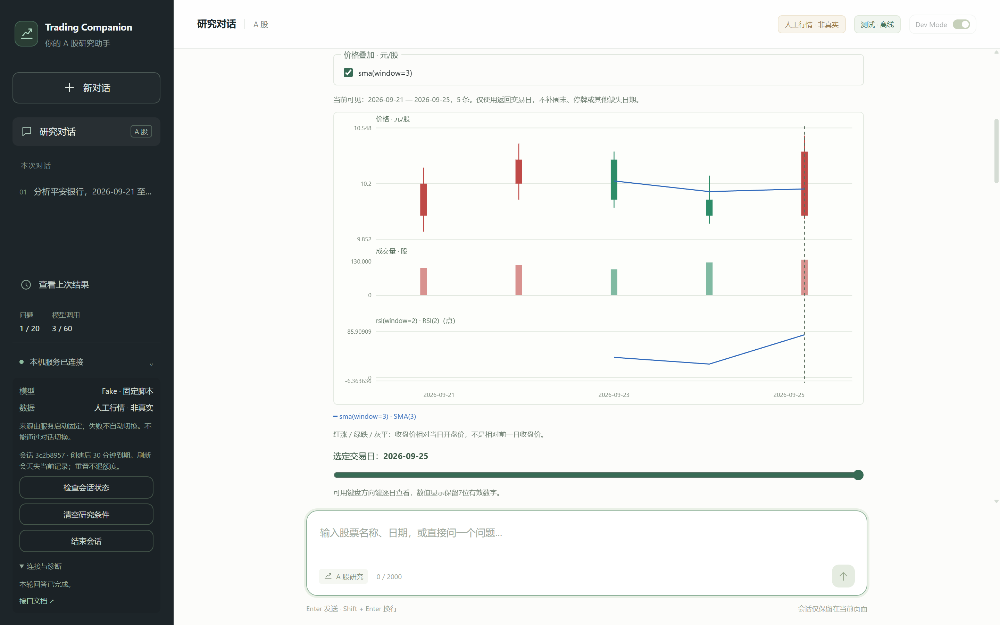
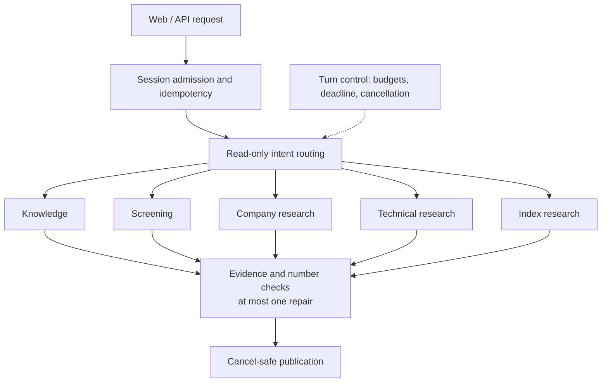

# Trading Companion

A Chinese-language research assistant for China's A-share market. You ask questions in plain language; the application collects public market, company and news data through controlled read-only tools, has a language model write the analysis, and checks the answer against the collected evidence before showing it. All trading decisions stay with you.



*Offline demo with a fixed fake model and five artificial daily bars; no live data or model calls.*

## What it does

- **Stock research**: trend, technical indicators (SMA, EMA, MACD, RSI, BOLL, ATR, ADX, OBV, VWMA, volume), company profile, financials, news and announcements, and comparisons of up to three named stocks.
- **Index research**: daily and complete-week analysis of five major A-share indices, with point-based levels.
- **Decision answers**: for buy/sell questions, a model verdict with direction and conviction, plus a program-calculated ATR plan (entry, stop, two targets, reward/risk). The app asks for a short, medium or long holding horizon before computing levels.
- **Screening**: numeric filters (price, PE, PB and similar) over a bounded quote sample, with coverage gaps shown.
- **Knowledge questions**: indicator definitions and general finance concepts, answered from local notes with citations.
- **Conversation**: follow-ups on the same stock, condition edits, history recall, and an interactive K-line chart (daily, weekly, and 1h/2h for Tencent data).

## Safety boundaries

- No brokerage connection, orders, position sizing or fund management. The application never trades.
- Price levels are computed by the program from historical evidence; the model cannot invent them. They are conditional references, not predictions.
- Model verdicts are self-assessed and not historically calibrated. Probabilities are never invented.
- Missing data and rejected model output are shown explicitly rather than hidden.

See [decision contracts and calculation limits](docs/research-decision-plan-design.md).

## Architecture

A modular Python backend (FastAPI) with a React/TypeScript workspace. A read-only router picks one controlled handler per message; every handler keeps its own identity, date, parameter and evidence checks.



Key design points:

- **Model proposals pass application gates.** Tool calls use a project-owned protocol with DeepSeek and OpenAI adapters; no agent framework.
- **Answers carry checked evidence.** Citations, numbers and company attribution are verified; these checks do not prove all prose correct.
- **Turns are bounded and inspectable.** Shared call, time and token budgets; idempotent requests; optional trace metadata without questions or answers.
- **Collection is bounded.** Company evidence and quote batches share at most three concurrent tasks with per-source request and byte limits.

More detail: [architecture](docs/architecture.md) · [request routing](docs/request-routing-design.md) · [company research](docs/company-research-design.md) · [turn control](docs/turn-control-design.md)

The command-line server enables intent v2 by default for DeepSeek sessions, following the user's
approval on November 9, 2026. Run `start.cmd --no-research-intent-v2` to restore the legacy entry;
OpenAI and demo sessions retain their existing entry. Direct `ResearchApiService` callers still
default to `research_intent_v2_enabled=False`. The switch follows user approval, not a passing
sealed evaluation; historical eligibility reports remain unchanged.
See [integration status and validation boundaries](docs/research-intent-v2.6-integration.md).

The independent integration acceptance tool prints its full public-dev and product-dialogue
plan by default, including the exact questions, per-flow call bounds and token estimates.
This command does not read `.env`, start a server, create databases or call a provider:

```powershell
.\.venv\Scripts\python.exe -X utf8 -B scripts/evaluate_research_intent_integration.py
```

After review and a separately agreed budget, the operator can run that plan with
`--live --max-calls <approved-limit>`. The limit is required and covers both entries,
setup turns, retries and fallbacks together. Use `--suite dev` or `--suite products`
to run a smaller approved batch; add `--json` for a machine-readable plan. Live mode
loads the normal model settings from `.env` and the environment without logging credentials,
uses the existing live security directory and Tencent sources, and serves the production
HTTP routes on a temporary loopback port. Each dialogue and entry gets separate stores
under a new `.agentbus/tmp/` run directory; `--output` must stay beneath that directory.
Reports retain failures and unmeasured cases, distinguish injected faults and saved-response
references, and show cache usage as unknown when the provider omits it. Optional `--prices`
accepts operator-supplied JSON rates per requested model (`currency`, `input_hit`, `input_miss`,
`output`, per million tokens); absent or incomplete usage keeps cost unknown.
This exposed regression run does not replace manual page checks or grant switch eligibility.

## Quick start (offline demo)

Windows is the supported platform. In PowerShell, from a checkout with dependencies installed:

```powershell
.\start.cmd --demo
```

The demo needs no API key, ignores `.env`, and opens the browser when the server is ready. Ask the demo to analyze Ping An Bank (the Chinese name) and request a trade plan to see a full answer with a verdict card and ATR table. Press Ctrl+C to stop.

## Setup

Requirements: Python 3.11+, Node 22.12+ and the pnpm version pinned in `frontend/package.json`.

```powershell
py -3.11 -m venv .venv
.\.venv\Scripts\python.exe -m pip install -e ".[api,model,data]"
pnpm.cmd --dir frontend install --frozen-lockfile
pnpm.cmd --dir frontend build
```

Create a `.env` file in the project root (it stays local and is git-ignored):

```dotenv
DEEPSEEK_API_KEY=replace_with_your_key
DEEPSEEK_MODEL=replace_with_your_model_id

# Optional: OpenAI as a second provider
OPENAI_API_KEY=replace_with_your_openai_key
OPENAI_MODEL=replace_with_your_openai_model_id
```

Then start normal mode:

```powershell
.\start.cmd
```

`start.cmd` builds missing frontend assets, refreshes a missing or expired security-name directory from the public SSE/SZSE lists, enables local tracing in `data/traces/`, and opens <http://127.0.0.1:8765/>. It never installs packages or overwrites configuration. Normal questions can call paid model APIs and public data sources.

DeepSeek sessions use intent v2 by default. To start with the legacy entry:

```powershell
.\start.cmd --no-research-intent-v2
```

Useful options (also accepted by `python -m trading_companion.api_server`):

| Option | Effect |
| --- | --- |
| `--port 8767` | Use another port |
| `--no-open-browser` | Do not open a browser |
| `--provider openai` | Default to OpenAI when only it is configured |
| `--no-research-intent-v2` | Restore legacy DeepSeek routing for this server run |
| `--snapshot-db PATH` | Keep a local SQLite archive of research evidence |
| `--personal-memory-db PATH` | Default off: keep up to 50 watchlist stocks, separate holding/preferences and a bounded public-title inbox in a local SQLite file ([design](docs/personal-memory-design.md)) |
| `--no-memory` | Disable conversation history, earlier-turn digests and personal memory; existing files are retained |
| `--trace-dir PATH` / `--no-trace` | Change or disable trace metadata |
| `--capture-news-titles` | Opt in to bounded public-title capture for live DeepSeek company research; no classifier calls |
| `--research-documents events` | Default off: read bounded, verified web text for explicit news, announcement or event questions ([design](docs/news-body-design.md)) |
| `--news-triage-sorting` | Default off: prioritize important related headlines in the new DeepSeek research path; paired live acceptance and user approval are still pending ([design](docs/news-triage-integration-design.md)) |
| `--screening-coverage expanded` | Larger, slower screening sample |

When both providers are configured, the web model selector offers each; a session keeps its provider. The **Dev Mode** button switches the page to a separate fake-model, synthetic-data backend. See the [configuration guide](docs/local-environment.md) and [Dev Mode design](docs/dev-mode-design.md).

To enable personal memory, run `start.cmd --personal-memory-db data\personal_memory.sqlite3`.
It is off by default, including in `start.cmd`. The sidebar supports local directory search,
add/remove and confirmed clearing; checked company-result cards also offer add/remove buttons.
Explicit chat commands such as “把平安银行加入自选” and “查看自选” run locally without
model or market-data calls. They still count as one session message; the separate panel remains
available after research message limits are reached. New chats, restarts and deleting chat
history preserve the watchlist. The unencrypted file stays on this computer, and its contents
are never automatically included in model inputs. Dev Mode, demo and synthetic services do not
open the real personal database. The holding/preference module adds separate per-stock records
for held/not held/uncertain status, preferred horizon and risk category. Unfilled values remain
distinct; no cost prices or position sizes are stored. Existing v1/v2 personal databases upgrade
transactionally to v3 when opened; older app versions cannot open an upgraded file. Removing
a watchlist stock also clears its inbox but preserves its preferences, and deleting preferences preserves the watchlist
and chat history. A user-selected research draft contains only the stock code and question
type, stays editable and is sent only after pressing Send. Watchlists and holding preferences
are committed and pushed as `9aa98af` and `4faea64`; see the
[personal-memory boundaries](docs/personal-memory-design.md).

**Research review** is reviewed, committed and pushed as `f2484cf`.
With local chat history enabled, the separate panel finds one stock's original verdicts and
reference levels, opens a single original Q&A without switching the research session, and
loads later daily closes only when clicked. Each page scans at most 20 original results;
an empty matching page may still offer Continue. New records use their saved completion time;
old records start after the source conversation's latest saved Shanghai date, which can omit
earlier prices and move later when that conversation continues. Price-basis checks happen
before requests; incompatible or unknown adjustment disables loading. Tencent prices are
unadjusted and provider-reported, not independently verified. Loading is limited to 366 calendar
days, two yearly requests and an eight-second cooperative budget, with no model calls or
performance statistics. Deleting source chat history invalidates its reviews. See the
[review contracts, limits and legacy-time notice](docs/research-review-design.md).

The **message inbox** changes are uncommitted and await Claude's review. Opening the panel,
refreshing and paging read saved local titles only. An explicit check reads at most five
watchlist stocks from fixed Sina news and Eastmoney announcement lists, with at most ten
actual HTTP attempts, five titles per source and a thirty-day lookback. Each next batch needs
another click. This is a limited check, not complete monitoring; previously saved parts can
remain after cancellation. Verified titles already fetched by ordinary current company research
can also be saved with no extra source or model requests, without advancing manual-check
watermarks. Mark-read and confirmed inbox clearing stay local. Important alerts, background
timers and push notifications remain unimplemented. See the [inbox limits and lifecycle](docs/watchlist-news-design.md).

To enable the optional document stage for normal company research:

```powershell
.\start.cmd --research-documents events
```

This stage reads supported Sina Finance article pages and Eastmoney announcement detail JSON
only after an explicit news, announcement, event or source-text request. General analysis,
historical research, saved-result recall, explanations and Dev Mode add no document HTTP
requests. Sina's `cj.sina.cn` links remain title-only, and PDF attachments are not read.
At most three documents can contribute two short excerpts each; the answer's folded source
panel shows only excerpts actually supplied to the model. Full text is neither published nor
archived. The optional SQLite archive can retain up to six selected candidate excerpts,
including candidates omitted from the model context; its document summaries record the
subset actually supplied. API responses and the page expose only that supplied subset.
The stage adds no model calls, but extra input tokens can increase API cost.
Three batches of 76 live pages verified readable text in 32/42 news articles and 34/34
announcements. Earlier eight-question checks exposed missed triggers, unrelated document
choices and weak excerpt selection. After sentence reflow and substantive-excerpt fixes,
the final A-2 check triggered all eight questions, selected related documents in all eight,
and supplied 14 substantive excerpts out of 15. Runs took 6.3–14.5 seconds, with 20 model
attempts in total. Claude reviewed, committed and pushed A-2 as `1d6f2c7`; the full gate
passed 3,849 unittest tests, 244 pytest cases, 884 frontend tests, the build and bundle checks.
Announcement extractor v3 may change paragraph positions and hashes; saved v1/v2 records
retain their original identities. At most one same-company, same-kind alternative is allowed
after a failed read within the original four-request, twelve-second budget. A-3 addresses
headers mixed with body text in HTML and was reviewed, committed and pushed as `b076461`. The switch
remains off by default; enabling it by default requires the user's decision. Enabling it does
not enable headline triage sorting.

## Development

Run the same gates as CI (Windows, no API key or live data needed):

```powershell
.\.venv\Scripts\python.exe -m pip install -e ".[api,model,data,dev]"
.\.venv\Scripts\python.exe -X utf8 -B scripts/verify.py all
```

Individual gates are `python`, `web` and `bundle` (run `web` before `bundle`). They fail on skipped or empty tests. The Python gate runs offline unit tests and pytest cases, fixed agent scenarios, repeated MVP scenarios, company workflows and an API walkthrough. Use the actual gate output for current counts. GitHub Actions runs one Windows job on pushes and pull requests. See the [CI design](docs/ci-design.md).

Inspect trace metadata without starting the server:

```powershell
.\.venv\Scripts\python.exe -m trading_companion.trace_cli --trace-dir ".\data\traces"
```

## Current work

- **Local memory and research review.** Watchlists, holding preferences and [research review](docs/research-review-design.md) are committed and pushed as `9aa98af`, `4faea64` and `f2484cf`. The fourth module, [message inbox](docs/watchlist-news-design.md), is in the uncommitted workspace awaiting review: local unread titles, explicit batches of at most five watchlist stocks/ten actual source attempts, and ordinary-research title reuse without additional requests. Personal memory stays explicitly enabled with `--personal-memory-db`, off in `start.cmd`, and is never automatically sent to models. Important alerts, timers and push remain unimplemented. Sidebar/history accessibility at widths of 534px or less remains a known limitation. See the [personal-memory design](docs/personal-memory-design.md).
- **Bounded event documents (A).** A-2 is committed and pushed as `1d6f2c7`: the final eight-question check passed triggering and document choice in 8/8 cases, with 14/15 supplied excerpts substantive. The switch remains off by default pending the user's decision. Omitted news tables and first-page-only announcements carry explicit partial-coverage notices into sources, model evidence and saved snapshots. A-3's HTML header-filtering change is committed and pushed as `b076461`; this adds no new live-acceptance result. Announcement PDFs and financial-report PDFs require separate work. See the [document limits and evidence flow](docs/news-body-design.md).
- **Research intent v2.** The command-line default for DeepSeek sessions lets the model interpret the whole request (task, subject, horizon, price-plan intent, exclusions, references) while the program guards actions that would expand authority. The user approved this switch despite known limits: the sealed evaluation scored 89/96, below its threshold; MACD knowledge answers sometimes fail; cancelling an order can be wrongly rejected; changing a screening result to the top two is unsupported. Historical evaluation reports remain unchanged. See [integration status](docs/research-intent-v2.6-integration.md), [v2.6 guard principles](docs/research-intent-v2.6-guard-principles.md) and [plan](docs/research-intent-v2.6-plan.md).
- **Headline triage.** The fixed ensemble passed its sealed headline-importance recall gate; answer sorting remains off pending thirty paired live cases and user approval. Preview the approved collection with `python scripts/freeze_news_triage_sorting.py` (at most 256 public HTTP attempts, no model calls) and the paid plan with `python scripts/evaluate_news_triage_sorting.py`. Explicit live modes require bounded allowances, frozen evidence and two completed human annotation files. Triage uses a three-second DeepSeek request limit within a five-second optional window, preserving at least fifteen seconds for the answer; the paired p95 added-latency gate stays at four seconds. Requests without a response retain conservative cost estimates; responses with invalid usage still stop the batch. One-shot claims prevent automatic reruns; only the explicitly approved, hash-bound first-arm interruption permits one complete rerun with its previous costs and attempts retained. Jev cost is explicitly an unverified alias estimate for this acceptance only. See the [collection, annotation, paid-run and blind-review commands](docs/news-triage-integration-design.md) and [product-v2 results](docs/news-triage-product-v2.md).

Not in scope yet: arbitrary-source document collection, PDF filing analysis, complete document understanding, whole-market completeness, calibrated forecasts, strategy backtesting and public deployment.

## Project layout

```
src/trading_companion/   Backend: data adapters, indicators, research workflows, routing, API
frontend/                React/TypeScript workspace
evaluation_tools/        Offline and bounded live evaluation tooling
data/evaluation/         Frozen evaluation corpora, manifests and locks
docs/                    Design documents (mostly in Chinese)
scripts/verify.py        Local and CI acceptance gates
tests/                   Offline regression tests
```

## Documentation

Most design documents are written in Chinese.

- [Project handoff](docs/agent-handoff.md): requirements, working preferences, current capabilities and coordination rules
- [Architecture and roadmap](docs/architecture.md)
- [Company research workflow](docs/company-research-design.md)
- [Bounded news and announcement text](docs/news-body-design.md)
- [Index research](docs/index-research-design.md)
- [Holding-horizon rules](docs/holding-horizon-design.md)
- [Technical analysis and timeframes](docs/technical-analysis-design.md)
- [Screening](docs/screening-design.md)
- [Conversation memory](docs/conversation-memory-design.md)
- [Local watchlist and holding preferences](docs/personal-memory-design.md)
- [Saved research reviews](docs/research-review-design.md) and [watchlist message inbox](docs/watchlist-news-design.md)
- [Local API](docs/local-api-design.md) and [web workspace](docs/web-workspace-design.md)
- [Chart workspace](docs/chart-workspace-design.md)
- [Turn tracing](docs/turn-tracing-design.md)
- [Tool-model protocol](docs/tool-model-design.md)
- [Current module status](docs/module-progress-2026-10-26.md)
