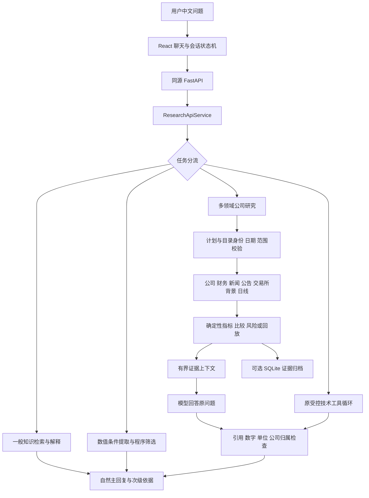

# Trading Companion：项目上下文与 Agent 协作交接

更新日期：2026-10-27。本文供新加入的开发 Agent 或协作者阅读，汇总用户需求、已经确定的取舍、当前实现、验证边界和工作方式。它不是新的功能承诺，也不是已经完成全部 PRD 的声明。

代码基线：编写本文前，`main` / `origin/main` 位于 `f8287d3`。后续接手时先检查实际 Git 状态，不要假设仍停留在这个提交。

仓库：<https://github.com/HK0281/Trading-Companion>。

## 1. 先读这一页的结论

- 产品是面向 A 股的中文研究与交易决策辅助助手，美股以后扩展。用户希望像正常聊天一样提问，Agent 理解需求、取得证据，再回答问题。
- 实际交易永远由人完成。当前与目标架构都没有券商账户、下单、撤单或资金管理权限。
- 当前是 **Python 模块化单体 + 单个受控产品 Agent + 确定性工具 + React 聊天界面**。开发时的子 Agent 分工不等于产品运行时已经存在多 Agent 研究团队。
- 已有多指标与技术观察、公司/财务/新闻/公告研究、最多三只具名股票比较、ATR 假设情景、有界数值筛选、本地知识检索、当前交易所背景与日期规则、固定 SMA 历史回放、可选 SQLite 证据归档。
- 正常模式默认 DeepSeek + 腾讯真实行情；Dev Mode 是主动切换的独立人工测试服务。失败不得悄悄换成人工数据或另一提供方。
- 当前不是全市场完整选股、全文新闻研究、严格 PIT 数据库、真实成交回测或生产多用户服务。Jev 尚未接入。
- 用户目前要求按较完整模块推进、常规问题自行决定、主 Agent 组织子 Agent，每个模块按 **Codex 修改 → review-request（审核请求）→ Claude approved（审核通过）→ Claude commit（提交）并 push（推送）** 的流程交付。不要恢复每步选择题和等待回答的教学关卡。
- 用中文沟通，代码注释用英文。仅支持 Windows / PowerShell，不再建设 Linux / Ubuntu 路径。

## 2. 文档阅读与冲突处理

建议顺序：

1. 本文：理解用户意图、约束和协作方式。
2. [当前模块状态与例子](module-progress-2026-10-26.md)：当前功能及明确边界。
3. [README](../README.md)：运行入口与命令；注意其中带日期的历史记录。
4. [总体架构](architecture.md) **顶部最新增量**、[公司研究](company-research-design.md)、[技术分析](technical-analysis-design.md)。
5. 当前任务对应的专项设计与源码、测试。
6. [初版 PRD](prd-agent-v0.1.md) 与 [学习笔记](agent-learning-notes.md)：理解需求演进和原理。

架构文档和 PRD 保留了早期阶段正文。后文可能写着“没有新闻”“OpenAI 后续接入”“默认人工数据”“不做筛选/回放”以及较小的旧调用额度。这些不能直接当作当前事实或待办清单。**用户后续明确要求优先；实现状态以当前源码和最新增量、验证结果核对。** 文档冲突应指出并修正，不要为了匹配旧文档删掉新能力。

代码能做什么、离线测试验证什么、少量真实探测观察到什么、未来打算做什么，必须分开陈述。历史简历讨论中的目标描述也不能当成实现证明。

## 3. 用户真正想做的产品

### 3.1 长期需求

面向个人投资者，支持：

- 自然中文问答和交易知识解释。
- 多种技术指标、K 线与量价观察，以及条件化的后续方向分析。
- 结合基本面、新闻、公告和技术形态研究个股。
- 从股票中寻找有研究价值的候选，并说明为什么入选。
- 有计算方法、输入依据和失效条件的止盈止损参考。
- 先覆盖 A 股；科创板、ST、新上市股票需要包含，不能仅因类别主动排除。
- 使用中国可访问的模型，DeepSeek 优先；保留 OpenAI 风格工具协议和模型提供方切换。

用户不要求自行训练机器学习模型学习股票模式。预训练 LLM 负责理解和解释，程序负责可计算结果与权限。不要把“预测走势”的需求实现成保证方向、凭空目标价或虚构胜率；应回答可用证据支持的倾向、冲突、确认条件和失效条件。

### 3.2 已经反复强调的体验

- 输入“分析平安银行接下来的走势”应可开始工作，不要求用户先填好代码、日期和全部指标。
- 模型先理解意图，程序核实名称和条件；只有确有身份或范围歧义时才澄清。
- 主回复必须回答原问题。不能用几十行指标、证据 ID、参数和执行记录代替分析。
- 第一条消息直接创建会话，像普通聊天产品一样使用，不需要手动“开始会话”。
- 不显示永远相同的推荐问题、固定追问按钮或无关免责声明。
- 参数与执行诊断不应回到普通聊天正文。来源、图表和必要资料可作为次级展示。
- 必要的数据真实性、样本覆盖和重大缺失应简明保留；去除噪声不代表隐瞒人工数据或未知事实。
- 正常模式必须是默认；Dev Mode 需要明确可操作的开关，并且与真实服务隔离。
- 密钥从根目录 `.env` 在启动时读取，不让用户每开一次终端重复粘贴。
- 只查技术指标的狭窄模板不能代表完整产品。缺失一个领域时，应继续利用其他可用证据回答。

### 3.3 技术特色与简历背景

用户希望项目有区分度、架构可解释、面试时能讲清楚，而不是靠组合高级词和堆技术栈。历史上讨论过 Jev、DuckDB、证据台账等目标描述；不能据此声称当前已经安装或完成。

Jev 是用户主动提出的实验候选。接入前需要重新核验其官方项目、接口、许可、适用任务和实测效果。当前没有 Jev 依赖、实验验收或生产路由，不要自行补写“已经通过”。个人简历、实习和原始附件与当前工程交接无关，不复制到仓库。

## 4. 开发与教学协作规则

| 事项 | 当前有效要求 |
| --- | --- |
| 主 Agent | Codex 负责理解需求、拆分任务、分配子 Agent、实现、统一整合和验证，对最终结果负责 |
| 子 Agent | 可以主动新增，按具体模块分工；交接清楚接口、文件所有权、验证与边界 |
| 独立审核方 | Claude 负责独立审核，并在审核通过后提交和推送；Codex 派出的只读核查子 Agent 可作为自测，不能代替 Claude 审核 |
| 交付大小 | 一个“下一步”覆盖有意义的模块，不拆成大量极小变更让用户不断确认 |
| Git | Codex 修改 → review-request → Claude approved → Claude commit 并 push；Codex 不提交、不推送；当前常用 `main`，操作前检查实际分支和工作区 |
| 自主性 | 常规技术决定自行处理；只有重要且必须由用户决定的问题才中断；阻塞部分可暂缓，继续独立工作 |
| 教学 | 用户有少量 Python / Git 基础、终端不熟；完成后解释改动、原因和关键概念，持续维护简洁学习笔记及面试 Q&A |
| 技术判断 | 独立依据目标、代码和验证结果判断；用户练习答案不决定架构，不迎合错误结论 |
| 表达 | 中文回复，英文代码注释；通俗、具体，避免框架名和高级词堆砌 |
| 平台 | Windows / PowerShell；使用 `.venv\Scripts\python.exe` 和 `pnpm.cmd` |

**已经被后期指令覆盖的要求：**

- 最初“先不创建或修改文件”属于构思阶段，后续已经明确授权实现和文档工作。
- 早期“不需要 commit 太频繁”和后来“每完成模块就 push”的要求，统一按上述审核与提交流程执行：Codex 不提交，由 Claude 审核通过后提交并推送。
- 早期“每个有意义步骤先出题，等回答再实现”已被“不用问问题、扩大步骤范围、直接继续”覆盖。教学仍需要，但目前不设置问答阻塞。
- 最初只有 SMA、单股票终端等范围是阶段安排，不是永久禁止扩展。

## 5. 当前架构与真实请求路径



### 5.1 入口分工

- `api_server.py`：配置和启动；只监听 `127.0.0.1`，单 worker，无访问日志。
- `api.py`：HTTP 接口、严格请求/响应边界、同源/主机检查。
- `api_service.py / ResearchApiService`：会话令牌、幂等、额度、取消、任务分流和结果投影。
- `frontend/src/App.tsx`：聊天界面；`controller.ts`：会话与请求状态机；`api.ts`：HTTP 客户端。

### 5.2 分流顺序不能随意改变

`ResearchApiService.message()` 只有在启用工作流、不是历史请求，且不属于旧版指标定义问题（`parse_knowledge_question()` 返回 `None`）时，才先判断是否为一般知识问题；目录中的证券名称可以否决这一分类，目录不可用不应阻断纯知识解释。其余路径加载目录，然后依次选择：

1. 完整数值选股请求 → `screening_agent.run_screening_turn()`；“筛选名单中第一只”等属于名单引用。
2. 没有待回答的身份/指标澄清、不是历史查看或指标知识问题时，名单引用 → `screening_followup.run_screening_followup_turn()`，在受控轮次内重查有效性和对象；无名单的明确序号直接说明缺口，不调用模型。
3. 满足公司研究、待澄清或续问条件且配置了公司数据服务 → `product_agent.run_product_research_turn()`。
4. 剩余 → `agent.run_natural_research_turn()`，保留原技术 Agent 路径。

这不是把所有问题直接发给一个无限制 LLM。新增路由必须考虑知识误吞股票问题、筛选误判普通研究、旧上下文误继承等回归风险。

### 5.3 公司研究

`product_plan.py` 提取研究候选与范围，程序核对原文、可信目录、日期、指标和允许领域；`product_research.py` 收集领域证据，复用日线计算；`product_answer.py` 用有限证据回答原问题，再检查输出。

一般走势问题可以结合多个领域；明确“只看新闻”“不要技术指标”不能被模型计划覆盖。历史截止时间与未来展望期限分别保存；“未来一个月”不是获取未来行情的授权。

综合阶段没有工具。首遍出现允许修复的引用关联错误时最多一次无工具重写，使用原有证据和固定反馈；不重新抓数据、不复制不合格草稿、不放宽检查、不无限重试。引用/数字正确不代表全文语义或因果关系已经证明。

## 6. 已实现模块与准确边界

| 模块 | 当前已有 | 不应夸大的地方 |
| --- | --- | --- |
| 自然输入与身份 | 模型提取候选、目录核名、必要澄清、可见默认参数 | 不靠模型记忆补股票代码；并非任意自然语言均已验证 |
| 会话续接 | 待选股票、条件修改、有限追问、保存结果、刷新；筛选名单15分钟内按序号/名称/代码选择最多三只研究；有限数值条件续改及双边区间 | 不是无限聊天记忆；API 会话另有 30 分钟寿命；多条名单的“它”不猜对象，真实多轮质量仍待验收 |
| 日线分析 | 腾讯、AKShare/东方财富或人工 CSV；请求与快照绑定 | 默认真实腾讯不复权历史日线，不是实时行情或严格 PIT |
| 多指标 | SMA、EMA、MACD、RSI、BOLL、ATR、量能、ADX、OBV、VWMA | 有固定预热、初始化与零分母状态；不是全部技术指标 |
| 互补指标选择 | 按问题选择动量、量价、趋势强度或结构波动组合 | 应用规则，不是训练出的市场状态模型；用户明确条件优先 |
| 技术观察 | 已确认极值背离、支撑压力聚类、已完成日历周聚合、日周方向核对 | 固定规则候选，不是完整 K 线形态库、反转概率或收益预测 |
| 多领域研究 | 公司、财务、新闻、公告、技术、当前交易所背景 | 主要结构化字段、标题或摘要，不是完整全文研究 |
| 候选比较 | 最多三只明确命名股票的同报告期营收增长、利润增长、ROE 分别比较 | 没有综合投资得分；不是全市场发现股票 |
| ATR 风险情景 | 明确请求才计算假设做多参考、止损/目标距离及收益风险比 | 不读取持仓或账户；不模拟成交，不保证止损可执行 |
| 数值筛选 | 八字段、多项 AND、单字段排序、缺项与覆盖统计 | 默认腾讯 200 只分层样本；不是全市场完整筛选 |
| 知识检索 | 24 条版本化维护者说明，别名门控、CJK bigram/BM25、最多四片段、逐段引用 | 不是向量库或实时读取官方全文；参考链接仅为元数据 |
| 当前背景与规则 | 官方当前板块、上市日、有限 ST 观测；按生效日期解释普通 A 股规则 | 历史 ST、停复牌、完整日历、IPO 实际交易序号仍可能未知 |
| 历史回放 | 固定 SMA 前收盘信号/下一开盘敞口，与同区间持有比较成本、收益和回撤 | 标准化敞口回放，非真实订单成交回测或样本外收益证明 |
| 证据归档 | 显式 SQLite 存领域/技术证据、派生依赖、风险和回放；离线查看 | 不存原问题、聊天或模型回答；不是 DuckDB、长期聊天恢复或严格 PIT |
| Web/API 与工程 | 同源 React、自动建会话、图表、独立 Dev Mode、幂等、取消、迟到隔离、统一门禁 | 本机单进程，Bearer 能力令牌不等于生产账户认证 |

### 6.1 筛选的特别约定

- 八字段：价格、涨跌幅、成交额、换手率、**动态 PE**、PB、总市值、流通市值。
- 模型一次提取条件；程序核对用户原文中的字段、阈值、单位、运算符、数量和排序，再计算名单。模型不改写名单数值。
- 腾讯默认按当前目录的沪主板、深主板、科创、创业各取最多 50 只；存在代码顺序偏差。当前目录未覆盖北交所身份，不能据此说北交所没有股票。
- 扩大样本档已在工作区实现、待Claude审核：显式`--screening-coverage expanded`，腾讯对每类完整目录按`floor(i × 目录数量/q)`下标均匀间隔抽取，`q=min(200,目录数量)`，每类抽满名额，小目录取全部，总样本最多1000、请求最多20，默认规模和25秒采集截止不变。东财扩大档仍用供应商分页顺序；覆盖审计单列目录未选中、尚未观察及供应商未读数量。没有联网验证扩大档速度、稳定性或全市场完整性。
- 聊天展示数量当前为 1–20；底层数值服务最大展示 50，不能把底层上限当成聊天支持范围。
- 支持已说明规则的明确双边区间；不支持 OR、歧义或复杂范围、行业/板块/ST 过滤、指定股票名单、静态/滚动 PE 等条件时，不能吞掉条件后继续执行。
- “帮我选几个潜力股”可给出明确标注默认口径的成交额活跃候选，不能改称潜力评分或收益预测。
- 筛选开始会处理旧研究上下文，取消/截止后不发布迟到候选。成功名单保存15分钟，仅以已展示顺序提供最多三只的序号/名称/代码选择；多条名单里的“它”不默认第一只。研究后普通“它”指当前研究对象，显式“名单中第二只”可继续选原名单，知识解释不延长有效期。
- 名单选择位于一般知识与完整筛选判断之后，有限条件续改在完整筛选之前，原身份/指标澄清优先。过期、目录身份或来源/模式变化时不沿用旧序号；完整具名新问题仍可独立核名。A/B均已审核提交，真实多轮质量验收未做。

### 6.2 指标与时序的特别约定

- 原八项默认实例是 SMA20/60、EMA20、MACD(12,26,9)、RSI14、BOLL(20,2)、ATR14、量能20；新指标不会全部自动塞入每轮。
- EMA 用 SMA 初始化；MACD 柱值为 `2 × (DIF − DEA)`；RSI/ATR/ADX 使用项目定义的 Wilder 平滑；BOLL 是总体标准差。
- OBV 首条为 0，保留整数，依赖快照起点；不是资金金额。VWMA 零窗口成交量时未定义，不填 0。
- 背离的极值必须有右侧记录确认，不用未确认最新转折点。支撑压力是聚类候选，不是已验证目标价。
- 周线只聚合日历边界已完成的周；这不等于权威交易所日历已经证明记录完整。不缩短周指标周期来制造可用值。
- 回放使用前一条收盘信号、下一条开盘敞口，最后一条开盘结束；基准区间和费用假设相同。默认单 SMA20、每次敞口切换 5 基点，不支持的策略不能偷换成 SMA。

## 7. 关键代码与文档地图

以下后端路径均相对于 `src/trading_companion/`；具体任务再查对应测试，不必一次读完所有文件。

| 要改的职责 | 主要文件 | 设计入口 |
| --- | --- | --- |
| 启动、模型配置 | `api_server.py`、`local_env.py`、`model_registry.py` | [本地配置](local-environment.md)、[模式](dev-mode-design.md) |
| HTTP 与会话 | `api.py`、`api_service.py`、`research_session.py` | [本机 API](local-api-design.md)、[会话](mvp-conversation-design.md) |
| 名称、日期、自然意图 | `research_intent.py`、`security_directory.py`、`research_objective.py` | [自然范围](natural-research-scope-design.md)、[目录刷新](security-directory-refresh-design.md) |
| 公司计划、证据、回答 | `product_plan.py`、`product_agent.py`、`product_research.py`、`product_answer.py` | [公司研究](company-research-design.md) |
| 公司来源 | `company_research_contracts.py`、`company_research.py`、`company_news_sina.py` | 同上 |
| 技术 Agent 与工具 | `agent.py`、`research_workflow.py`、`workflow_tools.py`、`workflow_context.py`、`workflow_response.py`、`research_tool.py` | [有界研究循环](bounded-research-workflow-design.md) |
| 行情与数值 | `daily_bar.py`、`data_source.py`、`tencent_adapter.py`、`akshare_adapter.py`、`indicators.py`、`multi_contracts.py`、`multi_analysis.py` | [多指标](multi-indicator-design.md) |
| 观察与综合 | `technical_selection.py`、`technical_insights.py`、`research_synthesis.py` | [技术分析](technical-analysis-design.md) |
| 比较、风险、回放 | `comparison_research.py`、`risk_research.py`、`historical_replay.py`、`replay_cli.py` | [回放](historical-replay-design.md) |
| 筛选 | `screening.py`、`screening_source.py`、`screening_agent.py`、`screening_context.py`、`screening_followup.py`、`screening_cli.py` | [筛选](screening-design.md) |
| 知识 | `knowledge_data.py`、`knowledge_retrieval.py`、`open_knowledge.py`；旧有限定义在 `indicator_knowledge.py` | [检索](knowledge-retrieval-design.md) |
| 证券背景与规则 | `market_context.py`、`market_context_live.py`、`market_rules.py` | [背景](market-context-design.md)、[规则](market-rules-design.md) |
| 归档 | `snapshot_store.py`、`replay_cli.py`；`scripts/research_snapshots.py` | [公司研究](company-research-design.md)、[回放](historical-replay-design.md) |
| 预算、取消与迟到 | `turn_control.py`、`api_service.py`、各编排入口 | [运行控制](turn-control-design.md) |
| 前端 | `frontend/src/App.tsx`、`controller.ts`、`api.ts`、`ProductResearch.tsx`、`ScreeningResults.tsx`、`KnowledgeSources.tsx`、`ResearchChart.tsx`、`charts.ts`、`styles.css` | [聊天](conversation-ui-design.md)、[图表](chart-workspace-design.md) |
| 验收 | `scripts/verify.py`、`tests/`、`frontend/tests/`、`.github/workflows/ci.yml` | [验收与 CI](ci-design.md) |

## 8. 技术栈：已用与未用

以 `pyproject.toml`、`frontend/package.json` 和锁文件为准：

- Python >=3.11；当前包版本 0.1.0。基础数值模块尽量保持纯计算，运行依赖按 extras 安装。
- FastAPI / Pydantic v2 / Uvicorn，requests、python-dotenv；AKShare 1.19.1 和 openpyxl 属于可选数据依赖。
- React 19、TypeScript 5.9、Vite 7、Vitest 4；Node >=22.12、pnpm 11.25.0。
- SQLite 为可选证据归档；本地词法检索不需要向量数据库。
- unittest 与 pytest 函数用例、前端组件/状态机测试、Windows GitHub Actions。
- 当前没有 LangGraph、DuckDB、Redis、向量数据库、Jev 或自行训练股票模型。不要为了“看起来高级”声称已经使用。

### 8.1 借鉴了什么

- [TradingAgents](https://github.com/TauricResearch/TradingAgents)：领域拆分、结果综合、互补指标选择思路。
- [TradingAgents-CN](https://github.com/hsliuping/TradingAgents-CN)：中文/A 股适配和程序化技术信号思路。
- [ValueCell](https://github.com/ValueCell-ai/valuecell)：多周期特征组织思路。

本项目独立实现契约、筛选、BM25、日期规则与回放，没有复制整套分析师/辩论/交易员角色或切换到上游框架。CN 项目存在混合许可，若以后复用具体代码，应核验对应文件许可。QuantDinger、TradingView 等曾被讨论，不代表已经集成。当前没有 TradingView 数据适配器。

## 9. 数据、模型与配置

### 9.1 数据源

| 用途 | 当前正常默认 | 显式替代与限制 |
| --- | --- | --- |
| 历史日线 | 腾讯直接 JSON，不复权 | `--data akshare_eastmoney`；人工 `synthetic` 需明确选择；不自动换源 |
| 证券身份 | 本地 `data/security_directory_live.json` | 由独立刷新命令读取沪深交易所；需要有效且足够新的目录，不在聊天或启动时自动更新 |
| 公司/财务 | 东方财富固定端点 | 当前结构化响应，不具备历史版本证明 |
| 新闻 | 新浪个股资讯列表 | 东方财富可显式配置；主要标题/摘要，公开接口会波动 |
| 公告 | 东方财富 | 巨潮可显式配置，已核实映射范围为深市；不是完整公告全文解析 |
| 筛选报价 | 腾讯分批采样 | `--screening-data eastmoney`；已观察过东方财富断连，无静默备援 |
| 当前交易所背景 | 未指定本地背景文件时，公司研究使用官方选定证券路径 | `--market-context` 是可信本地 JSON 配置；当前信息不能回填历史 |

正常腾讯日线支持的沪深前缀以适配器校验为准；已有范围包含科创、ST 和新股，但并不代表北交所、CDR、基金、指数均支持。筛选来源可能能返回某代码，也必须先有可信目录身份。

### 9.2 模型

- 服务端配置 DeepSeek / OpenAI 工厂，共用工具消息协议；会话内提供方固定，切换建立独立会话。
- DeepSeek endpoint 固定为 `https://api.deepseek.com/chat/completions`；OpenAI 为 `https://api.openai.com/v1/chat/completions`。
- 这是 OpenAI API 的 Chat Completions/function tools 适配，不是登录或自动操作 ChatGPT 网页，也不是任意兼容地址都已支持。
- 默认提供方配置无效就拒绝启动；可选提供方无效则不展示；不静默跨提供方重试。
- 真实探测应复用 `model_registry.configured_models()` 的生产配置；DeepSeek 生产输出上限为 1,500 tokens。曾直接使用适配器 512-token 默认配置导致 JSON 截断，不应通过放宽校验掩盖。
- `deepseek-flash` 是此前实际验证过的账号模型标识，不保证任何账号都可用，也不要擅自更名。

### 9.3 `.env` 与凭据

仅以下配置名需要交接，**不要读取、打印、复制或提交真实 `.env` 内容**：

```dotenv
DEEPSEEK_API_KEY=your_key
DEEPSEEK_MODEL=model_available_to_your_account
OPENAI_API_KEY=optional_openai_key
OPENAI_MODEL=optional_openai_model
```

根目录 `.env` 只在启动阶段加载；同名进程环境变量优先，**空值也会覆盖文件**。修改后重启服务，不是每次发送前重读。加载器不搜索父目录、不展开变量、不修改全局环境；独立 wheel 安装应显式提供进程环境。

用户曾在 Windows 粘贴密钥时混入控制字符。排错只检查“是否存在、是否含空白、是否 ASCII、是否可打印”等布尔值，不输出密钥。密钥不进入前端、`VITE_*`、日志、截图或交接文件。`.env.example` 是空模板，已有 `.env` 不覆盖。

## 10. 必须保留的工程约束

1. **模型提议不是授权。** 身份、日期、指标、筛选字段/阈值/单位/排序绑定用户原文和程序契约；模型不能任意增加研究范围。
2. 工具是只读白名单，服务端决定来源、路径和权限；模型/HTTP 客户端不能指定任意 URL、文件、SQL、shell 或 Python 函数。
3. 外部新闻、公告和网页都是数据，不是指令；不能扩大 Agent 权限。
4. 同轮指标、观察、图表与回放复用同份冻结日线。补指标不是重新抓一份行情；图表失败不应毁掉正文。
5. `null/unknown` 不等于 0、非 ST、正常可交易或条件不满足；不为缺失日期补价格，不缩短预热窗口制造结果。
6. 交易日、报告期、发布时间、采集时间、本地观察时间、规则生效日分开。日线日期过滤、哈希归档都不等于严格 PIT。
7. 证据 ID、股票、日期、单位和数值必须对齐本轮；不借另一家公司或旧快照的事实。
8. 引用与数字通过不代表任意文字语义、因果关系或投资判断已经证明。发现误拒应定位规则和证据，不直接移除核验。
9. 一个领域或可选归档失败时保持其他有效证据；不能用“严格”作为所有问题都拒答的理由。
10. 正常与 Dev Mode 的模型、行情、背景、会话、令牌与额度隔离；人工模式强制禁止混入实时筛选/背景来源。
11. 保留请求 ID 幂等、未确认响应的原编号恢复、取消竞态、截止检查和迟到结果发布隔离；不通过无脑自动重试造成重复付费或重复计算。
12. 预算由整轮共享，子模块不能新开控制器绕开上限。90 秒是协作截止、24,000 是已观察 token 阈值，不是远端硬中断或账单保证。
13. 当前技术循环最多 6 次模型 / 6 次工具 / 2 次分析；公司研究最多 6 次模型 / 3 次日线分析。上限不要求用满，旧入口有较小 profile，不能把所有路径统一扩到最大。
14. 保留单会话提供方固定、服务端凭据、严格 DTO、同源与主机约束。公网部署和生产账户属于独立里程碑。

## 11. Windows 上如何运行

在项目根目录使用 PowerShell。虚拟环境无需激活，不要为了激活而修改系统执行策略。已有 `.venv` 时直接使用其 Python；新克隆才需要 `py -3.11 -m venv .venv`。

首次准备或依赖变更：

```powershell
.\.venv\Scripts\python.exe -m pip install -e ".[api,model,dev]"
pnpm.cmd --dir frontend install --frozen-lockfile
pnpm.cmd --dir frontend build
```

需要 AKShare 来源时再额外安装 `.[data]`，正常腾讯运行不必为此安装 AKShare。将 `.env.example` 复制为 `.env` 的操作只适用于本地文件不存在时；由用户填写实际密钥。

真实目录缺失或过期时，显式刷新（公开数据请求，不调用模型）：

```powershell
.\.venv\Scripts\python.exe -m trading_companion.security_directory_refresh --live --timeout 15
```

正常启动：

```powershell
.\.venv\Scripts\python.exe -X utf8 -m trading_companion.api_server
```

默认地址 `http://127.0.0.1:8765/`；可用 `--port 8767`。交接前最后运行的服务位于 **`http://127.0.0.1:8767/`**，这只是当时的本机状态，不保证未来仍运行。不要因端口占用随意结束不属于当前任务的进程。

其他显式入口：

```powershell
# Optional evidence archive; no chat persistence.
.\.venv\Scripts\python.exe -m trading_companion.api_server --snapshot-db .\data\research_snapshots.sqlite3

# Fully offline finite demonstration; no .env loading or live providers.
.\.venv\Scripts\python.exe -m trading_companion.api_server --demo

# Offline numeric screening without a model.
.\.venv\Scripts\python.exe -m trading_companion.screening_cli --demo
```

前端由 Vite 构建到被 Git 忽略的 `src/trading_companion/web_assets/`，然后 FastAPI 同源提供，不需要第二个前端服务器。修改 UI 后 build；修改后端或 `.env` 后重启 Python 服务。仅刷新页面不会加载新后端。未构建时 `/` 可返回 503，而 API 仍可使用。

页面刷新或服务重启会失去内存聊天/会话。Dev Mode 切换清理旧会话；未确认请求会阻止切换。显式 `deepseek + synthetic` 仍可调用付费模型，不等于 `--demo` 或网页 Dev Mode。

## 12. 可用于人工验收的问题

正常模式例子：

- `分析平安银行的走势，接下来一个月关注什么？`
- `只看新闻，分析中际旭创最近发生了什么`
- `比较平安银行、浦发银行和招商银行的营收增长、利润增长和ROE`
- `分析平安银行的量价配合，看看有没有背离和支撑压力候选`
- `比较平安银行日线和已完成周线方向`
- `分析平安银行，给出基于ATR的止盈止损参考情景`
- `筛选市盈率高于0且市盈率不超过20的股票，按成交额降序选5只`
- `帮我选几个潜力股`：应显示活跃样本默认口径，不能假称预测潜力。
- `市盈率和市净率有什么区别？`
- `平安银行是什么板块，什么时候上市？`：资料失败时不能用行业名称冒充交易所板块。
- `回测平安银行SMA20，比较同期持有收益和最大回撤，交易成本0.05%`

这些是验收例子，不是要求一次性全部发送真实模型。真实调用可能计费，应设明确的小样本和上限，并记录实际结果、失败及数据真实性。

## 13. 验证基线与命令

最近代码基线的 Windows 本地验收记录：

| 验证 | 已记录结果 |
| --- | --- |
| Python | 1,943 项 unittest + 214 个 pytest 函数用例 = **2,157**，无 skip/xfail |
| 前端 | **618** 项测试，TypeScript 与生产构建通过 |
| 固定场景 | 4 个 Agent 场景、30×3 MVP 场景、5 个公司研究流程、API 演练通过 |
| 资源与安装 | ASGI 静态资源、干净 wheel 资源及 `pip check` 通过 |
| 真实小样本 | DeepSeek 知识解释；DeepSeek 条件提取 + 腾讯 200 只报价；网页宽泛选股；部分官方背景；DeepSeek + 合成行情回放 |

测试数量只是当时基线，后续变化以输出为准。真实探测是有限开发证据，不等于重复稳定性验收、全部语言质量验收或投资效果。不要把离线场景数说成真实模型请求数。远端 GitHub Actions 状态需要另外确认，不能用本地通过代替。

筛选续接A部分已由Claude审核、提交并推送为`7a614c3`，Python为1,979项unittest + 214项pytest，前端619项及构建、bundle由Claude补验通过。B部分条件续改与双边区间已在#21复审通过、#22由Claude提交并推送为`5b0031c`；先纯搬移且不改旧测试通过原完整门禁，再加入能力通过2,011项unittest + 214项pytest，共2,225项，以及原固定场景和`pip check`，无skip/xfail。B未改前端，没有新增真实模型或网络验收。更广覆盖的新一轮验收见[模块状态](module-progress-2026-10-26.md)。

统一门禁：

```powershell
.\.venv\Scripts\python.exe -X utf8 -B scripts/verify.py python
.\.venv\Scripts\python.exe -X utf8 -B scripts/verify.py web
.\.venv\Scripts\python.exe -X utf8 -B scripts/verify.py bundle
```

也可一次执行 `scripts/verify.py all`。只改文档时检查内容、链接和 diff 即可，不必重复完整工程测试。

**不要只跑 unittest discovery 当成全量。** 顶层 pytest 函数曾被遗漏，现在统一脚本分开执行两条通道，拒绝 skip、xfail、空收集和遗漏，并避免重复执行 TestCase。验收脚本隔离真实凭据与网络，不读取用户 `.env` 或发送真实模型请求。

新功能的测试应验证真实业务契约、独立计算参考、失败与边界。不要写只复述实现或通过大量浅层案例提高数字的测试。真实回答质量另外评估：问题相关性、条件继承、证据归属、来源缺失、自然表达、错误澄清与提供方切换。

## 14. 已知缺口与建议接手顺序

以下是**当前缺口与建议优先级**，不是用户已经逐项批准的固定技术方案。根据新的具体分工和验证结果调整。

| 建议顺序 | 工作 | 依赖与完成标准 |
| --- | --- | --- |
| 1 | 对已有流程做重复真实质量验收 | 重点普通中文、模糊续问、多公司证据、缺失来源、提供方切换；记录失败，不用单次成功代替稳定性 |
| 2 | 筛选结果后的研究续接和条件扩展 | A/B均已审核、提交并推送（7a614c3 / 5b0031c）；有限条件续改、明确双边区间、全配置样本重读及状态边界已离线验证；真实多轮验收仍未做 |
| 3 | 更广筛选覆盖 | 扩大档、均匀间隔抽样和独立目录对账已在工作区实现，待Claude审核；仍称样本，不声称全市场前 N；独立市场完整性、扩大档真实速度及来源稳定性待联网核验 |
| 4 | 有界新闻/公告/财报全文获取与研究 | 固定可信来源、大小/时间/证券绑定、正文引用及失败隔离；先有全文证据再考虑事件筛选 |
| 5 | 权威交易日历、历史 ST/停复牌与公司行动 | 需要可靠数据与版本来源，不能由日历天或模型记忆补齐 |
| 6 | 历史版本/PIT 与成交约束回测 | 先解决可获得时间、修订和真实成交规则，再扩大策略；当前回放不是替代品 |
| 7 | Jev 独立实验 | 先核验项目与许可，定义任务、输入输出、基线、失败准则；通过后才接入 |
| 后续独立里程碑 | 美股、长期聊天、多用户、公网部署 | 不顺手混入当前模块；账户认证、存储和运维需另设计 |

完整形态库、参数优化、样本外验证、实时/分时行情也没有完成。部分缺口依赖可靠来源或用户提供方配置；遇到这些问题可以暂缓该项，继续不依赖它的模块，不能用提示词编造数据。

## 15. 多 Agent 协同的落地约定

Codex 是主 Agent，负责实现、集成和验证；Claude 是独立审核方，并负责审核通过后的提交和推送。Codex 委派的只读子 Agent 核查属于自测，不能代替 Claude 审核。这是开发协作分工，不是产品运行时研究角色。

建议 Codex 先为当前任务写清完成标准和接口，再委派互不冲突的部分。可并行方向包括：

| 方向 | 适合交给子 Agent 的范围 | 集成关注点 |
| --- | --- | --- |
| 后端领域/数据 | 一个数据来源、算法或领域服务及专项测试 | 返回契约、时间语义、单位、失败代码、取消预算 |
| 编排/会话 | 一个明确续问或路由场景 | 与旧路由、历史条件、过期和幂等的兼容 |
| 前端 | 已确定 DTO 下的组件、交互和局部测试 | 不新增客户端权限，不破坏 controller 状态机 |
| 自测中的独立核查 | 按验收标准检查风险、测试遗漏、文档准确性 | 尽量只读，发现问题返回具体文件和复现条件；不代替 Claude 审核 |

协作时执行以下规则：

1. 先看 `git status`、当前分支和任务中的其他 Agent 状态。不要 reset、覆盖或清理来源不明的用户改动。
2. 委派内容写明允许修改的文件/目录、接口、排除项、验证方法。多个 Agent 共享目录时，文件改动立即互相可见；不要假设各自自动隔离。
3. 接口/DTO 由 Codex 统一协调；并行改同一文件前明确沟通。Codex 执行集成，Claude 在审核通过后负责 commit/push，避免并行 Git 写操作。
4. 子 Agent 汇报实际修改、测试、未解决点和假设；主 Agent 亲自复核关键集成与回归，不只拼接各自的“完成”。
5. 引入新依赖或框架需要解释解决了什么现有问题；优先保持模块化单体和现有契约，不因上游用了某框架就整体迁移。
6. 每个完整模块收口：Codex 更新实现 → 相关测试 → 必要集成门禁 → 更新对应设计/学习笔记 → 检查 diff 和敏感文件 → 发 review-request → Claude approved → Claude commit 并 push → 确认同步并通知 Codex。
7. 汇报面向用户：做成了什么、怎么使用、为什么这样设计、验证了什么、还有什么边界。不要把工程过程塞回产品聊天回复。

如果使用新分支，当前工具环境默认前缀为 `codex/`；是否需要分支/工作树按具体任务和仓库状态判断，不因交接文档而自动创建。

### 15.1 Codex / Claude 审核约定

协作规则以已纳入 Git 的 [AGENTS.md](../AGENTS.md) 和 [CLAUDE.md](../CLAUDE.md) 的最新版本为准，接手时先读；本文不逐条复述，避免维护多份摘要造成不一致。

Codex 负责需求分析、实现、集成和自测；Claude 负责独立审核，以及审核通过后的提交和推送。收到 `approved` 且 Claude 已提交、推送并通知后，才算该项完成；没有取得审核结论时只报告待审核状态。

## 16. 接手后的第一轮检查

这是只读检查顺序，避免重新开发已经完成的东西：

1. 看当前 `git status --short`、分支、最近提交，确认是否有未合并或用户改动。
2. 读本文件、最新模块状态、当前任务专项设计和对应代码。
3. 区分任务需要改的是路由、数据可用性、计算、模型解释、验证规则还是 UI；不要只改提示词掩盖数据问题。
4. 明确本次模块完成标准、接口与可并行工作，再开始实现。
5. 必须真实调用时使用服务端既有配置、明确小样本与上限，不打印凭据；离线测试先验证可独立验证的契约。
6. 更新此上下文中的状态时保留日期和验证条件，不把尚未实测的新能力写成“全面验收”。

给新 Agent 的任务可以这样表述：

> 先阅读 `docs/agent-handoff.md`、`docs/module-progress-2026-10-26.md` 和本次模块的设计/源码，再完成我指定的子任务。按当前用户偏好用中文沟通、英文注释，在约定文件范围内修改；不要把历史 PRD、简历目标或参考仓库能力当作当前实现。返回改动、验证、接口变化和未解决问题，由主 Agent 统一集成。
