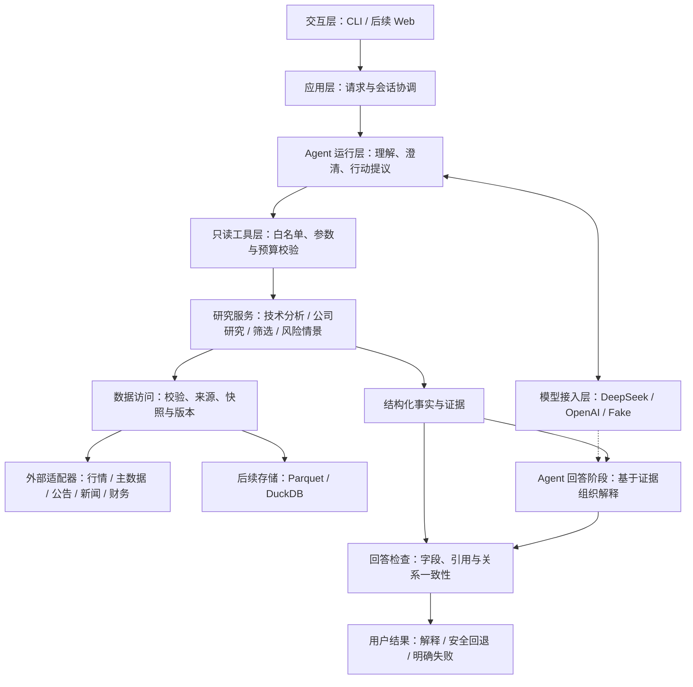

# Trading Companion：总体技术架构设计

版本：v0.1

日期：2026-10-16（America/Los_Angeles）

状态：目标架构与渐进实施方案；不是已完成功能清单。

阅读对象：项目开发者、协作者，以及希望理解项目技术取舍的读者。

## 1. 文档定位

本项目采用**模块化单体后端、受控的单个研究 Agent、确定性研究工具，以及可追溯的数据与证据**。

“模块化单体”是指先在一个 Python 项目中划分清楚职责，通过进程内接口组合能力，不提前拆成独立部署的微服务。这样更适合个人项目，也方便逐步学习、测试和定位问题。

本文回答“系统如何组织、模块如何协作、现有代码如何演进”。产品范围与验收依据见 [产品 Agent PRD](prd-agent-v0.1.md)；运行方法见 [README](../README.md)；概念和面试问答见 [学习笔记](agent-learning-notes.md)。本文不扩大当前 PRD 的交付范围，也不要求立即按目标目录重构。

标记约定：

- **已有**：能够在当前源码中找到的能力。
- **本期计划**：首个单股票、多指标日线 Agent 所需能力。
- **长期目标**：基本面、新闻、选股、历史版本、风险情景及 Web 等后续能力。
- **实验候选**：需要独立验证，不能作为已实现或必需依赖描述的能力。

## 2. 产品目标与不可突破的边界

长期产品面向 A 股个人投资者，支持知识解释、技术分析、公司研究、候选股票筛选，以及有明确假设的止盈止损情景研究。后续再扩展美股。

首个产品 Agent 聚焦中文单股票、多指标、已完成日线研究；新闻、选股、数值化止盈止损和收益评估不属于本期。

长期保持以下边界：

1. 所有实际交易由人完成；不接入券商账户，不创建下单、撤单、修改订单或资金管理通道。
2. 指标、比较关系和可计算的研究结果由程序产生；模型负责理解请求、提议使用允许的工具和解释证据。
3. 不以训练股票模式预测模型为前提，也不承诺收益、胜率或走势预测准确率。
4. 支持范围内的科创板、ST 和新上市股票不因类别被主动排除；身份未知或数据不足必须明确说明。
5. 任何输入、模型回答或外部新闻，都不能扩大程序授予的权限。

## 3. 当前实现基线

截至本文版本，项目还不是能够通过自然语言调用工具的产品 Agent。

| 模块 | 已有代码 | 实际能力与边界 |
| --- | --- | --- |
| 行情数据模型 | [daily_bar.py](../src/trading_companion/daily_bar.py) | 校验价格、成交量等 OHLCV 字段；没有证券主数据和历史风险标签 |
| 数据源接口 | [data_source.py](../src/trading_companion/data_source.py)、[csv_loader.py](../src/trading_companion/csv_loader.py) | `DailyBarSource` 统一日线读取；CSV 样例是人工数据 |
| 在线数据源 | [tencent_adapter.py](../src/trading_companion/tencent_adapter.py)、[akshare_adapter.py](../src/trading_companion/akshare_adapter.py) | 腾讯直接 JSON 接入，以及通过 AKShare 访问东方财富；来源显式选择，无自动切换 |
| 日期与指标 | [history.py](../src/trading_companion/history.py)、[indicators.py](../src/trading_companion/indicators.py) | 日期过滤、SMA、独立 EMA/MACD/RSI/BOLL/ATR/量能与日期结果点；见[剩余指标设计](indicators-design.md) |
| 分析服务 | [analysis.py](../src/trading_companion/analysis.py)、[multi_analysis.py](../src/trading_companion/multi_analysis.py)、[multi_contracts.py](../src/trading_companion/multi_contracts.py) | 旧单 SMA 接口保持兼容；独立多指标服务一次取数，返回逐字段状态、初始化元数据、关系和事实标识 |
| 模型接入 | [model.py](../src/trading_companion/model.py)、[deepseek_model.py](../src/trading_companion/deepseek_model.py)、[tool_model.py](../src/trading_companion/tool_model.py) | 原纯文本接口/Fake/DeepSeek继续兼容；新增独立工具消息协议和脚本Fake，真实供应商工具适配待做 |
| 只读工具执行 | [research_tool.py](../src/trading_companion/research_tool.py)、[research_tool_demo.py](../src/trading_companion/research_tool_demo.py) | 单个白名单日线工具、严格业务校验、每轮一次分析、紧凑证据视图；已用Fake和可信人工CSV离线串联，尚无完整Agent编排 |
| 运行入口 | [__main__.py](../src/trading_companion/__main__.py)、[model_cli.py](../src/trading_companion/model_cli.py) | 参数式行情 CLI 与独立模型联通 CLI；尚无自然语言对话主流程 |
| 验证 | [tests/](../tests/) | 离线回归测试；开发者另反馈一次真实 DeepSeek 文本请求成功，不等于 Agent 质量已验收 |

当前尚无 FastAPI、Web 前端、DuckDB 持久化、Jev、新闻/基本面、筛选、完整证据台账或严格 point-in-time 系统。

## 4. 总体架构

下图为目标模块关系，不表示全部模块已经存在。实线表示主要调用或结果流向，虚线表示模型生成依赖；取数结果会沿服务调用返回。



权限、超时、日志和测试贯穿各层。图中没有交易执行模块，也不预留可由模型激活的交易能力。

### 4.1 依赖规则

- 领域数据结构和指标计算不依赖模型、HTTP、界面或数据库。
- 研究服务依赖统一数据源接口，不到处硬编码某个供应商请求。
- 数据与模型适配器把外部协议转换为内部契约；适配器依赖契约，而不是让业务依赖供应商格式。
- Agent 只通过已注册的工具契约提出研究请求，不能绕过工具层直接调用适配器、数据库或终端。
- CLI 和未来 HTTP 入口调用相同的应用能力，不各自实现一套研究逻辑。
- 对象构建和供应商选择集中在应用装配处；不让模型动态导入模块或生成任意调用目标。

## 5. 模块职责

### 5.1 交互层与应用层

交互层负责接收输入和展示结果。第一版采用终端对话；后续 Web 展示聊天、K 线、指标、查询条件和证据卡片。

应用层协调会话、每轮请求、配置和返回结果。FastAPI 是 Web 阶段的建议入口，不是计算函数的依赖。HTTP 接口届时使用 Pydantic 校验输入，不为此全面替换当前内部 dataclass。

前端不直接调用模型供应商，也不接触服务端 API 密钥。当前不要求账户体系；以后开放多用户访问前，必须先补身份验证、资源归属、限流与会话隔离。

### 5.2 Agent 运行层

Agent 负责区分知识问答、行情研究、已有结果追问和超范围请求；提取参数、发起澄清、提议工具调用，并解释有效证据。

首版采用显式状态机：

```text
理解请求 → 澄清或校验 → 执行允许工具 → 整理事实 → 解释 → 检查 → 展示
```

知识问题可以跳过行情工具；已有结果追问只有在条件和证据仍匹配时才能复用。状态机限制允许的转移，模型不能自行添加无限循环或重试。

应用层管理会话生命周期；Agent 管理当前轮的理解、待澄清参数和执行阶段。已确认条件、待确认候选及上次结果分开保存。新条件查询失败后，不能把旧结果当作新结果展示。

首次实现只保留内存会话，不默认保存完整原始对话。开发协作中使用的子 Agent，不等于产品运行时需要多 Agent。

### 5.3 模型接入层

业务使用统一接口，供应商适配器负责消息转换、能力差异、响应解析与错误分类。DeepSeek 为首个真实提供方，Fake 支持离线验证，OpenAI 后续接入。

原 `TextModel.complete()` 及消息校验继续只支持纯文本。M2首切口新增独立 `ToolCapableModel`、工具定义/调用/结果/状态契约及脚本Fake，见[工具模型设计](tool-model-design.md)；旧演示只验证固定结果消息往返。随后新增的白名单执行器已通过独立入口连接研究服务，见下节。真实DeepSeek工具HTTP适配和完整Agent流程仍待实现，原文本CLI保持兼容。

兼容 OpenAI 风格接口不等于行为完全一致；切换提供方时必须验证消息、结构化输出、工具调用、截断和错误处理。用户显式选择提供方，不静默把对话发送给另一家服务。这里的 OpenAI 指模型 API，不是自动操作 ChatGPT 网页。

### 5.4 只读工具层

工具层是模型与程序能力之间的边界。模型提出请求不等于获得执行授权。

首版只开放一个多指标日线分析工具，一次获取选定历史序列后集中计算所需指标；跨年分片仍可能产生多次 HTTP 请求，不能把一次工具执行误认为一次网络请求。

工具层负责名称白名单、结构与业务参数校验、调用预算以及统一错误返回。不接受任意函数名、Python 对象、SQL、磁盘路径、终端命令或网络 URL。CSV 仅由开发者配置固定测试样例，不能让模型选文件。

2026-10-16已实现上述日线执行切口，详见[受控工具设计](research-tool-design.md)：`ResearchToolExecutor`按回合实例持有一次分析额度，多调用批次整体拒绝；完整研究结果保留本地，模型接收带请求内证据别名的紧凑结果。容量与历史校验失败明确返回，不截断证据、不自动重取数。这仍不包含自然语言路由、真实工具模型或全轮时限。

未来按需增加公司资料、公告检索、候选筛选和风险情景工具，不为每个指标单独暴露一次取数工具。

### 5.5 研究服务层

研究服务实现可脱离大模型运行的业务能力：

| 服务 | 职责 | 阶段 |
| --- | --- | --- |
| 技术分析 | 指标计算、日期对齐、逐字段可用性与交叉等确定性关系 | 首个 Agent 的核心；部分基础已有 |
| 公司研究 | 整理基本面、公告、新闻事件及其来源与时间 | 长期目标 |
| 股票筛选 | 对有版本的股票池执行确定性条件，返回候选、筛选理由和缺项 | 长期目标 |
| 风险情景 | 按明确方法计算参考水平，展示假设、适用条件和失效条件 | 长期目标；不执行交易 |

筛选首先保证股票池、数据时间和规则可复现，再由模型解释候选。模型不能凭记忆补齐缺失财务数字，也不能在没有方法与输入的情况下编目标价或上涨概率。

### 5.6 数据与证据层

数据层统一外部来源、数值单位、时间、复权口径和版本。长期补齐证券主数据、交易日历、历史 ST/上市/停复牌信息及公司行动。

证据模块把结果整理成可定位的事实。事实卡片由程序渲染；模型引用事实标识解释，不改写事实数字。未来新闻与公告引用还需定位原文、文档版本和支持结论的具体片段。

回答检查不仅验证“引用存在”，还要检查日期、单位、数值与方向关系。引用有效但把“低于”写成“高于”同样不合格。自由文本的全部语义无法仅靠字段校验保证，仍需人工评估和限制可表达的结论。

## 6. 关键数据契约

下表列出各阶段契约需要表达的内容。M1b已新增 `IndicatorSpec`、`MultiIndicatorRequest`、`MultiIndicatorResult` 及字段、组件、关系和事实契约，详见[多指标设计](multi-indicator-design.md)；会话、解释候选和历史版本等契约仍待后续实现。

| 契约 | 必须表达的内容 |
| --- | --- |
| 研究请求 | 请求编号、股票、日期区间、指标及参数、显式数据源、已采用默认值 |
| 数据快照 | 股票、覆盖区间、来源、复权与单位口径、获取时间；后续增加版本和历史可得性依据 |
| 指标结果 | 指标实例与参数、算法版本、计算起点、初始化方式、字段值、值对应日期及可用性 |
| 结构化事实 | 事实标识、数值或关系、单位、日期、支持它的结果字段及适用限制 |
| 解释候选 | 引用的事实标识、允许的关系与解释类型，以及不确定性；不获得新的执行权限 |
| 本轮结果 | 查询条件、整体数据状态、逐项结果、解释或回退内容、警告与脱敏诊断标识 |

可用性需区分“可用、历史不足、未定义、计算错误”，不能统统变成 `null` 后不解释原因。合法的 0 和不可用值不同。

MACD 的 DIF、DEA 和柱值可以在不同记录数下就绪。部分指标可用时只解释有效部分，不静默用旧日期字段补当前缺值，也不让模型补算。

旧版 `AnalysisResult` 的状态仍表达单 SMA 结果；多指标契约需要独立演进，不能把旧接口中 `ok` 的含义悄悄改成另一种语义。现有 `analyze_daily_bars()` 与 CLI 保持回归兼容。

## 7. 一次日线分析的数据流

以“分析 000001.SZ 截至 2025-09-05 的趋势和动量”为例，目标流程如下：

1. 应用创建本轮请求，提供明确日期锚点，并读取当前会话的已确认条件。
2. Agent 识别意图和候选参数；有歧义时追问，本轮不查询行情。
3. 程序合并条件、应用允许的默认值，校验股票、日期、指标、来源和预算。
4. 工具调用研究服务，由选定适配器读取日线；校验字段、单位、顺序和日期范围。
5. 同一份日线集中计算请求的指标，产生逐字段状态、初始化信息和确定性关系。
6. 证据模块生成事实标识。给模型的是必要字段、关系和缺项说明，而不是全部历史序列。
7. Agent 组织解释；程序核对引用与允许关系，不合格时按剩余预算修正，或回退为事实摘要。
8. 展示查询条件、实际最新交易日、事实、解释和限制；保存本轮匹配的确认条件与结果。

源失败、无数据或行情无效时，不调用模型生成走势判断。行情成功而模型失败时，可以保留可信事实，但必须明确没有完成模型解释。

## 8. 历史数据、存储与 point-in-time

### 8.1 时间不是一个字段

长期数据设计至少需要区分：

| 时间信息 | 含义 |
| --- | --- |
| `trade_date` 或业务所属期 | 行情发生日、财报所属期等，不等于公开日期 |
| `published_at` | 来源宣称的发布时间；本身仍需验证，不能证明当前版本当时已存在 |
| `retrieved_at` | 本系统实际读取时间，不代表历史用户当时可得 |
| 状态有效区间 | 某次 ST、停牌等状态从何时生效到何时结束 |
| 版本与可得性依据 | 具体内容版本、修订记录，以及什么证据支持它在截止时点已可得 |

日期过滤只限制业务日期，不能排除后续修订。财务数据、公告与风险标签需要保留历史版本；历史股票池还需包含当时存在、后来退市的股票，避免只看今天仍存续的样本。

仅在今天抓到一个标为过去发布时间的文档，不能据此声称已经还原当时内容。缺乏可验证版本时，明确标注局限，而不是倒填一个历史可得时间。

### 8.2 存储演进

后续优先考虑 Parquet 保存经许可的快照，DuckDB 执行本地结构化研究查询；使用数据源、股票、区间、口径和版本等条件定位数据。算法与计算起点也必须参与结果缓存标识，避免错用旧结果。

DuckDB 并不是 point-in-time 正确性的保证；保证来自时间契约、版本保存、查询规则和测试。公开接口可访问，也不代表允许任意缓存、商用或再分发，接入前需核对条款。

首版仍使用现有不复权日线。公司行动会影响指标，不能把价格跳变自动解释为交易趋势；以后引入复权，也要固定算法与数据版本，不静默替换口径。

### 8.3 模型自身的历史信息风险

即使工具数据已经按时点隔离，预训练模型仍可能记得之后发生的事件。历史研究只允许解释输入证据，并通过诱导后续信息的评估检查越界行为。

这能降低风险，但不能证明自由文本绝对没有历史信息污染。数据回放正确性、模型解释质量和交易策略表现是三类不同验证，不能相互代替。

## 9. Jev 的可选位置

Jev 是后续分类或路由任务的实验候选，不是第一版依赖。本文不重新核验其版本、许可、部署条件或承诺具体模型能力。

未来有新闻/公告后，可针对事件分类、相关性判断或进一步研究路由建立固定任务。先与简单规则、主模型比较准确性、覆盖率、延迟和成本，再决定是否接入。

接入应通过独立分类接口完成，主研究链路不依赖 Jev 专有输出。失败时执行事先定义、可见的回退；升级到付费模型也必须受用户配置、数据发送范围与预算约束。

Jev 不替代数值计算、权限校验、历史时点过滤或引用检查。不把全部输入强制先过一次 Jev，也不把所谓分类置信度当作交易胜率。

## 10. 安全、运行预算与诊断

### 10.1 安全边界

- 只注册研究工具；不注册交易、任意 SQL、任意文件或通用代码执行能力。
- 外部资料是数据，不是指令。新闻中的“忽略限制”等文本不能影响系统权限。
- 密钥由本地环境配置提供，不进入提示词、Git、前端、日志或错误信息。环境变量不是加密保险箱。
- 启用真实模型前说明哪些问题、会话与证据会发送到哪个提供方；测试默认使用假模型，不自动产生付费调用。
- 日志默认不保存原始完整对话；不同会话的状态和结果隔离。

### 10.2 预算与失败行为

采用 PRD 的本期建议值作为后续实现和测试起点，数值仍需在实施时确认；当前代码没有完整执行这些限制。

| 范围 | 建议约束 |
| --- | --- |
| 研究范围 | 每次 1 只股票、最多 12 个指标实例、含首尾最多 366 个自然日 |
| 工具 | 每轮最多执行 1 次日线分析工具 |
| 模型 | 理解、解释、修正合计最多 3 次；格式或证据修正共用最多 1 次机会 |
| 截止时间 | 单次模型请求 30 秒应用层截止时间，每轮总计 90 秒应用层截止时间 |

底层 HTTP 连接/读取超时不等于应用层总截止时间。需单独实现截止控制、取消或忽略迟到结果，不能让上一轮的结果污染新状态。供应商或 SDK 自动重试默认关闭；若后续启用，每次真实请求仍计入同一预算。

| 异常 | 目标行为 |
| --- | --- |
| 参数不明确或非法 | 追问或在联网前拒绝，不擅自改条件 |
| 源失败或无效行情 | 返回明确原因，不编行情，不静默换源 |
| 数据合法但部分指标不足 | 展示有效部分及缺项；不伪装完整成功 |
| 模型超时、截断或错误引用 | 明确失败或回退到可信事实，不把残缺解释当成功 |
| 越权工具、反复调用或总预算耗尽 | 程序阻断并结束当前轮 |

### 10.3 可观测性

记录请求编号、阶段、模型与提示词版本、数据源与快照标识、算法版本、调用次数、耗时及脱敏错误。token 用量未知时保留未知，费用仅在有对应计价规则时估算。

先采用结构化日志；确实需要跨进程追踪时再评估 OpenTelemetry 等组件，不为展示技术栈提前增加部署依赖。

## 11. 测试、评估与发布

| 验证层 | 主要检查 |
| --- | --- |
| 计算单元测试 | 已知样本、独立参考、初始化、零值、边界、日期对齐、未来数据不影响过去计算 |
| 契约与适配器测试 | 单位、来源、响应格式、请求限制、错误分类与供应商差异 |
| Agent 离线集成测试 | 假模型驱动理解、澄清、执行、回退、会话隔离和预算限制 |
| 真实模型评估 | 固定中文场景、重复运行、正确行动、参数理解、事实一致性与过度推断 |
| 后续历史与策略评估 | 先验证版本与时点，再单独设计策略、成交假设、费用及收益/回撤评价 |

真实模型评估记录模型、提示词、数据版本、日期、样本量和失败案例，人工复核语义。被成功拦截的错误、修正与回退应单独统计；不能靠大量回退就宣称产品效果优秀。

后续 GitHub Actions 默认只运行离线测试，不配置付费模型调用。当前仓库尚无该 CI 工作流。Web 阶段再补依赖锁定、可重复部署配置与必要的接口集成验证；现阶段不为文档新增运行依赖。

## 12. 目标目录与渐进迁移

下面是职责成熟后的目标目录，不是现有文件清单，也不是立刻执行的迁移指令。文件夹名不能代替真正的依赖边界。

```text
Trading Companion/
├─ src/trading_companion/
│  ├─ interfaces/       # CLI and HTTP entry points
│  ├─ application/      # Use cases, configuration and session coordination
│  ├─ agent/            # Per-turn state and controlled orchestration
│  ├─ models/           # Model contracts and provider adapters
│  ├─ tools/            # Tool schemas, registry and execution policies
│  ├─ research/         # Technical, company, screening and risk services
│  ├─ domain/           # Shared data structures and business rules
│  ├─ data/             # Providers, validation and repositories
│  ├─ evidence/         # Facts, citations and answer checks
│  └─ observability/    # Sanitized logs and run diagnostics
├─ frontend/            # Future web interface
├─ tests/               # Unit and integration tests
├─ evals/               # Agent behavior cases and evaluation reports
├─ docs/                # PRD, technical designs and learning notes
└─ pyproject.toml
```

迁移原则：先完成当前能力，在模块确实变大或出现第二个实现时拆分；保留导入兼容或同步更新调用方与测试。现有 `analysis.py` 演进为研究服务起点，`indicators.py` 保持纯计算，数据源与模型接口继续作为适配边界。不要只为目录整齐同时搬动全部文件。

## 13. 技术选型与取舍

| 部分 | 建议与理由 | 当前状态 |
| --- | --- | --- |
| 语言与计算 | Python、标准库与可独立验证的函数；不依赖大模型算数 | 已有 |
| 模型接入 | 统一契约加供应商适配器，先 Fake 与 DeepSeek，后 OpenAI | 文本基础、工具消息协议与脚本Fake已有；真实工具模型适配待做 |
| Agent 编排 | 先显式状态机，便于理解、约束与测试；复杂恢复确有需求后再评估 LangGraph | 计划 |
| HTTP API | FastAPI；Pydantic 用于外部输入校验，内部模型按需要演进 | Web 阶段 |
| 数据存储 | Parquet 与 DuckDB 用于单人历史研究；多用户并发写入和账户需求出现后再评估 PostgreSQL | 长期目标 |
| 前端 | React 与 TypeScript，用于聊天、图表和结构化结果；不要求依赖境外托管平台 | Web 阶段 |
| 测试与 CI | 延续 unittest，补 Agent 评估集与 GitHub Actions | 测试已有，评估与 CI 待建 |
| Jev | 独立分类实验，有可复现收益再纳入 | 实验候选 |

初期不引入微服务、Kubernetes、Redis、任务队列、向量数据库或产品多 Agent。出现明确瓶颈后再选组件；文档语义检索确有需求时再讨论 RAG，不把结构化行情数值当作向量检索问题。

## 14. 开发顺序与完成条件

| 阶段 | 交付内容 | 完成条件 |
| --- | --- | --- |
| 当前基础 | 数据模型、适配器、SMA、独立 EMA/MACD、文本模型接口 | 已有代码与对应测试；不称为完整 Agent |
| M1a：补齐指标 | 已新增独立 RSI、BOLL、ATR、量能，保持已有计算口径 | 数值函数与测试已补齐；仍不代表多指标服务或 Agent 完成 |
| M1b：多指标契约 | 独立服务已新增一次取数、逐字段状态、初始化元数据、关系事实和证据标识 | 默认组合与部分可用、证据依赖和旧接口回归；不等于模型工具循环已完成 |
| M2：单轮 Agent | 已有工具消息协议、受控执行器及Fake/人工CSV真实计算往返；真实工具适配、自然语言编排与解释检查待做 | 完整单股票问题走通，异常有明确回退；离线执行验证不代表M2整体完成 |
| M3：会话与预算 | 澄清、参数继承、对话入口、次数与截止时间 | 状态隔离、连续追问、越权和迟到结果测试通过 |
| M4：评估与说明 | 固定场景、真实模型验证、诊断与运行文档 | 报告实测结果和局限，不把离线测试当真实模型效果 |
| 长期扩展 | 主数据与日历、公司研究、筛选、历史版本与回放、风险情景、Web 和美股 | 每项单独定义数据契约、失败行为与验收；不一次性展开 |

严格历史策略评估必须等对应的股票池、版本与可得性约束足够明确后进行。先补主数据与公司研究来源，再逐步验证筛选和回放，最后研究有依据的风险情景；新增 UI 不改变交易权限边界。

多指标服务、工具消息协议与受控日线执行器已实现，下一步是真实提供方工具适配、单轮编排及解释检查。保留当前目录与已有供应商，不因此增加框架或接入新的外部模型。

## 15. 文档维护

- 新能力实现后，同时更新当前状态、运行说明和对应测试，不只修改目标架构。
- 影响权限、数据口径、供应商、状态机或存储的变化，记录原因、替代方案及验证结果。
- PRD 管范围，技术设计管实现，学习笔记解释概念；发现冲突时明确修订，不默默扩大范围。
- 尚未实现的接口、部署方案和实验结果不能作为项目既有成绩。
