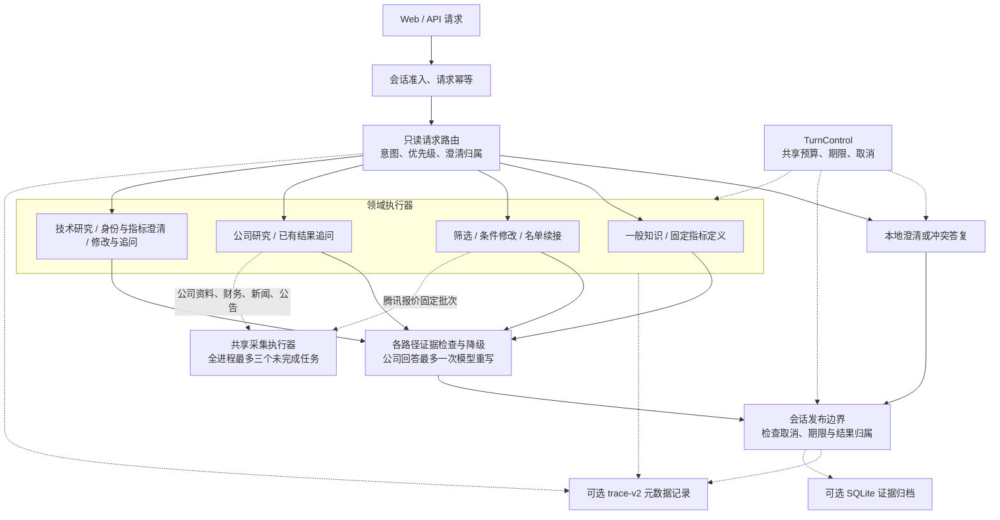
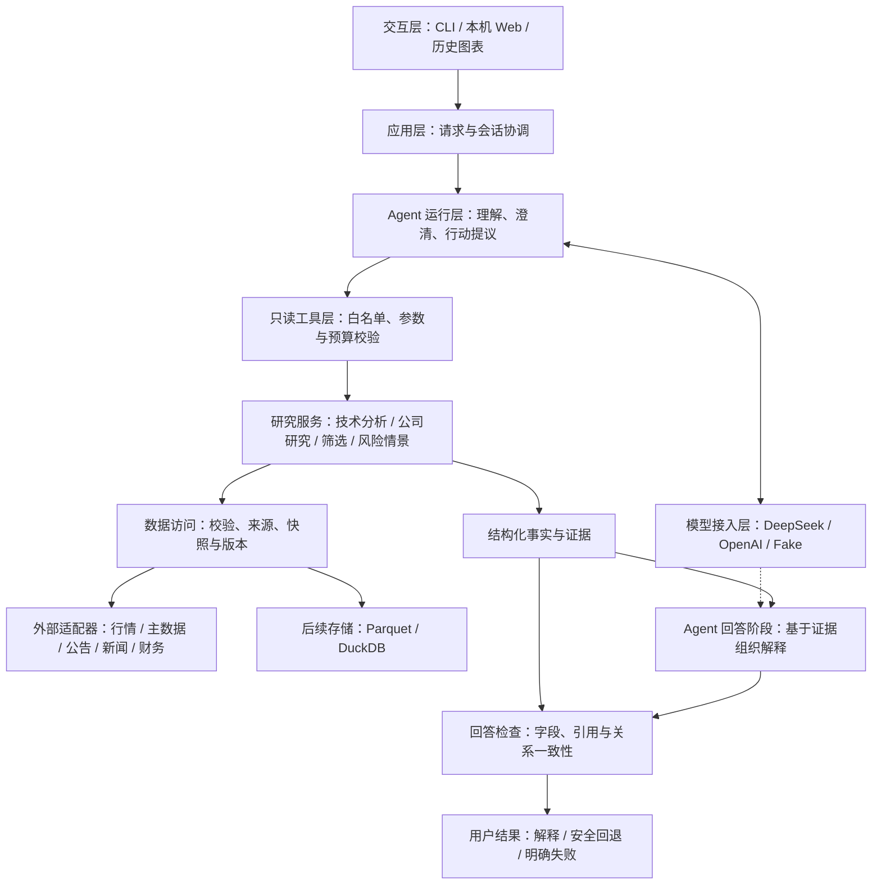
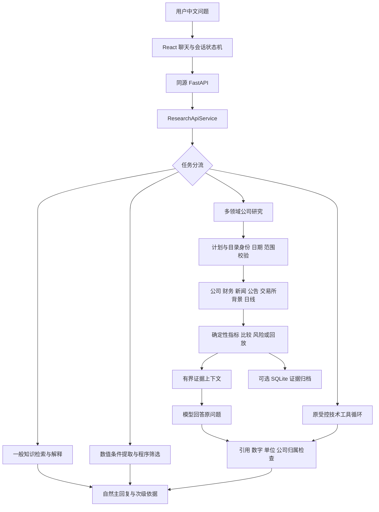
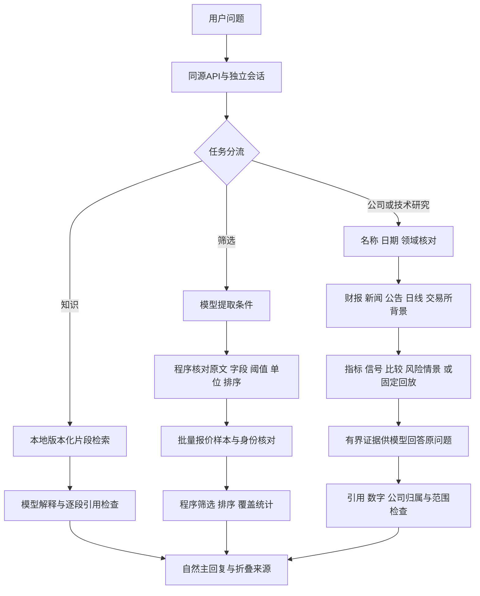

# Trading Companion：总体架构与交付记录

总体技术架构、模块边界、各阶段交付清单和协作交接说明。想快速了解项目，先读本文第一节。

> 本文由多份原设计文档按主题合并而成（2026-11-16）。各节保留原文，包括当时的日期、提交号、总线消息号和命令；其中提到的早期演示模块（如 `agent_demo`）和研究意图 v2.5/v2.6 封存评测脚本已在同次清理中删除，需要时请查看 git 历史（标签 `research-intent-v2.6-freeze-valid`）。

## 目录

- [Trading Companion：总体技术架构设计](#trading-companion总体技术架构设计)
- [Trading Companion：项目上下文与 Agent 协作交接](#trading-companion项目上下文与-agent-协作交接)
- [当前模块交付与使用示例](#当前模块交付与使用示例)
- [单股票日线 MVP：代码交付与验收清单](#单股票日线-mvp代码交付与验收清单)
- [MVP 会话收口：窗口澄清、相对日期与历史日线刷新](#mvp-会话收口窗口澄清相对日期与历史日线刷新)


## Trading Companion：总体技术架构设计

2026-11-12：[本机自选股及持仓偏好](memory-design.md#本机个人记忆自选股持仓与偏好)已分别提交推送 `9aa98af`、`4faea64`。独立个人 SQLite 库本轮由精确v1/v2严格事务升级v3，保留原自选及最多50份类别资料，新增消息/已见/逐源状态；升级后旧程序拒绝打开，失败整体回滚。仍通过 `--personal-memory-db PATH` 显式开启，默认关闭、`start.cmd` 不默认启用；`--no-memory` 优先禁用聊天历史/摘要、回顾和个人库。确定性管理命令在意图模型前处理并跳过聊天记忆；自选、持仓偏好、消息面板接口独立于研究会话；移除自选连带清对应消息，偏好与聊天仍独立删除。资料不自动发给模型，主动研究草稿只放代码和问题类型，须用户发送；管理不改变研究主体、待澄清或价位算法。Dev Mode、demo、synthetic 不打开真实个人库。重要提醒、后台定时和推送均未实现。

第三模块[研判回顾](memory-design.md#研判回顾原记录与按需后续走势)已由 Claude 审核、提交并推送 `f2484cf`：`memory_store.py` 有界读取聊天库原 `turns.result`，`research_review.py` 投影原判断/价位与走势资格，`research_review_prices.py` 提供独立固定腾讯HTTPS传输；`/v1/research-reviews` 三接口和独立页面不切研究会话、不复制判断到个人库、不调用模型。每页最多20原项、每项1 MiB；新完成时间优先，旧记录按 #625 取源对话最近保存日期后一天，不能用90秒预算推算硬截止。走势先核复权和真实性，点击才取，最多366日/两次年请求、512 KiB每响应、8秒协作期限，槽位在真实连接清理后释放；源删除后不发布迟到结果。规则 `personal-memory-review-v1` 以 `personal-memory-preferences-v1` 为父版，不包含统计校准。

第四模块[消息收件箱](news-design.md#自选股消息收件箱有限检查与本机未读)按 #629 批准方案实现，当前未提交待审核。`watchlist_news.py` 管公共标题/身份与有界游标，`personal_memory_store.py` 管v3事务和逐源状态；`watchlist_news_service.py` 管单批准入、编号重放、取消提交同锁及进度，`watchlist_news_sources.py` 通过 `ResearchDataService.read_watchlist_section` 复用新浪/东财公告核验并直接同步读取。`CollectionExecutor.run_inline` 借原全局3槽，在真实调用和客户端关闭后finally释放，无nested Future，不扩大普通研究最多3股限制。每批最多5股/10次实际请求/50标题，最近30天每源5条、512000字节每响应/5120000字节整批、跨批1秒间隔、20秒批次/6秒单次协作期限。

`/v1/personal/inbox` 打开/刷新/翻页只读本机，显式check POST才联网，独立前端 `MessageInbox.tsx` / `inboxMessages.ts` 不切研究会话。每股每源独立基线和水位，generation防删除重加后迟到写回；每股500消息/90天、2000已见指纹，清未读可见。`watchlist_news_sidecar.py` 复用正常当前研究已取得的核验标题，零新增请求、总共50＋150毫秒协作本机预算，不推进手动完整成功水位；未开库不增加库访问、额外墙钟读取或上下文。取消不撤销已保存部分，不承诺强制停止底层网络/磁盘阻塞；reader在pace后/真正send计数前用before_request有界复核身份，本服务移除/清空立即使gate失效。研究旁路before_commit/checkpoint取消可回滚事务，属协作边界；API收件箱可选sidecar_status仅保留内存固定码、重启null，存储DTO无此字段、不改研究响应或新增数据库，UI提示保存未确认。收件箱、自选及偏好不自动发模型或摘要。规则 `personal-memory-notifications-v1` 以完整 `personal-memory-review-v1` 为唯一父版。

2026-10-30 第2a批新增独立指数执行器：五指数真实日线、完整周证据、共享价格计算内核、独立点单位、受控模型回答、最近主体隔离及日/周图；公共结果为可选 `index_research`。股票入口继续使用原严格身份与单位。指数可选归档复用存储框架但使用独立版本负载。指数点位计划和小时图分后续批次，详见[指数研究设计](market-and-screening-design.md#五指数日线周线研究与点位情景计划)。下图为之前的股票处理链路。

2026-10-29更新：自然技术与公司研究共用取数、证据及v3正文执行链，路由仍分别记录意图和执行器。技术语义主体可以保存共用计划；范围约束、统一指标编辑及待澄清都使用现有载体，旧技术任务和结构化入口保留。见[技术共用设计](technical-analysis-design.md#自然技术研究共用自然语言回答流程)。下图中的公司执行器也承接自然技术，技术执行器继续承担旧任务、结构化研究及兼容能力。

### 2026-10-28：当前已实现的处理链路

当前产品是模块化单体后端、受控的单个研究 Agent 和同源 React/TypeScript 工作台。下图描述已经实现的路径；后面的日期章节保留历史状态，长期目标不能当成已实现功能。Windows 是运行和验收平台。



领域执行器按需使用受控模型和只读工具。实线表示处理流程，虚线表示共享控制或可选能力。领域执行器仍处理内部澄清和后续请求，选中入口不代表已经获得研究许可。固定指标知识由原技术入口执行，图中按能力列入知识；名单续接会在复核成员和有效期后进入公司或技术研究。详细边界如下：

| 职责 | 当前实现和验证边界 |
| --- | --- |
| 路由与澄清归属 | `request_routing.py` 按静态优先级选择执行入口，不调用模型、不修改会话，也不授予工具权限。路由1b明确知识、新筛选与待澄清的优先级；本地冲突答复复用原控制与发布边界。v1/v2 特征测试（冻结行为作为对照）覆盖35场景、105轮；历史事实、人工目标与审核过的差异分别保存，见[路由设计](request-understanding-design.md#请求路由明确意图优先级与澄清所有权)。 |
| 受控模型与工具 | `TurnControl` 是每轮共享的模型/分析预算、期限和取消控制器；模型提议继续经过身份、日期、参数和作用域核验。固定知识可零模型、零取数。调用协议由项目定义，适配 DeepSeek/OpenAI，不使用 Agent 编排框架，见[工具协议](agent-runtime-design.md#工具模型协议与离线-fake-往返)和[工作流](agent-runtime-design.md#有界研究工作流设计)。 |
| 有上限的采集 | 公司领域资料与腾讯筛选批次共用 `CollectionExecutor`，最多三个未完成任务，迟到线程真正结束前仍占名额。公司配额与报价请求/字节账本分别约束，腾讯全部批次成功才发布名单；公司领域可部分可用但明确缺失。东方财富分页、技术计算、模型及市场背景读取保留原执行方式，见[并发设计](research-data-design.md#有上限的资料与报价并发采集3a3b3c)。 |
| 检查、修复与发布 | 检查因路径而异，包括请求绑定、引用、数值、证券归属及计算关系，不证明任意文字推理。公司回答可在原额度内最多重写一次；失败按原规则降级，不新增无限重试。最终会话边界隔离取消和迟到结果，见[公司研究](research-data-design.md#多维公司研究流程证据与模型切换)和[整轮控制](agent-runtime-design.md#整轮运行控制共享预算取消与迟到结果)。 |
| 可选追踪与归档 | `trace-v2` 是第二版逐轮元数据格式，覆盖模型、工具、来源、检查与修复；详细事件有共享上限，查看器区分未记录、零次与截断。SQLite 是本地证据存储，归档在发布检查后受会话边界保护，不保存原问题、聊天或模型答案。两者默认关闭，失败不丢弃研究答复，见[追踪设计](agent-runtime-design.md#每轮运行记录路由模型工具来源及检查修复)与[归档边界](technical-analysis-design.md#历史回放与本地归档读取)。 |

当前离线测试、界面截图与固定延迟计时见 [README](../README.md#development)。截图使用人工数据和固定假模型；离线契约验证不是实盘质量或真实来源速度评估。没有交易接口、严格 PIT（按当时可见历史版本查询的数据库）、全市场完整筛选或订单成交回测；这些边界与后面的长期目标分开。

### 2026-10-27：顶层请求路由集中，行为保持兼容

API服务通过`request_routing.py`集中选择原一般知识、筛选修改、新筛选、名单续接、公司研究和技术研究入口。`RouteSpec`静态声明旧优先级，`RouteDecision`给出固定原因码；只读上下文不拥有会话清理、预算或发布能力。`api_service.py`继续安排知识可选目录提示/研究强制目录加载、调用原执行器并处理幂等、取消、公共输出与异常收尾。

路由与授权分离（routing ≠ authorization）：选中名单处理器不等于名单有效，身份、日期、来源、工具和发布仍由原执行器核验；内部澄清/编辑/知识流程不随本次搬移重做。原`09cd366`的35场景/105轮特征测试（characterization test / golden master，即冻结现有行为的基线）对照路由、完整公共返回、调用和会话状态，记录已有不一致，规则修正留待1b。模块边界、时钟与目录顺序、基线复核方式见[请求路由设计](request-understanding-design.md#请求路由明确意图优先级与澄清所有权)。

### 2026-10-26：筛选、知识检索、交易规则与回放

本次在技术分析扩展基础上补齐四类独立基础模块，并接入现有会话服务。当前完整状态和使用例子见[模块进度](architecture.md#当前模块交付与使用示例)。后文带日期的“未实现”保留为历史范围，不能替代本节。

| 架构职责 | 实际模块 | 当前行为 |
| --- | --- | --- |
| 候选筛选 | `screening.py`、`screening_source.py`、`screening_agent.py` | 模型提取明确数值条件；程序核对原文、字段、阈值和排序，批量取报价并确定性筛选，报告实际覆盖样本 |
| 知识检索 | `knowledge_data.py`、`knowledge_retrieval.py`、`open_knowledge.py` | 24条版本化维护者说明，别名门控/BM25检索，一次模型解释及逐段来源成员检查 |
| 当前交易所背景 | `market_context_live.py`、`market_context.py` | 官方沪深端点读取当前板块/上市日及有限风险警示观测；历史状态、发布时间不明时保持未知 |
| 有日期的规则 | `market_rules.py`、`product_research.py` | 按规则生效日期解释普通涨跌幅及T+1，区别条件规则和实际可交易性，不由日历天猜IPO交易序号 |
| 历史评估基础 | `historical_replay.py`、`replay_cli.py` | 同份快照上固定SMA、前一收盘信号/下一开盘敞口、同区间持有比较、成本/回撤与本地归档查看 |
| 可选展示 | `KnowledgeSources.tsx`、`ScreeningResults.tsx` | 自然答复及紧凑候选表，来源/条件/覆盖折叠，开发诊断不进入主会话 |

仍采用模块化单体与单个受控产品Agent。没有增加角色辩论框架或训练预测模型；筛选不声称全市场潜力排序，回放不声称实际成交回测，来源引用不声称已证明任意文字语义。开发期间子Agent的分工不等于产品运行时有多Agent团队。

### 2026-10-26：技术分析扩展与当前文件映射

本轮在既有公司研究与技术工具上增加互补指标、规则信号和日周核对，保持模块化单体、单个受控 Agent 与原八项默认组合。下方2026-10-25的领域资料、会话、模型和存储职责继续适用；更早的范围与测试数量是对应阶段的历史记录。算法口径、参数及边界见[技术分析设计](technical-analysis-design.md#技术分析扩展指标信号与日周核对)。

| 架构职责 | 实际模块 | 当前行为 |
| --- | --- | --- |
| 指标计算与契约 | `indicators.py`、`multi_contracts.py`、`multi_analysis.py` | 新增Wilder ADX、快照起点为零的整数OBV、成交量加权VWMA；逐字段报告预热不足或零量不可定义，保留原指标公式 |
| 互补指标选择 | `technical_selection.py`、`product_plan.py` | 未指定指标时按问题选择动量、量价、趋势强度或结构波动组合；一般问题仍用原八项，明确参数与否定优先 |
| 规则信号与周期 | `technical_insights.py` | 已确认极值上的RSI/MACD背离候选、支撑压力聚类、已完成日历周聚合、同参数周指标及日周方向比较；复用同份日线 |
| 证据与归档 | `product_research.py`、`snapshot_store.py` | 派生观察保留原始依赖事实；只发送有界观察给模型，可选SQLite保存完整依赖，保存前重建核对 |
| 图表与依据展示 | `frontend/src/charts.ts`、`ResearchChart.tsx`、`ProductResearch.tsx` | 校验新指标算法/单位，VWMA价格叠加、ADX/OBV独立面板；区分交易日、周线截至和日周核对日期 |

设计上参考TradingAgents的互补指标选择、TradingAgents-CN的程序化技术信号，以及ValueCell的多周期特征组织；由本项目独立实现契约与规则。没有引入新的Agent框架、训练股票模式或增加远程数据来源。技术工具循环仍为最多6次模型/6次工具/2次计算；公司研究最多6次模型/3次日线分析，共享原期限与取消控制。

背离和价格区域是固定规则候选，不代表全部K线形态识别或已验证预测效果。周线仅证明日历边界已结束，尚未以交易所日历证明记录齐全；不足的周指标不缩短周期补齐。完整形态库、预测质量评估、严格历史版本和策略回测仍未实现。

### 2026-10-25：当前业务扩展与文件映射

当前正常模式已经增加公司研究链路，沿用模块化单体、原模型协议、日线计算和会话控制。以本表判断现有能力；后文截至2026-10-24的“长期目标/未实现”和旧额度保留为历史阶段记录。完整数据流与取舍见[多维公司研究设计](research-data-design.md#多维公司研究流程证据与模型切换)。

运行与验收仅面向 Windows。本机命令使用 PowerShell、`.venv\Scripts\python.exe` 和 `pnpm.cmd`；GitHub Actions使用单一 Windows 任务。下文带日期的测试数量只表示当时结果。

| 架构职责 | 实际模块 | 当前行为 |
| --- | --- | --- |
| 入口与会话 | `api.py`、`api_service.py`、`research_session.py` | 一般知识、原技术循环和公司研究分流；共享幂等、取消与会话隔离 |
| 研究计划 | `product_plan.py`、`product_agent.py` | 一次意图提取，程序核名/核日，必要澄清，最多三只明确候选 |
| 领域资料 | `company_research_contracts.py`、`company_research.py`、`company_news_sina.py` | 公司背景、财务、新闻和公告分别校验与返回；固定端点，无静默换源 |
| 技术证据整合 | `product_research.py`、`multi_analysis.py`、`research_synthesis.py` | 复用同轮日线、数值事实与程序关系，限制送入模型的上下文 |
| 比较与风险计算 | `comparison_research.py`、`risk_research.py` | 同报告期财务指标排序、ATR假设情景；保留输入依赖与失败状态 |
| 回答与展示 | `product_answer.py`、`frontend/src/ProductResearch.tsx` | 模型回答原问题，检查引用/数字/公司归属，主回复与资料分层 |
| 模型适配与注册 | `deepseek_tool_model.py`、`openai_tool_model.py`、`model_registry.py`、`local_env.py` | DeepSeek/OpenAI服务端预配置，健康接口仅公布可用名称，会话内固定选择 |
| 本地证据存储 | `snapshot_store.py` | 显式SQLite归档、内容摘要与时间边界查询；不保存原问题、聊天或模型回答 |

借鉴 [TradingAgents](https://github.com/TauricResearch/TradingAgents) 的领域拆分和结果综合，以及 [TradingAgents-CN](https://github.com/hsliuping/TradingAgents-CN/tree/v3.0) 的中文市场适配思路；自行实现数据契约，没有搬入整套角色、依赖或混合许可的应用代码。当前没有新增产品多 Agent 团队或 LangGraph 依赖。

公司资料、候选比较和风险情景已有受限实现；全市场筛选、严格 PIT/历史修订、新闻公告全文理解、策略回测、Jev、美股及生产账户仍未完成。引用有效不证明任意自然语言语义；离线回归与真实回答质量验收分开。

以下为总体目标与此前渐进实施记录。

版本：v0.1

2026-10-24研究循环增量：Web/API和真实终端从固定一次工具调用升级为受控的单股票研究循环。模型可逐步选择日线分析、指标知识、快照检查及同一份行情上的补充指标计算；执行器验证权限，主报告/图表保持不变，补充证据独立核对，研究过程折叠展示。每轮最多6次模型（含意图提取）/6次工具/2次计算，保留协作截止、取消、上下文边界及旧入口。见[有界研究工作流设计](agent-runtime-design.md#有界研究工作流设计)。新闻、财报和交易权限不在本增量内。

2026-10-24答复层增量：自然研究将原问题传到最终模型阶段，复用工具结果生成“回答、条件性方向、观察条件”；关系论断仍由程序检查，模型正文不冒充程序事实。网页使用 `conversation` 主回复，报告留在附件；数据不足/人工模式采用简短应用答复。详见[自然语言答复设计](answer-design.md#从指标报告到自然语言研究答复)，本增量不增加工具、模型调用数或交易权限。

日期：2026-10-20（America/Los_Angeles）

增量更新：2026-10-22，整轮运行控制、本机FastAPI、同源React/TypeScript、统一验收/CI、历史K线/指标、本地证券背景，以及跨指标综合、会话收口、显式选源和MVP重复评估。

状态：目标架构与渐进实施方案；不是已完成功能清单。

阅读对象：项目开发者、协作者，以及希望理解项目技术取舍的读者。

### 1. 文档定位

本项目采用**模块化单体后端、受控的单个研究 Agent、确定性研究工具，以及可追溯的数据与证据**。

“模块化单体”是指先在一个 Python 项目中划分清楚职责，通过进程内接口组合能力，不提前拆成独立部署的微服务。这样更适合个人项目，也方便逐步学习、测试和定位问题。

本文回答“系统如何组织、模块如何协作、现有代码如何演进”。产品范围与验收依据见 [产品 Agent PRD](prd-agent-v0.1.md)；运行方法见 [README](../README.md)；概念和面试问答见 [学习笔记](agent-learning-notes.md)。本文不扩大当前 PRD 的交付范围，也不要求立即按目标目录重构。

标记约定：

- **已有**：能够在当前源码中找到的能力。
- **本期计划**：首个单股票、多指标日线 Agent 所需能力。
- **长期目标**：基本面、新闻、选股、历史版本、风险情景及 Web 等后续能力。
- **实验候选**：需要独立验证，不能作为已实现或必需依赖描述的能力。

### 2. 产品目标与不可突破的边界

长期产品面向 A 股个人投资者，支持知识解释、技术分析、公司研究、候选股票筛选，以及有明确假设的止盈止损情景研究。后续再扩展美股。

首个产品 Agent 聚焦中文单股票、多指标、已完成日线研究；新闻、选股、数值化止盈止损和收益评估不属于本期。

长期保持以下边界：

1. 所有实际交易由人完成；不接入券商账户，不创建下单、撤单、修改订单或资金管理通道。
2. 指标、比较关系和可计算的研究结果由程序产生；模型负责理解请求、提议使用允许的工具和解释证据。
3. 不以训练股票模式预测模型为前提，也不承诺收益、胜率或走势预测准确率。
4. 支持范围内的科创板、ST 和新上市股票不因类别被主动排除；身份未知或数据不足必须明确说明。
5. 任何输入、模型回答或外部新闻，都不能扩大程序授予的权限。

### 3. 当前实现基线

截至2026-10-22，已有明确格式与模型优先自然语言入口，目录核名、候选澄清、可见默认值、[事实报告](answer-design.md#安全回答展示程序事实摘要与模型草稿分离)、[受限解读检查](answer-design.md#受限指标解读结构化论断证据核对与安全回退)及[薄终端](agent-runtime-design.md#终端研究入口设计)。可选会话支持[股票身份续接](request-understanding-design.md#股票澄清续接保留条件不依赖模型记忆)、[明确指标替换](technical-analysis-design.md#指标修改与条件继承小范围可检查的多轮状态)、[结果快照/追问/知识](answer-design.md#研究结果保存追问与指标知识)与[明确条件修改](answer-design.md#会话内研究条件修改)。最新增加[整轮运行控制](agent-runtime-design.md#整轮运行控制共享预算取消与迟到结果)：共享90秒协作截止、模型/分析额度、已观察token停止阈值、取消信号及迟到结果隔离。新增43项、全量856项离线通过；独立进程演示及四场景离线评估通过，没有新增真实模型或行情调用。

[真实目录刷新](research-data-design.md#真实证券目录显式刷新与安全保存)已独立实测5,224条身份；[四场景契约评估](evaluation-design.md#固定场景-agent-契约评估)仅有用户回传一次 `complete` 真实模型通过，其余真实重复质量评估仍待做。本轮已实现有限的相对日期/历史刷新、模糊窗口短答续接及启动固定来源；不接受对话内切源。自由复合修改、开放问答及任意自由文本语义检查不作为本次MVP前置。现有预算不等于硬中断、计费上限或账户配额，代码完成不等于真实验收完成。

最新[MVP代码交付](architecture.md#单股票日线-mvp代码交付与验收清单)补上[程序跨指标综合](answer-design.md#跨指标现状综合解读)、[会话澄清/日期收口](architecture.md#mvp-会话收口窗口澄清相对日期与历史日线刷新)、[产品显式选源](research-data-design.md#产品入口的显式行情来源选择)及30场景×3评估。Windows离线Python1172项、前端269项通过；原Agent 4/4、新MVP 90/90、API 8/8及类型/构建/ASGI/wheel通过。没有新增真实模型/行情请求；新增浏览器验收仍受当前工具访问策略限制。

接口增量：[本机API](web-and-api-design.md#本机-fastapi-接口层)已把原Agent接入FastAPI，提供令牌隔离、幂等消息、历史/重置/删除、按请求取消及白名单响应。新增50项、当时全量906项离线通过，进程内8项检查与实际loopback TCP演示通过；不新增真实模型/行情请求。上段856项为运行控制模块完成时的记录。

交互增量：[本机Web工作台](web-and-api-design.md#本机-web-研究工作台)已复用该API，提供React/TypeScript对话、事实与证据、澄清填入、会话操作、协作取消和未确认请求的原编号恢复。前端43项测试通过；新增11项路由检查，当时Python全量917项通过。构建资源与API同源提供，未放宽跨域或扩大研究权限；桌面/手机真实浏览器离线演示通过。

2026-10-22工程验收记录：[统一离线验收与CI](operations.md#自动化验收与持续集成)在Windows全新虚拟环境通过Python946项、前端43项、Agent 4/4及API 8/8；新增29项验收器测试，检查零跳过、实际构建的同源资源及干净wheel。当前GitHub Actions只运行Windows任务，不注入模型密钥或部署；远端状态按对应提交的运行记录，不以历史本机结果替代。

| 模块 | 已有代码 | 实际能力与边界 |
| --- | --- | --- |
| 行情数据模型 | [daily_bar.py](../src/trading_companion/daily_bar.py) | 校验价格、成交量等 OHLCV 字段；证券状态在独立背景契约中表达，不污染价格模型 |
| 数据源接口 | [data_source.py](../src/trading_companion/data_source.py)、[csv_loader.py](../src/trading_companion/csv_loader.py) | `DailyBarSource` 统一日线读取；CSV 样例是人工数据 |
| 在线数据源 | [tencent_adapter.py](../src/trading_companion/tencent_adapter.py)、[akshare_adapter.py](../src/trading_companion/akshare_adapter.py) | 腾讯直接 JSON 接入，以及通过 AKShare 访问东方财富；来源显式选择，无自动切换 |
| 日期与指标 | [history.py](../src/trading_companion/history.py)、[indicators.py](../src/trading_companion/indicators.py) | 日期过滤、SMA、独立 EMA/MACD/RSI/BOLL/ATR/量能与日期结果点；见[剩余指标设计](technical-analysis-design.md#rsibollatr-与量能纯计算设计) |
| 分析服务 | [analysis.py](../src/trading_companion/analysis.py)、[multi_analysis.py](../src/trading_companion/multi_analysis.py)、[multi_contracts.py](../src/trading_companion/multi_contracts.py) | 旧单 SMA 接口保持兼容；独立多指标服务一次取数，返回逐字段状态、初始化元数据、关系和事实标识 |
| 模型接入 | [model.py](../src/trading_companion/model.py)、[deepseek_model.py](../src/trading_companion/deepseek_model.py)、[tool_model.py](../src/trading_companion/tool_model.py)、[deepseek_tool_model.py](../src/trading_companion/deepseek_tool_model.py) | 原纯文本接口继续兼容；工具消息契约、Fake与DeepSeek工具适配已有；开发者已反馈一次真实工具/人工CSV往返 |
| 只读工具执行 | [research_tool.py](../src/trading_companion/research_tool.py)、`research_tool_demo.py`（已删除） | 单个白名单日线工具、严格业务校验、每轮一次分析、紧凑证据视图；独立于编排层 |
| 受控研究编排 | [agent_input.py](../src/trading_companion/agent_input.py)、[agent.py](../src/trading_companion/agent.py) | 明确格式入口与自然语言初始请求共用执行流程，分别最多两次/三次模型调用，都最多一次分析；可选身份续接、结构化关系检查及默认安全展示 |
| 整轮运行控制 | [turn_control.py](../src/trading_companion/turn_control.py)、`turn_control_demo.py`（已删除） | 共享单调截止、调用/分析次数、已观察token阈值、线程安全取消、会话暂存发布与迟到拒绝；同步协作检查，不是硬中断/费用保证 |
| 请求理解与名称目录 | [research_intent.py](../src/trading_companion/research_intent.py)、[security_directory.py](../src/trading_companion/security_directory.py) | 模型候选原文检查、快照身份匹配、歧义阻断及日期/指标默认值；目录来源不证明历史状态或行情支持范围 |
| 股票澄清会话 | [research_session.py](../src/trading_companion/research_session.py) | 每会话一个待选请求，保留已校验日期/指标；15分钟有效期、取消、当前目录重查、执行前消费及进程内并发保护；不是完整聊天记忆 |
| 明确指标修改 | [research_edit.py](../src/trading_companion/research_edit.py)、[research_session.py](../src/trading_companion/research_session.py)、[agent.py](../src/trading_companion/agent.py) | 独立条件基准、整句校验、唯一实例替换及新请求重算；事实通过才记录，执行失败不恢复旧修改基准 |
| 明确条件修改 | [research_update.py](../src/trading_companion/research_update.py)、`condition_update_demo.py`（已删除） | 单维度换股票/ISO日期/添加或删除一个指标；当前身份及原条件重查，未知或歧义股票续接pending，执行复用原链路 |
| 保存结果与追问 | [research_memory.py](../src/trading_companion/research_memory.py)、[research_followup.py](../src/trading_companion/research_followup.py) | 一份15分钟快照、深复制隔离、current/history分开；追问最多一次模型仅选类型/指标，程序显示字段和重新核对的关系，不重新取数 |
| 有限指标知识 | [indicator_knowledge.py](../src/trading_companion/indicator_knowledge.py) | 项目维护七类及MACD子项定义，完整有限句式0模型/0行情；不是开放知识库或RAG |
| 独立目录刷新 | [exchange_directory.py](../src/trading_companion/exchange_directory.py)、[security_directory_refresh.py](../src/trading_companion/security_directory_refresh.py) | 显式联网读取沪深列表，必要分片校验后原子保存；失败不更新旧文件及时间，不证明全市场完整性 |
| 运行入口 | [__main__.py](../src/trading_companion/__main__.py)、[model_cli.py](../src/trading_companion/model_cli.py)、[tool_smoke.py](../src/trading_companion/tool_smoke.py)、`agent_demo.py`（已删除）、`natural_agent_demo.py`（已删除）、[session_agent_demo.py](../src/trading_companion/session_agent_demo.py) | 旧CLI与固定工具验证保持兼容，保留单轮及身份澄清离线演示；新增交互入口见下一行 |
| 终端交互与开发夹具 | [agent_cli.py](../src/trading_companion/agent_cli.py)、[development_fixtures.py](../src/trading_companion/development_fixtures.py)、[followup_demo.py](../src/trading_companion/followup_demo.py) | 显式DeepSeek及人工/腾讯数据，默认仅帮助；单会话、目录重读、安全展示、局部额度及`/last`；有连续离线演示，固定夹具与评估入口共享预检 |
| 本机HTTP接口 | [api_service.py](../src/trading_companion/api_service.py)、[api.py](../src/trading_companion/api.py)、[api_server.py](../src/trading_companion/api_server.py) | 单进程FastAPI/Pydantic边界、每会话Bearer令牌、有限内存/工作、消息幂等、协作取消和安全投影；默认离线，非生产鉴权/部署 |
| 本机Web工作台 | [frontend/](../frontend/)、[web_ui.py](../src/trading_companion/web_ui.py) | React/TypeScript同源构建、内存会话、有限页面记录、证据字段、澄清与原编号恢复；无客户端密钥、用户账户或公网部署 |
| 历史K线与指标 | [chart_projection.py](../src/trading_companion/chart_projection.py)、[ResearchChart.tsx](../frontend/src/ResearchChart.tsx)、[charts.ts](../frontend/src/charts.ts) | 同一次研究结果的有界投影与SVG，缺失断线、分单位轴、保存快照与失败隔离；不取新行情、不新增模型调用，不等于全历史证据认证 |
| 证券状态／交易日历背景 | [market_context.py](../src/trading_companion/market_context.py)、[marketContextData.ts](../frontend/src/marketContextData.ts)、[背景设计](market-and-screening-design.md#证券主数据与交易日历背景) | 独立本地快照、有效期／发布时间、未知、自然日年龄、日历对照与来源冲突；原研究ID冻结，失败降级；不发送模型、不猜测、不执行规则，不证明PIT |
| 自动化验收与CI | [verify.py](../scripts/verify.py)、[ci.yml](../.github/workflows/ci.yml) | Windows本地与Actions共用；严格零跳过、Agent/API离线契约、真实构建的ASGI/干净wheel检查；单一Windows任务，无模型密钥及部署 |
| 安全事实展示 | [research_report.py](../src/trading_companion/research_report.py)、`report_demo.py`（已删除） | 本轮请求/证据绑定，程序生成最新字段与缺项摘要；模型草稿仅供调试，不代表自由文本检查已完成 |
| 受限关系解读 | [relation_explanation.py](../src/trading_companion/relation_explanation.py)、`explanation_demo.py`（已删除） | 模型仅提交有界JSON论断；核对本轮证据、依赖及原精度关系后程序渲染，整段失败则回退；不检查任意文字或预测 |
| 固定场景评估 | [agent_evaluation.py](../evaluation_tools/agent_evaluation.py) | 默认人工数据/假模型；显式选择DeepSeek；独立预期与调用计数、夹具校验、失败停止及JSON报告，不是产品对话入口 |
| 跨指标综合 | [research_synthesis.py](../src/trading_companion/research_synthesis.py) | 最新/紧邻前一数值证据重查，四维度、相容/分歧/未知及条件观察；程序生成，不额外调用模型或行情，不投票或预测 |
| MVP重复评估 | [mvp_evaluation.py](../evaluation_tools/mvp_evaluation.py)、[mvp_evaluation_cases.py](../evaluation_tools/mvp_evaluation_cases.py) | 30场景、最多3次独立重复；解释和综合均核对，调用额度读配置前检查，首错停止，真实效果须另行人工验收 |
| 验证 | [tests/](../tests/)、[前端测试](../frontend/tests/) | 2026-10-22 Windows本地记录为Python1172项、前端269项零跳过通过，Agent 4/4、MVP 90/90、API 8/8；当前远端Windows验收看对应Actions，不等于真实模型质量验收 |

当前已有本机FastAPI、最小Web、历史K线/指标及独立本地证券状态／日历背景展示。真实主数据／日历适配器尚无；默认是明确人工夹具。也尚无生产多用户部署、DuckDB持久化、Jev、新闻/基本面、筛选、完整证据台账或严格point-in-time系统。

### 4. 总体架构

下图为目标模块关系，不表示全部模块已经存在。实线表示主要调用或结果流向，虚线表示模型生成依赖；取数结果会沿服务调用返回。



权限、超时、日志和测试贯穿各层。图中没有交易执行模块，也不预留可由模型激活的交易能力。

#### 4.1 依赖规则

- 领域数据结构和指标计算不依赖模型、HTTP、界面或数据库。
- 研究服务依赖统一数据源接口，不到处硬编码某个供应商请求。
- 数据与模型适配器把外部协议转换为内部契约；适配器依赖契约，而不是让业务依赖供应商格式。
- Agent 只通过已注册的工具契约提出研究请求，不能绕过工具层直接调用适配器、数据库或终端。
- CLI 和未来 HTTP 入口调用相同的应用能力，不各自实现一套研究逻辑。
- 对象构建和供应商选择集中在应用装配处；不让模型动态导入模块或生成任意调用目标。

### 5. 模块职责

#### 5.1 交互层与应用层

交互层负责接收输入和展示结果。第一版采用终端对话；现已补React/TypeScript本机工作台，展示对话、指标字段、查询条件和证据，以及[历史K线/指标](web-and-api-design.md#k-线与指标可视化)。图表直接投影本次研究数据，不重新取数，历史必须绑定已核实快照；图表失败不影响文字。页面状态机和HTTP客户端独立于React渲染，不复制Agent；前端构建后由原FastAPI同源提供，运行时不另启Node服务。TypeScript之外仍检查HTTP结果结构及请求编号，未确认响应保留原问题/编号，不自动重试或放行新研究。

应用层协调会话、每轮请求、配置和返回结果。当前已有本机FastAPI/Pydantic入口：路由负责DTO和协议，框架无关的 `ResearchApiService`负责会话、配额和幂等，复用原Agent；计算函数不依赖FastAPI，也不全面替换内部dataclass。公共响应白名单投影，不使用包含模型草稿的调试导出。

前端不直接调用模型供应商，也不接触服务端API密钥。当前用随机会话Bearer凭据隔离资源、限制Host/Origin及本机访问，不是账户体系；以后开放多用户访问前，必须先补用户身份、TLS、账户配额和共享会话等。现有同步HTTP路由在线程池运行，取消路由只发信号；不把同步模型请求放入事件循环阻塞其他请求。

#### 5.2 Agent 运行层

Agent 负责区分知识问答、行情研究、已有结果追问和超范围请求；提取参数、发起澄清、提议工具调用，并解释有效证据。

首版采用显式状态机：

```text
理解请求 → 澄清或校验 → 执行允许工具 → 整理事实 → 解释 → 检查 → 展示
```

知识问题可以跳过行情工具；已有结果追问只有在条件和证据仍匹配时才能复用。状态机限制允许的转移，模型不能自行添加无限循环或重试。

应用层管理会话生命周期；Agent 管理当前轮的理解、待澄清参数和执行阶段。已确认条件、待确认候选及上次结果分开保存。新条件查询失败后，不能把旧结果当作新结果展示。

首次实现只保留内存会话，不默认保存完整原始对话。开发协作中使用的子 Agent，不等于产品运行时需要多 Agent。

2026-10-22后续增量：[明确条件修改](answer-design.md#会话内研究条件修改)复用现有会话和执行器；局部修改由程序完整解析、合并并重查领域契约，不新增一次意图模型调用。换股票仍查目录，有歧义先选定；修改和指标替换共享 `_checked_edit_base()`，防止时效、来源和身份检查分叉。以下2026-10-21段落为上一阶段记录；自由复合修改和任意语义检查仍未完成。

实施更新（截至2026-10-21）：先实现[明确格式单轮入口](agent-runtime-design.md#单轮研究-agent受控编排的第一个版本)，缺项零模型/行情调用；随后增加[自然语言入口](request-understanding-design.md#自然语言研究入口理解意图核实名称展示默认值)，由模型提取原文候选、程序核实目录身份及条件。有歧义时零行情分析，可见默认值不覆盖用户显式要求。[真实目录刷新](research-data-design.md#真实证券目录显式刷新与安全保存) 已独立实测，离线演示仍保留人工夹具。可选[股票澄清会话](request-understanding-design.md#股票澄清续接保留条件不依赖模型记忆)保存非股票条件，短答选定身份后重查当前目录、来源及契约，沿用原具体日期；执行前消费待选状态。[程序事实摘要](answer-design.md#安全回答展示程序事实摘要与模型草稿分离)及[受限关系检查](answer-design.md#受限指标解读结构化论断证据核对与安全回退)由程序核对本轮证据和数值关系后生成中文；不合格则仅展示事实，不重试。后续增加明确指标替换、独立成功结果快照及有限追问：模型只选回答类型/指标，程序读保存字段并复查关系；知识定义走本地有限语法。通用条件修改、开放知识问答及任意自由文本语义检查未实现；各有限检查不改变 `answer_validation=not_performed` 的含义。

#### 5.3 模型接入层

业务使用统一接口，供应商适配器负责消息转换、能力差异、响应解析与错误分类。DeepSeek 为首个真实提供方，Fake 支持离线验证，OpenAI 后续接入。

原 `TextModel.complete()` 及消息校验继续只支持纯文本。M2首切口新增独立 `ToolCapableModel`、工具定义/调用/结果/状态契约及脚本Fake，见[工具模型设计](agent-runtime-design.md#工具模型协议与离线-fake-往返)；旧演示只验证固定结果消息往返。随后新增的白名单执行器已通过独立入口连接研究服务，见下节。2026-10-19新增独立 `DeepSeekToolModel`，见[工具适配设计](agent-runtime-design.md#deepseek-工具调用适配器)；与文本接口共享HTTP传输，均显式关闭thinking，避免在没有推理历史契约时启用思考工具调用。2026-10-20记录开发者一次真实 `deepseek-flash` 工具往返成功，使用人工CSV，不能外推为所有型号或完整Agent质量已验收。原文本CLI保持兼容。

兼容 OpenAI 风格接口不等于行为完全一致；切换提供方时必须验证消息、结构化输出、工具调用、截断和错误处理。用户显式选择提供方，不静默把对话发送给另一家服务。这里的 OpenAI 指模型 API，不是自动操作 ChatGPT 网页。

#### 5.4 只读工具层

工具层是模型与程序能力之间的边界。模型提出请求不等于获得执行授权。

首版只开放一个多指标日线分析工具，一次获取选定历史序列后集中计算所需指标；跨年分片仍可能产生多次 HTTP 请求，不能把一次工具执行误认为一次网络请求。

工具层负责名称白名单、结构与业务参数校验、调用预算以及统一错误返回。不接受任意函数名、Python 对象、SQL、磁盘路径、终端命令或网络 URL。CSV 仅由开发者配置固定测试样例，不能让模型选文件。

2026-10-16已实现上述日线执行切口，详见[受控工具设计](agent-runtime-design.md#受控日线指标工具执行器)：`ResearchToolExecutor`按回合实例持有一次分析额度，多调用批次整体拒绝；完整研究结果保留本地，模型接收带请求内证据别名的紧凑结果。容量与历史校验失败明确返回，不截断证据、不自动重取数。随后通过模拟HTTP和开发者真实工具固定任务记录验证了连接；执行器本身不负责自然语言路由或全轮时限。单轮runner只创建一个执行器，并额外检查提议是否仍属于本轮已识别请求。

未来按需增加公司资料、公告检索、候选筛选和风险情景工具，不为每个指标单独暴露一次取数工具。

#### 5.5 研究服务层

研究服务实现可脱离大模型运行的业务能力：

| 服务 | 职责 | 阶段 |
| --- | --- | --- |
| 技术分析 | 指标计算、日期对齐、逐字段可用性与交叉等确定性关系 | 首个 Agent 的核心；部分基础已有 |
| 公司研究 | 整理基本面、公告、新闻事件及其来源与时间 | 长期目标 |
| 股票筛选 | 对有版本的股票池执行确定性条件，返回候选、筛选理由和缺项 | 长期目标 |
| 风险情景 | 按明确方法计算参考水平，展示假设、适用条件和失效条件 | 长期目标；不执行交易 |

筛选首先保证股票池、数据时间和规则可复现，再由模型解释候选。模型不能凭记忆补齐缺失财务数字，也不能在没有方法与输入的情况下编目标价或上涨概率。

#### 5.6 数据与证据层

数据层统一外部来源、数值单位、时间、复权口径和版本。本地[证券状态／交易日历背景契约](market-and-screening-design.md#证券主数据与交易日历背景)已有，按有效区间与发布时间保留unknown，并与原bars作非破坏性冲突提示。真实master/calendar接入、完整历史ST/上市/停复牌版本及公司行动仍待实现；当前背景不进入模型或筛选，不将today快照冒充历史已知事实。

证据模块把结果整理成可定位的事实。事实卡片由程序渲染；模型引用事实标识解释，不改写事实数字。未来新闻与公告引用还需定位原文、文档版本和支持结论的具体片段。

回答检查不仅验证“引用存在”，还要检查日期、单位、数值与方向关系。引用有效但把“低于”写成“高于”同样不合格。自由文本的全部语义无法仅靠字段校验保证，仍需人工评估和限制可表达的结论。

当前已实现事实卡片的最小版本：`research_report.py` 检查本轮请求ID、股票、区间、指标、字段及其数值/单位/日期证据，生成固定中文摘要。`ResearchToolExecutor` 可接收可信应用传入的请求ID，与编排及事实关联；模型不能设置ID。报告不解读或验证自由文本，也不生成趋势关系，草稿仍保留在调试字段。详见[安全展示设计](answer-design.md#安全回答展示程序事实摘要与模型草稿分离)。

随后新增 `relation_explanation.py`：模型只能选择本轮可用关系，不能提交任意句子或目标价。程序检查引用、当前/前一记录、单位与依赖顺序，并从现有原精度数值核对关系；全段通过才渲染固定中文。`display_answer` 合并事实及通过的关系，否则回退；`safe_answer` 仍独立保留。支持七类指标与精确命名均线对，不包含跨指标冲突解释或预测质量验收，见[受限解读设计](answer-design.md#受限指标解读结构化论断证据核对与安全回退)。

### 6. 关键数据契约

下表列出各阶段契约需要表达的内容。M1b已新增 `IndicatorSpec`、`MultiIndicatorRequest`、`MultiIndicatorResult` 及字段、组件、关系和事实契约，详见[多指标设计](technical-analysis-design.md#多指标分析服务与证据契约)；最小股票澄清状态、事实报告及 `indicator-explanation-v1` 受限关系候选已独立实现。通用会话、自由文本解释和历史版本等契约仍待后续实现。

| 契约 | 必须表达的内容 |
| --- | --- |
| 研究请求 | 请求编号、股票、日期区间、指标及参数、显式数据源、已采用默认值 |
| 数据快照 | 股票、覆盖区间、来源、复权与单位口径、获取时间；后续增加版本和历史可得性依据 |
| 指标结果 | 指标实例与参数、算法版本、计算起点、初始化方式、字段值、值对应日期及可用性 |
| 结构化事实 | 事实标识、数值或关系、单位、日期、支持它的结果字段及适用限制 |
| 解释候选 | 引用的事实标识、允许的关系与解释类型，以及不确定性；不获得新的执行权限 |
| 本轮结果 | 查询条件、整体数据状态、逐项结果、解释或回退内容、警告与脱敏诊断标识 |

可用性需区分“可用、历史不足、未定义、计算错误”，不能统统变成 `null` 后不解释原因。合法的 0 和不可用值不同。

MACD 的 DIF、DEA 和柱值可以在不同记录数下就绪。部分指标可用时只解释有效部分，不静默用旧日期字段补当前缺值，也不让模型补算。

旧版 `AnalysisResult` 的状态仍表达单 SMA 结果；多指标契约需要独立演进，不能把旧接口中 `ok` 的含义悄悄改成另一种语义。现有 `analyze_daily_bars()` 与 CLI 保持回归兼容。

### 7. 一次日线分析的数据流

以“分析 000001.SZ 截至 2025-09-05 的趋势和动量”为例，目标流程如下：

1. 应用创建本轮请求，提供明确日期锚点，并读取当前会话的已确认条件。
2. Agent 识别意图和候选参数；有歧义时追问，本轮不查询行情。
3. 程序合并条件、应用允许的默认值，校验股票、日期、指标、来源和预算。
4. 工具调用研究服务，由选定适配器读取日线；校验字段、单位、顺序和日期范围。
5. 同一份日线集中计算请求的指标，产生逐字段状态、初始化信息和确定性关系。
6. 证据模块生成事实标识。给模型的是必要字段、关系和缺项说明，而不是全部历史序列。
   程序综合独立重查它实际使用的最新/紧邻前一数值，生成四维度参考比较，不采用任意模型文本；默认回答和历史概览复用它。停止不生成综合，取消不展示本轮结果。
7. Agent 组织解释；程序核对引用与允许关系，不合格时按剩余预算修正，或回退为事实摘要。
8. 展示查询条件、实际最新交易日、事实、解释和限制；保存本轮匹配的确认条件与结果。

源失败、无数据或行情无效时，不调用模型生成走势判断。行情成功而模型失败时，可以保留可信事实，但必须明确没有完成模型解释。

### 8. 历史数据、存储与 point-in-time

#### 8.1 时间不是一个字段

长期数据设计至少需要区分：

| 时间信息 | 含义 |
| --- | --- |
| `trade_date` 或业务所属期 | 行情发生日、财报所属期等，不等于公开日期 |
| `published_at` | 来源宣称的发布时间；本身仍需验证，不能证明当前版本当时已存在 |
| `retrieved_at` | 本系统实际读取时间，不代表历史用户当时可得 |
| 状态有效区间 | 某次 ST、停牌等状态从何时生效到何时结束 |
| 版本与可得性依据 | 具体内容版本、修订记录，以及什么证据支持它在截止时点已可得 |

日期过滤只限制业务日期，不能排除后续修订。财务数据、公告与风险标签需要保留历史版本；历史股票池还需包含当时存在、后来退市的股票，避免只看今天仍存续的样本。

仅在今天抓到一个标为过去发布时间的文档，不能据此声称已经还原当时内容。缺乏可验证版本时，明确标注局限，而不是倒填一个历史可得时间。

#### 8.2 存储演进

后续优先考虑 Parquet 保存经许可的快照，DuckDB 执行本地结构化研究查询；使用数据源、股票、区间、口径和版本等条件定位数据。算法与计算起点也必须参与结果缓存标识，避免错用旧结果。

DuckDB 并不是 point-in-time 正确性的保证；保证来自时间契约、版本保存、查询规则和测试。公开接口可访问，也不代表允许任意缓存、商用或再分发，接入前需核对条款。

首版仍使用现有不复权日线。公司行动会影响指标，不能把价格跳变自动解释为交易趋势；以后引入复权，也要固定算法与数据版本，不静默替换口径。

#### 8.3 模型自身的历史信息风险

即使工具数据已经按时点隔离，预训练模型仍可能记得之后发生的事件。历史研究只允许解释输入证据，并通过诱导后续信息的评估检查越界行为。

这能降低风险，但不能证明自由文本绝对没有历史信息污染。数据回放正确性、模型解释质量和交易策略表现是三类不同验证，不能相互代替。

### 9. Jev 的可选位置

Jev 是后续分类或路由任务的实验候选，不是第一版依赖。本文不重新核验其版本、许可、部署条件或承诺具体模型能力。

未来有新闻/公告后，可针对事件分类、相关性判断或进一步研究路由建立固定任务。先与简单规则、主模型比较准确性、覆盖率、延迟和成本，再决定是否接入。

接入应通过独立分类接口完成，主研究链路不依赖 Jev 专有输出。失败时执行事先定义、可见的回退；升级到付费模型也必须受用户配置、数据发送范围与预算约束。

Jev 不替代数值计算、权限校验、历史时点过滤或引用检查。不把全部输入强制先过一次 Jev，也不把所谓分类置信度当作交易胜率。

### 10. 安全、运行预算与诊断

#### 10.1 安全边界

- 只注册研究工具；不注册交易、任意 SQL、任意文件或通用代码执行能力。
- 外部资料是数据，不是指令。新闻中的“忽略限制”等文本不能影响系统权限。
- 密钥由本地环境配置提供，不进入提示词、Git、前端、日志或错误信息。环境变量不是加密保险箱。
- 启用真实模型前说明哪些问题、会话与证据会发送到哪个提供方；测试默认使用假模型，不自动产生付费调用。
- 日志默认不保存原始完整对话；不同会话的状态和结果隔离。

#### 10.2 预算与失败行为

当前产品Agent入口已接入[共享运行控制](agent-runtime-design.md#整轮运行控制共享预算取消与迟到结果)，以下区分实际同步限制与尚未实现的硬中断/费用保证。

当前明确格式runner最多两次模型调用，自然语言初始请求最多三次（多一次候选理解）；两者都最多一次分析、无自动修正。股票澄清首轮最多一次模型、零分析；成功短答续接不重复理解，最多两次模型、一次分析；无效短答、取消和过期均零调用。上述路径共用单轮计数、90秒单调协作期限及24,000已观察token阈值；不能把底层HTTPtimeout或协作检查写成硬期限。

终端层另外限制一次启动最多5条问题、15次模型转发，调用前消耗额度，重置状态不补额度；最多5次分析来自每轮执行器与输入上限的组合。启动级限制与每轮控制器独立，并不构成跨启动的账户配额或费用保证。中断时尚未返回一轮的分析次数标为未确认，不能静默记零；详见[终端设计](agent-runtime-design.md#终端研究入口设计)。

| 范围 | 实际约束 |
| --- | --- |
| 研究范围 | 每次 1 只股票、最多 12 个指标实例、含首尾最多 366 个自然日 |
| 工具 | 每轮最多执行 1 次日线分析工具 |
| 模型 | 理解、提议、解释共用最多3次；明确格式流程最多2次，没有自动修正 |
| 截止时间 | 模型连接/读取timeout默认30秒并取剩余时间较小值；每轮90秒协作检查，不是硬中断 |
| token | 已观察累计达到24,000停止，缺失/不一致usage另标记，不是完整账单或预调用保额 |

底层HTTP连接/读取timeout不等于应用层总截止时间。当前已在阶段及I/O边界检查截止/取消，迟到结果不继续调度或写入新会话状态；同步请求仍可能晚于90秒返回。新状态暂存后在取消锁内发布，旧基准消费及显式重置立即生效。供应商或SDK自动重试默认关闭；若后续启用，每次真实请求仍须计入同一预算。

| 异常 | 目标行为 |
| --- | --- |
| 参数不明确或非法 | 追问或在联网前拒绝，不擅自改条件 |
| 源失败或无效行情 | 返回明确原因，不编行情，不静默换源 |
| 数据合法但部分指标不足 | 展示有效部分及缺项；不伪装完整成功 |
| 模型超时、截断或错误引用 | 明确失败或回退到可信事实，不把残缺解释当成功 |
| 越权工具、反复调用或总预算耗尽 | 程序阻断并结束当前轮 |

#### 10.3 可观测性

记录请求编号、阶段、模型与提示词版本、数据源与快照标识、算法版本、调用次数、耗时及脱敏错误。token 用量未知时保留未知，费用仅在有对应计价规则时估算。

先采用结构化日志；确实需要跨进程追踪时再评估 OpenTelemetry 等组件，不为展示技术栈提前增加部署依赖。

### 11. 测试、评估与发布

| 验证层 | 主要检查 |
| --- | --- |
| 计算单元测试 | 已知样本、独立参考、初始化、零值、边界、日期对齐、未来数据不影响过去计算 |
| 契约与适配器测试 | 单位、来源、响应格式、请求限制、错误分类与供应商差异 |
| Agent 离线集成测试 | 假模型驱动理解、澄清、执行、回退、会话隔离和预算限制 |
| 真实模型评估 | 固定中文场景、重复运行、正确行动、参数理解、事实一致性与过度推断 |
| 后续历史与策略评估 | 先验证版本与时点，再单独设计策略、成交假设、费用及收益/回撤评价 |

真实模型评估记录模型、提示词、数据版本、日期、样本量和失败案例，人工复核语义。被成功拦截的错误、修正与回退应单独统计；不能靠大量回退就宣称产品效果优秀。

当前[固定场景入口](evaluation-design.md#固定场景-agent-契约评估)仅实现4项契约检查：完整、部分不足、名称理解与歧义澄清。它复用原Agent，不新增另一条研究链路；最多8次模型调用、3次分析，首错后停止。状态、范围、计数、参考值及有限关系检查有独立预期，正确受限也能通过。真实模式仍使用固定人工数据，以隔离模型问题；主Agent未发真实模型请求，用户已回传一次 `complete` 通过的报告（2次模型/1次分析），其他场景待反馈。这不替代PRD中至少30场景各3次的后续实测，也未评估解释相关性或语言价值。

GitHub Actions使用单一Windows离线任务和PowerShell，本地与远端共用 `scripts/verify.py`，不配置付费模型调用。前端已锁定依赖，Python仍是版本范围；构建/ASGI/wheel检查不等于生产部署或全环境逐字节复现。详情见[CI设计](operations.md#自动化验收与持续集成)。

### 12. 目标目录与渐进迁移

下面是职责成熟后的目标目录，不是现有文件清单，也不是立刻执行的迁移指令。文件夹名不能代替真正的依赖边界。

```text
Trading Companion/
├─ src/trading_companion/
│  ├─ interfaces/       # CLI and HTTP entry points
│  ├─ application/      # Use cases, configuration and session coordination
│  ├─ agent/            # Per-turn state and controlled orchestration
│  ├─ models/           # Model contracts and provider adapters
│  ├─ tools/            # Tool schemas, registry and execution policies
│  ├─ research/         # Technical, company, screening and risk services
│  ├─ domain/           # Shared data structures and business rules
│  ├─ data/             # Providers, validation and repositories
│  ├─ evidence/         # Facts, citations and answer checks
│  └─ observability/    # Sanitized logs and run diagnostics
├─ frontend/            # Future web interface
├─ tests/               # Unit and integration tests
├─ evals/               # Agent behavior cases and evaluation reports
├─ docs/                # PRD, technical designs and learning notes
└─ pyproject.toml
```

迁移原则：先完成当前能力，在模块确实变大或出现第二个实现时拆分；保留导入兼容或同步更新调用方与测试。现有 `analysis.py` 演进为研究服务起点，`indicators.py` 保持纯计算，数据源与模型接口继续作为适配边界。不要只为目录整齐同时搬动全部文件。

### 13. 技术选型与取舍

| 部分 | 建议与理由 | 当前状态 |
| --- | --- | --- |
| 语言与计算 | Python、标准库与可独立验证的函数；不依赖大模型算数 | 已有 |
| 模型接入 | 统一契约加供应商适配器，先 Fake 与 DeepSeek，后 OpenAI | 文本基础、工具契约/Fake与DeepSeek工具适配已有；一次真实工具/人工CSV固定任务反馈成功 |
| Agent 编排 | 先显式阶段与退出分支，便于理解、约束与测试；复杂恢复确有需求后再评估 LangGraph | 两种入口、可选身份续接、受限关系检查与薄终端已有；剩余真实模型评估及通用对话待做 |
| HTTP API | FastAPI/Pydantic外部校验，内部dataclass与Agent复用；单进程、会话凭据及幂等 | 本机版已有，生产部署后置 |
| 数据存储 | Parquet 与 DuckDB 用于单人历史研究；多用户并发写入和账户需求出现后再评估 PostgreSQL | 长期目标 |
| 前端 | React、TypeScript、Vite；原生SVG、同源静态资源，Vitest/React交互测试，不依赖境外CDN | 最小本机工作台及历史图表已有，实时/流式输出后置 |
| 测试与 CI | 延续 unittest、Vitest与固定契约入口，Windows GitHub Actions调用同一验收器 | 严格Windows本地与远端工作流；Python未锁全部依赖，真实重复评估待做 |
| Jev | 独立分类实验，有可复现收益再纳入 | 实验候选 |

初期不引入微服务、Kubernetes、Redis、任务队列、向量数据库或产品多 Agent。出现明确瓶颈后再选组件；文档语义检索确有需求时再讨论 RAG，不把结构化行情数值当作向量检索问题。

### 14. 开发顺序与完成条件

| 阶段 | 交付内容 | 完成条件 |
| --- | --- | --- |
| 当前基础 | 数据模型、适配器、SMA、独立 EMA/MACD、文本模型接口 | 已有代码与对应测试；不称为完整 Agent |
| M1a：补齐指标 | 已新增独立 RSI、BOLL、ATR、量能，保持已有计算口径 | 数值函数与测试已补齐；仍不代表多指标服务或 Agent 完成 |
| M1b：多指标契约 | 独立服务已新增一次取数、逐字段状态、初始化元数据、关系事实和证据标识 | 默认组合与部分可用、证据依赖和旧接口回归；不等于模型工具循环已完成 |
| M2：单轮 Agent | 已有工具契约、执行器、DeepSeek适配、两种入口、目录刷新、事实摘要、受限关系检查及薄终端；一次新契约真实完整场景反馈通过 | 完整单股票问题走通，异常有明确回退；其他实测与语义评估待做，不标整体完成 |
| M3：会话与预算 | 身份/指标澄清、明确修改、相对日期/刷新、快照、有限追问/知识、终端/API/Web及协作控制已有 | 代码和同步契约已离线验证，不代表真实语言质量、硬中断或费用保证 |
| M4：评估与说明 | 原4场景和新30场景×3、逐步预期、诊断与交付说明已有 | 离线通过；真实重复评估、人工复核及增量浏览器验收仍待做 |
| 长期扩展 | 主数据与日历、公司研究、筛选、历史版本与回放、风险情景、Web 和美股 | 每项单独定义数据契约、失败行为与验收；不一次性展开 |

严格历史策略评估必须等对应的股票池、版本与可得性约束足够明确后进行。先补主数据与公司研究来源，再逐步验证筛选和回放，最后研究有依据的风险情景；新增 UI 不改变交易权限边界。

MVP代码收口后，下一步优先进行真实模型重复评估与人工复核、真实历史行情试用及允许访问环境下的浏览器增量验收。真实master/calendar、公司行动和完整历史版本是后续数据能力，不再作为当前日线MVP的代码前置。不得绕过现有浏览器访问策略；不因离线开发或CI通过而将真实质量视为通过，不扩展公网部署或交易权限。

### 15. 文档维护

2026-10-21协作更新：用户要求扩大每个“下一步”的交付范围、不再提互动理解题。后续按完整功能块说明问题、实现与验证，仍补关键取舍和学习笔记，不一次性展开整个目标系统。2026-10-22最新要求：从本机API模块起，每完成一个模块，验证并检查提交内容后commit、push；不为微小修改频繁提交。

- 新能力实现后，同时更新当前状态、运行说明和对应测试，不只修改目标架构。
- 影响权限、数据口径、供应商、状态机或存储的变化，记录原因、替代方案及验证结果。
- PRD 管范围，技术设计管实现，学习笔记解释概念；发现冲突时明确修订，不默默扩大范围。
- 尚未实现的接口、部署方案和实验结果不能作为项目既有成绩。


## Trading Companion：项目上下文与 Agent 协作交接

更新日期：2026-10-27。本文供新加入的开发 Agent 或协作者阅读，汇总用户需求、已经确定的取舍、当前实现、验证边界和工作方式。它不是新的功能承诺，也不是已经完成全部 PRD 的声明。

代码基线：编写本文前，`main` / `origin/main` 位于 `f8287d3`。后续接手时先检查实际 Git 状态，不要假设仍停留在这个提交。

仓库：<https://github.com/HK0281/Trading-Companion>。

### 1. 先读这一页的结论

- 产品是面向 A 股的中文研究与交易决策辅助助手，美股以后扩展。用户希望像正常聊天一样提问，Agent 理解需求、取得证据，再回答问题。
- 实际交易永远由人完成。当前与目标架构都没有券商账户、下单、撤单或资金管理权限。
- 当前是 **Python 模块化单体 + 单个受控产品 Agent + 确定性工具 + React 聊天界面**。开发时的子 Agent 分工不等于产品运行时已经存在多 Agent 研究团队。
- 已有多指标与技术观察、公司/财务/新闻/公告研究、最多三只具名股票比较、ATR 假设情景、有界数值筛选、本地知识检索、当前交易所背景与日期规则、固定 SMA 历史回放、可选 SQLite 证据归档。
- 正常模式默认 DeepSeek + 腾讯真实行情；Dev Mode 是主动切换的独立人工测试服务。失败不得悄悄换成人工数据或另一提供方。
- 当前不是全市场完整选股、全文新闻研究、严格 PIT 数据库、真实成交回测或生产多用户服务。Jev 尚未接入。
- 用户目前要求按较完整模块推进、常规问题自行决定、主 Agent 组织子 Agent，每个模块按 **Codex 修改 → review-request（审核请求）→ Claude approved（审核通过）→ Claude commit（提交）并 push（推送）** 的流程交付。不要恢复每步选择题和等待回答的教学关卡。
- 用中文沟通，代码注释用英文。仅支持 Windows / PowerShell，不再建设 Linux / Ubuntu 路径。

### 2. 文档阅读与冲突处理

建议顺序：

1. 本文：理解用户意图、约束和协作方式。
2. [当前模块状态与例子](architecture.md#当前模块交付与使用示例)：当前功能及明确边界。
3. [README](../README.md)：运行入口与命令；注意其中带日期的历史记录。
4. [总体架构](architecture.md#trading-companion总体技术架构设计) **顶部最新增量**、[公司研究](research-data-design.md#多维公司研究流程证据与模型切换)、[技术分析](technical-analysis-design.md#技术分析扩展指标信号与日周核对)。
5. 当前任务对应的专项设计与源码、测试。
6. [初版 PRD](prd-agent-v0.1.md) 与 [学习笔记](agent-learning-notes.md)：理解需求演进和原理。

架构文档和 PRD 保留了早期阶段正文。后文可能写着“没有新闻”“OpenAI 后续接入”“默认人工数据”“不做筛选/回放”以及较小的旧调用额度。这些不能直接当作当前事实或待办清单。**用户后续明确要求优先；实现状态以当前源码和最新增量、验证结果核对。** 文档冲突应指出并修正，不要为了匹配旧文档删掉新能力。

代码能做什么、离线测试验证什么、少量真实探测观察到什么、未来打算做什么，必须分开陈述。历史简历讨论中的目标描述也不能当成实现证明。

### 3. 用户真正想做的产品

#### 3.1 长期需求

面向个人投资者，支持：

- 自然中文问答和交易知识解释。
- 多种技术指标、K 线与量价观察，以及条件化的后续方向分析。
- 结合基本面、新闻、公告和技术形态研究个股。
- 从股票中寻找有研究价值的候选，并说明为什么入选。
- 有计算方法、输入依据和失效条件的止盈止损参考。
- 先覆盖 A 股；科创板、ST、新上市股票需要包含，不能仅因类别主动排除。
- 使用中国可访问的模型，DeepSeek 优先；保留 OpenAI 风格工具协议和模型提供方切换。

用户不要求自行训练机器学习模型学习股票模式。预训练 LLM 负责理解和解释，程序负责可计算结果与权限。不要把“预测走势”的需求实现成保证方向、凭空目标价或虚构胜率；应回答可用证据支持的倾向、冲突、确认条件和失效条件。

#### 3.2 已经反复强调的体验

- 输入“分析平安银行接下来的走势”应可开始工作，不要求用户先填好代码、日期和全部指标。
- 模型先理解意图，程序核实名称和条件；只有确有身份或范围歧义时才澄清。
- 主回复必须回答原问题。不能用几十行指标、证据 ID、参数和执行记录代替分析。
- 第一条消息直接创建会话，像普通聊天产品一样使用，不需要手动“开始会话”。
- 不显示永远相同的推荐问题、固定追问按钮或无关免责声明。
- 参数与执行诊断不应回到普通聊天正文。来源、图表和必要资料可作为次级展示。
- 必要的数据真实性、样本覆盖和重大缺失应简明保留；去除噪声不代表隐瞒人工数据或未知事实。
- 正常模式必须是默认；Dev Mode 需要明确可操作的开关，并且与真实服务隔离。
- 密钥从根目录 `.env` 在启动时读取，不让用户每开一次终端重复粘贴。
- 只查技术指标的狭窄模板不能代表完整产品。缺失一个领域时，应继续利用其他可用证据回答。

#### 3.3 技术特色与简历背景

用户希望项目有区分度、架构可解释、面试时能讲清楚，而不是靠组合高级词和堆技术栈。历史上讨论过 Jev、DuckDB、证据台账等目标描述；不能据此声称当前已经安装或完成。

Jev 是用户主动提出的实验候选。接入前需要重新核验其官方项目、接口、许可、适用任务和实测效果。当前没有 Jev 依赖、实验验收或生产路由，不要自行补写“已经通过”。个人简历、实习和原始附件与当前工程交接无关，不复制到仓库。

### 4. 开发与教学协作规则

| 事项 | 当前有效要求 |
| --- | --- |
| 主 Agent | Codex 负责理解需求、拆分任务、分配子 Agent、实现、统一整合和验证，对最终结果负责 |
| 子 Agent | 可以主动新增，按具体模块分工；交接清楚接口、文件所有权、验证与边界 |
| 独立审核方 | Claude 负责独立审核，并在审核通过后提交和推送；Codex 派出的只读核查子 Agent 可作为自测，不能代替 Claude 审核 |
| 交付大小 | 一个“下一步”覆盖有意义的模块，不拆成大量极小变更让用户不断确认 |
| Git | Codex 修改 → review-request → Claude approved → Claude commit 并 push；Codex 不提交、不推送；当前常用 `main`，操作前检查实际分支和工作区 |
| 自主性 | 常规技术决定自行处理；只有重要且必须由用户决定的问题才中断；阻塞部分可暂缓，继续独立工作 |
| 教学 | 用户有少量 Python / Git 基础、终端不熟；完成后解释改动、原因和关键概念，持续维护简洁学习笔记及面试 Q&A |
| 技术判断 | 独立依据目标、代码和验证结果判断；用户练习答案不决定架构，不迎合错误结论 |
| 表达 | 中文回复，英文代码注释；通俗、具体，避免框架名和高级词堆砌 |
| 平台 | Windows / PowerShell；使用 `.venv\Scripts\python.exe` 和 `pnpm.cmd` |

**已经被后期指令覆盖的要求：**

- 最初“先不创建或修改文件”属于构思阶段，后续已经明确授权实现和文档工作。
- 早期“不需要 commit 太频繁”和后来“每完成模块就 push”的要求，统一按上述审核与提交流程执行：Codex 不提交，由 Claude 审核通过后提交并推送。
- 早期“每个有意义步骤先出题，等回答再实现”已被“不用问问题、扩大步骤范围、直接继续”覆盖。教学仍需要，但目前不设置问答阻塞。
- 最初只有 SMA、单股票终端等范围是阶段安排，不是永久禁止扩展。

### 5. 当前架构与真实请求路径



#### 5.1 入口分工

- `api_server.py`：配置和启动；只监听 `127.0.0.1`，单 worker，无访问日志。
- `api.py`：HTTP 接口、严格请求/响应边界、同源/主机检查。
- `api_service.py / ResearchApiService`：会话令牌、幂等、额度、取消、任务分流和结果投影。
- `frontend/src/App.tsx`：聊天界面；`controller.ts`：会话与请求状态机；`api.ts`：HTTP 客户端。

#### 5.2 分流顺序不能随意改变

2026-11-12 自选模块和持仓与偏好已由 Claude 审核、提交并推送 `9aa98af`、`4faea64`。在下述研究分流及意图模型之前，本地处理明确个人管理命令，不调用模型或行情、不写聊天历史/摘要、不改变研究待澄清。管理消息仍计一条会话消息，面板接口独立于研究会话；“平安银行值得加入自选吗”“分析自选股里的平安银行”“我持有平安银行，分析走势”仍研究，不保存或自动加载个人资料。接口为 `/v1/personal/watchlist` 与 `/v1/personal/preferences`，详见[设计](memory-design.md#本机个人记忆自选股持仓与偏好)。

`ResearchApiService.message()` 只有在启用工作流、不是历史请求，且不属于旧版指标定义问题（`parse_knowledge_question()` 返回 `None`）时，才先判断是否为一般知识问题；目录中的证券名称可以否决这一分类，目录不可用不应阻断纯知识解释。其余路径加载目录，然后依次选择：

1. 完整数值选股请求 → `screening_agent.run_screening_turn()`；“筛选名单中第一只”等属于名单引用。
2. 没有待回答的身份/指标澄清、不是历史查看或指标知识问题时，名单引用 → `screening_followup.run_screening_followup_turn()`，在受控轮次内重查有效性和对象；无名单的明确序号直接说明缺口，不调用模型。
3. 满足公司研究、待澄清或续问条件且配置了公司数据服务 → `product_agent.run_product_research_turn()`。
4. 剩余 → `agent.run_natural_research_turn()`，保留原技术 Agent 路径。

这不是把所有问题直接发给一个无限制 LLM。新增路由必须考虑知识误吞股票问题、筛选误判普通研究、旧上下文误继承等回归风险。

#### 5.3 公司研究

`product_plan.py` 提取研究候选与范围，程序核对原文、可信目录、日期、指标和允许领域；`product_research.py` 收集领域证据，复用日线计算；`product_answer.py` 用有限证据回答原问题，再检查输出。

一般走势问题可以结合多个领域；明确“只看新闻”“不要技术指标”不能被模型计划覆盖。历史截止时间与未来展望期限分别保存；“未来一个月”不是获取未来行情的授权。

综合阶段没有工具。首遍出现允许修复的引用关联错误时最多一次无工具重写，使用原有证据和固定反馈；不重新抓数据、不复制不合格草稿、不放宽检查、不无限重试。引用/数字正确不代表全文语义或因果关系已经证明。

### 6. 已实现模块与准确边界

| 模块 | 当前已有 | 不应夸大的地方 |
| --- | --- | --- |
| 自然输入与身份 | 模型提取候选、目录核名、必要澄清、可见默认参数 | 不靠模型记忆补股票代码；并非任意自然语言均已验证 |
| 会话续接 | 待选股票、条件修改、有限追问、保存结果、刷新；筛选名单15分钟内按序号/名称/代码选择最多三只研究；有限数值条件续改及双边区间 | 不是无限聊天记忆；API 会话另有 30 分钟寿命；多条名单的“它”不猜对象，真实多轮质量仍待验收 |
| 本机自选 | 已提交9aa98af，独立个人库、最多50只、侧栏/结果按钮及明确聊天命令、跨对话保留 | `start.cmd`默认开启个人库，`--no-personal-memory`仅关个人库、`--no-memory`全关；直接服务仍需显式路径；不自动外发清单，未加密 |
| 持仓与偏好 | 已提交推送4faea64；逐股固定持有/期限/风险类别，最多50份，独立确认删除，主动放入代码与问题类型草稿 | 未填写/不确定/未持有分开；不收成本仓位，不自动发模型或发送草稿；与自选、聊天独立删除 |
| 研判回顾 | 已提交推送f2484cf；聊天原结果有界读取、原问答只读定位、点击后取后来日线 | 每页20原项/每项1 MiB；旧记录按#625保守起点，未知复权拒绝；不做命中率或收益统计 |
| 消息收件箱 | 已提交推送3306114；本机未读每页20条；显式检查最多5股10次实际请求；普通研究复用已得标题不追加请求 | 个人库v3严格升级；固定两源30天每源5条，有限检查非全量监控；重要提醒/定时/推送未实现 |
| 日线分析 | 腾讯、AKShare/东方财富或人工 CSV；请求与快照绑定 | 默认真实腾讯不复权历史日线，不是实时行情或严格 PIT |
| 多指标 | SMA、EMA、MACD、RSI、BOLL、ATR、量能、ADX、OBV、VWMA | 有固定预热、初始化与零分母状态；不是全部技术指标 |
| 互补指标选择 | 按问题选择动量、量价、趋势强度或结构波动组合 | 应用规则，不是训练出的市场状态模型；用户明确条件优先 |
| 技术观察 | 已确认极值背离、支撑压力聚类、已完成日历周聚合、日周方向核对 | 固定规则候选，不是完整 K 线形态库、反转概率或收益预测 |
| 多领域研究 | 公司、财务、新闻、公告、技术、当前交易所背景 | 主要结构化字段、标题或摘要，不是完整全文研究 |
| 候选比较 | 最多三只明确命名股票的同报告期营收增长、利润增长、ROE 分别比较 | 没有综合投资得分；不是全市场发现股票 |
| ATR 风险情景 | 明确请求才计算假设做多参考、止损/目标距离及收益风险比 | 不读取持仓或账户；不模拟成交，不保证止损可执行 |
| 数值筛选 | 八字段、多项 AND、单字段排序、缺项与覆盖统计 | 默认腾讯 200 只分层样本；不是全市场完整筛选 |
| 知识检索 | 24 条版本化维护者说明，别名门控、CJK bigram/BM25、最多四片段、逐段引用 | 不是向量库或实时读取官方全文；参考链接仅为元数据 |
| 当前背景与规则 | 官方当前板块、上市日、有限 ST 观测；按生效日期解释普通 A 股规则 | 历史 ST、停复牌、完整日历、IPO 实际交易序号仍可能未知 |
| 历史回放 | 固定 SMA 前收盘信号/下一开盘敞口，与同区间持有比较成本、收益和回撤 | 标准化敞口回放，非真实订单成交回测或样本外收益证明 |
| 证据归档 | 显式 SQLite 存领域/技术证据、派生依赖、风险和回放；离线查看 | 不存原问题、聊天或模型回答；不是 DuckDB、长期聊天恢复或严格 PIT |
| Web/API 与工程 | 同源 React、自动建会话、图表、独立 Dev Mode、幂等、取消、迟到隔离、统一门禁 | 本机单进程，Bearer 能力令牌不等于生产账户认证 |

#### 6.1 筛选的特别约定

- 八字段：价格、涨跌幅、成交额、换手率、**动态 PE**、PB、总市值、流通市值。
- 模型一次提取条件；程序核对用户原文中的字段、阈值、单位、运算符、数量和排序，再计算名单。模型不改写名单数值。
- 腾讯默认按当前目录的沪主板、深主板、科创、创业各取最多 50 只；存在代码顺序偏差。当前目录未覆盖北交所身份，不能据此说北交所没有股票。
- 扩大样本档已在工作区实现、待Claude审核：显式`--screening-coverage expanded`，腾讯对每类完整目录按`floor(i × 目录数量/q)`下标均匀间隔抽取，`q=min(200,目录数量)`，每类抽满名额，小目录取全部，总样本最多1000、请求最多20，默认规模和25秒采集截止不变。东财扩大档仍用供应商分页顺序；覆盖审计单列目录未选中、尚未观察及供应商未读数量。没有联网验证扩大档速度、稳定性或全市场完整性。
- 聊天展示数量当前为 1–20；底层数值服务最大展示 50，不能把底层上限当成聊天支持范围。
- 支持已说明规则的明确双边区间；不支持 OR、歧义或复杂范围、行业/板块/ST 过滤、指定股票名单、静态/滚动 PE 等条件时，不能吞掉条件后继续执行。
- “帮我选几个潜力股”可给出明确标注默认口径的成交额活跃候选，不能改称潜力评分或收益预测。
- 筛选开始会处理旧研究上下文，取消/截止后不发布迟到候选。成功名单保存15分钟，仅以已展示顺序提供最多三只的序号/名称/代码选择；多条名单里的“它”不默认第一只。研究后普通“它”指当前研究对象，显式“名单中第二只”可继续选原名单，知识解释不延长有效期。
- 名单选择位于一般知识与完整筛选判断之后，有限条件续改在完整筛选之前，原身份/指标澄清优先。过期、目录身份或来源/模式变化时不沿用旧序号；完整具名新问题仍可独立核名。A/B均已审核提交，真实多轮质量验收未做。

#### 6.2 指标与时序的特别约定

- 原八项默认实例是 SMA20/60、EMA20、MACD(12,26,9)、RSI14、BOLL(20,2)、ATR14、量能20；新指标不会全部自动塞入每轮。
- EMA 用 SMA 初始化；MACD 柱值为 `2 × (DIF − DEA)`；RSI/ATR/ADX 使用项目定义的 Wilder 平滑；BOLL 是总体标准差。
- OBV 首条为 0，保留整数，依赖快照起点；不是资金金额。VWMA 零窗口成交量时未定义，不填 0。
- 背离的极值必须有右侧记录确认，不用未确认最新转折点。支撑压力是聚类候选，不是已验证目标价。
- 周线只聚合日历边界已完成的周；这不等于权威交易所日历已经证明记录完整。不缩短周指标周期来制造可用值。
- 回放使用前一条收盘信号、下一条开盘敞口，最后一条开盘结束；基准区间和费用假设相同。默认单 SMA20、每次敞口切换 5 基点，不支持的策略不能偷换成 SMA。

### 7. 关键代码与文档地图

以下后端路径均相对于 `src/trading_companion/`；具体任务再查对应测试，不必一次读完所有文件。

| 要改的职责 | 主要文件 | 设计入口 |
| --- | --- | --- |
| 启动、模型配置 | `api_server.py`、`local_env.py`、`model_registry.py` | [本地配置](operations.md#本地模型配置与启动)、[模式](agent-runtime-design.md#正常模式与-dev-mode) |
| HTTP 与会话 | `api.py`、`api_service.py`、`research_session.py` | [本机 API](web-and-api-design.md#本机-fastapi-接口层)、[会话](architecture.md#mvp-会话收口窗口澄清相对日期与历史日线刷新) |
| 名称、日期、自然意图 | `research_intent.py`、`security_directory.py`、`research_objective.py` | [自然范围](answer-design.md#自然单股研究历史数据与未来展望分开)、[目录刷新](research-data-design.md#真实证券目录显式刷新与安全保存) |
| 公司计划、证据、回答 | `product_plan.py`、`product_agent.py`、`product_research.py`、`product_answer.py` | [公司研究](research-data-design.md#多维公司研究流程证据与模型切换) |
| 公司来源 | `company_research_contracts.py`、`company_research.py`、`company_news_sina.py` | 同上 |
| 技术 Agent 与工具 | `agent.py`、`research_workflow.py`、`workflow_tools.py`、`workflow_context.py`、`workflow_response.py`、`research_tool.py` | [有界研究循环](agent-runtime-design.md#有界研究工作流设计) |
| 行情与数值 | `daily_bar.py`、`data_source.py`、`tencent_adapter.py`、`akshare_adapter.py`、`indicators.py`、`multi_contracts.py`、`multi_analysis.py` | [多指标](technical-analysis-design.md#多指标分析服务与证据契约) |
| 观察与综合 | `technical_selection.py`、`technical_insights.py`、`research_synthesis.py` | [技术分析](technical-analysis-design.md#技术分析扩展指标信号与日周核对) |
| 比较、风险、回放 | `comparison_research.py`、`risk_research.py`、`historical_replay.py`、`replay_cli.py` | [回放](technical-analysis-design.md#历史回放与本地归档读取) |
| 筛选 | `screening.py`、`screening_source.py`、`screening_agent.py`、`screening_context.py`、`screening_followup.py`、`screening_cli.py` | [筛选](market-and-screening-design.md#有界-a-股报价样本筛选) |
| 知识 | `knowledge_data.py`、`knowledge_retrieval.py`、`open_knowledge.py`；旧有限定义在 `indicator_knowledge.py` | [检索](research-data-design.md#有来源的交易知识问答) |
| 证券背景与规则 | `market_context.py`、`market_context_live.py`、`market_rules.py` | [背景](market-and-screening-design.md#证券主数据与交易日历背景)、[规则](market-and-screening-design.md#真实证券背景与a股规则解释) |
| 归档 | `snapshot_store.py`、`replay_cli.py`；`scripts/research_snapshots.py` | [公司研究](research-data-design.md#多维公司研究流程证据与模型切换)、[回放](technical-analysis-design.md#历史回放与本地归档读取) |
| 预算、取消与迟到 | `turn_control.py`、`api_service.py`、各编排入口 | [运行控制](agent-runtime-design.md#整轮运行控制共享预算取消与迟到结果) |
| 前端 | `frontend/src/App.tsx`、`controller.ts`、`api.ts`、`ProductResearch.tsx`、`ScreeningResults.tsx`、`KnowledgeSources.tsx`、`ResearchChart.tsx`、`charts.ts`、`styles.css` | [聊天](web-and-api-design.md#对话式研究界面)、[图表](web-and-api-design.md#k-线与指标可视化) |
| 验收 | `scripts/verify.py`、`tests/`、`frontend/tests/`、`.github/workflows/ci.yml` | [验收与 CI](operations.md#自动化验收与持续集成) |

### 8. 技术栈：已用与未用

以 `pyproject.toml`、`frontend/package.json` 和锁文件为准：

- Python >=3.11；当前包版本 0.1.0。基础数值模块尽量保持纯计算，运行依赖按 extras 安装。
- FastAPI / Pydantic v2 / Uvicorn，requests、python-dotenv；AKShare 1.19.1 和 openpyxl 属于可选数据依赖。
- React 19、TypeScript 5.9、Vite 7、Vitest 4；Node >=22.12、pnpm 11.25.0。
- SQLite 为可选证据归档；本地词法检索不需要向量数据库。
- unittest 与 pytest 函数用例、前端组件/状态机测试、Windows GitHub Actions。
- 当前没有 LangGraph、DuckDB、Redis、向量数据库、Jev 或自行训练股票模型。不要为了“看起来高级”声称已经使用。

#### 8.1 借鉴了什么

- [TradingAgents](https://github.com/TauricResearch/TradingAgents)：领域拆分、结果综合、互补指标选择思路。
- [TradingAgents-CN](https://github.com/hsliuping/TradingAgents-CN)：中文/A 股适配和程序化技术信号思路。
- [ValueCell](https://github.com/ValueCell-ai/valuecell)：多周期特征组织思路。

本项目独立实现契约、筛选、BM25、日期规则与回放，没有复制整套分析师/辩论/交易员角色或切换到上游框架。CN 项目存在混合许可，若以后复用具体代码，应核验对应文件许可。QuantDinger、TradingView 等曾被讨论，不代表已经集成。当前没有 TradingView 数据适配器。

### 9. 数据、模型与配置

#### 9.1 数据源

| 用途 | 当前正常默认 | 显式替代与限制 |
| --- | --- | --- |
| 历史日线 | 腾讯直接 JSON，不复权 | `--data akshare_eastmoney`；人工 `synthetic` 需明确选择；不自动换源 |
| 证券身份 | 本地 `data/security_directory_live.json` | 由独立刷新命令读取沪深交易所；需要有效且足够新的目录，不在聊天或启动时自动更新 |
| 公司/财务 | 东方财富固定端点 | 当前结构化响应，不具备历史版本证明 |
| 新闻 | 新浪个股资讯列表 | 东方财富可显式配置；主要标题/摘要，公开接口会波动 |
| 公告 | 东方财富 | 巨潮可显式配置，已核实映射范围为深市；不是完整公告全文解析 |
| 筛选报价 | 腾讯分批采样 | `--screening-data eastmoney`；已观察过东方财富断连，无静默备援 |
| 当前交易所背景 | 未指定本地背景文件时，公司研究使用官方选定证券路径 | `--market-context` 是可信本地 JSON 配置；当前信息不能回填历史 |

正常腾讯日线支持的沪深前缀以适配器校验为准；已有范围包含科创、ST 和新股，但并不代表北交所、CDR、基金、指数均支持。筛选来源可能能返回某代码，也必须先有可信目录身份。

#### 9.2 模型

- 服务端配置 DeepSeek / OpenAI 工厂，共用工具消息协议；会话内提供方固定，切换建立独立会话。
- DeepSeek endpoint 固定为 `https://api.deepseek.com/chat/completions`；OpenAI 为 `https://api.openai.com/v1/chat/completions`。
- 这是 OpenAI API 的 Chat Completions/function tools 适配，不是登录或自动操作 ChatGPT 网页，也不是任意兼容地址都已支持。
- 默认提供方配置无效就拒绝启动；可选提供方无效则不展示；不静默跨提供方重试。
- 真实探测应复用 `model_registry.configured_models()` 的生产配置；DeepSeek 生产输出上限为 1,500 tokens。曾直接使用适配器 512-token 默认配置导致 JSON 截断，不应通过放宽校验掩盖。
- `deepseek-flash` 是此前实际验证过的账号模型标识，不保证任何账号都可用，也不要擅自更名。

#### 9.3 `.env` 与凭据

仅以下配置名需要交接，**不要读取、打印、复制或提交真实 `.env` 内容**：

```dotenv
DEEPSEEK_API_KEY=your_key
DEEPSEEK_MODEL=model_available_to_your_account
OPENAI_API_KEY=optional_openai_key
OPENAI_MODEL=optional_openai_model
```

根目录 `.env` 只在启动阶段加载；同名进程环境变量优先，**空值也会覆盖文件**。修改后重启服务，不是每次发送前重读。加载器不搜索父目录、不展开变量、不修改全局环境；独立 wheel 安装应显式提供进程环境。

用户曾在 Windows 粘贴密钥时混入控制字符。排错只检查“是否存在、是否含空白、是否 ASCII、是否可打印”等布尔值，不输出密钥。密钥不进入前端、`VITE_*`、日志、截图或交接文件。`.env.example` 是空模板，已有 `.env` 不覆盖。

### 10. 必须保留的工程约束

1. **模型提议不是授权。** 身份、日期、指标、筛选字段/阈值/单位/排序绑定用户原文和程序契约；模型不能任意增加研究范围。
2. 工具是只读白名单，服务端决定来源、路径和权限；模型/HTTP 客户端不能指定任意 URL、文件、SQL、shell 或 Python 函数。
3. 外部新闻、公告和网页都是数据，不是指令；不能扩大 Agent 权限。
4. 同轮指标、观察、图表与回放复用同份冻结日线。补指标不是重新抓一份行情；图表失败不应毁掉正文。
5. `null/unknown` 不等于 0、非 ST、正常可交易或条件不满足；不为缺失日期补价格，不缩短预热窗口制造结果。
6. 交易日、报告期、发布时间、采集时间、本地观察时间、规则生效日分开。日线日期过滤、哈希归档都不等于严格 PIT。
7. 证据 ID、股票、日期、单位和数值必须对齐本轮；不借另一家公司或旧快照的事实。
8. 引用与数字通过不代表任意文字语义、因果关系或投资判断已经证明。发现误拒应定位规则和证据，不直接移除核验。
9. 一个领域或可选归档失败时保持其他有效证据；不能用“严格”作为所有问题都拒答的理由。
10. 正常与 Dev Mode 的模型、行情、背景、会话、令牌与额度隔离；人工模式强制禁止混入实时筛选/背景来源。
11. 保留请求 ID 幂等、未确认响应的原编号恢复、取消竞态、截止检查和迟到结果发布隔离；不通过无脑自动重试造成重复付费或重复计算。
12. 预算由整轮共享，子模块不能新开控制器绕开上限。90 秒是协作截止、24,000 是已观察 token 阈值，不是远端硬中断或账单保证。
13. 当前技术循环最多 6 次模型 / 6 次工具 / 2 次分析；公司研究最多 6 次模型 / 3 次日线分析。上限不要求用满，旧入口有较小 profile，不能把所有路径统一扩到最大。
14. 保留单会话提供方固定、服务端凭据、严格 DTO、同源与主机约束。公网部署和生产账户属于独立里程碑。

### 11. Windows 上如何运行

在项目根目录使用 PowerShell。虚拟环境无需激活，不要为了激活而修改系统执行策略。已有 `.venv` 时直接使用其 Python；新克隆才需要 `py -3.11 -m venv .venv`。

首次准备或依赖变更：

```powershell
.\.venv\Scripts\python.exe -m pip install -e ".[api,model,dev]"
pnpm.cmd --dir frontend install --frozen-lockfile
pnpm.cmd --dir frontend build
```

需要 AKShare 来源时再额外安装 `.[data]`，正常腾讯运行不必为此安装 AKShare。将 `.env.example` 复制为 `.env` 的操作只适用于本地文件不存在时；由用户填写实际密钥。

真实目录缺失或过期时，显式刷新（公开数据请求，不调用模型）：

```powershell
.\.venv\Scripts\python.exe -m trading_companion.security_directory_refresh --live --timeout 15
```

正常启动（默认开启聊天历史、个人记忆和有界事件正文阅读）：

```powershell
.\start.cmd
```

`start.cmd` 默认个人库为 `data\personal_memory.sqlite3`，首次正常启动创建。`--no-personal-memory` 只关个人库，保留聊天和研判回顾；`--no-memory` 禁用全部记忆，均不删除已有文件且优先于路径。正文可用 `--research-documents off` 关闭，用户后传参数覆盖脚本默认。demo/synthetic 自动省略脚本隐式个人库与正文默认值，显式开启仍按原规则报错；网页 Dev Mode 继续隔离真实库和来源。直接运行 `python -m trading_companion.api_server` 的正文仍默认关闭、个人库仍需显式路径；`ResearchApiService` 的构造默认值不变。

默认地址 `http://127.0.0.1:8765/`；可用 `--port 8767`。交接前最后运行的服务位于 **`http://127.0.0.1:8767/`**，这只是当时的本机状态，不保证未来仍运行。不要因端口占用随意结束不属于当前任务的进程。

其他显式入口：

```powershell
# Optional evidence archive; no chat persistence.
.\.venv\Scripts\python.exe -m trading_companion.api_server --snapshot-db .\data\research_snapshots.sqlite3

# Fully offline finite demonstration; no .env loading or live providers.
.\.venv\Scripts\python.exe -m trading_companion.api_server --demo

# Offline numeric screening without a model.
.\.venv\Scripts\python.exe -m trading_companion.screening_cli --demo
```

前端由 Vite 构建到被 Git 忽略的 `src/trading_companion/web_assets/`，然后 FastAPI 同源提供，不需要第二个前端服务器。修改 UI 后 build；修改后端或 `.env` 后重启 Python 服务。仅刷新页面不会加载新后端。未构建时 `/` 可返回 503，而 API 仍可使用。

页面刷新或服务重启会失去内存聊天/会话。Dev Mode 切换清理旧会话；未确认请求会阻止切换。显式 `deepseek + synthetic` 仍可调用付费模型，不等于 `--demo` 或网页 Dev Mode。

### 12. 可用于人工验收的问题

正常模式例子：

- `分析平安银行的走势，接下来一个月关注什么？`
- `只看新闻，分析中际旭创最近发生了什么`
- `比较平安银行、浦发银行和招商银行的营收增长、利润增长和ROE`
- `分析平安银行的量价配合，看看有没有背离和支撑压力候选`
- `比较平安银行日线和已完成周线方向`
- `分析平安银行，给出基于ATR的止盈止损参考情景`
- `筛选市盈率高于0且市盈率不超过20的股票，按成交额降序选5只`
- `帮我选几个潜力股`：应显示活跃样本默认口径，不能假称预测潜力。
- `市盈率和市净率有什么区别？`
- `平安银行是什么板块，什么时候上市？`：资料失败时不能用行业名称冒充交易所板块。
- `回测平安银行SMA20，比较同期持有收益和最大回撤，交易成本0.05%`

这些是验收例子，不是要求一次性全部发送真实模型。真实调用可能计费，应设明确的小样本和上限，并记录实际结果、失败及数据真实性。

### 13. 验证基线与命令

最近代码基线的 Windows 本地验收记录：

| 验证 | 已记录结果 |
| --- | --- |
| Python | 1,943 项 unittest + 214 个 pytest 函数用例 = **2,157**，无 skip/xfail |
| 前端 | **618** 项测试，TypeScript 与生产构建通过 |
| 固定场景 | 4 个 Agent 场景、30×3 MVP 场景、5 个公司研究流程、API 演练通过 |
| 资源与安装 | ASGI 静态资源、干净 wheel 资源及 `pip check` 通过 |
| 真实小样本 | DeepSeek 知识解释；DeepSeek 条件提取 + 腾讯 200 只报价；网页宽泛选股；部分官方背景；DeepSeek + 合成行情回放 |

测试数量只是当时基线，后续变化以输出为准。真实探测是有限开发证据，不等于重复稳定性验收、全部语言质量验收或投资效果。不要把离线场景数说成真实模型请求数。远端 GitHub Actions 状态需要另外确认，不能用本地通过代替。

筛选续接A部分已由Claude审核、提交并推送为`7a614c3`，Python为1,979项unittest + 214项pytest，前端619项及构建、bundle由Claude补验通过。B部分条件续改与双边区间已在#21复审通过、#22由Claude提交并推送为`5b0031c`；先纯搬移且不改旧测试通过原完整门禁，再加入能力通过2,011项unittest + 214项pytest，共2,225项，以及原固定场景和`pip check`，无skip/xfail。B未改前端，没有新增真实模型或网络验收。更广覆盖的新一轮验收见[模块状态](architecture.md#当前模块交付与使用示例)。

统一门禁：

```powershell
.\.venv\Scripts\python.exe -X utf8 -B scripts/verify.py python
.\.venv\Scripts\python.exe -X utf8 -B scripts/verify.py web
.\.venv\Scripts\python.exe -X utf8 -B scripts/verify.py bundle
```

也可一次执行 `scripts/verify.py all`。只改文档时检查内容、链接和 diff 即可，不必重复完整工程测试。

**不要只跑 unittest discovery 当成全量。** 顶层 pytest 函数曾被遗漏，现在统一脚本分开执行两条通道，拒绝 skip、xfail、空收集和遗漏，并避免重复执行 TestCase。验收脚本隔离真实凭据与网络，不读取用户 `.env` 或发送真实模型请求。

新功能的测试应验证真实业务契约、独立计算参考、失败与边界。不要写只复述实现或通过大量浅层案例提高数字的测试。真实回答质量另外评估：问题相关性、条件继承、证据归属、来源缺失、自然表达、错误澄清与提供方切换。

### 14. 已知缺口与建议接手顺序

以下是**当前缺口与建议优先级**，不是用户已经逐项批准的固定技术方案。根据新的具体分工和验证结果调整。

| 建议顺序 | 工作 | 依赖与完成标准 |
| --- | --- | --- |
| 1 | 对已有流程做重复真实质量验收 | 重点普通中文、模糊续问、多公司证据、缺失来源、提供方切换；记录失败，不用单次成功代替稳定性 |
| 2 | 筛选结果后的研究续接和条件扩展 | A/B均已审核、提交并推送（7a614c3 / 5b0031c）；有限条件续改、明确双边区间、全配置样本重读及状态边界已离线验证；真实多轮验收仍未做 |
| 3 | 更广筛选覆盖 | 已由Claude审核并提交、推送为09cd366；扩大档、均匀间隔抽样和独立目录对账已离线验证，仍称样本；独立市场完整性、真实速度及来源稳定性待联网核验 |
| 4 | 有界新闻/公告/财报正文获取与研究 | A-1、A-2已提交；A-2最终同8题触发/相关选篇均8/8，实质片段14/15。A-3的HTML混排版头过滤已提交推送b076461；用户已批准start.cmd默认开启，`--research-documents off`可关闭，直接服务默认不变。B/C PDF另审；见[正文设计](research-data-design.md#新闻与公告正文-a来源预算和回答片段) |
| 5 | 权威交易日历、历史 ST/停复牌与公司行动 | 需要可靠数据与版本来源，不能由日历天或模型记忆补齐 |
| 6 | 历史版本/PIT 与成交约束回测 | 先解决可获得时间、修订和真实成交规则，再扩大策略；当前回放不是替代品 |
| 7 | Jev 独立实验 | 先核验项目与许可，定义任务、输入输出、基线、失败准则；通过后才接入 |
| 后续独立里程碑 | 美股、长期聊天、多用户、公网部署 | 不顺手混入当前模块；账户认证、存储和运维需另设计 |

完整形态库、参数优化、样本外验证、实时/分时行情也没有完成。部分缺口依赖可靠来源或用户提供方配置；遇到这些问题可以暂缓该项，继续不依赖它的模块，不能用提示词编造数据。

#### 14.1 2026-10-27定稿后的当前顺序

2026-11-12当前状态：正文A-1已由Claude审核提交并推送d5701c2，三批76份真实网页新闻32/42、公告34/34可读。A-2在#609首轮同题复测中虽然触发/选篇均8/8，实质片段仅4–5/15；追加公告纯文本视觉行重排及实质句筛选后，#611最终原8题复测触发8/8、相关选篇8/8、实质片段14/15，每轮6.3–14.5秒，共20次模型尝试。Claude的 `verify.py all` 退出0：3,849项unittest、244项pytest、884项前端及构建、bundle通过；此前Codex沙箱全量Python检查的一项pytest函数通道错误未在Claude环境复现。A-2已由Claude审核、提交并推送1d6f2c7。

公告提取器为eastmoney-announcement-body-v3；旧v1/v2快照原身份保留，前端按精确字段组接纳v3。只选连续原文实质片段，维持每篇2片、每片480字符、4请求/12秒、原公司公平与E编号，意图模型提示词不改。API/前端只公开实际供应片段，可选快照保留最多6候选，不保存全文；CJ/PDF仍不读。用户于2026-11-12决定在start.cmd默认开启正文阅读和个人记忆，Jev排序不因此启用；直接服务默认不变。A-3的HTML版头与正文混排过滤已由Claude审核、提交并推送b076461；其规则基线为intent-research-documents-v3、父版v2，不继承旧付费评估资格，不增加真实回答验收结论。线程#589的自选和持仓偏好已由Claude分别提交推送9aa98af、4faea64；第三模块研判回顾按#622/#625实现，已由Claude审核、提交推送f2484cf（#627）。第四模块消息收件箱按#629批准方案实现，已由Claude审核、提交并推送3306114（#637），与origin/main同步。个人库默认data\personal_memory.sqlite3，可用--no-personal-memory仅关个人库、--no-memory全关；正文可用--research-documents off关闭。重要提醒、后台定时和推送未实现。PDF另审，旧4a stash原样保留。

持仓偏好保存逐股固定A档类别，独立最多50份，不因清空自选或历史删除；资料删除也保留两者。个人库当前精确v1/v2在事务内升级v3，原自选/偏好不变，增加消息/已见/逐源状态，坏结构/额外对象拒绝，失败回滚，升级后旧程序无法打开；关闭/开发路径不打开或迁移。PATCH按`expected_revision`更新局部类别，DELETE用固定格式`If-Match`标识；跨页面冲突409需刷新核对，不自动重试。成本/仓位管理本地整条拒绝，不进模型历史；研究响应不附个人资料，草稿只含同股代码和退出/买入问题类型，用户点击仅放入编辑框、按发送才出站。`held`可选退出草稿、`not_held`可选买入草稿，`unknown`/未填写不显示按钮。#617的自选搜索未知状态/可访问标签随本模块修正；≤534px侧栏与历史入口可达性仅记录为既有已知限制，本模块未修复整体窄屏布局。

研判回顾的唯一来源为聊天库原`turns.result`，不建判断副本或迁移表；每次最多扫描20原项、每项1 MiB，空匹配仍可继续。单条原问答只读定位不切研究会话，列表和详情零模型/零行情；点击才取同口径腾讯日线，供应商报告不代表独立核实。新记录保存`review_context.completed_at`；旧记录按#625取源对话最近保存上海日期之后，必须显示指定提示，不能恢复#623已撤回的“asked_at+10分钟”或“90秒硬上限”依据。最多366日、两次请求、每响应512 KiB、8秒协作期限；断连后工作器完成真实清理才释放槽位，源删除后最终拒绝发布，本页清理、其他页下次访问失效。无命中率、准确率或收益统计。规则为`personal-memory-review-v1`，父版`personal-memory-preferences-v1`；本模块已由Claude审核、提交并推送f2484cf，工程门禁和临时库页面验收由Claude完成，不读用户真实聊天库。完整字段和边界见[研判回顾设计](memory-design.md#研判回顾原记录与按需后续走势)。

第四模块完整约束见[消息收件箱设计](news-design.md#自选股消息收件箱有限检查与本机未读)：GET只读本机，显式check POST才请求固定新浪新闻/东财公告，最多5股10次实际请求/50标题、最近30天每源5条、实际开始跨批间隔≥1秒、20秒批次/6秒单次协作预算。同步窄读取共享原3槽，真实响应及客户端清理后才释放；实际尝试后失败或取消也消耗检查位置，未发出保留游标。一个检查在途、编号重放不联网，generation/revision与手动取消提交同锁防迟到写回；reader的before_request在pace后/真实send计数前有界重核身份，本服务移除/清空立即invalidate在途gate；每股500消息/90天、2000指纹，清未读有告知。移除自选清对应消息、保留偏好和聊天；清消息独立确认及集合冲突核验。普通当前研究旁路复用已得标题，零额外来源/模型请求、50＋150毫秒合计200毫秒协作本机预算，不推进手动成功水位；禁用零库访问/额外时钟/上下文，历史/重放/开发不触发。旁路提交前before_commit/checkpoint取消使事务回滚，属协作边界；API收件箱可选sidecar_status只存内存fixed码、重启null，UI提示保存未确认，纯store DTO无该字段，不改研究响应或增加数据库。后台定时、重要性判断、弹窗和推送未实现，网络/磁盘阻塞均不能硬停止。研判回顾仅将收益风险比显示固定两位，原值不变。规则personal-memory-notifications-v1以完整personal-memory-review-v1为唯一父版；旧题库及封存/付费锁不改。Claude完整门禁已通过，并以600276、600519新浪真实页面作有限离线复核：收件箱skipped为0、filtered_count分别3/9，普通研究skipped仍3/9；不增加真实模型验收结论。Codex未提交，Claude已审核、提交并推送3306114。

上表是原缺口清单；用户已同意调整当前主线：统一请求路由及冲突测试 → 运行追踪 → 有界并发 → README首屏 → 离线评估框架 → 最后单独批准真实付费评估。追踪默认关闭、启动时显式开启；并发分公司领域、多公司、筛选批次三步。MCP暂不做，新闻正文4a的14文件半成品由Claude保存于stash，恢复时重新合并验收。各项均按plan、实现验证、review-request、Claude审核后提交推送执行。

路由1a已由Claude提交、推送为`03bfe1c`，冻结v1旧行为并集中分发。1b已在工作区实现，待审核：语义意图、入口与原因码分离，六项冲突修正；v1及原观察器逐字节不改，v2独立保存目标。105轮中100轮完整保持，5轮53处投影字段变化全部说明，另补澄清、开关、修改前缀及异常状态的真实入口反例，见[设计](request-understanding-design.md#请求路由明确意图优先级与澄清所有权)与差异。没有实测真实语言成功率或线上提速数字。

### 15. 多 Agent 协同的落地约定

2026-10-28：用户调整 Jev 顺序为先新闻标题分诊，意图影子实验 #118 暂缓。新闻分诊第一步方案 #123 已获 #124 批准；Claude在 #128 逐条复核72条标注，#131审核通过，#132通知已提交推送55e50ac并与origin/main同步。没有产品接入、真实调用或效果数字。按审核要求使用普通连接/读取超时及流式截止，不承诺绝对墙钟上限；不改共享 DeepSeek 传输，不做跨报告合并。见设计。第二步产品影子接入及第三步改变回答仍未实施。

针对审核 #126 改写68条标题，去掉自我声明，70条满足产品标题字符串过滤，另两条近似字仅为人工补充；规则基线与假响应生成器冻结，不根据得分或模型答案挑题。N040改为主体、N030改为协会事件。#128确认用户已同意N011、N031均标中性，并授权将manifest标为reviewed、reviewer为claude，记录复核日期和用户确认项；该收尾只更新N011理由和状态元数据，其他标题、标签不变。live输出计划且通过标注门禁后才从固定`.env`合并所选一个密钥，环境变量优先；offline/plan-only不读密钥或文件。流式读取超时正确归入timeout。此项已由Claude提交推送，Codex未提交推送；没有执行真实调用。

后续任务 #133 补录Claude已核对的评估价格：Jev为USD 0.042/0、DeepSeek为CNY 2/8（每百万输入/输出token，核对日2026-10-28）。DeepSeek使用峰时、缓存未命中最高价，费用为已记录token的估算上限而非账单；身份检查保持严格，Markdown单列请求/实际模型及名称不符的费用未知请求。价格补充为当前待审工作区改动，没有真实调用。

Codex 是主 Agent，负责实现、集成和验证；Claude 是独立审核方，并负责审核通过后的提交和推送。Codex 委派的只读子 Agent 核查属于自测，不能代替 Claude 审核。这是开发协作分工，不是产品运行时研究角色。

建议 Codex 先为当前任务写清完成标准和接口，再委派互不冲突的部分。可并行方向包括：

| 方向 | 适合交给子 Agent 的范围 | 集成关注点 |
| --- | --- | --- |
| 后端领域/数据 | 一个数据来源、算法或领域服务及专项测试 | 返回契约、时间语义、单位、失败代码、取消预算 |
| 编排/会话 | 一个明确续问或路由场景 | 与旧路由、历史条件、过期和幂等的兼容 |
| 前端 | 已确定 DTO 下的组件、交互和局部测试 | 不新增客户端权限，不破坏 controller 状态机 |
| 自测中的独立核查 | 按验收标准检查风险、测试遗漏、文档准确性 | 尽量只读，发现问题返回具体文件和复现条件；不代替 Claude 审核 |

协作时执行以下规则：

1. 先看 `git status`、当前分支和任务中的其他 Agent 状态。不要 reset、覆盖或清理来源不明的用户改动。
2. 委派内容写明允许修改的文件/目录、接口、排除项、验证方法。多个 Agent 共享目录时，文件改动立即互相可见；不要假设各自自动隔离。
3. 接口/DTO 由 Codex 统一协调；并行改同一文件前明确沟通。Codex 执行集成，Claude 在审核通过后负责 commit/push，避免并行 Git 写操作。
4. 子 Agent 汇报实际修改、测试、未解决点和假设；主 Agent 亲自复核关键集成与回归，不只拼接各自的“完成”。
5. 引入新依赖或框架需要解释解决了什么现有问题；优先保持模块化单体和现有契约，不因上游用了某框架就整体迁移。
6. 每个完整模块收口：Codex 更新实现 → 相关测试 → 必要集成门禁 → 更新对应设计/学习笔记 → 检查 diff 和敏感文件 → 发 review-request → Claude approved → Claude commit 并 push → 确认同步并通知 Codex。
7. 汇报面向用户：做成了什么、怎么使用、为什么这样设计、验证了什么、还有什么边界。不要把工程过程塞回产品聊天回复。

如果使用新分支，当前工具环境默认前缀为 `codex/`；是否需要分支/工作树按具体任务和仓库状态判断，不因交接文档而自动创建。

#### 15.1 Codex / Claude 审核约定

协作规则以已纳入 Git 的 [AGENTS.md](../AGENTS.md) 和 [CLAUDE.md](../CLAUDE.md) 的最新版本为准，接手时先读；本文不逐条复述，避免维护多份摘要造成不一致。

Codex 负责需求分析、实现、集成和自测；Claude 负责独立审核，以及审核通过后的提交和推送。收到 `approved` 且 Claude 已提交、推送并通知后，才算该项完成；没有取得审核结论时只报告待审核状态。

### 16. 接手后的第一轮检查

这是只读检查顺序，避免重新开发已经完成的东西：

1. 看当前 `git status --short`、分支、最近提交，确认是否有未合并或用户改动。
2. 读本文件、最新模块状态、当前任务专项设计和对应代码。
3. 区分任务需要改的是路由、数据可用性、计算、模型解释、验证规则还是 UI；不要只改提示词掩盖数据问题。
4. 明确本次模块完成标准、接口与可并行工作，再开始实现。
5. 必须真实调用时使用服务端既有配置、明确小样本与上限，不打印凭据；离线测试先验证可独立验证的契约。
6. 更新此上下文中的状态时保留日期和验证条件，不把尚未实测的新能力写成“全面验收”。

给新 Agent 的任务可以这样表述：

> 先阅读 `docs/architecture.md` 中的“项目上下文与 Agent 协作交接”“当前模块交付与使用示例”两节和本次模块的设计/源码，再完成我指定的子任务。按当前用户偏好用中文沟通、英文注释，在约定文件范围内修改；不要把历史 PRD、简历目标或参考仓库能力当作当前实现。返回改动、验证、接口变化和未解决问题，由主 Agent 统一集成。


## 当前模块交付与使用示例

更新：2026-10-27。本文件描述当前代码，不把初版PRD的后续设想当作已完成能力。正常模式使用已有根目录`.env`和服务端预配置的来源；不需要新的付费服务密钥。

### 1. 本次完成的基础模块

| 模块 | 从聊天中可以做什么 | 核心文件 | 明确边界 |
| --- | --- | --- | --- |
| 数值候选筛选 | 按PE、PB、价格、涨跌幅、成交额、换手率、总/流通市值的明确阈值筛选，并按单一字段排序 | `screening.py`、`screening_source.py`、`screening_agent.py` | AND条件，有界样本；不声称全市场排名、潜力评分或新闻选股 |
| 名单研究续接（A，已提交） | 按表格序号、名称或代码选择最多三只继续研究，保留只看新闻等原要求 | `screening_context.py`、`screening_followup.py` | 同一会话15分钟；只选已展示对象，歧义先澄清 |
| 条件续改与区间（B，已提交） | 增加条件、替换一个字段的全部旧约束、修改排序与数量；明确双边区间 | `screening_intent.py`、`screening_agent.py` | 八字段、最多12项AND、聊天1–20只；未知尾句与冲突不执行；续改重读整个配置样本 |
| 更广筛选覆盖（已提交09cd366） | 启动时显式选择扩大档；折叠区查看抽样方法、目录缺口与未观察数量 | `screening.py`、`screening_source.py`、`ScreeningResults.tsx` | 最多1000条/20请求；腾讯按完整板块目录均匀间隔抽样、东财按页；默认规模不变；真实速度和市场完整性未核验 |
| 统一请求路由（1a已提交03bfe1c；1b待审核） | 固定知识可插问；技术身份/指标澄清回复保留原任务；关闭一般知识时明确提示 | `request_routing.py`、`api_service.py`、`agent.py` | 只读匹配，原执行器负责授权；v1旧事实与v2目标分开，35场景/105轮离线对照不等于真实语言准确率 |
| 有来源的知识解释 | 对PE/PB、报表、风险、交易概念等检索本地说明，再由模型自然解释并关联段落出处 | `knowledge_data.py`、`knowledge_retrieval.py`、`open_knowledge.py` | 24条维护者说明，附参考链接；不假装已经读取网页全文或实时核实规则 |
| 当前证券背景 | 公司研究时获取交易所当前板块、上市日和有限ST观测；公开来源可查看 | `market_context_live.py`、`market_context.py` | 当前观测不回填历史；深圳ST、历史停牌与完整日历仍可能未知 |
| 规则解释 | 区分板块和生效版本，解释普通涨跌幅、T+1及IPO例外条件 | `market_rules.py`、`product_research.py` | 条件规则不等于当日可交易性；IPO交易序号没有权威日历就保持未知 |
| 历史回放 | 固定SMA规则与同区间持有比较，给出成本、收益、差值和回撤 | `historical_replay.py`、`replay_cli.py` | 标准化敞口回放；未模拟真实成交、手数、涨跌停、公司行动或全部券商税费 |
| 网页展示 | 知识正文不重复；来源折叠；筛选显示候选表、字段单位和覆盖信息 | `KnowledgeSources.tsx`、`ScreeningResults.tsx` | 畸形可选结构回退原文字，不触发额外请求；参数/执行调试不返回主会话 |
| 工程验收 | 原unittest与新增pytest函数都进入统一验收 | `scripts/verify.py` | 零跳过、零xfail、非空收集；离线契约和真实语言质量分开验收 |

这些增量与之前已有的名称澄清、多指标、日周技术观察、基本面/新闻/公告、最多三只明确候选比较、ATR假设情景、DeepSeek/OpenAI适配、聊天/API、SQLite证据归档共同构成当前产品。

### 2. 可以直接输入的问题

在正常网页会话中发送：

- `筛选市盈率高于0且市盈率不超过20的股票，按成交额降序选5只`
- `筛选换手率大于2%且PB小于2的股票，按换手率从高到低选5只`
- 名单产生后：`第一只只看新闻，不要技术指标`、`比较前两只的基本面`、`名单中第二只只看SMA3`
- 双边区间：`筛选PE在10到20之间的股票`（包含两端）、`筛选10 < PE <= 20`
- 条件续改：`再加换手率大于2%`、`把PE改为低于15`、`按市净率升序选3只`
- `市盈率和市净率有什么区别？应该怎样结合使用？`
- `怎么结合利润表和现金流量表判断盈利质量？`
- `平安银行是什么板块，什么时候上市？`
- `中芯国际的涨跌幅限制是什么？`
- `回测平安银行SMA20，比较同期持有收益和最大回撤，交易成本0.05%`

股票名称仍由可信本地目录核实，模型不能靠记忆补代码。需要当前ST状态时，来源没有证据就回答未核实，不能把“未出现在一个列表里”解释成非ST。

路由1b在工作区修正六项冲突，待审核：例如先说`平安只看SMA3`，待澄清时插问`MACD是什么`，再回复`平安银行`，将继续原来的SMA3请求。知识插问不延长15分钟期限；`第一个`不能借旧筛选名单绕过证券名称确认。workflow关闭时一般知识给明确提示，不创建公司请求；异常多待澄清要求取消或重置。详见路由修正及逐轮证据。

筛选中的PE明确是动态市盈率。支持上述数值条件同时成立及明确双边区间，不支持行业/板块过滤、静态/滚动PE、OR、指定股票名单等条件；这些请求会先说明缺口，不删掉一部分条件后继续。上下界倒置、单位不明或未知附加句也先澄清。数量使用阿拉伯数字。泛泛选股且没有数值条件时，明确以成交额给出活跃样本，不将它命名为潜力预测。

筛选名单在同一会话有效15分钟，可按表格序号、名称或代码选最多三只研究；知识问题不消耗或延长名单。多只名单只说“它”会要求明确对象；选择并研究后，“它”指当前研究对象，“名单中第二只”仍可继续选其他成员。名单过期、身份/模式变化或清空会话后不能沿用旧序号；重新筛选取数失败或取消也不回退到旧名单。B部分已由Claude复审并提交、推送为`5b0031c`；有效续改不调用模型，重新采集整个配置样本，成功后展示全部新条件并更新序号。详见[筛选与续接规则](market-and-screening-design.md#有界-a-股报价样本筛选)。

回放默认SMA20及单次敞口切换5基点成本；明确参数时支持一个SMA，不把其他策略静默改成SMA规则。前一条收盘产生信号，下一条开盘调整敞口，最后一日开盘结束；基准使用完全相同的区间和入场/退出费用假设。数据太短就说明不足。

### 3. 数据与模型如何协作



首次筛选只需一次模型意图提取，有限条件续改不调用模型，数值名单均由程序生成；一次批量快照读取不等于一次HTTP请求，腾讯默认200只当前需多批请求。公司研究最多三只明确候选，共用原模型/日线分析额度与协作期限。知识解释不请求行情，历史回放复用同份日线，不重新取数。所有路径都没有下单通道。

筛选默认腾讯，按各板块代码顺序取有界样本；当前目录没有北交所身份，不把0条目录记录当成市场没有股票。可以显式启动`--screening-data eastmoney`选择另一来源，失败不会自动换源。真实测试中东方财富列表出现过断连，因此没有将其设为默认。Dev Mode隔离真实筛选和交易所背景来源，不从正常模式借数据。

扩大档以整个板块的可信目录为基础，取`q=min(200,目录数量)`个均匀位置，下标为`floor(i × 目录数量/q)`，可触及代码靠后的对象；每类抽满名额，小目录取全部。它不是随机代表样本，也没有核验股票上市年代。覆盖审计把目录未选中、目录中尚未观察到可核对报价、供应商未读页和选中但缺报价分别说明，读取完配置目录或供应商列表仍不等于证明全市场完整。默认标准档不变。

### 4. Windows入口

原启动方式不变，重新构建界面并重启Python服务即可加载新后端：

```powershell
pnpm.cmd --dir frontend build
.\.venv\Scripts\python.exe -m trading_companion.api_server --port 8765
```

显式启用扩大筛选样本：

```powershell
.\.venv\Scripts\python.exe -m trading_companion.api_server --screening-data tencent --screening-coverage expanded --port 8765
```

扩大档最多1000条、20请求，默认80只/批最多15请求；增加延迟和限流风险，默认25秒采集截止不变。东财扩大档使用`--screening-data eastmoney --screening-coverage expanded`，每类最多两页，不做间隔抽样。扩大档尚未联网验证速度与来源稳定性。CLI也支持同名开关，不能与原单源数量覆盖参数混用，详见筛选设计。

独立离线筛选：

```powershell
.\.venv\Scripts\python.exe -m trading_companion.screening_cli --demo
```

真实筛选CLI不使用模型：

```powershell
.\.venv\Scripts\python.exe -m trading_companion.screening_cli --live --directory data/security_directory_live.json --condition pe_dynamic gt 0 --condition pe_dynamic lte 20 --sort-by amount_cny --limit 5
```

可选证据归档仍通过`api_server --snapshot-db <本地SQLite路径>`启用。已有归档用`replay_cli --db <路径> list/show/replay`检查，不请求模型或行情；具体示例见[回放设计](technical-analysis-design.md#历史回放与本地归档读取)。归档不是长期聊天历史。

### 5. 借鉴与本项目的判断

沿用此前对TradingAgents/TradingAgents-CN的参考：领域研究拆分后综合、工具与模型职责分离、中国市场数据与规则单独适配。没有直接搬入角色辩论、LangGraph或混合许可的应用代码。

这次的筛选契约、覆盖统计、本地BM25检索、日期规则和回放算法由本项目实现。24条知识片段不需要外部向量库；筛选与指标是可计算任务，使用确定性代码更容易核对。先补基础功能和接口，再依据实际规模决定是否引入更大的框架。

### 6. 本轮验证记录

更广覆盖（工作区待复审）：按#27修正抽样名额后，Python统一门禁通过2,016项unittest与228项pytest函数用例，共2,244项，另有原4个Agent场景、90次MVP重复、5项公司研究流程、API演示与`pip check`，无skip/xfail。新增测试验证靠后代码入选与重复抽样一致、1000条/20请求上限、中间批缺报价、25秒截止和2000000字节总预算、第二页新增候选、目录缺口/未知身份、扩大范围续改及中止不发布半份名单、启动配置与Dev隔离。另按617、1411、1495、1701条构造离线目录，验证四类均抽满200只、150只的小目录取全部、下标递增且无重复；不是新的真实网络验收。

本轮TypeScript检查通过；直接Vitest因esbuild子进程`spawn EPERM`未能启动，统一`web`因本机未安装pnpm失败。`PIP_NO_INDEX=1`下尝试`bundle`，已运行既有编译资源的ASGI检查，但wheel隔离构建缺少可离线取得的`setuptools>=68`而失败；没有安装依赖。Claude在#27已补验修复前一版：20个文件共631项前端测试、TypeScript、Vite构建、新资源bundle及`pip check`均通过。本次抽满名额修复更新了前端校验和展示，新增两条名额矛盾用例，TypeScript再验通过；web/Vitest/bundle重试仍受上述环境限制，新一版前端及打包仍待Claude复验，不能沿用上一版通过结论。没有访问真实行情、调用付费模型或联网验证扩大档速度/稳定性；交付仍待Claude审核、提交与推送。

A部分名单续接的本轮开发验证：新增36项离线名单/接口测试；修复普通研究时间序数误触名单路由后，统一Python门禁通过1,979项unittest和214项pytest函数用例，共2,193项，以及原固定场景和`pip check`，无skip/xfail。先前Codex运行统一`web`门禁因PATH找不到`pnpm.cmd`停止，直接Vitest受esbuild子进程`spawn EPERM`阻止，`bundle`又因离线缺少隔离构建依赖而失败，没有安装新依赖。

Claude在审核消息#14中补验通过：直接用本地Node执行Vitest，20个文件共619项前端测试通过；TypeScript检查和Vite生产构建成功；`verify.py bundle`确认3个编译资源由ASGI准确提供并包含在wheel中，`pip check`通过。核实本机本来就没有安装pnpm，统一`web`脚本因此仍不能直接运行。A部分在#16复审通过，并在#17由Claude提交、推送为`7a614c3`。

B部分先纯搬移条件核对代码，未改任何原测试，完整Python门禁仍通过1,979项unittest和214项pytest；之后加入续改与区间，完整门禁通过2,011项unittest和214项pytest，共2,225项，以及原固定场景和`pip check`，无skip/xfail。新增测试验证区间实际执行端点、原文绑定、全样本重读、无模型续改、过期/模式、幂等、取消与迟到发布。B未改前端或打包配置，沿用A的前端/构建补验记录；没有做真实模型或行情请求。B在#21复审通过、#22由Claude提交并推送为`5b0031c`。

以下为此前基础模块的验收记录：

统一Windows验收通过：1,943项unittest与214个pytest函数用例，共2,157项Python测试；618项前端测试；原4个Agent契约场景、30场景×3的MVP回归、5个公司研究流程、API演示、TypeScript、生产构建、ASGI资源和干净wheel检查通过，无skip或xfail。测试数不等于真实模型请求数。

另有独立小样本实测：

| 探测 | 实际观察 |
| --- | --- |
| DeepSeek知识解释 | 一次调用，PE/PB回答accepted，关联两条本地片段；网页可展开段落、维护版本和参考链接 |
| DeepSeek意图＋腾讯报价 | 一次模型调用，200/200报价身份通过；`0<动态PE≤20`匹配48项、按成交额展示5项；网页表格/条件/覆盖可查看 |
| 网页宽泛选股 | `帮我选几个潜力股`进入筛选，程序应用可见默认条件，200只实际样本按成交额列5只，明确显示活跃候选而非潜力评分 |
| 官方选定证券背景 | 平安银行取得深市主板与1991-04-03上市日；中芯国际取得科创板与2020-07-16上市日；不因此宣称完整ST/日历覆盖 |
| 公司研究中的背景 | 独立实时研究曾成功回答交易所板块/上市日；网页另一次仅取得公司行业资料，促成交易所缺失coverage和行业/板块区分修复，未用单次成功掩盖来源波动 |
| DeepSeek＋合成行情回放 | 固定SMA问题走通，两次模型调用、一次日线分析、一次源读取；合成结果不代表真实市场收益 |

这些是有限的开发探测，尚未构成新场景多次真实质量验收。东方财富列表出现过断连，完整深市XLSX背景刷新也未验证成功；目前正常会话使用针对1–3只明确股票的官方JSON路径，失败独立报告，不静默换源。

### 7. 尚未完成

- 完整新闻/公告/财报全文的抓取、解析与语义研究；当前主要依赖结构化字段、标题或摘要。
- 全市场筛选完整性、行业/事件/技术形态等复合选股；名单续接、有限条件续改与区间解析已审核提交。扩大采样及覆盖审计在本轮工作区实现、待审核，仍不代表全市场筛选。
- 完整权威交易日历、历史ST/停复牌版本、公司行动和所有交易规则校验。
- 严格PIT及供应商历史修订归档；当前SQLite记录本地观察边界。
- 包含成交约束的完整策略回测、参数优化及样本外验证。
- Jev实验与接入、美股、多用户账户、长期聊天恢复及公网部署。
- 新场景多次真实模型评估与人工语言质量检查；少量探测不等于已验证长期稳定性或投资效果。

有些缺口依赖可靠历史数据或新的提供方配置，不能靠再加一段提示词补齐。当前模块返回明确的局部缺失，继续利用已有可用证据回答问题。


## 单股票日线 MVP：代码交付与验收清单

日期：2026-10-22。范围以 [产品 PRD](prd-agent-v0.1.md) 的本期单股票日线研究为准，不是完整交易助手。

2026-10-24研究循环增量：Web/API和真实终端支持模型逐步选择日线分析、指标知识、快照检查、同快照补充计算，最终提交有引用的自然答复；保留主报告和图表，补充关系与研究过程在详情中展示。新profile每轮最多6次模型（含意图）/6次工具/2次计算，保留原共享时间/token/取消机制；下文“一次分析”等为原MVP交付记录，最新机制以[有界研究工作流设计](agent-runtime-design.md#有界研究工作流设计)为准。本轮没有调用真实模型或行情；新闻/基本面和完整对话记忆仍未实现。

2026-10-24增量：网页研究回答不再只展示程序指标综合，已接入基于原问题和工具结果的模型自然语言正文，以及简短数据就绪回退。原报告/关系/综合作为事实附件保留；新正文语义与真实模型质量不由离线测试证明。见[新答复协议与启动说明](answer-design.md#从指标报告到自然语言研究答复)。

### 1. 本轮补齐了什么

| 缺口 | 实现 | 关键边界 |
| --- | --- | --- |
| 单项指标之外的综合解读 | `research_synthesis.py`，接入 `AgentTurnResult.display_answer` 和历史概览 | 趋势、动量、波动、量能分别描述；有数值依赖，不投票、不预测 |
| 模糊窗口修改不能接短答 | `research_edit.py` / `research_session.py` / `agent.py` | 保存原请求及目标窗口；用户只回复“SMA3”后，仍执行原来的“改成5日” |
| 相对日期修改与刷新 | `research_update.py`，复用日期解析和原研究链路 | “最近一个月”按30自然日；“看最新的”截止上海前一自然日，不是实时行情 |
| 东方财富只在底层可用 | `agent_cli.py` / `api_server.py` / `api_service.py` 及 Web 来源展示 | 显式 `--data akshare_eastmoney`；不自动换源，不接受对话或 HTTP 请求任意改来源 |
| 完整场景集缺少可重复执行入口 | `mvp_evaluation_cases.py` / `mvp_evaluation.py` | 固定30场景、最多3次独立重复；默认 fake，真实模型须显式选择并给足调用额度 |

此前已有七类指标、证券名称解析、模型工具提议检查、只读研究执行器、结果快照与有限追问、运行预算、本机 API、同源 Web、K线/指标图及可选本地证券背景。这一轮复用它们，没有另建第二套 Agent。

### 2. 最终数据流

```text
Web / 终端
  -> 本机应用服务与会话
  -> 初始问题由模型提取候选；有限修改从已校验状态继承
  -> 程序核对证券身份、日期、指标和启动来源
  -> 模型提议工具调用；程序严格比对本轮请求
  -> 只读工具：一次分析，读取所选来源并做确定性计算
  -> 事实报告 + 结构化关系检查 + 程序四维度综合
  -> 同一结果的文字、证据、图表与已冻结的可选背景
```

`safe_answer`、`explanation_validation`、`research_synthesis` 是不同的验证结果：事实成功不等于模型解读成功；模型失败时，程序仍可展示自己独立核对的参考比较，但 Agent 保持 `limited`，不伪装模型通过。

综合模块不采用任意模型文字，也不信任现有关系标签；实际用到的最新/紧邻前一条数值及其 fact 必须重新匹配。历史概览从原请求/结果重新生成，0次模型、0次行情；只问 RSI 的追问不被扩成全套综合。停止只留此前核验的事实，取消不展示本轮结果；所有请求的计算字段都不可用时，不生成综合解读。

本轮保留模块化单体、原进程内接口和既有额度，没有增加代理数量、模型调用或数据库依赖。开发协作子 Agent 不等于产品使用多 Agent。

### 3. 会话与来源的明确取舍

- 窗口澄清绑定原请求、原证券、可信来源和目标窗口；15分钟有效，不能用短答延长原研究基准寿命。额外条件不能被静默忽略。
- “看最新的”保留股票、指标、来源及自然日跨度，创建新研究。日期相同也可按明确刷新重跑，但须说明没有发现新行情。人工模式仅重跑固定样例。
- 来源仅在启动时选择。同一服务内固定一种来源；要换源，停止并按新来源重启、创建新会话。旧结果不能改标签冒充另一个来源。
- AKShare 缺依赖时先返回 `data_dependency_missing`，不先读取模型配置；包存在不等于供应商连通或数据正确。

详细规则见 [综合解读](answer-design.md#跨指标现状综合解读)、[会话收口](architecture.md#mvp-会话收口窗口澄清相对日期与历史日线刷新) 和 [来源选择](research-data-design.md#产品入口的显式行情来源选择)。

### 4. 如何运行

真实 DeepSeek 模式现在支持源码项目根目录 `.env`：填写 `DEEPSEEK_API_KEY` 与 `DEEPSEEK_MODEL` 后启动，不再需要每次终端输入；终端环境变量仍优先。见[本地配置与启动](operations.md#本地模型配置与启动)。离线 `--demo` 不读取文件或密钥。

项目根目录中，先完成已有安装与构建，不必激活虚拟环境：

```powershell
.\.venv\Scripts\python.exe -m pip install -e '.[api,model,dev]'
pnpm.cmd --dir frontend install --frozen-lockfile
pnpm.cmd --dir frontend build
$env:PYTHONPATH='src'
.\.venv\Scripts\python.exe -X utf8 -B -m trading_companion.api_server --demo
```

打开 <http://127.0.0.1:8000/>。`--demo` 是有限的固定脚本，不是能自由理解任意输入的假模型。后端更新后需重启服务；无请求执行时再刷新页面，重启会丢失内存会话。

自由输入须显式启用真实 DeepSeek；以下命令可能计费，需用户自行配置模型凭据：

```powershell
.\.venv\Scripts\python.exe -X utf8 -B -m trading_companion.api_server --provider deepseek --data synthetic
```

先问 `分析平安银行，2026-09-21 至 2026-09-25，只看SMA3、SMA4和RSI2`，随后可试 `改成5日` → `SMA3`、`把日期改成最近一个月`、`看最新的`、`查看上次结果`。人工模式日期锚点固定，数值不是真实行情。

真实历史日线模式：

```powershell
.\.venv\Scripts\python.exe -X utf8 -B -m trading_companion.api_server --provider deepseek --data tencent --directory data/security_directory_live.json
```

东方财富需额外安装 `.[data]`，然后把 `--data tencent` 改为 `--data akshare_eastmoney`。两个命令都需当前可用的真实本地证券目录；目录刷新是单独的显式联网操作，不由服务自动执行。终端入口 `trading_companion.agent_cli` 接受相同数据模式。

### 5. 新的30场景评估

默认只运行一项离线场景：

```powershell
.\.venv\Scripts\python.exe -X utf8 -B -m evaluation_tools.mvp_evaluation
```

完整离线执行：

```powershell
.\.venv\Scripts\python.exe -X utf8 -B -m evaluation_tools.mvp_evaluation --case all --repeat 3 --model-call-limit 201
```

场景涵盖七类单指标、完整组合、历史不足、默认参数、名称/代码/歧义、多股票、日期边界、知识、不支持的交易/新闻任务、澄清续接、指标修改、刷新、相对日期及保存结果。

30场景每轮计划67次模型方法调用，3次共201次；90个场景实例包含72次分析。离线的调用只是固定 `FixtureModel` 方法，不是付费请求，也不证明自然语言理解能力。重复之间重建模型与会话，失败即停止，不以重试挑选好结果。

报告逐步核对状态、完整研究范围、调用预算、模型解读状态、失败码、综合摘要和显示内容。部分成功不能掩盖模型解释被拒绝，程序综合失败也不能被顶层 `completed` 掩盖。

报告只写标准输出，不自动保存文件；含执行时间、参考日期、逐响应模型名、系统提示词与工具定义的 SHA-256、可见安全回答、已知 token 加总及步骤墙钟时间 p50/p95。不导出原始模型草稿、提示词原文或凭据。指纹不是完整上下文/模型权重版本，保存结果的动态请求编号也会影响系统提示词指纹；复核时还应记录 Git 提交和运行环境。缺失 usage 保持未知；耗时不是生产延迟基准。

原 `agent_evaluation` 四场景入口保留，适合小额度排错；新入口用于更宽的 MVP 固定行为集。两者都不评收益或预测准确率。

若用户决定做真实模型评估，可在上述完整命令增加 `--provider deepseek`，显式允许最多201次潜在付费调用。**本次开发没有执行它。** 即使真实固定场景全部通过，报告仍标记 `pending_live_repeats_and_human_review`，需要人工检查回答、失败原因和条件，而不是自动宣布产品验收。

### 6. 代码完成不等于真实验收完成

统一工程检查：

```powershell
.\.venv\Scripts\python.exe -X utf8 -B scripts/verify.py all
```

本轮 Windows 本地：Python 1172项、前端269项零跳过；原 Agent 4/4、新 MVP 90/90、API 8/8；TypeScript、Vite、ASGI 实际资源与干净 wheel 检查通过。测试和评估使用人工行情/假模型，不请求真实提供方。

仍需单独完成：

1. 真实 DeepSeek 固定场景的重复运行与人工复核，记录实际结果，不能引用 fake 的90/90作为效果。
2. 当前网络环境下腾讯/AKShare 真实历史日线端到端试用，包括失败时提示和不换源行为。
3. 增量浏览器验收，尤其图表、背景、综合正文及来源标签。当前工具的本地浏览器访问此前被策略拒绝，不绕过；组件/ASGI检查不替代浏览器。

新闻、基本面、选股、数值止盈止损、美股、Jev、OpenAI提供方切换、严格PIT存储/回放、账户与公网部署仍属后续，不作为这次 MVP 代码前置。真实证券状态/交易日历适配器也不阻塞当前日线 MVP；缺资料显示未知，不冒充已实现。


## MVP 会话收口：窗口澄清、相对日期与历史日线刷新

本模块只扩展已有研究条件的有限修改，不是通用聊天记忆，也不授予模型下单权限。

### 1. 模糊窗口修改

已验证研究包含 SMA3、SMA4、RSI2 时，用户说“改成5日”，应用不能自行挑第一条指标：

1. `window_edit_candidates()` 检查整句并生成候选，不调用模型或行情。
2. `ResearchSession` 保存 `PendingIndicatorEdit`：原完整请求、证券身份、目标窗口、候选、创建时间、可信数据配置。
3. 返回 `indicator_edit_ambiguous`，状态为 `awaiting_indicator`，列出用户可复制的原指标标签。
4. 用户只回复“SMA3”时，`resume_indicator_edit()` 重查原基准、当前目录、来源配置及15分钟时效。
5. 校验通过后恢复原来的“改成5日”目标，消费待澄清请求，创建新 request ID 并重新分析一次。

候选唯一时直接执行；MACD 无单独 window，不猜 fast/slow/signal。泛称“均线”只列原组合中的 SMA/EMA。无待澄清请求的短指标不会启动新研究；附加股票、日期等子句不被静默忽略。用户也可重述完整、明确的一项指标修改，替代待澄清修改。

身份澄清和指标澄清互斥。有效回复、取消、清空、新问题、开始新研究、过期或基准失效都会消费或清除待澄清修改。无效短答不延长原请求时效，也不延长原研究基准15分钟的时效。

### 2. 相对日期修改

“改成最近一个月”“把日期改成最近30天”复用 `research_intent._dates()` 的现有算法，而不是让模型换算日期：

- 截止上海前一自然日，包含首尾日期。
- 一周7天、一月30天、一年365天；总区间最多366自然日。
- 股票、指标和数据来源不变，产生新请求重新计算。
- 今天、未来、交易日口径、复合条件不猜，要求用户澄清。

标记 `dates:relative_update`；月/年同时标记 `relative_unit:30_days_per_month_365_per_year`。算法口径和明确日期会进入可见消息。

### 3. 有限整句刷新

“看最新的”“更新到最新”“刷新行情”等完整命令，只把原自然日区间平移到上海前一自然日，保留股票、指标、来源及区间长度。

这不是实时行情，也不保证前一自然日是交易日。合成样例入口使用应用配置的固定参考日期，不查询真实市场。若日期没有变化，明确刷新仍允许新分析，但消息必须说明“区间未变化，重新计算，不代表发现了新行情”。

标记 `dates:refresh_latest_previous_day`；日期不变额外标记 `refresh:same_dates`。不静默换源、不重复使用旧结果。

### 4. 数据流与取消隔离

`用户整句 → 有限路由/解析 → 可信会话基准校验 → 合并一类条件 → 新请求 → 模型工具提议严格比对 → 确定性计算 → 事实检查 → 会话保存`

待澄清状态通过现有 `_fork_for_turn()` / `_publish_turn()` 暂存与发布。真正开始新研究前立即消费父会话旧基准和 pending；取消、超时或迟到模型返回不能重新发布待澄清请求或旧研究基准。

### 5. 主要接口与验证

- `research_edit.py`：整句窗口候选、显式标签和短答解析。
- `research_update.py`：相对日期、刷新命令与条件合并。
- `research_session.py`：待澄清状态、可信基准、时效和身份检查。
- `agent.py`：路由和现有执行链整合，不绕过提议检查或 TurnControl。
- `tests/test_mvp_conversation.py`：离线覆盖窗口恢复、额外子句、身份与配置变化、取消和迟到隔离、日期口径、固定样例刷新及模型/分析调用预算；测试禁止真实 HTTP 和密钥读取。
