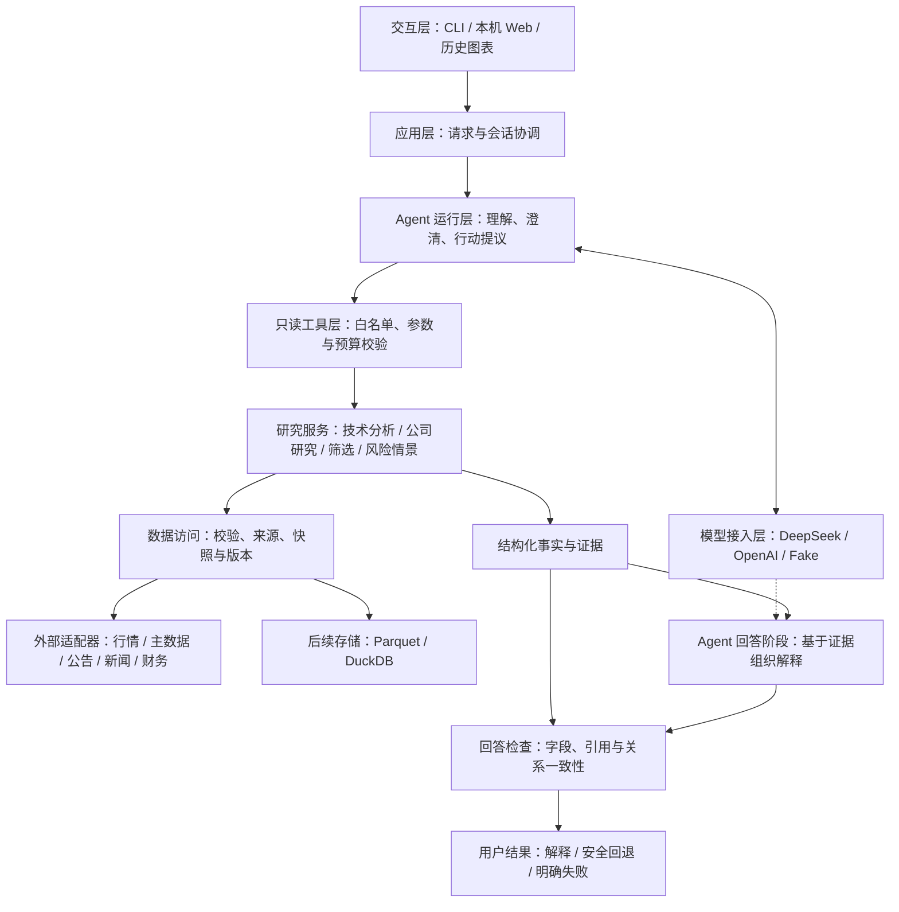

# Trading Companion：总体技术架构设计

## 2026-10-25：当前业务扩展与文件映射

当前正常模式已经增加公司研究链路，沿用模块化单体、原模型协议、日线计算和会话控制。以本表判断现有能力；后文截至2026-10-24的“长期目标/未实现”和旧额度保留为历史阶段记录。完整数据流与取舍见[多维公司研究设计](company-research-design.md)。

运行与验收仅面向 Windows。本机命令使用 PowerShell、`.venv\Scripts\python.exe` 和 `pnpm.cmd`；GitHub Actions使用单一 Windows 任务。下文带日期的测试数量只表示当时结果。

| 架构职责 | 实际模块 | 当前行为 |
| --- | --- | --- |
| 入口与会话 | `api.py`、`api_service.py`、`research_session.py` | 一般知识、原技术循环和公司研究分流；共享幂等、取消与会话隔离 |
| 研究计划 | `product_plan.py`、`product_agent.py` | 一次意图提取，程序核名/核日，必要澄清，最多三只明确候选 |
| 领域资料 | `company_research_contracts.py`、`company_research.py`、`company_news_sina.py` | 公司背景、财务、新闻和公告分别校验与返回；固定端点，无静默换源 |
| 技术证据整合 | `product_research.py`、`multi_analysis.py`、`research_synthesis.py` | 复用同轮日线、数值事实与程序关系，限制送入模型的上下文 |
| 比较与风险计算 | `comparison_research.py`、`risk_research.py` | 同报告期财务指标排序、ATR假设情景；保留输入依赖与失败状态 |
| 回答与展示 | `product_answer.py`、`frontend/src/ProductResearch.tsx` | 模型回答原问题，检查引用/数字/公司归属，主回复与资料分层 |
| 模型适配与注册 | `deepseek_tool_model.py`、`openai_tool_model.py`、`model_registry.py`、`local_env.py` | DeepSeek/OpenAI服务端预配置，健康接口仅公布可用名称，会话内固定选择 |
| 本地证据存储 | `snapshot_store.py` | 显式SQLite归档、内容摘要与时间边界查询；不保存原问题、聊天或模型回答 |

借鉴 [TradingAgents](https://github.com/TauricResearch/TradingAgents) 的领域拆分和结果综合，以及 [TradingAgents-CN](https://github.com/hsliuping/TradingAgents-CN/tree/v3.0) 的中文市场适配思路；自行实现数据契约，没有搬入整套角色、依赖或混合许可的应用代码。当前没有新增产品多 Agent 团队或 LangGraph 依赖。

公司资料、候选比较和风险情景已有受限实现；全市场筛选、严格 PIT/历史修订、新闻公告全文理解、策略回测、Jev、美股及生产账户仍未完成。引用有效不证明任意自然语言语义；离线回归与真实回答质量验收分开。

以下为总体目标与此前渐进实施记录。

版本：v0.1

2026-10-24研究循环增量：Web/API和真实终端从固定一次工具调用升级为受控的单股票研究循环。模型可逐步选择日线分析、指标知识、快照检查及同一份行情上的补充指标计算；执行器验证权限，主报告/图表保持不变，补充证据独立核对，研究过程折叠展示。每轮最多6次模型（含意图提取）/6次工具/2次计算，保留协作截止、取消、上下文边界及旧入口。见[有界研究工作流设计](bounded-research-workflow-design.md)。新闻、财报和交易权限不在本增量内。

2026-10-24答复层增量：自然研究将原问题传到最终模型阶段，复用工具结果生成“回答、条件性方向、观察条件”；关系论断仍由程序检查，模型正文不冒充程序事实。网页使用 `conversation` 主回复，报告留在附件；数据不足/人工模式采用简短应用答复。详见[自然语言答复设计](natural-research-response-design.md)，本增量不增加工具、模型调用数或交易权限。

日期：2026-10-20（America/Los_Angeles）

增量更新：2026-10-22，整轮运行控制、本机FastAPI、同源React/TypeScript、统一验收/CI、历史K线/指标、本地证券背景，以及跨指标综合、会话收口、显式选源和MVP重复评估。

状态：目标架构与渐进实施方案；不是已完成功能清单。

阅读对象：项目开发者、协作者，以及希望理解项目技术取舍的读者。

## 1. 文档定位

本项目采用**模块化单体后端、受控的单个研究 Agent、确定性研究工具，以及可追溯的数据与证据**。

“模块化单体”是指先在一个 Python 项目中划分清楚职责，通过进程内接口组合能力，不提前拆成独立部署的微服务。这样更适合个人项目，也方便逐步学习、测试和定位问题。

本文回答“系统如何组织、模块如何协作、现有代码如何演进”。产品范围与验收依据见 [产品 Agent PRD](prd-agent-v0.1.md)；运行方法见 [README](../README.md)；概念和面试问答见 [学习笔记](agent-learning-notes.md)。本文不扩大当前 PRD 的交付范围，也不要求立即按目标目录重构。

标记约定：

- **已有**：能够在当前源码中找到的能力。
- **本期计划**：首个单股票、多指标日线 Agent 所需能力。
- **长期目标**：基本面、新闻、选股、历史版本、风险情景及 Web 等后续能力。
- **实验候选**：需要独立验证，不能作为已实现或必需依赖描述的能力。

## 2. 产品目标与不可突破的边界

长期产品面向 A 股个人投资者，支持知识解释、技术分析、公司研究、候选股票筛选，以及有明确假设的止盈止损情景研究。后续再扩展美股。

首个产品 Agent 聚焦中文单股票、多指标、已完成日线研究；新闻、选股、数值化止盈止损和收益评估不属于本期。

长期保持以下边界：

1. 所有实际交易由人完成；不接入券商账户，不创建下单、撤单、修改订单或资金管理通道。
2. 指标、比较关系和可计算的研究结果由程序产生；模型负责理解请求、提议使用允许的工具和解释证据。
3. 不以训练股票模式预测模型为前提，也不承诺收益、胜率或走势预测准确率。
4. 支持范围内的科创板、ST 和新上市股票不因类别被主动排除；身份未知或数据不足必须明确说明。
5. 任何输入、模型回答或外部新闻，都不能扩大程序授予的权限。

## 3. 当前实现基线

截至2026-10-22，已有明确格式与模型优先自然语言入口，目录核名、候选澄清、可见默认值、[事实报告](safe-report-design.md)、[受限解读检查](grounded-explanation-design.md)及[薄终端](terminal-agent-design.md)。可选会话支持[股票身份续接](identity-clarification-design.md)、[明确指标替换](indicator-edit-design.md)、[结果快照/追问/知识](result-followup-design.md)与[明确条件修改](condition-update-design.md)。最新增加[整轮运行控制](turn-control-design.md)：共享90秒协作截止、模型/分析额度、已观察token停止阈值、取消信号及迟到结果隔离。新增43项、全量856项离线通过；独立进程演示及四场景离线评估通过，没有新增真实模型或行情调用。

[真实目录刷新](security-directory-refresh-design.md)已独立实测5,224条身份；[四场景契约评估](agent-evaluation-design.md)仅有用户回传一次 `complete` 真实模型通过，其余真实重复质量评估仍待做。本轮已实现有限的相对日期/历史刷新、模糊窗口短答续接及启动固定来源；不接受对话内切源。自由复合修改、开放问答及任意自由文本语义检查不作为本次MVP前置。现有预算不等于硬中断、计费上限或账户配额，代码完成不等于真实验收完成。

最新[MVP代码交付](mvp-completion.md)补上[程序跨指标综合](research-synthesis-design.md)、[会话澄清/日期收口](mvp-conversation-design.md)、[产品显式选源](source-selection-design.md)及30场景×3评估。Windows离线Python1172项、前端269项通过；原Agent 4/4、新MVP 90/90、API 8/8及类型/构建/ASGI/wheel通过。没有新增真实模型/行情请求；新增浏览器验收仍受当前工具访问策略限制。

接口增量：[本机API](local-api-design.md)已把原Agent接入FastAPI，提供令牌隔离、幂等消息、历史/重置/删除、按请求取消及白名单响应。新增50项、当时全量906项离线通过，进程内8项检查与实际loopback TCP演示通过；不新增真实模型/行情请求。上段856项为运行控制模块完成时的记录。

交互增量：[本机Web工作台](web-workspace-design.md)已复用该API，提供React/TypeScript对话、事实与证据、澄清填入、会话操作、协作取消和未确认请求的原编号恢复。前端43项测试通过；新增11项路由检查，当时Python全量917项通过。构建资源与API同源提供，未放宽跨域或扩大研究权限；桌面/手机真实浏览器离线演示通过。

2026-10-22工程验收记录：[统一离线验收与CI](ci-design.md)在Windows全新虚拟环境通过Python946项、前端43项、Agent 4/4及API 8/8；新增29项验收器测试，检查零跳过、实际构建的同源资源及干净wheel。当前GitHub Actions只运行Windows任务，不注入模型密钥或部署；远端状态按对应提交的运行记录，不以历史本机结果替代。

| 模块 | 已有代码 | 实际能力与边界 |
| --- | --- | --- |
| 行情数据模型 | [daily_bar.py](../src/trading_companion/daily_bar.py) | 校验价格、成交量等 OHLCV 字段；证券状态在独立背景契约中表达，不污染价格模型 |
| 数据源接口 | [data_source.py](../src/trading_companion/data_source.py)、[csv_loader.py](../src/trading_companion/csv_loader.py) | `DailyBarSource` 统一日线读取；CSV 样例是人工数据 |
| 在线数据源 | [tencent_adapter.py](../src/trading_companion/tencent_adapter.py)、[akshare_adapter.py](../src/trading_companion/akshare_adapter.py) | 腾讯直接 JSON 接入，以及通过 AKShare 访问东方财富；来源显式选择，无自动切换 |
| 日期与指标 | [history.py](../src/trading_companion/history.py)、[indicators.py](../src/trading_companion/indicators.py) | 日期过滤、SMA、独立 EMA/MACD/RSI/BOLL/ATR/量能与日期结果点；见[剩余指标设计](indicators-design.md) |
| 分析服务 | [analysis.py](../src/trading_companion/analysis.py)、[multi_analysis.py](../src/trading_companion/multi_analysis.py)、[multi_contracts.py](../src/trading_companion/multi_contracts.py) | 旧单 SMA 接口保持兼容；独立多指标服务一次取数，返回逐字段状态、初始化元数据、关系和事实标识 |
| 模型接入 | [model.py](../src/trading_companion/model.py)、[deepseek_model.py](../src/trading_companion/deepseek_model.py)、[tool_model.py](../src/trading_companion/tool_model.py)、[deepseek_tool_model.py](../src/trading_companion/deepseek_tool_model.py) | 原纯文本接口继续兼容；工具消息契约、Fake与DeepSeek工具适配已有；开发者已反馈一次真实工具/人工CSV往返 |
| 只读工具执行 | [research_tool.py](../src/trading_companion/research_tool.py)、[research_tool_demo.py](../src/trading_companion/research_tool_demo.py) | 单个白名单日线工具、严格业务校验、每轮一次分析、紧凑证据视图；独立于编排层 |
| 受控研究编排 | [agent_input.py](../src/trading_companion/agent_input.py)、[agent.py](../src/trading_companion/agent.py) | 明确格式入口与自然语言初始请求共用执行流程，分别最多两次/三次模型调用，都最多一次分析；可选身份续接、结构化关系检查及默认安全展示 |
| 整轮运行控制 | [turn_control.py](../src/trading_companion/turn_control.py)、[turn_control_demo.py](../src/trading_companion/turn_control_demo.py) | 共享单调截止、调用/分析次数、已观察token阈值、线程安全取消、会话暂存发布与迟到拒绝；同步协作检查，不是硬中断/费用保证 |
| 请求理解与名称目录 | [research_intent.py](../src/trading_companion/research_intent.py)、[security_directory.py](../src/trading_companion/security_directory.py) | 模型候选原文检查、快照身份匹配、歧义阻断及日期/指标默认值；目录来源不证明历史状态或行情支持范围 |
| 股票澄清会话 | [research_session.py](../src/trading_companion/research_session.py) | 每会话一个待选请求，保留已校验日期/指标；15分钟有效期、取消、当前目录重查、执行前消费及进程内并发保护；不是完整聊天记忆 |
| 明确指标修改 | [research_edit.py](../src/trading_companion/research_edit.py)、[research_session.py](../src/trading_companion/research_session.py)、[agent.py](../src/trading_companion/agent.py) | 独立条件基准、整句校验、唯一实例替换及新请求重算；事实通过才记录，执行失败不恢复旧修改基准 |
| 明确条件修改 | [research_update.py](../src/trading_companion/research_update.py)、[condition_update_demo.py](../src/trading_companion/condition_update_demo.py) | 单维度换股票/ISO日期/添加或删除一个指标；当前身份及原条件重查，未知或歧义股票续接pending，执行复用原链路 |
| 保存结果与追问 | [research_memory.py](../src/trading_companion/research_memory.py)、[research_followup.py](../src/trading_companion/research_followup.py) | 一份15分钟快照、深复制隔离、current/history分开；追问最多一次模型仅选类型/指标，程序显示字段和重新核对的关系，不重新取数 |
| 有限指标知识 | [indicator_knowledge.py](../src/trading_companion/indicator_knowledge.py) | 项目维护七类及MACD子项定义，完整有限句式0模型/0行情；不是开放知识库或RAG |
| 独立目录刷新 | [exchange_directory.py](../src/trading_companion/exchange_directory.py)、[security_directory_refresh.py](../src/trading_companion/security_directory_refresh.py) | 显式联网读取沪深列表，必要分片校验后原子保存；失败不更新旧文件及时间，不证明全市场完整性 |
| 运行入口 | [__main__.py](../src/trading_companion/__main__.py)、[model_cli.py](../src/trading_companion/model_cli.py)、[tool_smoke.py](../src/trading_companion/tool_smoke.py)、[agent_demo.py](../src/trading_companion/agent_demo.py)、[natural_agent_demo.py](../src/trading_companion/natural_agent_demo.py)、[session_agent_demo.py](../src/trading_companion/session_agent_demo.py) | 旧CLI与固定工具验证保持兼容，保留单轮及身份澄清离线演示；新增交互入口见下一行 |
| 终端交互与开发夹具 | [agent_cli.py](../src/trading_companion/agent_cli.py)、[development_fixtures.py](../src/trading_companion/development_fixtures.py)、[followup_demo.py](../src/trading_companion/followup_demo.py) | 显式DeepSeek及人工/腾讯数据，默认仅帮助；单会话、目录重读、安全展示、局部额度及`/last`；有连续离线演示，固定夹具与评估入口共享预检 |
| 本机HTTP接口 | [api_service.py](../src/trading_companion/api_service.py)、[api.py](../src/trading_companion/api.py)、[api_server.py](../src/trading_companion/api_server.py) | 单进程FastAPI/Pydantic边界、每会话Bearer令牌、有限内存/工作、消息幂等、协作取消和安全投影；默认离线，非生产鉴权/部署 |
| 本机Web工作台 | [frontend/](../frontend/)、[web_ui.py](../src/trading_companion/web_ui.py) | React/TypeScript同源构建、内存会话、有限页面记录、证据字段、澄清与原编号恢复；无客户端密钥、用户账户或公网部署 |
| 历史K线与指标 | [chart_projection.py](../src/trading_companion/chart_projection.py)、[ResearchChart.tsx](../frontend/src/ResearchChart.tsx)、[charts.ts](../frontend/src/charts.ts) | 同一次研究结果的有界投影与SVG，缺失断线、分单位轴、保存快照与失败隔离；不取新行情、不新增模型调用，不等于全历史证据认证 |
| 证券状态／交易日历背景 | [market_context.py](../src/trading_companion/market_context.py)、[MarketContext.tsx](../frontend/src/MarketContext.tsx)、[背景设计](market-context-design.md) | 独立本地快照、有效期／发布时间、未知、自然日年龄、日历对照与来源冲突；原研究ID冻结，失败降级；不发送模型、不猜测、不执行规则，不证明PIT |
| 自动化验收与CI | [verify.py](../scripts/verify.py)、[ci.yml](../.github/workflows/ci.yml) | Windows本地与Actions共用；严格零跳过、Agent/API离线契约、真实构建的ASGI/干净wheel检查；单一Windows任务，无模型密钥及部署 |
| 安全事实展示 | [research_report.py](../src/trading_companion/research_report.py)、[report_demo.py](../src/trading_companion/report_demo.py) | 本轮请求/证据绑定，程序生成最新字段与缺项摘要；模型草稿仅供调试，不代表自由文本检查已完成 |
| 受限关系解读 | [relation_explanation.py](../src/trading_companion/relation_explanation.py)、[explanation_demo.py](../src/trading_companion/explanation_demo.py) | 模型仅提交有界JSON论断；核对本轮证据、依赖及原精度关系后程序渲染，整段失败则回退；不检查任意文字或预测 |
| 固定场景评估 | [agent_evaluation.py](../src/trading_companion/agent_evaluation.py) | 默认人工数据/假模型；显式选择DeepSeek；独立预期与调用计数、夹具校验、失败停止及JSON报告，不是产品对话入口 |
| 跨指标综合 | [research_synthesis.py](../src/trading_companion/research_synthesis.py) | 最新/紧邻前一数值证据重查，四维度、相容/分歧/未知及条件观察；程序生成，不额外调用模型或行情，不投票或预测 |
| MVP重复评估 | [mvp_evaluation.py](../src/trading_companion/mvp_evaluation.py)、[mvp_evaluation_cases.py](../src/trading_companion/mvp_evaluation_cases.py) | 30场景、最多3次独立重复；解释和综合均核对，调用额度读配置前检查，首错停止，真实效果须另行人工验收 |
| 验证 | [tests/](../tests/)、[前端测试](../frontend/tests/) | 2026-10-22 Windows本地记录为Python1172项、前端269项零跳过通过，Agent 4/4、MVP 90/90、API 8/8；当前远端Windows验收看对应Actions，不等于真实模型质量验收 |

当前已有本机FastAPI、最小Web、历史K线/指标及独立本地证券状态／日历背景展示。真实主数据／日历适配器尚无；默认是明确人工夹具。也尚无生产多用户部署、DuckDB持久化、Jev、新闻/基本面、筛选、完整证据台账或严格point-in-time系统。

## 4. 总体架构

下图为目标模块关系，不表示全部模块已经存在。实线表示主要调用或结果流向，虚线表示模型生成依赖；取数结果会沿服务调用返回。



权限、超时、日志和测试贯穿各层。图中没有交易执行模块，也不预留可由模型激活的交易能力。

### 4.1 依赖规则

- 领域数据结构和指标计算不依赖模型、HTTP、界面或数据库。
- 研究服务依赖统一数据源接口，不到处硬编码某个供应商请求。
- 数据与模型适配器把外部协议转换为内部契约；适配器依赖契约，而不是让业务依赖供应商格式。
- Agent 只通过已注册的工具契约提出研究请求，不能绕过工具层直接调用适配器、数据库或终端。
- CLI 和未来 HTTP 入口调用相同的应用能力，不各自实现一套研究逻辑。
- 对象构建和供应商选择集中在应用装配处；不让模型动态导入模块或生成任意调用目标。

## 5. 模块职责

### 5.1 交互层与应用层

交互层负责接收输入和展示结果。第一版采用终端对话；现已补React/TypeScript本机工作台，展示对话、指标字段、查询条件和证据，以及[历史K线/指标](chart-workspace-design.md)。图表直接投影本次研究数据，不重新取数，历史必须绑定已核实快照；图表失败不影响文字。页面状态机和HTTP客户端独立于React渲染，不复制Agent；前端构建后由原FastAPI同源提供，运行时不另启Node服务。TypeScript之外仍检查HTTP结果结构及请求编号，未确认响应保留原问题/编号，不自动重试或放行新研究。

应用层协调会话、每轮请求、配置和返回结果。当前已有本机FastAPI/Pydantic入口：路由负责DTO和协议，框架无关的 `ResearchApiService`负责会话、配额和幂等，复用原Agent；计算函数不依赖FastAPI，也不全面替换内部dataclass。公共响应白名单投影，不使用包含模型草稿的调试导出。

前端不直接调用模型供应商，也不接触服务端API密钥。当前用随机会话Bearer凭据隔离资源、限制Host/Origin及本机访问，不是账户体系；以后开放多用户访问前，必须先补用户身份、TLS、账户配额和共享会话等。现有同步HTTP路由在线程池运行，取消路由只发信号；不把同步模型请求放入事件循环阻塞其他请求。

### 5.2 Agent 运行层

Agent 负责区分知识问答、行情研究、已有结果追问和超范围请求；提取参数、发起澄清、提议工具调用，并解释有效证据。

首版采用显式状态机：

```text
理解请求 → 澄清或校验 → 执行允许工具 → 整理事实 → 解释 → 检查 → 展示
```

知识问题可以跳过行情工具；已有结果追问只有在条件和证据仍匹配时才能复用。状态机限制允许的转移，模型不能自行添加无限循环或重试。

应用层管理会话生命周期；Agent 管理当前轮的理解、待澄清参数和执行阶段。已确认条件、待确认候选及上次结果分开保存。新条件查询失败后，不能把旧结果当作新结果展示。

首次实现只保留内存会话，不默认保存完整原始对话。开发协作中使用的子 Agent，不等于产品运行时需要多 Agent。

2026-10-22后续增量：[明确条件修改](condition-update-design.md)复用现有会话和执行器；局部修改由程序完整解析、合并并重查领域契约，不新增一次意图模型调用。换股票仍查目录，有歧义先选定；修改和指标替换共享 `_checked_edit_base()`，防止时效、来源和身份检查分叉。以下2026-10-21段落为上一阶段记录；自由复合修改和任意语义检查仍未完成。

实施更新（截至2026-10-21）：先实现[明确格式单轮入口](single-turn-agent-design.md)，缺项零模型/行情调用；随后增加[自然语言入口](natural-input-design.md)，由模型提取原文候选、程序核实目录身份及条件。有歧义时零行情分析，可见默认值不覆盖用户显式要求。[真实目录刷新](security-directory-refresh-design.md) 已独立实测，离线演示仍保留人工夹具。可选[股票澄清会话](identity-clarification-design.md)保存非股票条件，短答选定身份后重查当前目录、来源及契约，沿用原具体日期；执行前消费待选状态。[程序事实摘要](safe-report-design.md)及[受限关系检查](grounded-explanation-design.md)由程序核对本轮证据和数值关系后生成中文；不合格则仅展示事实，不重试。后续增加明确指标替换、独立成功结果快照及有限追问：模型只选回答类型/指标，程序读保存字段并复查关系；知识定义走本地有限语法。通用条件修改、开放知识问答及任意自由文本语义检查未实现；各有限检查不改变 `answer_validation=not_performed` 的含义。

### 5.3 模型接入层

业务使用统一接口，供应商适配器负责消息转换、能力差异、响应解析与错误分类。DeepSeek 为首个真实提供方，Fake 支持离线验证，OpenAI 后续接入。

原 `TextModel.complete()` 及消息校验继续只支持纯文本。M2首切口新增独立 `ToolCapableModel`、工具定义/调用/结果/状态契约及脚本Fake，见[工具模型设计](tool-model-design.md)；旧演示只验证固定结果消息往返。随后新增的白名单执行器已通过独立入口连接研究服务，见下节。2026-10-19新增独立 `DeepSeekToolModel`，见[工具适配设计](deepseek-tool-model-design.md)；与文本接口共享HTTP传输，均显式关闭thinking，避免在没有推理历史契约时启用思考工具调用。2026-10-20记录开发者一次真实 `deepseek-flash` 工具往返成功，使用人工CSV，不能外推为所有型号或完整Agent质量已验收。原文本CLI保持兼容。

兼容 OpenAI 风格接口不等于行为完全一致；切换提供方时必须验证消息、结构化输出、工具调用、截断和错误处理。用户显式选择提供方，不静默把对话发送给另一家服务。这里的 OpenAI 指模型 API，不是自动操作 ChatGPT 网页。

### 5.4 只读工具层

工具层是模型与程序能力之间的边界。模型提出请求不等于获得执行授权。

首版只开放一个多指标日线分析工具，一次获取选定历史序列后集中计算所需指标；跨年分片仍可能产生多次 HTTP 请求，不能把一次工具执行误认为一次网络请求。

工具层负责名称白名单、结构与业务参数校验、调用预算以及统一错误返回。不接受任意函数名、Python 对象、SQL、磁盘路径、终端命令或网络 URL。CSV 仅由开发者配置固定测试样例，不能让模型选文件。

2026-10-16已实现上述日线执行切口，详见[受控工具设计](research-tool-design.md)：`ResearchToolExecutor`按回合实例持有一次分析额度，多调用批次整体拒绝；完整研究结果保留本地，模型接收带请求内证据别名的紧凑结果。容量与历史校验失败明确返回，不截断证据、不自动重取数。随后通过模拟HTTP和开发者真实工具固定任务记录验证了连接；执行器本身不负责自然语言路由或全轮时限。单轮runner只创建一个执行器，并额外检查提议是否仍属于本轮已识别请求。

未来按需增加公司资料、公告检索、候选筛选和风险情景工具，不为每个指标单独暴露一次取数工具。

### 5.5 研究服务层

研究服务实现可脱离大模型运行的业务能力：

| 服务 | 职责 | 阶段 |
| --- | --- | --- |
| 技术分析 | 指标计算、日期对齐、逐字段可用性与交叉等确定性关系 | 首个 Agent 的核心；部分基础已有 |
| 公司研究 | 整理基本面、公告、新闻事件及其来源与时间 | 长期目标 |
| 股票筛选 | 对有版本的股票池执行确定性条件，返回候选、筛选理由和缺项 | 长期目标 |
| 风险情景 | 按明确方法计算参考水平，展示假设、适用条件和失效条件 | 长期目标；不执行交易 |

筛选首先保证股票池、数据时间和规则可复现，再由模型解释候选。模型不能凭记忆补齐缺失财务数字，也不能在没有方法与输入的情况下编目标价或上涨概率。

### 5.6 数据与证据层

数据层统一外部来源、数值单位、时间、复权口径和版本。本地[证券状态／交易日历背景契约](market-context-design.md)已有，按有效区间与发布时间保留unknown，并与原bars作非破坏性冲突提示。真实master/calendar接入、完整历史ST/上市/停复牌版本及公司行动仍待实现；当前背景不进入模型或筛选，不将today快照冒充历史已知事实。

证据模块把结果整理成可定位的事实。事实卡片由程序渲染；模型引用事实标识解释，不改写事实数字。未来新闻与公告引用还需定位原文、文档版本和支持结论的具体片段。

回答检查不仅验证“引用存在”，还要检查日期、单位、数值与方向关系。引用有效但把“低于”写成“高于”同样不合格。自由文本的全部语义无法仅靠字段校验保证，仍需人工评估和限制可表达的结论。

当前已实现事实卡片的最小版本：`research_report.py` 检查本轮请求ID、股票、区间、指标、字段及其数值/单位/日期证据，生成固定中文摘要。`ResearchToolExecutor` 可接收可信应用传入的请求ID，与编排及事实关联；模型不能设置ID。报告不解读或验证自由文本，也不生成趋势关系，草稿仍保留在调试字段。详见[安全展示设计](safe-report-design.md)。

随后新增 `relation_explanation.py`：模型只能选择本轮可用关系，不能提交任意句子或目标价。程序检查引用、当前/前一记录、单位与依赖顺序，并从现有原精度数值核对关系；全段通过才渲染固定中文。`display_answer` 合并事实及通过的关系，否则回退；`safe_answer` 仍独立保留。支持七类指标与精确命名均线对，不包含跨指标冲突解释或预测质量验收，见[受限解读设计](grounded-explanation-design.md)。

## 6. 关键数据契约

下表列出各阶段契约需要表达的内容。M1b已新增 `IndicatorSpec`、`MultiIndicatorRequest`、`MultiIndicatorResult` 及字段、组件、关系和事实契约，详见[多指标设计](multi-indicator-design.md)；最小股票澄清状态、事实报告及 `indicator-explanation-v1` 受限关系候选已独立实现。通用会话、自由文本解释和历史版本等契约仍待后续实现。

| 契约 | 必须表达的内容 |
| --- | --- |
| 研究请求 | 请求编号、股票、日期区间、指标及参数、显式数据源、已采用默认值 |
| 数据快照 | 股票、覆盖区间、来源、复权与单位口径、获取时间；后续增加版本和历史可得性依据 |
| 指标结果 | 指标实例与参数、算法版本、计算起点、初始化方式、字段值、值对应日期及可用性 |
| 结构化事实 | 事实标识、数值或关系、单位、日期、支持它的结果字段及适用限制 |
| 解释候选 | 引用的事实标识、允许的关系与解释类型，以及不确定性；不获得新的执行权限 |
| 本轮结果 | 查询条件、整体数据状态、逐项结果、解释或回退内容、警告与脱敏诊断标识 |

可用性需区分“可用、历史不足、未定义、计算错误”，不能统统变成 `null` 后不解释原因。合法的 0 和不可用值不同。

MACD 的 DIF、DEA 和柱值可以在不同记录数下就绪。部分指标可用时只解释有效部分，不静默用旧日期字段补当前缺值，也不让模型补算。

旧版 `AnalysisResult` 的状态仍表达单 SMA 结果；多指标契约需要独立演进，不能把旧接口中 `ok` 的含义悄悄改成另一种语义。现有 `analyze_daily_bars()` 与 CLI 保持回归兼容。

## 7. 一次日线分析的数据流

以“分析 000001.SZ 截至 2025-09-05 的趋势和动量”为例，目标流程如下：

1. 应用创建本轮请求，提供明确日期锚点，并读取当前会话的已确认条件。
2. Agent 识别意图和候选参数；有歧义时追问，本轮不查询行情。
3. 程序合并条件、应用允许的默认值，校验股票、日期、指标、来源和预算。
4. 工具调用研究服务，由选定适配器读取日线；校验字段、单位、顺序和日期范围。
5. 同一份日线集中计算请求的指标，产生逐字段状态、初始化信息和确定性关系。
6. 证据模块生成事实标识。给模型的是必要字段、关系和缺项说明，而不是全部历史序列。
   程序综合独立重查它实际使用的最新/紧邻前一数值，生成四维度参考比较，不采用任意模型文本；默认回答和历史概览复用它。停止不生成综合，取消不展示本轮结果。
7. Agent 组织解释；程序核对引用与允许关系，不合格时按剩余预算修正，或回退为事实摘要。
8. 展示查询条件、实际最新交易日、事实、解释和限制；保存本轮匹配的确认条件与结果。

源失败、无数据或行情无效时，不调用模型生成走势判断。行情成功而模型失败时，可以保留可信事实，但必须明确没有完成模型解释。

## 8. 历史数据、存储与 point-in-time

### 8.1 时间不是一个字段

长期数据设计至少需要区分：

| 时间信息 | 含义 |
| --- | --- |
| `trade_date` 或业务所属期 | 行情发生日、财报所属期等，不等于公开日期 |
| `published_at` | 来源宣称的发布时间；本身仍需验证，不能证明当前版本当时已存在 |
| `retrieved_at` | 本系统实际读取时间，不代表历史用户当时可得 |
| 状态有效区间 | 某次 ST、停牌等状态从何时生效到何时结束 |
| 版本与可得性依据 | 具体内容版本、修订记录，以及什么证据支持它在截止时点已可得 |

日期过滤只限制业务日期，不能排除后续修订。财务数据、公告与风险标签需要保留历史版本；历史股票池还需包含当时存在、后来退市的股票，避免只看今天仍存续的样本。

仅在今天抓到一个标为过去发布时间的文档，不能据此声称已经还原当时内容。缺乏可验证版本时，明确标注局限，而不是倒填一个历史可得时间。

### 8.2 存储演进

后续优先考虑 Parquet 保存经许可的快照，DuckDB 执行本地结构化研究查询；使用数据源、股票、区间、口径和版本等条件定位数据。算法与计算起点也必须参与结果缓存标识，避免错用旧结果。

DuckDB 并不是 point-in-time 正确性的保证；保证来自时间契约、版本保存、查询规则和测试。公开接口可访问，也不代表允许任意缓存、商用或再分发，接入前需核对条款。

首版仍使用现有不复权日线。公司行动会影响指标，不能把价格跳变自动解释为交易趋势；以后引入复权，也要固定算法与数据版本，不静默替换口径。

### 8.3 模型自身的历史信息风险

即使工具数据已经按时点隔离，预训练模型仍可能记得之后发生的事件。历史研究只允许解释输入证据，并通过诱导后续信息的评估检查越界行为。

这能降低风险，但不能证明自由文本绝对没有历史信息污染。数据回放正确性、模型解释质量和交易策略表现是三类不同验证，不能相互代替。

## 9. Jev 的可选位置

Jev 是后续分类或路由任务的实验候选，不是第一版依赖。本文不重新核验其版本、许可、部署条件或承诺具体模型能力。

未来有新闻/公告后，可针对事件分类、相关性判断或进一步研究路由建立固定任务。先与简单规则、主模型比较准确性、覆盖率、延迟和成本，再决定是否接入。

接入应通过独立分类接口完成，主研究链路不依赖 Jev 专有输出。失败时执行事先定义、可见的回退；升级到付费模型也必须受用户配置、数据发送范围与预算约束。

Jev 不替代数值计算、权限校验、历史时点过滤或引用检查。不把全部输入强制先过一次 Jev，也不把所谓分类置信度当作交易胜率。

## 10. 安全、运行预算与诊断

### 10.1 安全边界

- 只注册研究工具；不注册交易、任意 SQL、任意文件或通用代码执行能力。
- 外部资料是数据，不是指令。新闻中的“忽略限制”等文本不能影响系统权限。
- 密钥由本地环境配置提供，不进入提示词、Git、前端、日志或错误信息。环境变量不是加密保险箱。
- 启用真实模型前说明哪些问题、会话与证据会发送到哪个提供方；测试默认使用假模型，不自动产生付费调用。
- 日志默认不保存原始完整对话；不同会话的状态和结果隔离。

### 10.2 预算与失败行为

当前产品Agent入口已接入[共享运行控制](turn-control-design.md)，以下区分实际同步限制与尚未实现的硬中断/费用保证。

当前明确格式runner最多两次模型调用，自然语言初始请求最多三次（多一次候选理解）；两者都最多一次分析、无自动修正。股票澄清首轮最多一次模型、零分析；成功短答续接不重复理解，最多两次模型、一次分析；无效短答、取消和过期均零调用。上述路径共用单轮计数、90秒单调协作期限及24,000已观察token阈值；不能把底层HTTPtimeout或协作检查写成硬期限。

终端层另外限制一次启动最多5条问题、15次模型转发，调用前消耗额度，重置状态不补额度；最多5次分析来自每轮执行器与输入上限的组合。启动级限制与每轮控制器独立，并不构成跨启动的账户配额或费用保证。中断时尚未返回一轮的分析次数标为未确认，不能静默记零；详见[终端设计](terminal-agent-design.md)。

| 范围 | 实际约束 |
| --- | --- |
| 研究范围 | 每次 1 只股票、最多 12 个指标实例、含首尾最多 366 个自然日 |
| 工具 | 每轮最多执行 1 次日线分析工具 |
| 模型 | 理解、提议、解释共用最多3次；明确格式流程最多2次，没有自动修正 |
| 截止时间 | 模型连接/读取timeout默认30秒并取剩余时间较小值；每轮90秒协作检查，不是硬中断 |
| token | 已观察累计达到24,000停止，缺失/不一致usage另标记，不是完整账单或预调用保额 |

底层HTTP连接/读取timeout不等于应用层总截止时间。当前已在阶段及I/O边界检查截止/取消，迟到结果不继续调度或写入新会话状态；同步请求仍可能晚于90秒返回。新状态暂存后在取消锁内发布，旧基准消费及显式重置立即生效。供应商或SDK自动重试默认关闭；若后续启用，每次真实请求仍须计入同一预算。

| 异常 | 目标行为 |
| --- | --- |
| 参数不明确或非法 | 追问或在联网前拒绝，不擅自改条件 |
| 源失败或无效行情 | 返回明确原因，不编行情，不静默换源 |
| 数据合法但部分指标不足 | 展示有效部分及缺项；不伪装完整成功 |
| 模型超时、截断或错误引用 | 明确失败或回退到可信事实，不把残缺解释当成功 |
| 越权工具、反复调用或总预算耗尽 | 程序阻断并结束当前轮 |

### 10.3 可观测性

记录请求编号、阶段、模型与提示词版本、数据源与快照标识、算法版本、调用次数、耗时及脱敏错误。token 用量未知时保留未知，费用仅在有对应计价规则时估算。

先采用结构化日志；确实需要跨进程追踪时再评估 OpenTelemetry 等组件，不为展示技术栈提前增加部署依赖。

## 11. 测试、评估与发布

| 验证层 | 主要检查 |
| --- | --- |
| 计算单元测试 | 已知样本、独立参考、初始化、零值、边界、日期对齐、未来数据不影响过去计算 |
| 契约与适配器测试 | 单位、来源、响应格式、请求限制、错误分类与供应商差异 |
| Agent 离线集成测试 | 假模型驱动理解、澄清、执行、回退、会话隔离和预算限制 |
| 真实模型评估 | 固定中文场景、重复运行、正确行动、参数理解、事实一致性与过度推断 |
| 后续历史与策略评估 | 先验证版本与时点，再单独设计策略、成交假设、费用及收益/回撤评价 |

真实模型评估记录模型、提示词、数据版本、日期、样本量和失败案例，人工复核语义。被成功拦截的错误、修正与回退应单独统计；不能靠大量回退就宣称产品效果优秀。

当前[固定场景入口](agent-evaluation-design.md)仅实现4项契约检查：完整、部分不足、名称理解与歧义澄清。它复用原Agent，不新增另一条研究链路；最多8次模型调用、3次分析，首错后停止。状态、范围、计数、参考值及有限关系检查有独立预期，正确受限也能通过。真实模式仍使用固定人工数据，以隔离模型问题；主Agent未发真实模型请求，用户已回传一次 `complete` 通过的报告（2次模型/1次分析），其他场景待反馈。这不替代PRD中至少30场景各3次的后续实测，也未评估解释相关性或语言价值。

GitHub Actions使用单一Windows离线任务和PowerShell，本地与远端共用 `scripts/verify.py`，不配置付费模型调用。前端已锁定依赖，Python仍是版本范围；构建/ASGI/wheel检查不等于生产部署或全环境逐字节复现。详情见[CI设计](ci-design.md)。

## 12. 目标目录与渐进迁移

下面是职责成熟后的目标目录，不是现有文件清单，也不是立刻执行的迁移指令。文件夹名不能代替真正的依赖边界。

```text
Trading Companion/
├─ src/trading_companion/
│  ├─ interfaces/       # CLI and HTTP entry points
│  ├─ application/      # Use cases, configuration and session coordination
│  ├─ agent/            # Per-turn state and controlled orchestration
│  ├─ models/           # Model contracts and provider adapters
│  ├─ tools/            # Tool schemas, registry and execution policies
│  ├─ research/         # Technical, company, screening and risk services
│  ├─ domain/           # Shared data structures and business rules
│  ├─ data/             # Providers, validation and repositories
│  ├─ evidence/         # Facts, citations and answer checks
│  └─ observability/    # Sanitized logs and run diagnostics
├─ frontend/            # Future web interface
├─ tests/               # Unit and integration tests
├─ evals/               # Agent behavior cases and evaluation reports
├─ docs/                # PRD, technical designs and learning notes
└─ pyproject.toml
```

迁移原则：先完成当前能力，在模块确实变大或出现第二个实现时拆分；保留导入兼容或同步更新调用方与测试。现有 `analysis.py` 演进为研究服务起点，`indicators.py` 保持纯计算，数据源与模型接口继续作为适配边界。不要只为目录整齐同时搬动全部文件。

## 13. 技术选型与取舍

| 部分 | 建议与理由 | 当前状态 |
| --- | --- | --- |
| 语言与计算 | Python、标准库与可独立验证的函数；不依赖大模型算数 | 已有 |
| 模型接入 | 统一契约加供应商适配器，先 Fake 与 DeepSeek，后 OpenAI | 文本基础、工具契约/Fake与DeepSeek工具适配已有；一次真实工具/人工CSV固定任务反馈成功 |
| Agent 编排 | 先显式阶段与退出分支，便于理解、约束与测试；复杂恢复确有需求后再评估 LangGraph | 两种入口、可选身份续接、受限关系检查与薄终端已有；剩余真实模型评估及通用对话待做 |
| HTTP API | FastAPI/Pydantic外部校验，内部dataclass与Agent复用；单进程、会话凭据及幂等 | 本机版已有，生产部署后置 |
| 数据存储 | Parquet 与 DuckDB 用于单人历史研究；多用户并发写入和账户需求出现后再评估 PostgreSQL | 长期目标 |
| 前端 | React、TypeScript、Vite；原生SVG、同源静态资源，Vitest/React交互测试，不依赖境外CDN | 最小本机工作台及历史图表已有，实时/流式输出后置 |
| 测试与 CI | 延续 unittest、Vitest与固定契约入口，Windows GitHub Actions调用同一验收器 | 严格Windows本地与远端工作流；Python未锁全部依赖，真实重复评估待做 |
| Jev | 独立分类实验，有可复现收益再纳入 | 实验候选 |

初期不引入微服务、Kubernetes、Redis、任务队列、向量数据库或产品多 Agent。出现明确瓶颈后再选组件；文档语义检索确有需求时再讨论 RAG，不把结构化行情数值当作向量检索问题。

## 14. 开发顺序与完成条件

| 阶段 | 交付内容 | 完成条件 |
| --- | --- | --- |
| 当前基础 | 数据模型、适配器、SMA、独立 EMA/MACD、文本模型接口 | 已有代码与对应测试；不称为完整 Agent |
| M1a：补齐指标 | 已新增独立 RSI、BOLL、ATR、量能，保持已有计算口径 | 数值函数与测试已补齐；仍不代表多指标服务或 Agent 完成 |
| M1b：多指标契约 | 独立服务已新增一次取数、逐字段状态、初始化元数据、关系事实和证据标识 | 默认组合与部分可用、证据依赖和旧接口回归；不等于模型工具循环已完成 |
| M2：单轮 Agent | 已有工具契约、执行器、DeepSeek适配、两种入口、目录刷新、事实摘要、受限关系检查及薄终端；一次新契约真实完整场景反馈通过 | 完整单股票问题走通，异常有明确回退；其他实测与语义评估待做，不标整体完成 |
| M3：会话与预算 | 身份/指标澄清、明确修改、相对日期/刷新、快照、有限追问/知识、终端/API/Web及协作控制已有 | 代码和同步契约已离线验证，不代表真实语言质量、硬中断或费用保证 |
| M4：评估与说明 | 原4场景和新30场景×3、逐步预期、诊断与交付说明已有 | 离线通过；真实重复评估、人工复核及增量浏览器验收仍待做 |
| 长期扩展 | 主数据与日历、公司研究、筛选、历史版本与回放、风险情景、Web 和美股 | 每项单独定义数据契约、失败行为与验收；不一次性展开 |

严格历史策略评估必须等对应的股票池、版本与可得性约束足够明确后进行。先补主数据与公司研究来源，再逐步验证筛选和回放，最后研究有依据的风险情景；新增 UI 不改变交易权限边界。

MVP代码收口后，下一步优先进行真实模型重复评估与人工复核、真实历史行情试用及允许访问环境下的浏览器增量验收。真实master/calendar、公司行动和完整历史版本是后续数据能力，不再作为当前日线MVP的代码前置。不得绕过现有浏览器访问策略；不因离线开发或CI通过而将真实质量视为通过，不扩展公网部署或交易权限。

## 15. 文档维护

2026-10-21协作更新：用户要求扩大每个“下一步”的交付范围、不再提互动理解题。后续按完整功能块说明问题、实现与验证，仍补关键取舍和学习笔记，不一次性展开整个目标系统。2026-10-22最新要求：从本机API模块起，每完成一个模块，验证并检查提交内容后commit、push；不为微小修改频繁提交。

- 新能力实现后，同时更新当前状态、运行说明和对应测试，不只修改目标架构。
- 影响权限、数据口径、供应商、状态机或存储的变化，记录原因、替代方案及验证结果。
- PRD 管范围，技术设计管实现，学习笔记解释概念；发现冲突时明确修订，不默默扩大范围。
- 尚未实现的接口、部署方案和实验结果不能作为项目既有成绩。
