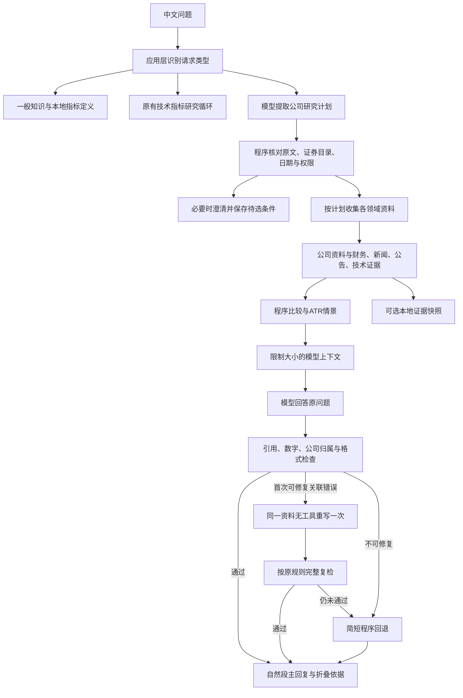

# 多维公司研究：流程、证据与模型切换

更新：2026-10-27。本文描述当前业务扩展；早期单股票日线 PRD 的历史范围仍保留，不再用它推断新增能力尚未接入。技术分析新增ADX/OBV/VWMA、互补指标组合、规则候选、已完成周线与日周核对，详细口径见[技术分析设计](technical-analysis-design.md)；下文带日期的验证记录保留为当时结果。

## 1. 目标与参考

用户直接提出研究问题，例如“分析平安银行的走势，结合财报和新闻说说接下来关注什么”。系统先理解需求，再取得相应资料，由程序计算指标与风险情景，最后让模型用自然语言回答原问题。主回复不再用字段清单代替分析；来源和详细数据作为可展开的依据。

参考两个项目的公开设计：

- [TradingAgents](https://github.com/TauricResearch/TradingAgents)：分开处理市场、财务、新闻等领域，把工具输出交给综合阶段，并限制工具循环。
- [TradingAgents-CN](https://github.com/hsliuping/TradingAgents-CN/tree/v3.0)：中文提问、A 股数据适配、模型配置和面向使用者的研究流程。

本项目保留模块化单体和显式 Python 编排，自行实现领域数据契约与程序检查；没有复制研究员、辩论者、交易员的整套角色，也没有迁移到 LangGraph。这里更需要先解决数据覆盖、回答相关性与会话条件继承。领域拆分是一种职责划分，不要求每个领域都增加一次模型调用。

参考公开架构不等于直接复用代码许可。CN v3.0 包含混合许可，不能把整仓的应用代码及其依赖链视为统一开放许可搬入本项目；具体文件复用需另行核对。本次是独立实现，没有复制这些模块。

## 2. 当前请求流程

一般知识由 `open_knowledge.py` 处理；固定指标定义继续使用零模型快捷路径。具名股票、行情与新闻请求不借知识入口使用模型记忆补数字。保守识别的教学问题不强制加载证券目录，目录过期不会阻止解释 PE/PB。

没有公司研究续接上下文、且明确只研究技术指标时，保留 `research_workflow.py` 的有界工具循环。宽泛的个股分析、基本面、新闻、公告、最多三只明确候选的比较，以及风险情景走 `product_agent.py`；已有公司研究的“只看技术面”可沿用该公司研究路径。两条路径共享原有模型协议、研究计算、会话控制与 HTTP 服务，不是两个独立产品。

## 3. 理解需求与会话边界

`product_plan.py` 请求一次结构化意图，提取原文中的名称、代码、历史日期、未来观察期限和研究领域。模型不根据记忆把名称换成代码：程序确认这些表述确实存在于问题中，再通过证券目录核实身份；名单不能漏股，最多三只，歧义先澄清。

宽泛的分析或方向问题默认收集公司背景、财务、新闻、公告、技术面。明确的领域问题按计划缩小范围。历史数据截止日与“未来一个月怎么看”分别表示数据边界和回答目标，后者不会授权查询未来行情。

公司研究也透传明确指标条件。例如“分析平安银行基本面并结合RSI7”保存 `rsi(window=7)`，而不是回到默认 RSI14；`ProductPlan.indicators` 经校验后传给同一轮日线请求，股票澄清和新领域追问继续保留这组条件。解析先识别并移除指标短语，再处理日期，避免把“20日均线”误当成历史窗口。KDJ、RSI999或无效MACD参数会要求澄清，不静默替换成默认指标。

未提供明确指标时，`technical_selection.py`才按动量、量价、趋势强度或结构波动问题选互补组合；一般问题继续使用原八项默认。ADX、OBV和VWMA可明确请求，也可以由适当组合引入。选择来自应用规则，不能称为模型学习的行情分类；明确参数与否定仍优先，原有ATR风险依赖另按权限处理。

`_positive_scope()` 先处理明确否定，再决定领域与指标。例如“只看新闻，不需要技术指标”不取日线；“只看基本面，不要RSI7”不会因出现RSI这个词就新增技术研究。`只看/仅看`约束与否定领域由程序执行，模型提出的其他领域不能覆盖这些边界。当前是对已定义表达的有界解析，不等于已经理解所有自然语言否定。

待选股票条件和最近研究结果各有独立状态，默认有效期为15分钟。查看已有结果可以不重新取数；需要新领域时开展新研究，同时继承未被显式修改的历史窗口、历史模式和未来观察期限。只有明确“最新/刷新”或新日期窗口才覆盖原时间条件，不能把历史追问悄悄变成当前研究。直接“只看技术面”也可续接原公司，明确否定的领域不再加入计划。会话不是无限聊天记忆，复杂修改和更多自然表述仍需独立验证。

`turn_control.py` 为公司研究保留每轮最多6次模型调用、最多3次日线计算和共享协作期限。当前通常一次意图理解、一次无工具综合；综合遇到允许修复的关联错误时最多再调用一次。上限不是必须用满的步骤数，也不是硬中断或账单上限。内置服务把最多三家公司的非技术资料统一调度，整批最多三个领域任务，进程共用三个在途名额；公司分账与整批请求/字节总账原子更新，不能互借。全部资料先在主线程校验，再按原公司顺序执行技术计算及合并证据，模型和筛选批次保持原执行方式。不透明注入服务仍逐公司调用。

3b把3a原逐公司各默认20秒的来源窗口收紧为整批共享20秒（可信配置最多30秒）；来源缓慢时可能更早显示部分覆盖。截止保留已接纳领域，缺失项记固定超时代码，并在自然回答或兜底中明确哪些证券的哪些资料“未取得”，不增加界面或模型调用。来源超时追踪为stopped，普通故障为failed；整轮取消的未完成来源仍可保留unfinished，迟到结果不发布。详见[并发采集设计、评估指标与离线计时](collection-concurrency-design.md)。

正常服务可用 `.\.venv\Scripts\python.exe -m trading_companion.api_server --collection-workers 1` 逐领域采集，用于同来源真实评估对照或来源限流时回退；参数只接受1、2、3，默认3，只能在启动时配置，聊天和HTTP不能修改。`--demo`及独立Dev Mode继续使用人工夹具。旧的单HTTP客户端注入默认串行，自有并发任务各自创建和关闭客户端；不会共享未经证明可并发的连接会话。

## 4. 数据领域与来源

| 领域 | 当前实现 | 可以支持什么 |
| --- | --- | --- |
| 公司背景 | 东方财富公司资料 | 主营、行业、公司简介、上市日期等当前背景 |
| 财务 | 东方财富财务端点 | 当前响应中截止日可用的最近报告期：收入、归母净利润、同比与加权 ROE |
| 新闻 | 默认新浪个股资讯列表；东方财富可显式配置 | 有界标题或摘要，不能冒充已读取新闻全文 |
| 公告 | 默认东方财富；巨潮可显式配置 | 与证券对应的公告标题和时间；巨潮已核实映射范围为深市 |
| 技术面 | 启动时固定的腾讯或 AKShare/东方财富行情 | 同份日线的指标、已确认极值/价格区域候选、已完成周线与日周核对及计算依赖 |

`company_research_contracts.py` 将 request、section、evidence 分开。证据保存证券、来源、内容类型、发布时间、日期精度、报告期、采集时间与修订限制。`product_research.py` 再次检查请求、标的、领域与时间绑定，统一为 `ProductEvidence`；原始数值与单位单独保留，展示数值可以采用易读精度。

技术派生观察由`technical_insights.py`复用同一冻结日线产生，保留完整原始依赖；映射到`ProductEvidence`时仍为技术领域，用`daily_signal_derived`、`completed_week_derived`与`cross_timeframe_derived`区分时间口径。模型只接收受限的关键观察，前端按对应交易日、周线截至或日周核对日期展示，避免把周证据标成日线日期。

公司资料缺少可靠历史发布时间时，只能作为明确标记的当前背景；历史截面不拿它替代当时的公司事实。财务公告日、报告期和更新日分别判断，不能把采集时间当作历史发布时间。

适配器使用固定端点，拒绝跳转、过大响应、错误 JSONP、缺失证券关联和不合格时间。每个领域分别报告可用、空结果或失败，新闻失败不会丢弃已经取得的财务。不同来源由服务端预先配置，失败后不暗中换源。

新浪入口只读取有限一页；页面标题必须对应公司名和代码，每条保留的标题也要与证券关联。它不是完整新闻库，也没有阅读全文。原有记录中的2026-10-25中际旭创公开源小规模探测，仅说明当次公司资料、财务与公告可用，东方财富新闻 callback 异常被拒绝；不外推为长期稳定性或完整研究质量验收。

## 5. 有界候选比较

`comparison_research.py` 只比较用户已经明确的候选，不从全市场发现股票。对营收同比、归母净利润同比、加权 ROE 分别检查：

1. 每只候选都有唯一、属于本公司的有效数值证据。
2. 指标单位为统一百分数，报告期一致且不晚于研究截止日。
3. 使用原始值排序，缺项不补零、不同报告期不强行排序。

每项按数值降序排列，精确相等使用 `1、1、3` 的并列名次；展示舍入不改变顺序。比较结论保留原证据依赖，供模型解释。三项不合成为“总分”或“最值得买”，也不把高增长、高 ROE 自动等同于更好的投资标的。

## 6. 风险情景计算

`risk_research.build_risk_scenario` 接收已校验的同一份日线分析，以最新历史收盘价为假设做多参考点。默认止损距离为1.5×ATR，目标距离为原风险距离的两倍。

明确请求止盈止损或目标情景才启用该计算，普通方向展望不会自动获得这个权限。计划缺少ATR、且本轮没有明确排除ATR时，程序追加ATR14依赖，记录 `indicator_dependency:atr14_for_risk`，保留原有RSI7等明确指标。继承此前自定义指标的风险追问也会补齐依赖；这只是同次日线分析多计算一个指标，不额外取一份行情。若条件明确排除ATR或已有ATR不可用，不能靠模型编造风险水平。

本轮请求包含 ATR14 时优先使用它；ATR14 不足不能偷换更短周期。没有 ATR14 时，只有唯一明确请求的 ATR 才能形成无歧义情景。不能借用旧点、旧股票或另一轮的事实。

程序使用 Decimal，在0.01元网格上对止损向上、目标向下取整，再重新计算实际每股风险、比例与收益风险比。缺少可用 ATR、价格不合理或证据依赖不一致时返回不可用，不让模型自编目标价。

这描述假设，不读取账户、持仓或真实成本，不提交委托。费用、滑点、跳空与成交限制没有进入公式；它不能充当完整交易策略或保证止损成交。

## 7. 综合回答与依据展示

`model_research_context()` 在公司和领域之间分配有限上下文，保留风险情景与已计算关系的机会，不把完整历史序列塞给模型。每份证据分配本轮 `E` 别名，原始标识继续保留在本地。

`product_answer.py` 让模型回答原问题，通常先给主要判断，再说明关键依据、相反证据和观察条件。综合阶段没有工具，不能继续浏览、计算或执行操作。主回复采用自然段；`ProductResearch.tsx` 将资料按公司、来源与报告期折叠展示。

输出检查覆盖 JSON、段落长度、引用存在性、可用上下文、公司归属、数字及单位来源、参考目标的假设措辞。纯粹说明某领域缺失的短段落可以没有引用，但不能夹带其他事实。模型失败或输出不合格时使用简短程序回退；已有技术观察和有效风险参考仍可保留，不重新展示长篇字段清单。

数值检查允许有类型依据的自然表达：`CNY/share` 数值事实中的“元/股”可以写成股票价格常用的“元”，已引用技术事实/关系中的均线、RSI、ATR、布林带和量能窗口可以写为“20日”或“20个交易日”等等价形式。已确认的“未来1个月”允许写为“未来一个月”，不换算成30天或交易日。“不构成目标价”这样的明确否定也不会被误当成在给出数值目标。这不允许金额缩放、价格换算、改动正负号/精度或借用其他段落的数值。模型上下文保留单位，ATR和收益风险比的展示采用7位有效数字，原计算与快照仍保留原始精度。

产品编排显式传入 `repair_invalid=True`：首遍完整输出只有引用关联、已提供数值未在本段绑定对应事实，或比较漏掉已有证据公司这类问题时，才允许一次无工具重写。例如模型引用了“价格与均线关系”记录，却漏引段落内收盘价的数值事实，程序不直接替模型补引用，而是让它重新生成完整答案，再执行完全相同的检查。

重写使用同一份已裁剪资料和应用固定反馈，不复制被拒绝的草稿、不再取数，也不放宽单位、精度、公司或风险标签检查。第一次构造上下文时就预留反馈空间，两次请求都必须满足工具消息协议的字符上限。未知数字、错误单位或精度、危险链接/指令、收益保证、拒答、截断、工具提议或提供方失败不进入修复；第二次仍不合格就回退。两次调用、token观察、取消和期限共用同一个 `TurnControl`，`ProductAnswerRun.responses` 保留实际返回的响应，不形成无限重试。

引用存在、数字正确，不代表自由文字中的全部因果或观点已被证明。当前检查明确不等于原文语义蕴含、所有关系方向认证或预测准确率；尤其不能仅凭新闻标题推出经营变化。真实回答需要独立质量评估。

## 8. 可选 SQLite 证据快照

启动 `api_server --snapshot-db <本地路径>` 后，服务端显式打开 SQLite；默认不创建证据库。成功取得公司研究证据时，可归档公共计划、公司证据、完整技术快照、派生观察及其原始依赖事实和风险情景，不保存原始提问、聊天、模型回答或密钥。技术观察在保存前从同份快照重建核对；这不补建供应商未保存的历史版本。

`snapshot_store.py` 使用固定 schema、参数化查询、版本与 SHA-256 摘要。内容标识让重复保存幂等，首次观察时间保持不变；事务和连接锁处理并发，单份原始 JSON 上限16MiB。错误采用固定代码，不展示数据库路径或正文。

时间分为两个边界：

- `observed_at`：这份快照第一次写入本地的时间。
- `source_retrieval`：来源资料实际采集时间的汇总；未知就保持未知。

`load/list(..., known_at=...)` 只返回在该时刻已由本地观察、且来源采集时间已知并不晚于查询时刻的快照。它不能证明供应商当时的完整版本，也不是严格 PIT、策略回测或历史新闻归档。摘要可发现损坏，不防止控制数据库的人重写正文并重新计算摘要。

归档失败只标记保存不可用，不能丢弃已经形成的研究回答。当前没有面向用户的长期聊天恢复或快照浏览器，不能把本地存储模块描述成已完成这些界面。

## 9. DeepSeek 与 OpenAI

`model_registry.configured_models()` 仅在显式启动配置阶段读取本地模型设置。默认提供方必须有效，可选提供方配置缺失或格式无效时不公开；不因为默认失败而替换为另一家。

`local_env.load_model_environment()` 保留 DeepSeek 默认行为，新增 `provider="openai"`。每家只返回自己的模型名与密钥，不插值、不修改进程环境，不接受客户端端点。

| 配置与接口 | 行为 |
| --- | --- |
| `DEEPSEEK_MODEL`、`DEEPSEEK_API_KEY` | 默认正常模式；沿用 DeepSeek 工具适配器 |
| `OPENAI_MODEL`、`OPENAI_API_KEY` | 可选 OpenAI API；型号必须显式配置 |
| `GET /health` 的 `available_providers` | 返回服务端已配置的提供方名称，绝不返回密钥 |
| `POST /v1/sessions` 的 `provider` | 从可用 DeepSeek/OpenAI 中选择；省略时使用启动默认值 |

模型在会话内固定。网页切换提供方时建立独立会话，不把原研究记录静默送给另一家；进行中或状态未确认的请求不能靠切换绕过处理。

`openai_tool_model.py` 使用固定 Chat Completions 地址、`developer` 消息、`max_completion_tokens`、`store=false` 和非流式请求；不发送 `temperature`，不跟随重定向或自动重试。它复用严格工具响应解析，统一返回 `provider="openai"`。输出预算包含所选模型可能消耗的推理 token，达到上限仍须当作不完整结果。配置方需要选择支持该消息与工具格式的模型；ChatGPT 网页订阅不等于 API 凭据。

## 10. 失败隔离与验证

关键验证入口包括：

- `test_company_research.py`、`test_company_news_sina.py`：固定 HTTP 响应、时间/单位/标的检查及领域失败隔离。
- `test_product_plan.py`、`test_product_agent.py`、`test_product_answer.py`、`test_product_answer_repair.py`：意图、歧义续接、同轮证据、自然回答、有界重写与回退。
- `test_product_indicator_scope.py`、`test_product_regressions.py`：明确指标透传、周期与日期区分、否定领域、历史追问和ATR依赖。
- `test_comparison_research.py`、`test_risk_research.py`：确定性排序、缺失值、报告期、精度与风险依赖。
- `test_snapshot_store.py`：事务、并发、摘要损坏、版本、隐私、容量与观察时间查询。
- `test_openai_tool_model.py`、`test_model_registry.py`、`test_local_env.py`：模拟 HTTP、请求格式、脱敏、配置隔离与无静默替代。
- API 与前端测试：会话选择、幂等/取消、自然主回复、折叠依据与新会话切换。

测试只使用合成凭据、假模型或 mock HTTP；离线契约通过不意味着真实模型解释质量通过。历史追问必须重点检查条件是否被正确继承；多候选、慢来源、新闻缺失和截断回答也需要人工复核。完整测试结果以本次实际验收输出为准，本文不预写新的通过总数。

本次最终离线结果：1791项Python测试、4个Agent契约场景、30场景×3的MVP回归、5个公司研究流程及API演示通过，无跳过；前端533项测试、TypeScript检查和生产构建通过。干净wheel安装与同源资源检查通过。它们覆盖工程契约，不是1791次真实模型或市场预测评估。

### 2026-10-25 真实请求复核记录

这些是开发时的小样本探测，不能当作稳定通过率、预测能力或长期来源可用性报告。

| 复核 | 观察结果 | 可以说明什么 |
| --- | --- | --- |
| 五场景单遍基线，真实DeepSeek＋固定合成资料 | 当次2/5通过；财务、新闻意图与风险综合曾失败 | 单遍模型输出仍有波动；不能用离线5/5替代此结果 |
| 产品路径再次复核财务与公告新闻，真实DeepSeek＋合成资料 | 两项均2次模型调用、自然答复accepted；无额外取数 | 新编排可走通这两类问题；没有因此宣称所有场景稳定 |
| 风险情景，真实DeepSeek＋合成资料 | 曾因漏引数值事实和“元/股→元”表达被拒绝 | 促成有界重写及有类型单位别名；数值错误仍拒绝 |
| 中际旭创多领域研究，真实模型＋公开来源 | 当次公司、财务、新闻、公告和技术资料可用，2次模型调用、自然答复accepted | 一次完整公开资料研究链路可用 |
| 网页平安银行多领域方向与止盈止损，真实模型＋公开来源 | 2次模型调用、241条日线、4段自然回答及逐段折叠依据；财务缺失，保留新闻、技术与计算情景 | 领域缺失不会变成整轮拒答；回答会说明具体缺口 |
| 随后独立查询平安银行财务接口 | 当次5个财务字段可用、0条跳过 | 公开接口存在时点差异，不能将先前缺失推断为公司没有财报 |
| 最终网页中际旭创基本面、新闻、技术面与未来一个月展望 | 2次模型调用，状态已完成，4段模型自然回答；逐段展开可核对报告期、数值和来源 | 修复常见期限/周期表达与否定目标的误拦截后，当前界面可完成此问句 |

本次没有配置真实OpenAI凭据，OpenAI仅完成模拟HTTP、配置、接口及前端验证；未宣称真实OpenAI研究验收。修复机制的预算、完整复检与不重取资料由离线测试覆盖，不将其视为已完成真实模型重复质量评估。

另一次将真实旧草稿重放后进行1次实时重写、0次重新取数的探测仍回退：新草稿把新闻中的时间改写为“前一交易日”等未绑定说法。它没有因为用了第二次调用就被放行。这说明有界纠错能限制成本与发布边界，但不保证模型下一次一定合格。

`scripts/evaluate_company_research.py` 使用固定合成公司资料与日线。默认 `--provider fake` 检查代码；显式选择 `deepseek` 才会调用真实模型，仍不请求真实行情或新闻。它直接调用 `synthesize_product_answer()` 的默认单遍模式，不启用产品编排中的一次修复。因此公司研究场景预期仍为一次理解、一次综合；首遍引用错误会使该评估失败，不能把它与产品开启修复后的体验或调用次数混为一谈。纯知识场景只需一次模型调用。输出契约通过也不等于语言质量、来源蕴含或投资效果通过。

## 11. 仍未完成的能力

2026-10-26增量已增加有界样本的数值筛选、当前交易所上市背景、有生效日期的条件规则、带引用的本地知识检索，以及固定SMA下一开盘敞口回放和收益/回撤比较。参见[当前模块进度](module-progress-2026-10-26.md)。交易所背景获取失败独立进入coverage，行业不能冒充交易所板块；历史请求不会取当前状态回填。

全市场完整性、完整历史主数据与规则校验、新闻/公告全文理解、严格版本化PIT、真实成交策略模拟、美股及生产多用户部署仍未完成。Jev只是独立实验候选。当前产品也没有自主下单权限。
