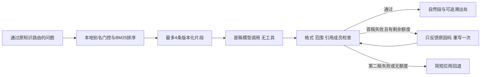

# 有来源的交易知识问答

更新：2026-11-10。一般交易问答默认先检索本地知识片段，再用无工具模型调用解释；检查失败时，可在整轮剩余额度内重写一次。此次放宽来自2026-11-09真实诊断与用户“错误率高就放宽”的原则（总线消息#543）。原有指标定义快捷路径保持零模型调用。

## 1. 解决的问题与流程

原来的`open_knowledge.py`只把问题交给模型，虽然限制了格式和范围，但无法指出回答参考了什么。现在使用随Python包发布的24条维护者说明，先选相关片段，再要求模型逐段引用本轮片段别名。



`knowledge_data.py`保存内容与参考元数据；`knowledge_retrieval.py`负责确定性检索；`open_knowledge.py`组织上下文、检查输出和生成公开答复。没有新增向量服务、数据库、抓取任务或模型提供方，也不自动访问片段里的链接。

## 2. 知识范围与来源含义

| 分类 | 当前内容 |
| --- | --- |
| A股交易概念 | T+1、申报数量、板块/新股涨跌幅差异、ST、停牌与缺失行情、除权复权 |
| 财务概念 | 报表关系、PE、PB、ROE、利润与现金流、报告期及披露时点 |
| 风险与计划 | 理论仓位、分散与相关性、回撤、止损与成交风险、胜率/盈亏比/成本 |
| 技术指标 | MACD位置与交叉、RSI、ADX、OBV、VWMA、布林带/ATR及指标相关性 |
| 研究方法 | 前视偏差、幸存者偏差、过拟合与历史可得性 |

所有中文片段均为`content_origin=maintainer_explanation`，并非官方原文引述：

- `source_type=official_reference`：维护者说明附有交易所或监管机构的参考页面。例如上交所交易规则发布页、SEC/Investor.gov投资者教育、AMF及印度尼西亚交易所的通用财务概念说明。引用外国投教不表示将外国交易规则移植到A股。
- `source_type=project_reference`：维护者说明引用本项目的计算实现或设计文档。例如MACD柱值、OBV起点、仓位教学公式与历史研究边界。

每条保留本地内容版本、维护日期、标题、说明片段、参考标题、发布方、链接和参考版本说明。外部网页未存全文或完整历史版本；项目链接指向可变的`main`分支。`live_verified=false`明确表示本次问答没有实时核验链接或规则有效性，维护日期也不是外部资料采集时间。

片段避免给所有A股套用同一个涨跌幅百分比或最小申报量。具体证券、板块、生效日和订单能力仍需另行核实；本模块不执行这些核实。

## 3. 检索为何这样实现

24条内容无需先引入外部向量库。当前算法为`alias-gated-cjk-bigram-bm25-v1`：

1. NFKC归一化全角字符，统一大小写、`P/E`与`PE`、`T + 1`等写法。
2. 先匹配精选主题别名，避免把弱相关的字词当成出处。例如未收录DCF时，不因问题里也有一个泛化词就提供无关片段。
3. 中文使用相邻双字词元，英文保留词元，按BM25及命中别名排序；同分用稳定内容ID排序。
4. 最多返回4条，绑定本轮`K1`等别名。若真实序列化后的模型消息超过既有协议限额，按排名移除整条低优先片段，不截断一句解释或悄悄扩大限额。

这是可解释的词法检索，不是语义召回或规则自动更新。没有匹配时仍可做一次通用概念解释，但由应用在正文开头明确提示本地知识库未覆盖；不补造来源。自定义`KnowledgeRetriever(())`可用于测试这种路径。

## 4. 模型与公开接口

旧调用保持兼容：

```python
answer_general_knowledge(question, model=model, directory=directory, mentions=())
```

可选`retriever`用于注入本地语料。可选`repair_invalid=False`保留直接调用的单稿行为；生产Agent入口及诊断脚本显式启用重写，且必须使用现有`ControlledToolModel`（统一计量调用、时间及用量的模型包装器）并有剩余额度。原有知识路由仍先拒绝个股数值查询、保存结果追问和交易执行请求，不赋予浏览或市场权限。

消息顺序保持现有协议：系统指令、原始用户问题、`LOCAL_KNOWLEDGE_CONTEXT\n`开头的应用资料、最终格式请求。资料以数据处理，不作为新的系统指令；模型不能执行其中内容。

输出仍使用`general-knowledge-answer-v1`和字符串段落，新增逐段引用：

```json
{
  "version": "general-knowledge-answer-v1",
  "paragraphs": ["PE与PB观察不同分母，比较时需要统一口径。"],
  "citations": [{"paragraph": 0, "sources": ["K1", "K2"]}]
}
```

命中资料时，保留下来的正文中至少一段引用本轮资料即可；未引用段落照常显示，不给它补挂来源。索引从0开始，未知别名、重复引用、非法索引、额外字段和正文内另造的链接或引文标记仍拒绝。没有命中时引用必须为空；旧的无`citations`模型JSON仅在这个路径兼容。

首稿系统指令、资料和格式请求保持原样；校验边界做以下局部放宽：

- 超过6段时，先检查全部原始段落，再把第7段起的内容按顺序、用空格并入第6段。合并后最多800字；遇到放不下的整段时，从那里截掉剩余尾段，不截半句话。诊断分别记录`knowledge_paragraphs_merged`、`knowledge_paragraphs_truncated`。空段、超长原始段、段内换行和总响应6500字上限不变。
- 引用先按原始索引检查，再映射到合并后的段落，合并产生的同一来源同一位置去重；被截掉段落的引用不再显示。引用记录数量上限为6与原始段落数的较大值，使7段各有引用的正常回答也能合并；原始重复索引仍拒绝。若唯一引用随尾段被截掉，仍按`citation_missing`失败。
- 当前数字规则只放行同一分句、时点词之前带“假设、假如、例如、比如、举例、设、若”的算例。“假设当前股价为20元”通过，“今日股价为20元”仍拒绝；前一分句的假设不能覆盖后一分句的真实行情断言。
- 普通标题【计算步骤】和公式EMA[12]通过；【K1】【1】【来源】【资料1】、[K1]、独立[1]等引用标记仍拒绝。数字方括号必须紧挨英文字母才按公式处理。

仍不通过时，生产入口最多重写一稿：在最后的格式请求内附上固定原因码和重写说明，不带首稿原文，不新增工具或重新取数。两稿均完整校验，第二稿再次违反行情数字、实时访问声明、收益保证、链接、HTML等红线即失败。两稿响应都计入用量及响应元数据。共享整轮、时间、token和会话额度不扩大；独立知识轮的默认1次额度保持，只有剩余额度时才能重写。重写遇到会话额度不足、模型错误或拒答时保留原来的校验失败；取消、期限和token停止信号继续向外传递。

`GeneralKnowledgeAnswer`原位置参数及`to_dict()`的版本、状态、正文、段落、无行情/无交易字段继续存在。公开`citations`从空列表扩展为维护者片段与可信元数据，按片段聚合`paragraph_indices`；可选`retrieval`给出语料版本、分类、命中情况和无网络标记，不暴露原始问题或模型内部响应。

公开答复的`validation_scope`为`format_scope_and_citation_membership_not_prose_semantics`。引用链接和片段只能来自程序已知资料，不能由模型生成。返回字典和列表均与内部冻结对象分离，客户端修改不会改动保存结果。

## 5. 验证与边界

验证覆盖主题检索、别名和全角写法、未知主题、稳定排序、不可变结果、版本/来源区分、逐段引用、未知或重复别名、无匹配路径、协议容量、取消、共享调用预算及既有API/启动/快照路径。只使用假模型和本地内容，不新增真实模型或行情请求。

仍有明确边界：成员检查只证明引用确实在本次检索结果中，不能证明自由文字的每个结论由片段推出。假设算例没有全面数值推导认证，词法召回也可能漏掉近义表达。现有24条内容并非完整知识库、实时法规服务或基于全文的检索系统；真实回答相关性与解释质量需要独立抽查。

扩充语料时应逐条核对参考链接与解释，区分维护日期和外部发布时间，修改内容版本，并给重要近义问题补检索案例。不要通过给所有主题添加泛化别名来提高表面的命中率。

## 6. 仅记录类别的拒绝诊断

知识结果的 `to_dict()` 新增 `diagnostics` 字段，既有回答版本、状态、大类错误码和失败提示保持不变。例如：

```json
{
  "version": "knowledge-validation-v2",
  "state": "rejected",
  "reason": "knowledge_bracket_reference",
  "first_reason": "knowledge_json_invalid",
  "rewrite_attempts": 1,
  "acceptance": null,
  "adjustments": []
}
```

`state=accepted`表示输出检查通过；`rejected`表示失败；`not_run`表示还没有检查输出，例如检索失败或首稿不完整。非拒绝状态的`reason`为`null`。`first_reason`保留首稿拒绝类别，`reason`为最终拒绝类别；`rewrite_attempts`为0或1，统计是否尝试提交重写（会话可能在下层拒绝转发）。成功时`acceptance=first_pass`或`after_rewrite`，其他状态为`null`。`adjustments`只含上述合并/截尾固定标记，描述最后接受检查的稿件。所有类别走固定白名单，陌生原因归`other`，不返回问题、模型正文、引用别名、命中字词或异常详情。返回的字典与列表均与内部对象分离。

每个原因均以 `knowledge_` 开头，后缀如下：

| 类别 | 固定原因后缀 |
| --- | --- |
| 响应文本 | `response_type_invalid`、`response_too_long` |
| JSON 解析 | `json_invalid`、`json_too_deep`、`json_duplicate_key`、`json_nonfinite_number` |
| 顶层结构 | `payload_type_invalid`、`payload_keys_invalid`、`version_invalid`、`paragraphs_type_invalid`、`paragraph_count_invalid` |
| 段落格式 | `paragraph_type_invalid`、`paragraph_empty`、`paragraph_too_long`、`paragraph_nonprintable` |
| 内容范围 | `html_forbidden`、`link_forbidden`、`claimed_access`、`guaranteed_return`、`current_number_claim`、`bracket_reference` |
| 引用集合 | `citations_type_invalid`、`citation_count_invalid`、`citation_shape_invalid` |
| 段落索引 | `citation_index_invalid`、`citation_index_duplicate` |
| 引用来源 | `citation_sources_type_invalid`、`citation_source_count_invalid`、`citation_source_unknown`、`citation_source_duplicate`、`citation_missing` |
| 无匹配声明 | `no_match_notice_too_long` |

共32类，每稿只报告首次拒绝点，不能据此认为其余规则都已通过。重复JSON键与非有限数字的原因不会被通用解析错误覆盖。`check/knowledge_answer`追踪事件使用同一原因类别，重写复用`repair/model_rewrite`事件；追踪记录只含执行类别，格式及旧记录读取方式不变。

2026-11-09首轮真实诊断共14次：MACD四种问法12次中失败3次，分别为7段超限、漏引一段和当前数字规则；ETF两次通过。报告未保存原文，因此第三类是否确为假设算例只能推测。此次按#543放宽形式要求并增加一次重写，实际成功率仍需Claude复测。12/26/9、DIF/DEA及普通EMA递推式原本就不触发当前行情数字规则；引用成员检查始终不证明自由文字的真实性。

### 有界真实诊断

`scripts/diagnose_general_knowledge.py` 默认仅输出包含公开测试问题的计划，不读取模型配置、不联网、不创建目录或会话数据：

```powershell
.\.venv\Scripts\python.exe -X utf8 -B scripts/diagnose_general_knowledge.py
```

固定批次是四种 MACD 问法各三次，加“ETF是什么”两次，共 14 题。只调用生产的通用知识实现，使用现有 DeepSeek 回答模型配置、提示词与知识资料；不调用意图模型、不改提示词、不保存对话、不创建行情数据源。该诊断不能替代新旧入口的完整验收，也不评价解释质量。

首轮诊断按#541执行后，#543授权在本次审核、提交后由Claude用总共14次真实请求复测。输出目录必须全新且位于`.agentbus/tmp/`内，每个批次另取目录名，保留run1历史报告：

```powershell
.\.venv\Scripts\python.exe -X utf8 -B scripts/diagnose_general_knowledge.py --live --max-calls 14 --output .agentbus/tmp/macd-diagnostic-run2
```

`--live`必须同时给出`--max-calls`和`--output`；上限只能是1–14，首稿、重写和失败尝试都计数。每题最多2次且不超过全局剩余额度，连接错误不重发，全局请求观察器在发请求前扣数。重写可能使14题无法全测，剩余题目标为`not_measured`；中断或启动失败也保留完整14题分母，不自动追加调用。

批次目录里的`report.json`（版本`general-knowledge-diagnostic-report-v2`）仅保存case_id、重复序号、状态、安全诊断、调用次数、用量、耗时及run_id，不保存问题、任何模型正文或reasoning、引用别名、请求消息、凭据或异常原文。`summary.acceptance_counts`分别统计首次通过和重写后通过；`first_reason_by_case`保留包括修复成功在内的首稿拒绝原因，`reason_by_case`只统计最终拒绝；`case_counts`保留计划数、通过数、失败数和未测数。缺失token用量保留`null`，不当作零。

同目录 `trace/` 仅保存现有的无正文追踪元数据，可用终端工具汇总原因：

```powershell
.\.venv\Scripts\python.exe -X utf8 -B -m trading_companion.trace_cli --trace-dir .agentbus/tmp/macd-diagnostic-run2/trace --format json
```

小批次未复现失败时，只能报告“本批未复现”；后续修复与追加真实调用另行讨论。诊断材料不会写入 Git。

当前源码登记更新为`intent-knowledge-rewrite-v1`，上一版`intent-knowledge-diagnostics-v1`完整移入历史登记。既有冻结题目、观察器、快照和历史报告不改写；当前回归测试先严格核对v2诊断契约，再仅移除这一已核对字段，与原始快照比较其余全部结果、状态和调用数。额外字段、错误诊断状态或正文变化仍会让测试失败。
