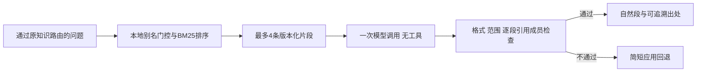

# 有来源的交易知识问答

更新：2026-10-26。一般交易问答默认先检索本地知识片段，再用一次无工具模型调用解释。原有指标定义快捷路径保持零模型调用；本文不把知识说明扩展为个股实时研究或交易操作。

## 1. 解决的问题与流程

原来的`open_knowledge.py`只把问题交给模型，虽然限制了格式和范围，但无法指出回答参考了什么。现在使用随Python包发布的24条维护者说明，先选相关片段，再要求模型逐段引用本轮片段别名。



`knowledge_data.py`保存内容与参考元数据；`knowledge_retrieval.py`负责确定性检索；`open_knowledge.py`组织上下文、检查输出和生成公开答复。没有新增向量服务、数据库、抓取任务或模型提供方，也不自动访问片段里的链接。

## 2. 知识范围与来源含义

| 分类 | 当前内容 |
| --- | --- |
| A股交易概念 | T+1、申报数量、板块/新股涨跌幅差异、ST、停牌与缺失行情、除权复权 |
| 财务概念 | 报表关系、PE、PB、ROE、利润与现金流、报告期及披露时点 |
| 风险与计划 | 理论仓位、分散与相关性、回撤、止损与成交风险、胜率/盈亏比/成本 |
| 技术指标 | MACD位置与交叉、RSI、ADX、OBV、VWMA、布林带/ATR及指标相关性 |
| 研究方法 | 前视偏差、幸存者偏差、过拟合与历史可得性 |

所有中文片段均为`content_origin=maintainer_explanation`，并非官方原文引述：

- `source_type=official_reference`：维护者说明附有交易所或监管机构的参考页面。例如上交所交易规则发布页、SEC/Investor.gov投资者教育、AMF及印度尼西亚交易所的通用财务概念说明。引用外国投教不表示将外国交易规则移植到A股。
- `source_type=project_reference`：维护者说明引用本项目的计算实现或设计文档。例如MACD柱值、OBV起点、仓位教学公式与历史研究边界。

每条保留本地内容版本、维护日期、标题、说明片段、参考标题、发布方、链接和参考版本说明。外部网页未存全文或完整历史版本；项目链接指向可变的`main`分支。`live_verified=false`明确表示本次问答没有实时核验链接或规则有效性，维护日期也不是外部资料采集时间。

片段避免给所有A股套用同一个涨跌幅百分比或最小申报量。具体证券、板块、生效日和订单能力仍需另行核实；本模块不执行这些核实。

## 3. 检索为何这样实现

24条内容无需先引入外部向量库。当前算法为`alias-gated-cjk-bigram-bm25-v1`：

1. NFKC归一化全角字符，统一大小写、`P/E`与`PE`、`T + 1`等写法。
2. 先匹配精选主题别名，避免把弱相关的字词当成出处。例如未收录DCF时，不因问题里也有一个泛化词就提供无关片段。
3. 中文使用相邻双字词元，英文保留词元，按BM25及命中别名排序；同分用稳定内容ID排序。
4. 最多返回4条，绑定本轮`K1`等别名。若真实序列化后的模型消息超过既有协议限额，按排名移除整条低优先片段，不截断一句解释或悄悄扩大限额。

这是可解释的词法检索，不是语义召回或规则自动更新。没有匹配时仍可做一次通用概念解释，但由应用在正文开头明确提示本地知识库未覆盖；不补造来源。自定义`KnowledgeRetriever(())`可用于测试这种路径。

## 4. 模型与公开接口

旧调用保持兼容：

```python
answer_general_knowledge(question, model=model, directory=directory, mentions=())
```

新增可选`retriever`用于注入本地语料，不赋予浏览或市场权限。原有知识路由仍先拒绝个股数值查询、保存结果追问和交易执行请求。

消息顺序保持现有协议：系统指令、原始用户问题、`LOCAL_KNOWLEDGE_CONTEXT\n`开头的应用资料、最终格式请求。资料以数据处理，不作为新的系统指令；模型不能执行其中内容。

输出仍使用`general-knowledge-answer-v1`和字符串段落，新增逐段引用：

```json
{
  "version": "general-knowledge-answer-v1",
  "paragraphs": ["PE与PB观察不同分母，比较时需要统一口径。"],
  "citations": [{"paragraph": 0, "sources": ["K1", "K2"]}]
}
```

命中资料时每段必须引用至少一条已送入本次模型上下文的片段；索引从0开始。拒绝未知别名、漏引段落、重复引用、错误索引、额外字段和正文内另造的链接或引文标记。没有命中时引用必须为空；旧的无`citations`模型JSON仅在这个路径兼容。任何不合格输出直接回退，不重试或二次取数。

`GeneralKnowledgeAnswer`原位置参数及`to_dict()`的版本、状态、正文、段落、无行情/无交易字段继续存在。公开`citations`从空列表扩展为维护者片段与可信元数据，按片段聚合`paragraph_indices`；可选`retrieval`给出语料版本、分类、命中情况和无网络标记，不暴露原始问题或模型内部响应。

公开答复的`validation_scope`为`format_scope_and_citation_membership_not_prose_semantics`。引用链接和片段只能来自程序已知资料，不能由模型生成。返回字典和列表均与内部冻结对象分离，客户端修改不会改动保存结果。

## 5. 验证与边界

验证覆盖主题检索、别名和全角写法、未知主题、稳定排序、不可变结果、版本/来源区分、逐段引用、未知或重复别名、无匹配路径、协议容量、取消、共享调用预算及既有API/启动/快照路径。只使用假模型和本地内容，不新增真实模型或行情请求。

仍有明确边界：成员检查只证明引用确实在本次检索结果中，不能证明自由文字的每个结论由片段推出。假设算例没有全面数值推导认证，词法召回也可能漏掉近义表达。现有24条内容并非完整知识库、实时法规服务或基于全文的检索系统；真实回答相关性与解释质量需要独立抽查。

扩充语料时应逐条核对参考链接与解释，区分维护日期和外部发布时间，修改内容版本，并给重要近义问题补检索案例。不要通过给所有主题添加泛化别名来提高表面的命中率。
