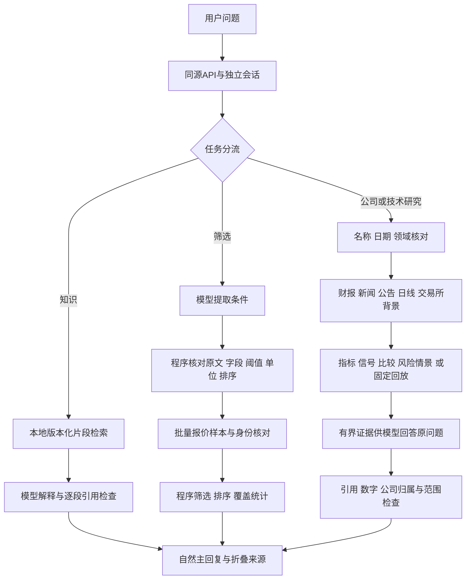

# 当前模块交付与使用示例

更新：2026-10-27。本文件描述当前代码，不把初版PRD的后续设想当作已完成能力。正常模式使用已有根目录`.env`和服务端预配置的来源；不需要新的付费服务密钥。

## 1. 本次完成的基础模块

| 模块 | 从聊天中可以做什么 | 核心文件 | 明确边界 |
| --- | --- | --- | --- |
| 数值候选筛选 | 按PE、PB、价格、涨跌幅、成交额、换手率、总/流通市值的明确阈值筛选，并按单一字段排序 | `screening.py`、`screening_source.py`、`screening_agent.py` | AND条件，有界样本；不声称全市场排名、潜力评分或新闻选股 |
| 名单研究续接（A，已提交） | 按表格序号、名称或代码选择最多三只继续研究，保留只看新闻等原要求 | `screening_context.py`、`screening_followup.py` | 同一会话15分钟；只选已展示对象，歧义先澄清 |
| 条件续改与区间（B，已提交） | 增加条件、替换一个字段的全部旧约束、修改排序与数量；明确双边区间 | `screening_intent.py`、`screening_agent.py` | 八字段、最多12项AND、聊天1–20只；未知尾句与冲突不执行；续改重读整个配置样本 |
| 更广筛选覆盖（待审核） | 启动时显式选择扩大档；折叠区查看抽样方法、目录缺口与未观察数量 | `screening.py`、`screening_source.py`、`ScreeningResults.tsx` | 最多1000条/20请求；腾讯按完整板块目录均匀间隔抽样、东财按页；默认规模不变；真实速度和市场完整性未核验 |
| 有来源的知识解释 | 对PE/PB、报表、风险、交易概念等检索本地说明，再由模型自然解释并关联段落出处 | `knowledge_data.py`、`knowledge_retrieval.py`、`open_knowledge.py` | 24条维护者说明，附参考链接；不假装已经读取网页全文或实时核实规则 |
| 当前证券背景 | 公司研究时获取交易所当前板块、上市日和有限ST观测；公开来源可查看 | `market_context_live.py`、`market_context.py` | 当前观测不回填历史；深圳ST、历史停牌与完整日历仍可能未知 |
| 规则解释 | 区分板块和生效版本，解释普通涨跌幅、T+1及IPO例外条件 | `market_rules.py`、`product_research.py` | 条件规则不等于当日可交易性；IPO交易序号没有权威日历就保持未知 |
| 历史回放 | 固定SMA规则与同区间持有比较，给出成本、收益、差值和回撤 | `historical_replay.py`、`replay_cli.py` | 标准化敞口回放；未模拟真实成交、手数、涨跌停、公司行动或全部券商税费 |
| 网页展示 | 知识正文不重复；来源折叠；筛选显示候选表、字段单位和覆盖信息 | `KnowledgeSources.tsx`、`ScreeningResults.tsx` | 畸形可选结构回退原文字，不触发额外请求；参数/执行调试不返回主会话 |
| 工程验收 | 原unittest与新增pytest函数都进入统一验收 | `scripts/verify.py` | 零跳过、零xfail、非空收集；离线契约和真实语言质量分开验收 |

这些增量与之前已有的名称澄清、多指标、日周技术观察、基本面/新闻/公告、最多三只明确候选比较、ATR假设情景、DeepSeek/OpenAI适配、聊天/API、SQLite证据归档共同构成当前产品。

## 2. 可以直接输入的问题

在正常网页会话中发送：

- `筛选市盈率高于0且市盈率不超过20的股票，按成交额降序选5只`
- `筛选换手率大于2%且PB小于2的股票，按换手率从高到低选5只`
- 名单产生后：`第一只只看新闻，不要技术指标`、`比较前两只的基本面`、`名单中第二只只看SMA3`
- 双边区间：`筛选PE在10到20之间的股票`（包含两端）、`筛选10 < PE <= 20`
- 条件续改：`再加换手率大于2%`、`把PE改为低于15`、`按市净率升序选3只`
- `市盈率和市净率有什么区别？应该怎样结合使用？`
- `怎么结合利润表和现金流量表判断盈利质量？`
- `平安银行是什么板块，什么时候上市？`
- `中芯国际的涨跌幅限制是什么？`
- `回测平安银行SMA20，比较同期持有收益和最大回撤，交易成本0.05%`

股票名称仍由可信本地目录核实，模型不能靠记忆补代码。需要当前ST状态时，来源没有证据就回答未核实，不能把“未出现在一个列表里”解释成非ST。

筛选中的PE明确是动态市盈率。支持上述数值条件同时成立及明确双边区间，不支持行业/板块过滤、静态/滚动PE、OR、指定股票名单等条件；这些请求会先说明缺口，不删掉一部分条件后继续。上下界倒置、单位不明或未知附加句也先澄清。数量使用阿拉伯数字。泛泛选股且没有数值条件时，明确以成交额给出活跃样本，不将它命名为潜力预测。

筛选名单在同一会话有效15分钟，可按表格序号、名称或代码选最多三只研究；知识问题不消耗或延长名单。多只名单只说“它”会要求明确对象；选择并研究后，“它”指当前研究对象，“名单中第二只”仍可继续选其他成员。名单过期、身份/模式变化或清空会话后不能沿用旧序号；重新筛选取数失败或取消也不回退到旧名单。B部分已由Claude复审并提交、推送为`5b0031c`；有效续改不调用模型，重新采集整个配置样本，成功后展示全部新条件并更新序号。详见[筛选与续接规则](screening-design.md)。

回放默认SMA20及单次敞口切换5基点成本；明确参数时支持一个SMA，不把其他策略静默改成SMA规则。前一条收盘产生信号，下一条开盘调整敞口，最后一日开盘结束；基准使用完全相同的区间和入场/退出费用假设。数据太短就说明不足。

## 3. 数据与模型如何协作



首次筛选只需一次模型意图提取，有限条件续改不调用模型，数值名单均由程序生成；一次批量快照读取不等于一次HTTP请求，腾讯默认200只当前需多批请求。公司研究最多三只明确候选，共用原模型/日线分析额度与协作期限。知识解释不请求行情，历史回放复用同份日线，不重新取数。所有路径都没有下单通道。

筛选默认腾讯，按各板块代码顺序取有界样本；当前目录没有北交所身份，不把0条目录记录当成市场没有股票。可以显式启动`--screening-data eastmoney`选择另一来源，失败不会自动换源。真实测试中东方财富列表出现过断连，因此没有将其设为默认。Dev Mode隔离真实筛选和交易所背景来源，不从正常模式借数据。

扩大档以整个板块的可信目录为基础，取`q=min(200,目录数量)`个均匀位置，下标为`floor(i × 目录数量/q)`，可触及代码靠后的对象；每类抽满名额，小目录取全部。它不是随机代表样本，也没有核验股票上市年代。覆盖审计把目录未选中、目录中尚未观察到可核对报价、供应商未读页和选中但缺报价分别说明，读取完配置目录或供应商列表仍不等于证明全市场完整。默认标准档不变。

## 4. Windows入口

原启动方式不变，重新构建界面并重启Python服务即可加载新后端：

```powershell
pnpm.cmd --dir frontend build
.\.venv\Scripts\python.exe -m trading_companion.api_server --port 8765
```

显式启用扩大筛选样本：

```powershell
.\.venv\Scripts\python.exe -m trading_companion.api_server --screening-data tencent --screening-coverage expanded --port 8765
```

扩大档最多1000条、20请求，默认80只/批最多15请求；增加延迟和限流风险，默认25秒采集截止不变。东财扩大档使用`--screening-data eastmoney --screening-coverage expanded`，每类最多两页，不做间隔抽样。扩大档尚未联网验证速度与来源稳定性。CLI也支持同名开关，不能与原单源数量覆盖参数混用，详见筛选设计。

独立离线筛选：

```powershell
.\.venv\Scripts\python.exe -m trading_companion.screening_cli --demo
```

真实筛选CLI不使用模型：

```powershell
.\.venv\Scripts\python.exe -m trading_companion.screening_cli --live --directory data/security_directory_live.json --condition pe_dynamic gt 0 --condition pe_dynamic lte 20 --sort-by amount_cny --limit 5
```

可选证据归档仍通过`api_server --snapshot-db <本地SQLite路径>`启用。已有归档用`replay_cli --db <路径> list/show/replay`检查，不请求模型或行情；具体示例见[回放设计](historical-replay-design.md)。归档不是长期聊天历史。

## 5. 借鉴与本项目的判断

沿用此前对TradingAgents/TradingAgents-CN的参考：领域研究拆分后综合、工具与模型职责分离、中国市场数据与规则单独适配。没有直接搬入角色辩论、LangGraph或混合许可的应用代码。

这次的筛选契约、覆盖统计、本地BM25检索、日期规则和回放算法由本项目实现。24条知识片段不需要外部向量库；筛选与指标是可计算任务，使用确定性代码更容易核对。先补基础功能和接口，再依据实际规模决定是否引入更大的框架。

## 6. 本轮验证记录

更广覆盖（工作区待复审）：按#27修正抽样名额后，Python统一门禁通过2,016项unittest与228项pytest函数用例，共2,244项，另有原4个Agent场景、90次MVP重复、5项公司研究流程、API演示与`pip check`，无skip/xfail。新增测试验证靠后代码入选与重复抽样一致、1000条/20请求上限、中间批缺报价、25秒截止和2000000字节总预算、第二页新增候选、目录缺口/未知身份、扩大范围续改及中止不发布半份名单、启动配置与Dev隔离。另按617、1411、1495、1701条构造离线目录，验证四类均抽满200只、150只的小目录取全部、下标递增且无重复；不是新的真实网络验收。

本轮TypeScript检查通过；直接Vitest因esbuild子进程`spawn EPERM`未能启动，统一`web`因本机未安装pnpm失败。`PIP_NO_INDEX=1`下尝试`bundle`，已运行既有编译资源的ASGI检查，但wheel隔离构建缺少可离线取得的`setuptools>=68`而失败；没有安装依赖。Claude在#27已补验修复前一版：20个文件共631项前端测试、TypeScript、Vite构建、新资源bundle及`pip check`均通过。本次抽满名额修复更新了前端校验和展示，新增两条名额矛盾用例，TypeScript再验通过；web/Vitest/bundle重试仍受上述环境限制，新一版前端及打包仍待Claude复验，不能沿用上一版通过结论。没有访问真实行情、调用付费模型或联网验证扩大档速度/稳定性；交付仍待Claude审核、提交与推送。

A部分名单续接的本轮开发验证：新增36项离线名单/接口测试；修复普通研究时间序数误触名单路由后，统一Python门禁通过1,979项unittest和214项pytest函数用例，共2,193项，以及原固定场景和`pip check`，无skip/xfail。先前Codex运行统一`web`门禁因PATH找不到`pnpm.cmd`停止，直接Vitest受esbuild子进程`spawn EPERM`阻止，`bundle`又因离线缺少隔离构建依赖而失败，没有安装新依赖。

Claude在审核消息#14中补验通过：直接用本地Node执行Vitest，20个文件共619项前端测试通过；TypeScript检查和Vite生产构建成功；`verify.py bundle`确认3个编译资源由ASGI准确提供并包含在wheel中，`pip check`通过。核实本机本来就没有安装pnpm，统一`web`脚本因此仍不能直接运行。A部分在#16复审通过，并在#17由Claude提交、推送为`7a614c3`。

B部分先纯搬移条件核对代码，未改任何原测试，完整Python门禁仍通过1,979项unittest和214项pytest；之后加入续改与区间，完整门禁通过2,011项unittest和214项pytest，共2,225项，以及原固定场景和`pip check`，无skip/xfail。新增测试验证区间实际执行端点、原文绑定、全样本重读、无模型续改、过期/模式、幂等、取消与迟到发布。B未改前端或打包配置，沿用A的前端/构建补验记录；没有做真实模型或行情请求。B在#21复审通过、#22由Claude提交并推送为`5b0031c`。

以下为此前基础模块的验收记录：

统一Windows验收通过：1,943项unittest与214个pytest函数用例，共2,157项Python测试；618项前端测试；原4个Agent契约场景、30场景×3的MVP回归、5个公司研究流程、API演示、TypeScript、生产构建、ASGI资源和干净wheel检查通过，无skip或xfail。测试数不等于真实模型请求数。

另有独立小样本实测：

| 探测 | 实际观察 |
| --- | --- |
| DeepSeek知识解释 | 一次调用，PE/PB回答accepted，关联两条本地片段；网页可展开段落、维护版本和参考链接 |
| DeepSeek意图＋腾讯报价 | 一次模型调用，200/200报价身份通过；`0<动态PE≤20`匹配48项、按成交额展示5项；网页表格/条件/覆盖可查看 |
| 网页宽泛选股 | `帮我选几个潜力股`进入筛选，程序应用可见默认条件，200只实际样本按成交额列5只，明确显示活跃候选而非潜力评分 |
| 官方选定证券背景 | 平安银行取得深市主板与1991-04-03上市日；中芯国际取得科创板与2020-07-16上市日；不因此宣称完整ST/日历覆盖 |
| 公司研究中的背景 | 独立实时研究曾成功回答交易所板块/上市日；网页另一次仅取得公司行业资料，促成交易所缺失coverage和行业/板块区分修复，未用单次成功掩盖来源波动 |
| DeepSeek＋合成行情回放 | 固定SMA问题走通，两次模型调用、一次日线分析、一次源读取；合成结果不代表真实市场收益 |

这些是有限的开发探测，尚未构成新场景多次真实质量验收。东方财富列表出现过断连，完整深市XLSX背景刷新也未验证成功；目前正常会话使用针对1–3只明确股票的官方JSON路径，失败独立报告，不静默换源。

## 7. 尚未完成

- 完整新闻/公告/财报全文的抓取、解析与语义研究；当前主要依赖结构化字段、标题或摘要。
- 全市场筛选完整性、行业/事件/技术形态等复合选股；名单续接、有限条件续改与区间解析已审核提交。扩大采样及覆盖审计在本轮工作区实现、待审核，仍不代表全市场筛选。
- 完整权威交易日历、历史ST/停复牌版本、公司行动和所有交易规则校验。
- 严格PIT及供应商历史修订归档；当前SQLite记录本地观察边界。
- 包含成交约束的完整策略回测、参数优化及样本外验证。
- Jev实验与接入、美股、多用户账户、长期聊天恢复及公网部署。
- 新场景多次真实模型评估与人工语言质量检查；少量探测不等于已验证长期稳定性或投资效果。

有些缺口依赖可靠历史数据或新的提供方配置，不能靠再加一段提示词补齐。当前模块返回明确的局部缺失，继续利用已有可用证据回答问题。
