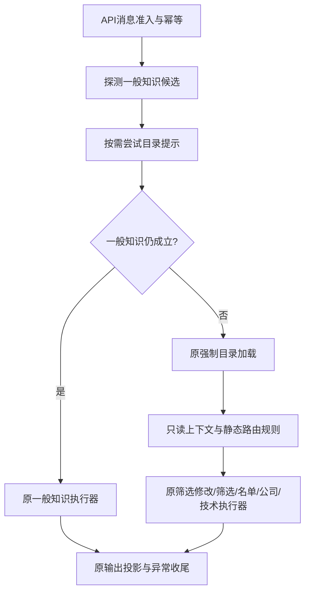

# 请求路由：先冻结行为，再集中判断

2026-10-27，路由1a；已实现、离线验证，待审核。这里只集中API顶层分发，冲突规则修正属于后续1b。

## 1. 为什么分两步

`api_service.py`原来同时安排目录加载、判断问法、选择执行器和处理会话收尾。筛选修改、名单续接、知识与公司研究会争用同一句话；改变条件顺序，可能连带改变待澄清状态和取数次数。

本步采用 **characterization test / golden master（特征测试／黄金基线）**：先在旧业务代码上记录现有行为，再用固定记录保护搬移。这是 **refactoring under test（在测试保护下重构）**。记录的是旧行为事实，包括已有不一致；它不是产品正确性规范，也不是假模型理解中文的准确率。

原始代码版本为`09cd36682d4cd3f9dbcb66251ac5ec3dfe0aa6e3`，[基线数据](../tests/fixtures/request-routing-v1.json)包含35个场景、105轮消息。业务代码未改动时完整捕获并连续两次通过重复验证；提取路由后用同一记录逐项比较。审核后再将这份完整记录确定性投影成不足300,000字节的存储格式，没有重新采集或改变旧预期。有限场景对照加已有回归能提供兼容证据，不能形式化证明所有可能输入都等价。

## 2. 模块边界



- [request_routing.py](../src/trading_companion/request_routing.py)：选择入口；不调用执行器。`RouteKind`限定六条路径，`RouteDecision`携带路径与固定原因码，`RouteSpec`静态声明匹配条件和优先级。
- `RoutingSessionView`只保存是否存在待澄清/基准的标志，以及不可变的已展示名单。它没有清理、修改或发布会话的方法。存在标志使用`True/None`，保持既有领域判断中`is None`的含义。
- `RoutingContext`保存这个只读投影、目录、来源、历史/开发模式及公司服务是否可用。工作流开关在前置知识探测时传入。保留原报价源对象的身份引用，不能通过复制对象绕过“来源已变化”检查。
- [api_service.py](../src/trading_companion/api_service.py)：仍拥有准入、开始时间、目录加载、执行器调用及全部收尾。六个执行器调用表达式和参数与旧版相同。
- 原技术Agent、公司研究、筛选与名单执行器继续处理内部命令、知识、身份澄清、条件核对、预算、取消和发布；本步不重做这些内部流程。

**路由与授权分离（routing ≠ authorization）**：路由命中只说明“交给谁处理”，不证明这次研究可以执行。例如过期名单的明确序号仍交名单执行器，由它解释过期并拒绝；路由自己不清除名单，也不能批准证券身份、日期、来源或工具调用。

冻结的数据类只阻止字段重新赋值。目录和名单本身沿用既有不可变契约，报价源只作身份比较；不声称把所有外部依赖都深复制或变成不可变对象。

## 3. 保留的顺序与目录策略

| 优先级 | 顶层路径 | 原规则 |
| --- | --- | --- |
| 10 | 一般知识 | 工作流开启、非历史、不是固定指标定义；先无目录探测，再用可选目录排除证券 |
| 20 | 筛选修改 | 非历史、非固定指标知识、无三类待澄清，且匹配已有修改语法 |
| 30 | 新筛选 | 现有新筛选判断；仍可替换待澄清，不追加上一行的门槛 |
| 40 | 名单研究续接 | 与修改相同的前置门槛；用原名单判定与惰性时钟 |
| 50 | 公司研究 | 原公司服务/待澄清/领域/具名问题/已保存结果/历史候选表达式 |
| 60 | 技术研究 | 原有有界后备入口，内部仍处理固定指标知识等 |

优先级来自原分支顺序，固定原因码为`legacy.<路径名>`。重复优先级、路径或原因码视为开发配置错误。表由应用代码定义，没有模型或HTTP可用的注册入口。按顺序短路，首条匹配后停止；不会为了收集全部候选而多算条件。

公司候选在筛选匹配之前计算，尽管其执行优先级较低；保留原布尔短路顺序。各领域匹配仍使用原问题与原规范化规则，没有全局改写标点、Unicode或证券提及。

一般知识目录提示可以加载失败，也可用陈旧目录排除公司名；不因此授权研究。若知识被否决且目录仍为空，后续强制加载会再次尝试，仍可返回原`directory_unusable`。API保留原异常集合和公开错误，不合并两次加载。

名单候选在真正走到该分支时额外读取一次原可信时钟。不能提前读取，也不能用本轮开始时间替代；15分钟边界可能在两次读取间经过。因此路由是可注入固定时钟的只读判定，不是完全没有外部读取的数学纯函数。执行器仍按原时机核验最新时间，不因路由已命中而放宽检查。

## 4. 冻结了什么

[观察器](../tests/routing_baseline_support.py)通过真实`ResearchApiService.message()`与`history()`运行已有假模型和内存来源。它包装并继续调用原执行器；名单内部的公司/技术执行入口也有记录。它不读取`.env`，通过项目原离线网络拦截阻止连接。

每轮记录包括：

- 完整公共返回的SHA-256和规范化JSON字节长度；状态、错误码、阶段、证券/日期参数、调用次数、筛选行ID顺序等保留原文。固定API问题的HTTP状态、错误码和消息仍保留原文。
- 最外层路由、嵌套执行入口，以及目录、时钟、模型、报价、公司和日线调用的有序事件与关键参数。
- 模型转发、数据读取次数；公开运行信息中的模型尝试、响应、分析次数和预算。
- 前后会话摘要：技术当前/历史基准、三类待澄清、公司计划/答案/保存时间、名单条件/身份/到期时间、额度、缓存记录、市场背景缓存和忙碌状态。公司计划和答案的大块内容采用同样的完整指纹，并保留证券、日期、领域和状态等关键字段。

`ResearchSession.to_dict()`不完整导出公司和筛选状态，因此观察器单独采集它们。访问令牌不进入记录。

归一化阶段仅把随机32位十六进制UUID按首次出现映射成稳定标识，保留嵌入证据与字典键的引用关系；不丢弃字段。API寿命时钟、所有`TurnControl`单调时钟（包括历史请求）、日线采集/验证时钟都在测试中固定；名单边界场景显式提供墙钟序列。日期、到期时间、计数、预算、答案、错误码和顺序仍参与比较。

存储使用格式版本2、投影版本`routing-projection-v1`：对完整结果、公司计划和答案的**全部字段**进行JSON键排序、紧凑编码、UTF-8编码，计算SHA-256及字节长度；禁止NaN。没有截短正文，也没有忽略图表或引用变化。数组顺序、缺字段和显式null仍能影响指纹。相邻两轮的投影前状态若与上轮投影后状态完全相同，就写为`{"$ref":"previous.after"}`；比较前只从冻结的上轮预期展开，不用当前实际状态补齐。每个场景占一行JSON，减少缩进和重复内容。

**指纹比较能发现差异，但不能直接展示内容差异。** 比较器先将新的完整观测做相同投影；失败时把该轮完整新观测、预期投影和实际投影写到`.agentbus/tmp/routing-baseline-*/step-N.json`，断言消息给出场景、轮次、不同字段和文件路径。排查时使用写出的完整观测，必要时按下节命令另存完整捕获；成功时不写诊断文件。大块旧正文不再重复存入Git，指纹不是可逆压缩。

用例覆盖知识与目录故障、工作流关闭、固定知识、公司服务关闭、开发模式、新筛选/区间/修改、空/失效名单、时间序数与名单序号、三类待澄清、普通指代与显式名单、历史、取消、失败、幂等和跨会话隔离。

两种容易误当成“搬移时顺便修好”的旧行为被明确保存：

1. 公司待澄清时`MACD是什么`仍进公司入口；技术待澄清时同一句走原技术入口回答知识，保留待澄清。
2. 技术身份待澄清后，短回复`平安银行`可因具名公司判断转入公司入口。工作流关闭时，`怎么用PE/PB看估值`也可能进入公司入口并留下待澄清，随后固定知识仍被它截住。

这些兼容预期不代表建议的产品行为。后续1b如修正，必须另列修改前、修改后和理由，保留v1事实，添加单独的新目标预期。

## 5. 验证与有意升级基线

正常测试只读数据，绝不会重录预期：

```powershell
.\.venv\Scripts\python.exe -X utf8 -B -m unittest tests.test_request_routing tests.test_routing_baseline
.\.venv\Scripts\python.exe -X utf8 -B scripts/verify.py python
```

基线元信息包含原代码版本、完整捕获的SHA-256/大小/当时观察器摘要与命令、投影版本/实现摘要、夹具与时钟说明，以及完整捕获生成命令。源码摘要按UTF-8、换行归一为LF计算，兼容Windows检出时的CRLF。`project_corpus()`只读取现有完整冻结记录做确定性转换，不调用API或执行器。

捕获辅助入口必须显式开启、指定当前完整提交号，要求`src/scripts/tests`的已跟踪文件相对于该提交无差异，拒绝覆盖已有输出。它只在有意升级到v2时使用，正常测试不调用。默认生成紧凑投影格式；可用`--full-output`另外保存完整记录供排查，两个路径必须不同、均不能已存在，完整记录不提交。

在选定版本、已具备该观察器及语料的检出目录中，确认没有未提交的被测代码改动，再执行：

```powershell
$routingRevision = git rev-parse HEAD
.\.venv\Scripts\python.exe -X utf8 -B -m tests.routing_baseline_support --capture --input tests/fixtures/request-routing-v1.json --output tests/fixtures/request-routing-v2.json --full-output .agentbus/tmp/request-routing-v2-full.json --source-commit $routingRevision --corpus-version request-routing-v2
```

若要复核原始v1，可在单独检出原`09cd366`的目录中放入同版本观察器与语料，输出到一个尚不存在的临时文件；不要覆盖仓库v1。捕获器先核对每轮人工列出的旧路径/关键错误码，再记录实际结果；新路由器不能生成自己的预期。1b需要的新目标场景可复用输入，但不能用“重新捕获”掩盖未经审核的差异。

本步不增加公共API字段、运行追踪文件、前端变化或模型/网络调用。运行记录、并发、README与正式效果评估各按已定稿的后续范围单独实施。
