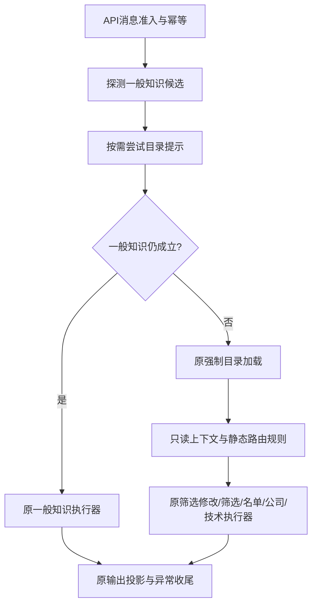

# 请求路由：明确意图、优先级与澄清所有权

2026-10-30 指数2a（方案 #299、批准 #300）：当前规则为 `index-research-v1`，父版本为 `market-routing-guard-v1`。原优先级25的 `market_research` 转交独立 `index_research` 执行器；五指数可实际研究并查看日/周图，含A股三条补漏与科创板身份澄清。指数待办纳入冲突计数、取消及成功替换；最近主体和15分钟保存结果隔离股票。下述第一步临时说明是历史行为，不再代表五指数当前能力；源码内部旧 `market_research_unavailable` 仅作识别标记，正式执行会再次解析对象。股票117轮v1～v7和304题不改，详见[指数研究设计](index-research-design.md)。

2026-10-30 指数误判保护（方案 #292、批准 #293）：当前规则为 `market-routing-guard-v1`，父版本为 `decision-horizon-v1`。新增优先级25的 `market_research` 意图，明确的指数问题先给出零模型、零行情的临时能力说明，不再续接旧股票或吞进单个股票待澄清。原会话与历史不被改写；完整指数研究及观察期限点位计划留给下一步。识别范围、反例和117轮比较见[指数误判保护记录](request-routing-market-guard-deltas.md)。下述14类意图、两个本地结果码等为历史设计；当前新增指数意图及固定能力说明，但不接入模型分类器。

2026-10-29 参数边界更新：当前2a规则为`technical-parameter-grounding-v1`。带“近/最近/过去”的日数归日期，后置显式参数归指标；旧研究路径与产品共用，其他路由选择不变。[取舍及验证说明](technical-numeric-grounding-design.md)记录“近20日均线”和“20日均线”的区别。以下为历史父版本记录。

2026-10-29 技术共用更新：当前规则为 `technical-shared-narrative-v1`。自然技术保留技术意图，使用共用执行器及v3正文；最近主体、名单单只、指标编辑与历史按实际保存载体续接。旧任务及禁用能力保留原分工。[范围与保存设计](technical-shared-narrative-design.md)、[v6差异](request-routing-technical-deltas.md)记录117轮中的31轮、382字段变化，其余86轮不变。v1～v5和原观察器冻结，下述B/B2为历史父版本。

2026-10-29 B2更新：当前规则为 `contextual-routing-b2-dates-v1`，承接已提交的B规则。本次补认模型漏填/截短的唯一原文历史日期，多个时间或不支持的表达继续澄清；未来期限独立处理。[B2差异记录](request-routing-b2-dates-deltas.md)核对以v5为父的117轮，全部零差异；下文B的7轮变化属于上一版本。没有接入模型分类器或扩大预算。

2026-10-29 B批历史规则：`contextual-routing-b-v1`，已由Claude审核提交为 `633793a`。可信研究对象按成功发布的先后顺序保存，技术研究后的“那现在能买吗”转公司新研究；过期数据不复用，身份在当前目录重核后重新取数。多个对象的单数指代仍只问对象，明确新问题不继承。

完整具名新研究、新筛选不再被旧pending（等待用户补充的任务）拦住；成功发布才替换，模型/取数失败、预算耗尽、取消和并发不提前消费原pending。知识插问保留原任务；多pending的短回复仍冲突，知识和完整独立任务可分流。候选按显示顺序接受名称、代码或唯一序号，支持“平安银行，改看近60日”，整句剩余条件不能丢弃；候选外裸名称仍澄清。

[B差异](request-routing-b-deltas.md)保留原117轮：7轮变化、110轮严格相同，逐字段132处；[逐项处置](request-routing-b-disposition.md)列出已完成与延期内容。下文1b表格是父规则记录；B的覆盖以本段及差异表为准。没有接入模型分类器、扩大调用预算或改变回答核对器。

2026-10-29补充：在原优先级内加入有界决策表达及公司追问续接，未新增模型分类或顶层意图。原105轮保持v2完整观察；新增12轮见[决策接入记录](request-routing-decision-deltas.md)，回答数据见[研判计划契约](research-decision-plan-design.md)。

2026-10-27。路由1a已由Claude审核、提交并推送为`03bfe1c`；路由1b已在工作区实现并离线验证，待Claude审核，尚未提交。以下先说明当前目标规则，再保留1a的历史设计与来源记录。

## 父规则：路由1b（B以前）

语义意图是用户这轮要做的事，执行入口是项目中实际处理它的流程。`IntentKind`声明14类意图，`RouteKind`声明六个原入口及一个受控本地答复入口；`RouteDecision`同时给出意图、入口和固定规则ID。同一技术入口可回答固定定义、续接股票澄清、续接指标目标或执行技术研究，不再要求执行入口与意图一一对应。

| 优先级 | 意图 | 入口与互斥条件 |
| --- | --- | --- |
| 0 | 完整取消/重置命令 | 单一公司待澄清用公司入口，其他正常状态用技术入口；多待澄清冲突用技术命令清理。命令仍由原流程执行。 |
| 1 | 明确历史查看 | 保留旧选择：公司待澄清、公司历史请求或已保存公司结果且匹配原追问规则用公司入口，其余用技术入口。 |
| 5 | 多待澄清冲突 | 同时存在两种以上待澄清，受控本地答复`routing_state_conflict`；不猜所有者，不自动清理。 |
| 10 | 完整固定指标定义 | 原技术知识入口，零模型、零取数。 |
| 11 | 完整一般知识 | workflow开启，保守知识判断排除具名证券、当前数据和额外研究要求；原一般知识入口。 |
| 12 | 一般知识功能关闭 | workflow关闭，完整一般知识给`general_knowledge_disabled`；零模型、零取数，保留原强制目录加载。 |
| 20 | 明确新筛选 | 排除锚定的筛选修改及名单指代；正常单一待澄清可以被明确新筛选替换。 |
| 30/31/32 | 公司身份/技术身份/指标目标澄清 | 单一所有者接收短回复与非法回复，执行器核对候选、目录、来源及期限；具名短回复不能抢入另一研究入口。 |
| 40 | 筛选条件修改 | 无待澄清，锚定字段和修改语法；无名单/过期也交修改流程解释。 |
| 50 | 名单研究续接 | 无待澄清，沿用显式名单/序号及有效成员规则；延迟读取时钟，执行器再次核验。 |
| 60 | 公司研究与公司结果追问 | 公司服务已配置，保留周线、背离、历史回放等既有分工；不能截走完整知识和澄清回复。 |
| 70 | 技术研究与原追问、修改 | 原有有界后备，不新增模型重路由、重试或指标语法能力。 |

静态表的意图、优先级和规则ID必须唯一，执行入口可以重复。匹配不调用模型或网络，不修改会话；名单时钟只在原时机读取。普通无待澄清的取消和文字历史查看仍保留原分支曾产生的一次时钟读取，以保持旧事件序列。可信`history=True`不增加这次读取。生产路径保持短路，不为列出候选而执行所有匹配器。

一般知识可在强制目录加载前走可选身份提示，但多待澄清冲突会阻止这项提前分流。固定定义和两个本地答复仍需原强制目录加载；目录不可用时仍返回503，不借知识路由放宽研究准入。原目录、TTL（有效时间）、预算、取消与发布校验继续由执行器负责。

`agent.py:run_routing_reply_turn()`只接受两个固定本地结果码，复用`_controlled`执行包装的会话锁、取消和发布协议；不写入、消费或续期待澄清。公共输出为`needs_clarification`、非空`message`、无研究附件，网页已有通用文字回退可展示，不需要新增前端代码。

### 旧事实与目标预期分开

- [v1数据](../tests/fixtures/request-routing-v1.json)与[原观察器](../tests/routing_baseline_support.py)内容保留。v1记录旧`09cd366`的事实；1a在`03bfe1c`仍完全匹配。`.gitattributes`仅对`tests/fixtures/*.json`固定LF检出，文件指纹统一CRLF为LF后计算，格式标为`sha256_utf8_normalized_lf`；不修改v1的LF内容，也不调整Python/Markdown文件的换行。
- [v2数据](../tests/fixtures/request-routing-v2.json)保留相同35场景、105轮输入，目标意图由[新辅助层](../tests/routing_targets_support.py)的人工意图表及B1/B2/B4结果约束声明，另记录完整投影。B3/B5/B6由[真实入口反例测试](../tests/test_routing_conflicts_api.py)补齐。
- 当前105轮中100轮与v1逐字段一致；另5轮的53处投影字段变化全部归入B1/B2/B4，包括后一轮的缓存和累计状态传递差异。[可读差异](request-routing-1b-deltas.md)列出每轮和全部字段路径，v2的`deltas`保存完整改前/改后值。顺序数组按整体值比较，不丢项、不排序。
- 测试先核对独立目标，再核对当前完整观测；无差异轮次仍以v1为预期，有差异轮次以v2为预期。正常测试从不重录数据。故意去掉固定知识、技术澄清或知识关闭规则时，三组反例都会失败。
- v2明确标注基于`03bfe1c`的未提交工作区候选，记录源码的LF归一摘要及`v1_hash_format`；它不声称这份新代码已属于某个提交。审核#49只更新摘要格式说明和测试源码清单，全部场景、目标、观测与差异原样保留。旧捕获器的干净提交、显式开启和拒绝覆盖约束没有降低。

生成候选仅在有意改变目标并准备人工审核时执行，输出路径必须新建且互不相同：

```powershell
.\.venv\Scripts\python.exe -X utf8 -B -m tests.routing_targets_support --propose --output .agentbus/tmp/routing-v2-candidate.json --full-output .agentbus/tmp/routing-v2-full.json
```

工具先校验人工目标，拒绝方案清单之外的变化；候选由人工核查后才移入版本化目标文件。详细校验与测试命令见[差异文档](request-routing-1b-deltas.md)。旧捕获器不适用于未提交工作区，下面的1a命令是它的历史用法，不用于绕过这一限制。

---

以下为路由1a的历史设计，描述当时有意保留的旧规则与冻结方法；其中“后续1b”已由上面的当前规则实现，旧事实不因此改写。

## 1. 为什么分两步

`api_service.py`原来同时安排目录加载、判断问法、选择执行器和处理会话收尾。筛选修改、名单续接、知识与公司研究会争用同一句话；改变条件顺序，可能连带改变待澄清状态和取数次数。

本步采用 **characterization test / golden master（特征测试／黄金基线）**：先在旧业务代码上记录现有行为，再用固定记录保护搬移。这是 **refactoring under test（在测试保护下重构）**。记录的是旧行为事实，包括已有不一致；它不是产品正确性规范，也不是假模型理解中文的准确率。

原始代码版本为`09cd36682d4cd3f9dbcb66251ac5ec3dfe0aa6e3`，[基线数据](../tests/fixtures/request-routing-v1.json)包含35个场景、105轮消息。业务代码未改动时完整捕获并连续两次通过重复验证；提取路由后用同一记录逐项比较。审核后再将这份完整记录确定性投影成不足300,000字节的存储格式，没有重新采集或改变旧预期。有限场景对照加已有回归能提供兼容证据，不能形式化证明所有可能输入都等价。

## 2. 模块边界



- [request_routing.py](../src/trading_companion/request_routing.py)：选择入口；不调用执行器。`RouteKind`限定六条路径，`RouteDecision`携带路径与固定原因码，`RouteSpec`静态声明匹配条件和优先级。
- `RoutingSessionView`只保存是否存在待澄清/基准的标志，以及不可变的已展示名单。它没有清理、修改或发布会话的方法。存在标志使用`True/None`，保持既有领域判断中`is None`的含义。
- `RoutingContext`保存这个只读投影、目录、来源、历史/开发模式及公司服务是否可用。工作流开关在前置知识探测时传入。保留原报价源对象的身份引用，不能通过复制对象绕过“来源已变化”检查。
- [api_service.py](../src/trading_companion/api_service.py)：仍拥有准入、开始时间、目录加载、执行器调用及全部收尾。六个执行器调用表达式和参数与旧版相同。
- 原技术Agent、公司研究、筛选与名单执行器继续处理内部命令、知识、身份澄清、条件核对、预算、取消和发布；本步不重做这些内部流程。

**路由与授权分离（routing ≠ authorization）**：路由命中只说明“交给谁处理”，不证明这次研究可以执行。例如过期名单的明确序号仍交名单执行器，由它解释过期并拒绝；路由自己不清除名单，也不能批准证券身份、日期、来源或工具调用。

冻结的数据类只阻止字段重新赋值。目录和名单本身沿用既有不可变契约，报价源只作身份比较；不声称把所有外部依赖都深复制或变成不可变对象。

## 3. 保留的顺序与目录策略

| 优先级 | 顶层路径 | 原规则 |
| --- | --- | --- |
| 10 | 一般知识 | 工作流开启、非历史、不是固定指标定义；先无目录探测，再用可选目录排除证券 |
| 20 | 筛选修改 | 非历史、非固定指标知识、无三类待澄清，且匹配已有修改语法 |
| 30 | 新筛选 | 现有新筛选判断；仍可替换待澄清，不追加上一行的门槛 |
| 40 | 名单研究续接 | 与修改相同的前置门槛；用原名单判定与惰性时钟 |
| 50 | 公司研究 | 原公司服务/待澄清/领域/具名问题/已保存结果/历史候选表达式 |
| 60 | 技术研究 | 原有有界后备入口，内部仍处理固定指标知识等 |

优先级来自原分支顺序，固定原因码为`legacy.<路径名>`。重复优先级、路径或原因码视为开发配置错误。表由应用代码定义，没有模型或HTTP可用的注册入口。按顺序短路，首条匹配后停止；不会为了收集全部候选而多算条件。

公司候选在筛选匹配之前计算，尽管其执行优先级较低；保留原布尔短路顺序。各领域匹配仍使用原问题与原规范化规则，没有全局改写标点、Unicode或证券提及。

一般知识目录提示可以加载失败，也可用陈旧目录排除公司名；不因此授权研究。若知识被否决且目录仍为空，后续强制加载会再次尝试，仍可返回原`directory_unusable`。API保留原异常集合和公开错误，不合并两次加载。

名单候选在真正走到该分支时额外读取一次原可信时钟。不能提前读取，也不能用本轮开始时间替代；15分钟边界可能在两次读取间经过。因此路由是可注入固定时钟的只读判定，不是完全没有外部读取的数学纯函数。执行器仍按原时机核验最新时间，不因路由已命中而放宽检查。

## 4. 冻结了什么

[观察器](../tests/routing_baseline_support.py)通过真实`ResearchApiService.message()`与`history()`运行已有假模型和内存来源。它包装并继续调用原执行器；名单内部的公司/技术执行入口也有记录。它不读取`.env`，通过项目原离线网络拦截阻止连接。

每轮记录包括：

- 完整公共返回的SHA-256和规范化JSON字节长度；状态、错误码、阶段、证券/日期参数、调用次数、筛选行ID顺序等保留原文。固定API问题的HTTP状态、错误码和消息仍保留原文。
- 最外层路由、嵌套执行入口，以及目录、时钟、模型、报价、公司和日线调用的有序事件与关键参数。
- 模型转发、数据读取次数；公开运行信息中的模型尝试、响应、分析次数和预算。
- 前后会话摘要：技术当前/历史基准、三类待澄清、公司计划/答案/保存时间、名单条件/身份/到期时间、额度、缓存记录、市场背景缓存和忙碌状态。公司计划和答案的大块内容采用同样的完整指纹，并保留证券、日期、领域和状态等关键字段。

`ResearchSession.to_dict()`不完整导出公司和筛选状态，因此观察器单独采集它们。访问令牌不进入记录。

归一化阶段仅把随机32位十六进制UUID按首次出现映射成稳定标识，保留嵌入证据与字典键的引用关系；不丢弃字段。API寿命时钟、所有`TurnControl`单调时钟（包括历史请求）、日线采集/验证时钟都在测试中固定；名单边界场景显式提供墙钟序列。日期、到期时间、计数、预算、答案、错误码和顺序仍参与比较。

存储使用格式版本2、投影版本`routing-projection-v1`：对完整结果、公司计划和答案的**全部字段**进行JSON键排序、紧凑编码、UTF-8编码，计算SHA-256及字节长度；禁止NaN。没有截短正文，也没有忽略图表或引用变化。数组顺序、缺字段和显式null仍能影响指纹。相邻两轮的投影前状态若与上轮投影后状态完全相同，就写为`{"$ref":"previous.after"}`；比较前只从冻结的上轮预期展开，不用当前实际状态补齐。每个场景占一行JSON，减少缩进和重复内容。

**指纹比较能发现差异，但不能直接展示内容差异。** 比较器先将新的完整观测做相同投影；失败时把该轮完整新观测、预期投影和实际投影写到`.agentbus/tmp/routing-baseline-*/step-N.json`，断言消息给出场景、轮次、不同字段和文件路径。排查时使用写出的完整观测，必要时按下节命令另存完整捕获；成功时不写诊断文件。大块旧正文不再重复存入Git，指纹不是可逆压缩。

用例覆盖知识与目录故障、工作流关闭、固定知识、公司服务关闭、开发模式、新筛选/区间/修改、空/失效名单、时间序数与名单序号、三类待澄清、普通指代与显式名单、历史、取消、失败、幂等和跨会话隔离。

两种容易误当成“搬移时顺便修好”的旧行为被明确保存：

1. 公司待澄清时`MACD是什么`仍进公司入口；技术待澄清时同一句走原技术入口回答知识，保留待澄清。
2. 技术身份待澄清后，短回复`平安银行`可因具名公司判断转入公司入口。工作流关闭时，`怎么用PE/PB看估值`也可能进入公司入口并留下待澄清，随后固定知识仍被它截住。

这些兼容预期不代表建议的产品行为。后续1b如修正，必须另列修改前、修改后和理由，保留v1事实，添加单独的新目标预期。

## 5. 验证与有意升级基线

正常测试只读数据，绝不会重录预期：

```powershell
.\.venv\Scripts\python.exe -X utf8 -B -m unittest tests.test_request_routing tests.test_routing_baseline
.\.venv\Scripts\python.exe -X utf8 -B scripts/verify.py python
```

基线元信息包含原代码版本、完整捕获的SHA-256/大小/当时观察器摘要与命令、投影版本/实现摘要、夹具与时钟说明，以及完整捕获生成命令。源码摘要按UTF-8、换行归一为LF计算，兼容Windows检出时的CRLF。`project_corpus()`只读取现有完整冻结记录做确定性转换，不调用API或执行器。

捕获辅助入口必须显式开启、指定当前完整提交号，要求`src/scripts/tests`的已跟踪文件相对于该提交无差异，拒绝覆盖已有输出。它只在有意升级到v2时使用，正常测试不调用。默认生成紧凑投影格式；可用`--full-output`另外保存完整记录供排查，两个路径必须不同、均不能已存在，完整记录不提交。

在选定版本、已具备该观察器及语料的检出目录中，确认没有未提交的被测代码改动，再执行：

```powershell
$routingRevision = git rev-parse HEAD
.\.venv\Scripts\python.exe -X utf8 -B -m tests.routing_baseline_support --capture --input tests/fixtures/request-routing-v1.json --output tests/fixtures/request-routing-v2.json --full-output .agentbus/tmp/request-routing-v2-full.json --source-commit $routingRevision --corpus-version request-routing-v2
```

若要复核原始v1，可在单独检出原`09cd366`的目录中放入同版本观察器与语料，输出到一个尚不存在的临时文件；不要覆盖仓库v1。捕获器先核对每轮人工列出的旧路径/关键错误码，再记录实际结果；新路由器不能生成自己的预期。1b需要的新目标场景可复用输入，但不能用“重新捕获”掩盖未经审核的差异。

本步不增加公共API字段、运行追踪文件、前端变化或模型/网络调用。运行记录、并发、README与正式效果评估各按已定稿的后续范围单独实施。
