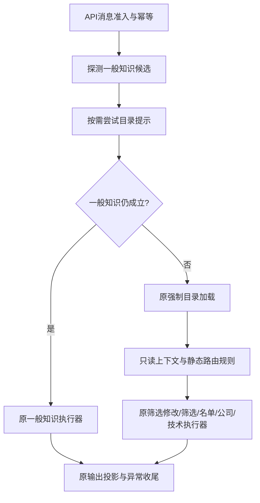

# 请求理解：路由、自然输入与研究意图 v2

用户问题如何被理解：请求路由与市场护栏、自然输入和身份澄清，以及研究意图 v2.6 的方案、护栏原则、封存检验和正式接入。

> 本文由多份原设计文档按主题合并而成（2026-11-16）。各节保留原文，包括当时的日期、提交号、总线消息号和命令；其中提到的早期演示模块（如 `agent_demo`）和研究意图 v2.5/v2.6 封存评测脚本已在同次清理中删除，需要时请查看 git 历史（标签 `research-intent-v2.6-freeze-valid`）。

## 目录

- [请求路由：明确意图、优先级与澄清所有权](#请求路由明确意图优先级与澄清所有权)
- [指数请求误判保护](#指数请求误判保护)
- [自然语言研究入口：理解意图、核实名称、展示默认值](#自然语言研究入口理解意图核实名称展示默认值)
- [股票澄清续接：保留条件，不依赖模型记忆](#股票澄清续接保留条件不依赖模型记忆)
- [研究意图 v2.6 实现方案](#研究意图-v26-实现方案)
- [研究意图 v2.6 护栏原则](#研究意图-v26-护栏原则)
- [v2.6.8 公开候选回顾与解释边界](#v268-公开候选回顾与解释边界)
- [v2.6.8 候选锁与一次性封存检验](#v268-候选锁与一次性封存检验)
- [v2.6 接入、验收与默认开启](#v26-接入验收与默认开启)


## 请求路由：明确意图、优先级与澄清所有权

2026-10-30 指数2a（方案 #299、批准 #300）：当前规则为 `index-research-v1`，父版本为 `market-routing-guard-v1`。原优先级25的 `market_research` 转交独立 `index_research` 执行器；五指数可实际研究并查看日/周图，含A股三条补漏与科创板身份澄清。指数待办纳入冲突计数、取消及成功替换；最近主体和15分钟保存结果隔离股票。下述第一步临时说明是历史行为，不再代表五指数当前能力；源码内部旧 `market_research_unavailable` 仅作识别标记，正式执行会再次解析对象。股票117轮v1～v7和304题不改，详见[指数研究设计](market-and-screening-design.md#五指数日线周线研究与点位情景计划)。

2026-10-30 指数误判保护（方案 #292、批准 #293）：当前规则为 `market-routing-guard-v1`，父版本为 `decision-horizon-v1`。新增优先级25的 `market_research` 意图，明确的指数问题先给出零模型、零行情的临时能力说明，不再续接旧股票或吞进单个股票待澄清。原会话与历史不被改写；完整指数研究及观察期限点位计划留给下一步。识别范围、反例和117轮比较见[指数误判保护记录](request-understanding-design.md#指数请求误判保护)。下述14类意图、两个本地结果码等为历史设计；当前新增指数意图及固定能力说明，但不接入模型分类器。

2026-10-29 参数边界更新：当前2a规则为`technical-parameter-grounding-v1`。带“近/最近/过去”的日数归日期，后置显式参数归指标；旧研究路径与产品共用，其他路由选择不变。[取舍及验证说明](technical-analysis-design.md#技术回答数字核对与日期参数边界)记录“近20日均线”和“20日均线”的区别。以下为历史父版本记录。

2026-10-29 技术共用更新：当前规则为 `technical-shared-narrative-v1`。自然技术保留技术意图，使用共用执行器及v3正文；最近主体、名单单只、指标编辑与历史按实际保存载体续接。旧任务及禁用能力保留原分工。[范围与保存设计](technical-analysis-design.md#自然技术研究共用自然语言回答流程)、v6差异记录117轮中的31轮、382字段变化，其余86轮不变。v1～v5和原观察器冻结，下述B/B2为历史父版本。

2026-10-29 B2更新：当前规则为 `contextual-routing-b2-dates-v1`，承接已提交的B规则。本次补认模型漏填/截短的唯一原文历史日期，多个时间或不支持的表达继续澄清；未来期限独立处理。B2差异记录核对以v5为父的117轮，全部零差异；下文B的7轮变化属于上一版本。没有接入模型分类器或扩大预算。

2026-10-29 B批历史规则：`contextual-routing-b-v1`，已由Claude审核提交为 `633793a`。可信研究对象按成功发布的先后顺序保存，技术研究后的“那现在能买吗”转公司新研究；过期数据不复用，身份在当前目录重核后重新取数。多个对象的单数指代仍只问对象，明确新问题不继承。

完整具名新研究、新筛选不再被旧pending（等待用户补充的任务）拦住；成功发布才替换，模型/取数失败、预算耗尽、取消和并发不提前消费原pending。知识插问保留原任务；多pending的短回复仍冲突，知识和完整独立任务可分流。候选按显示顺序接受名称、代码或唯一序号，支持“平安银行，改看近60日”，整句剩余条件不能丢弃；候选外裸名称仍澄清。

B差异保留原117轮：7轮变化、110轮严格相同，逐字段132处；逐项处置列出已完成与延期内容。下文1b表格是父规则记录；B的覆盖以本段及差异表为准。没有接入模型分类器、扩大调用预算或改变回答核对器。

2026-10-29补充：在原优先级内加入有界决策表达及公司追问续接，未新增模型分类或顶层意图。原105轮保持v2完整观察；新增12轮见决策接入记录，回答数据见[研判计划契约](answer-design.md#参考研判与-atr-条件计划)。

2026-10-27。路由1a已由Claude审核、提交并推送为`03bfe1c`；路由1b已在工作区实现并离线验证，待Claude审核，尚未提交。以下先说明当前目标规则，再保留1a的历史设计与来源记录。

### 父规则：路由1b（B以前）

语义意图是用户这轮要做的事，执行入口是项目中实际处理它的流程。`IntentKind`声明14类意图，`RouteKind`声明六个原入口及一个受控本地答复入口；`RouteDecision`同时给出意图、入口和固定规则ID。同一技术入口可回答固定定义、续接股票澄清、续接指标目标或执行技术研究，不再要求执行入口与意图一一对应。

| 优先级 | 意图 | 入口与互斥条件 |
| --- | --- | --- |
| 0 | 完整取消/重置命令 | 单一公司待澄清用公司入口，其他正常状态用技术入口；多待澄清冲突用技术命令清理。命令仍由原流程执行。 |
| 1 | 明确历史查看 | 保留旧选择：公司待澄清、公司历史请求或已保存公司结果且匹配原追问规则用公司入口，其余用技术入口。 |
| 5 | 多待澄清冲突 | 同时存在两种以上待澄清，受控本地答复`routing_state_conflict`；不猜所有者，不自动清理。 |
| 10 | 完整固定指标定义 | 原技术知识入口，零模型、零取数。 |
| 11 | 完整一般知识 | workflow开启，保守知识判断排除具名证券、当前数据和额外研究要求；原一般知识入口。 |
| 12 | 一般知识功能关闭 | workflow关闭，完整一般知识给`general_knowledge_disabled`；零模型、零取数，保留原强制目录加载。 |
| 20 | 明确新筛选 | 排除锚定的筛选修改及名单指代；正常单一待澄清可以被明确新筛选替换。 |
| 30/31/32 | 公司身份/技术身份/指标目标澄清 | 单一所有者接收短回复与非法回复，执行器核对候选、目录、来源及期限；具名短回复不能抢入另一研究入口。 |
| 40 | 筛选条件修改 | 无待澄清，锚定字段和修改语法；无名单/过期也交修改流程解释。 |
| 50 | 名单研究续接 | 无待澄清，沿用显式名单/序号及有效成员规则；延迟读取时钟，执行器再次核验。 |
| 60 | 公司研究与公司结果追问 | 公司服务已配置，保留周线、背离、历史回放等既有分工；不能截走完整知识和澄清回复。 |
| 70 | 技术研究与原追问、修改 | 原有有界后备，不新增模型重路由、重试或指标语法能力。 |

静态表的意图、优先级和规则ID必须唯一，执行入口可以重复。匹配不调用模型或网络，不修改会话；名单时钟只在原时机读取。普通无待澄清的取消和文字历史查看仍保留原分支曾产生的一次时钟读取，以保持旧事件序列。可信`history=True`不增加这次读取。生产路径保持短路，不为列出候选而执行所有匹配器。

一般知识可在强制目录加载前走可选身份提示，但多待澄清冲突会阻止这项提前分流。固定定义和两个本地答复仍需原强制目录加载；目录不可用时仍返回503，不借知识路由放宽研究准入。原目录、TTL（有效时间）、预算、取消与发布校验继续由执行器负责。

`agent.py:run_routing_reply_turn()`只接受两个固定本地结果码，复用`_controlled`执行包装的会话锁、取消和发布协议；不写入、消费或续期待澄清。公共输出为`needs_clarification`、非空`message`、无研究附件，网页已有通用文字回退可展示，不需要新增前端代码。

#### 旧事实与目标预期分开

- [v1数据](../tests/fixtures/request-routing-v1.json)与[原观察器](../tests/routing_baseline_support.py)内容保留。v1记录旧`09cd366`的事实；1a在`03bfe1c`仍完全匹配。`.gitattributes`仅对`tests/fixtures/*.json`固定LF检出，文件指纹统一CRLF为LF后计算，格式标为`sha256_utf8_normalized_lf`；不修改v1的LF内容，也不调整Python/Markdown文件的换行。
- [v2数据](../tests/fixtures/request-routing-v2.json)保留相同35场景、105轮输入，目标意图由[新辅助层](../tests/routing_targets_support.py)的人工意图表及B1/B2/B4结果约束声明，另记录完整投影。B3/B5/B6由[真实入口反例测试](../tests/test_routing_conflicts_api.py)补齐。
- 当前105轮中100轮与v1逐字段一致；另5轮的53处投影字段变化全部归入B1/B2/B4，包括后一轮的缓存和累计状态传递差异。可读差异列出每轮和全部字段路径，v2的`deltas`保存完整改前/改后值。顺序数组按整体值比较，不丢项、不排序。
- 测试先核对独立目标，再核对当前完整观测；无差异轮次仍以v1为预期，有差异轮次以v2为预期。正常测试从不重录数据。故意去掉固定知识、技术澄清或知识关闭规则时，三组反例都会失败。
- v2明确标注基于`03bfe1c`的未提交工作区候选，记录源码的LF归一摘要及`v1_hash_format`；它不声称这份新代码已属于某个提交。审核#49只更新摘要格式说明和测试源码清单，全部场景、目标、观测与差异原样保留。旧捕获器的干净提交、显式开启和拒绝覆盖约束没有降低。

生成候选仅在有意改变目标并准备人工审核时执行，输出路径必须新建且互不相同：

```powershell
.\.venv\Scripts\python.exe -X utf8 -B -m tests.routing_targets_support --propose --output .agentbus/tmp/routing-v2-candidate.json --full-output .agentbus/tmp/routing-v2-full.json
```

工具先校验人工目标，拒绝方案清单之外的变化；候选由人工核查后才移入版本化目标文件。详细校验与测试命令见差异文档。旧捕获器不适用于未提交工作区，下面的1a命令是它的历史用法，不用于绕过这一限制。

---

以下为路由1a的历史设计，描述当时有意保留的旧规则与冻结方法；其中“后续1b”已由上面的当前规则实现，旧事实不因此改写。

### 1. 为什么分两步

`api_service.py`原来同时安排目录加载、判断问法、选择执行器和处理会话收尾。筛选修改、名单续接、知识与公司研究会争用同一句话；改变条件顺序，可能连带改变待澄清状态和取数次数。

本步采用 **characterization test / golden master（特征测试／黄金基线）**：先在旧业务代码上记录现有行为，再用固定记录保护搬移。这是 **refactoring under test（在测试保护下重构）**。记录的是旧行为事实，包括已有不一致；它不是产品正确性规范，也不是假模型理解中文的准确率。

原始代码版本为`09cd36682d4cd3f9dbcb66251ac5ec3dfe0aa6e3`，[基线数据](../tests/fixtures/request-routing-v1.json)包含35个场景、105轮消息。业务代码未改动时完整捕获并连续两次通过重复验证；提取路由后用同一记录逐项比较。审核后再将这份完整记录确定性投影成不足300,000字节的存储格式，没有重新采集或改变旧预期。有限场景对照加已有回归能提供兼容证据，不能形式化证明所有可能输入都等价。

### 2. 模块边界



- [request_routing.py](../src/trading_companion/request_routing.py)：选择入口；不调用执行器。`RouteKind`限定六条路径，`RouteDecision`携带路径与固定原因码，`RouteSpec`静态声明匹配条件和优先级。
- `RoutingSessionView`只保存是否存在待澄清/基准的标志，以及不可变的已展示名单。它没有清理、修改或发布会话的方法。存在标志使用`True/None`，保持既有领域判断中`is None`的含义。
- `RoutingContext`保存这个只读投影、目录、来源、历史/开发模式及公司服务是否可用。工作流开关在前置知识探测时传入。保留原报价源对象的身份引用，不能通过复制对象绕过“来源已变化”检查。
- [api_service.py](../src/trading_companion/api_service.py)：仍拥有准入、开始时间、目录加载、执行器调用及全部收尾。六个执行器调用表达式和参数与旧版相同。
- 原技术Agent、公司研究、筛选与名单执行器继续处理内部命令、知识、身份澄清、条件核对、预算、取消和发布；本步不重做这些内部流程。

**路由与授权分离（routing ≠ authorization）**：路由命中只说明“交给谁处理”，不证明这次研究可以执行。例如过期名单的明确序号仍交名单执行器，由它解释过期并拒绝；路由自己不清除名单，也不能批准证券身份、日期、来源或工具调用。

冻结的数据类只阻止字段重新赋值。目录和名单本身沿用既有不可变契约，报价源只作身份比较；不声称把所有外部依赖都深复制或变成不可变对象。

### 3. 保留的顺序与目录策略

| 优先级 | 顶层路径 | 原规则 |
| --- | --- | --- |
| 10 | 一般知识 | 工作流开启、非历史、不是固定指标定义；先无目录探测，再用可选目录排除证券 |
| 20 | 筛选修改 | 非历史、非固定指标知识、无三类待澄清，且匹配已有修改语法 |
| 30 | 新筛选 | 现有新筛选判断；仍可替换待澄清，不追加上一行的门槛 |
| 40 | 名单研究续接 | 与修改相同的前置门槛；用原名单判定与惰性时钟 |
| 50 | 公司研究 | 原公司服务/待澄清/领域/具名问题/已保存结果/历史候选表达式 |
| 60 | 技术研究 | 原有有界后备入口，内部仍处理固定指标知识等 |

优先级来自原分支顺序，固定原因码为`legacy.<路径名>`。重复优先级、路径或原因码视为开发配置错误。表由应用代码定义，没有模型或HTTP可用的注册入口。按顺序短路，首条匹配后停止；不会为了收集全部候选而多算条件。

公司候选在筛选匹配之前计算，尽管其执行优先级较低；保留原布尔短路顺序。各领域匹配仍使用原问题与原规范化规则，没有全局改写标点、Unicode或证券提及。

一般知识目录提示可以加载失败，也可用陈旧目录排除公司名；不因此授权研究。若知识被否决且目录仍为空，后续强制加载会再次尝试，仍可返回原`directory_unusable`。API保留原异常集合和公开错误，不合并两次加载。

名单候选在真正走到该分支时额外读取一次原可信时钟。不能提前读取，也不能用本轮开始时间替代；15分钟边界可能在两次读取间经过。因此路由是可注入固定时钟的只读判定，不是完全没有外部读取的数学纯函数。执行器仍按原时机核验最新时间，不因路由已命中而放宽检查。

### 4. 冻结了什么

[观察器](../tests/routing_baseline_support.py)通过真实`ResearchApiService.message()`与`history()`运行已有假模型和内存来源。它包装并继续调用原执行器；名单内部的公司/技术执行入口也有记录。它不读取`.env`，通过项目原离线网络拦截阻止连接。

每轮记录包括：

- 完整公共返回的SHA-256和规范化JSON字节长度；状态、错误码、阶段、证券/日期参数、调用次数、筛选行ID顺序等保留原文。固定API问题的HTTP状态、错误码和消息仍保留原文。
- 最外层路由、嵌套执行入口，以及目录、时钟、模型、报价、公司和日线调用的有序事件与关键参数。
- 模型转发、数据读取次数；公开运行信息中的模型尝试、响应、分析次数和预算。
- 前后会话摘要：技术当前/历史基准、三类待澄清、公司计划/答案/保存时间、名单条件/身份/到期时间、额度、缓存记录、市场背景缓存和忙碌状态。公司计划和答案的大块内容采用同样的完整指纹，并保留证券、日期、领域和状态等关键字段。

`ResearchSession.to_dict()`不完整导出公司和筛选状态，因此观察器单独采集它们。访问令牌不进入记录。

归一化阶段仅把随机32位十六进制UUID按首次出现映射成稳定标识，保留嵌入证据与字典键的引用关系；不丢弃字段。API寿命时钟、所有`TurnControl`单调时钟（包括历史请求）、日线采集/验证时钟都在测试中固定；名单边界场景显式提供墙钟序列。日期、到期时间、计数、预算、答案、错误码和顺序仍参与比较。

存储使用格式版本2、投影版本`routing-projection-v1`：对完整结果、公司计划和答案的**全部字段**进行JSON键排序、紧凑编码、UTF-8编码，计算SHA-256及字节长度；禁止NaN。没有截短正文，也没有忽略图表或引用变化。数组顺序、缺字段和显式null仍能影响指纹。相邻两轮的投影前状态若与上轮投影后状态完全相同，就写为`{"$ref":"previous.after"}`；比较前只从冻结的上轮预期展开，不用当前实际状态补齐。每个场景占一行JSON，减少缩进和重复内容。

**指纹比较能发现差异，但不能直接展示内容差异。** 比较器先将新的完整观测做相同投影；失败时把该轮完整新观测、预期投影和实际投影写到`.agentbus/tmp/routing-baseline-*/step-N.json`，断言消息给出场景、轮次、不同字段和文件路径。排查时使用写出的完整观测，必要时按下节命令另存完整捕获；成功时不写诊断文件。大块旧正文不再重复存入Git，指纹不是可逆压缩。

用例覆盖知识与目录故障、工作流关闭、固定知识、公司服务关闭、开发模式、新筛选/区间/修改、空/失效名单、时间序数与名单序号、三类待澄清、普通指代与显式名单、历史、取消、失败、幂等和跨会话隔离。

两种容易误当成“搬移时顺便修好”的旧行为被明确保存：

1. 公司待澄清时`MACD是什么`仍进公司入口；技术待澄清时同一句走原技术入口回答知识，保留待澄清。
2. 技术身份待澄清后，短回复`平安银行`可因具名公司判断转入公司入口。工作流关闭时，`怎么用PE/PB看估值`也可能进入公司入口并留下待澄清，随后固定知识仍被它截住。

这些兼容预期不代表建议的产品行为。后续1b如修正，必须另列修改前、修改后和理由，保留v1事实，添加单独的新目标预期。

### 5. 验证与有意升级基线

正常测试只读数据，绝不会重录预期：

```powershell
.\.venv\Scripts\python.exe -X utf8 -B -m unittest tests.test_request_routing tests.test_routing_baseline
.\.venv\Scripts\python.exe -X utf8 -B scripts/verify.py python
```

基线元信息包含原代码版本、完整捕获的SHA-256/大小/当时观察器摘要与命令、投影版本/实现摘要、夹具与时钟说明，以及完整捕获生成命令。源码摘要按UTF-8、换行归一为LF计算，兼容Windows检出时的CRLF。`project_corpus()`只读取现有完整冻结记录做确定性转换，不调用API或执行器。

捕获辅助入口必须显式开启、指定当前完整提交号，要求`src/scripts/tests`的已跟踪文件相对于该提交无差异，拒绝覆盖已有输出。它只在有意升级到v2时使用，正常测试不调用。默认生成紧凑投影格式；可用`--full-output`另外保存完整记录供排查，两个路径必须不同、均不能已存在，完整记录不提交。

在选定版本、已具备该观察器及语料的检出目录中，确认没有未提交的被测代码改动，再执行：

```powershell
$routingRevision = git rev-parse HEAD
.\.venv\Scripts\python.exe -X utf8 -B -m tests.routing_baseline_support --capture --input tests/fixtures/request-routing-v1.json --output tests/fixtures/request-routing-v2.json --full-output .agentbus/tmp/request-routing-v2-full.json --source-commit $routingRevision --corpus-version request-routing-v2
```

若要复核原始v1，可在单独检出原`09cd366`的目录中放入同版本观察器与语料，输出到一个尚不存在的临时文件；不要覆盖仓库v1。捕获器先核对每轮人工列出的旧路径/关键错误码，再记录实际结果；新路由器不能生成自己的预期。1b需要的新目标场景可复用输入，但不能用“重新捕获”掩盖未经审核的差异。

本步不增加公共API字段、运行追踪文件、前端变化或模型/网络调用。运行记录、并发、README与正式效果评估各按已定稿的后续范围单独实施。


## 指数请求误判保护

后续状态：方案 #299 经 #300 批准的第2a批已在工作区实现五指数日/周研究，详见[当前指数设计](market-and-screening-design.md#五指数日线周线研究与点位情景计划)。本页保留第一步提交 `f396f8c` 的历史说明；下文“当前不可用”“保留股票待办”和“茅台多任务漏识别”等表述属于该历史版本。当前完整指数研究成功后替换待办并发布最近指数主体；多任务补漏已加入独立产品测试。点位计划及小时图继续分批交付。

2026-10-30，方案 #292 经 #293 批准；承接用户确认的指数分析方向 #291。本步是指数功能前的路由修复，指数行情、研判和按观察期限计算的点位情景计划尚未接入。

### 当前行为

“分析一下大盘指数的走势”不再被当成继续上一只股票。新意图 `market_research` 的优先级为25，低于命令、历史、待办冲突、知识和新筛选，高于股票的单个待澄清、名单续接和研究后备。公司功能是否开启都生效。

目前返回明确的能力说明“指数分析还在接入中”，没有模型调用或行情读取，不附旧股票的正文、评级、计划或图表。回复沿用原本轮控制器、会话锁、取消和发布协议；API仍按原方式登记消息和幂等重放记录。识别不绕过原目录加载、配置或身份准入规则。

本地能力说明不创建指数研究主体，不消费、改写或续期原股票待办、名单及保存研究；显式历史仍可查看。它表示本次指数研究尚未执行。指数研究完成后的最近主体、无对象追问、观察期限确认和失效规则由下一步统一实现，本步没有伪造临时研究记录。

### 识别范围和反例

[识别模块](../src/trading_companion/market_scope.py)保存首批五个指数的独立可信身份：

| 指数 | 完整代码 | 名称别名 |
| --- | --- | --- |
| 上证指数 | 000001.SH | 上证综合指数、上证综指、上证指数、沪指、上证 |
| 深证成指 | 399001.SZ | 深证成份指数、深证成指、深成指 |
| 沪深300 | 000300.SH | 沪深300指数、沪深300、沪深三百 |
| 创业板指 | 399006.SZ | 创业板指数、创业板指；创业板走势等明确问法 |
| 科创50 | 000688.SH | 上证科创板50成份指数、科创50指数、科创50、科创五十 |

“大盘”“大盘指数”“A股大盘”，以及“A股后市如何／走势／行情／怎么样”等观察问题对应上证观察基准；“创业板最近怎么样”等观察问题对应创业板指。完整供应商代码也可识别。重叠名称先匹配完整对象，科创50的全称不会因包含“上证”而成为两个指数。股票目录和股票代码校验保持原样，裸000001及000001.SZ仍由原股票流程处理。

- 上证50、上证180、中证500等未在首批的指数返回“暂不支持该指数”，不能按前缀误认成上证指数。
- 多个指数或“分析大盘再分析平安银行”等独立研究任务先反问研究哪一个，不默默只回答一个。板块轮动、全市场宽度、成份穿透和资金流请求给范围说明，不声称已有资料。
- “大盘股”“大盘蓝筹”是股票风格，不命中“大盘”。“沪深300ETF”等基金／衍生工具不被当作指数本身。
- 单独的“指数”不建立指数对象，只认具名指数、股票指数／宽基指数／A股指数等限定词及明确的大盘问法。识别前复用指标知识模块的名称表遮蔽已知指标，不另维护一份名称表；相对强弱指数、指数移动平均／平滑均线、威廉指数、随机指数、能量潮指数、顺势指数、趋向指数等技术名称不触发大盘回复。“恐慌指数”明确返回暂不支持。“创业板股票”“创业板最近上市的股票怎么样”“创业板开户”不触发指数观察。
- “指数是什么”“指数移动平均线怎么算”“创业板上市规则”进入适用的知识流程；一般知识关闭时仍使用原功能关闭说明。一般金融概念新增识别不等于新增本地知识资料，未命中资料时保持原无匹配说明。
- “大盘下跌对茅台的影响”等公司背景问题仍交原公司流程；已知公司身份由目录辅助判断，规则不虚构公司名称。
- 观察期限追问中，“上证指数走势呢”被识别为独立指数请求，临时说明不消耗原追问；随后“短线”“中线”仍可续接原股票任务。
- 含下单、权限修改或注入的指数请求复用现有拒绝规则，零模型调用；不让临时能力说明替代这些拒绝。

HTTP路由、公司执行入口及有／无会话的自然技术入口共用同一个识别函数。普通未具名的股票追问、股票参数修改等仍使用原规则。本规则有界且依赖有限表达，不能视为通用自然语言理解；Jev尚未参与。

已知局限：复合任务的公司识别依赖可信目录中的全名和已登记别名。例如目录未登记“茅台”时，“分析大盘再分析茅台”尚不能像“分析大盘再分析贵州茅台”一样识别为两个任务。本步不扩充公司别名，也不靠模型猜测身份；用户可写完整公司名称。

### 规则来源与历史兼容

当前规则为 `market-routing-guard-v1`，父版本为 `decision-horizon-v1`。在[规则登记](../data/evaluation/intent-rule-baselines-v1.json)中完整追加父版本的原登记，并登记新当前版本及30份源码摘要，其中新增 `market_scope.py`。未知源码变化仍拒绝运行评估；旧版本阈值锁和参考报告不能用于新版本。

原v1的304题、人工标注、家庭划分、manifest、8类实验定义、历史锁，以及路由v1～v7和父链没有改写。意图评估v2需另行编写、复核与运行；本步没有真实模型分类成绩。

以当前v7为有效父期望的原39场景、117轮路由回归保持逐字段零差异，没有新增替代旧期望的观察文件。独立的指数案例见[产品回归](../tests/test_market_request_routing.py)，不向历史题库补录新问题或新结果。

复现：

```powershell
.\.venv\Scripts\python.exe -X utf8 -B -m unittest tests.test_market_request_routing tests.test_request_routing tests.test_routing_conflicts_api tests.test_intent_router_task tests.test_intent_router_evaluation tests.test_routing_baseline tests.test_decision_routing_baseline
.\.venv\Scripts\python.exe -X utf8 -B scripts/verify.py python
```

专项86项通过，包含冻结路由、指数边界、指标名称反例、A股／创业板观察问法、旧规则锁拒绝和会话隔离。全量门禁结果以本次工作区审核请求为准；测试使用离线模型与数据夹具，不代表真实模型理解质量，也不代表指数研究功能已经上线。


## 自然语言研究入口：理解意图、核实名称、展示默认值

2026-10-29 B2日期补认：模型漏填或只抄出部分历史时间时，程序先遮蔽证券名称、指标和已识别的展望期限，再从原问题找一个完整、受支持的历史日期表达。复用原日期换算，不产生第二套月/年算法；多表达、剩余不支持时间词、非法数量/日期或超限范围继续澄清，模型原文外日期仍为 `ungrounded_intent`。`applied_defaults` 增加 `date_expression:local_recognition`，终端显示“历史时间条件由程序从原问题本地识别”；普通trace仅记固定操作 `local_date_expression` 和结果码 `local_date_recognized`，不保存原话。公司研究共用此日期函数时，补认的ISO历史日期仍设置历史研究标记，不能授权当前资料；后续明确修改日期会清理旧本地识别标记。近20个交易日继续延期，因为尚无交易日历换算。“未来一个月”仍是展望期限，不能取未来行情。基线与版本

2026-10-29 B批续接更新：具名完整新研究不再要求“新问题：”前缀，旧身份/指标澄清不截获它；纯知识作为插问保留原待澄清。候选选择支持显示序号和附带的一次受控条件更新，例如“平安银行，改看近60日”。名称仍由当前目录核验，条件整句校验，非法尾句不部分执行。B差异与延期边界优先于下文历史描述；本批没有全面增加模型修正或日期同义理解。

日期：2026-10-20（America/Los_Angeles）

后续更新：已新增[真实目录显式刷新](research-data-design.md#真实证券目录显式刷新与安全保存)，真实获取5,224条身份记录，并保留本文件中的4条离线夹具演示。目录集成不等于自然语言研究全链路真实验收。

后续更新：已实现可选[股票澄清续接](request-understanding-design.md#股票澄清续接保留条件不依赖模型记忆)。以下38项/409项是自然入口初版的阶段验证记录；续接阶段新增44项，当时全量499项通过。随后补充[安全事实报告](answer-design.md#安全回答展示程序事实摘要与模型草稿分离)，当时全量539项通过；再增加[受限关系解读检查](answer-design.md#受限指标解读结构化论断证据核对与安全回退)，当前全量593项离线测试通过。自然入口共用新检查，不增加模型调用；这不是任意模型自由文本校验。

### 为什么调整

前一版要求完整代码、日期和指标格式，适合验证工具链路，但不适合作为正常产品入口。用户应当能说“看看平安银行最近走势”。本步增加独立自然语言入口，保留原明确格式入口和现有计算/执行边界。

模型先理解表达，但不凭记忆把公司名称换成股票代码；名称、日期、指标全部通过程序校验后，才进入原有研究流程。

### 文件和数据流

| 文件 | 职责 |
| --- | --- |
| [research_intent.py](../src/trading_companion/research_intent.py) | 一次模型理解、原文片段检查、证券解析、日期规则及指标默认值；非股票条件可独立校验以供续接 |
| [security_directory.py](../src/trading_companion/security_directory.py) | 带来源与时间的目录快照、名称/代码/别名匹配、候选及新鲜度检查 |
| [agent.py](../src/trading_companion/agent.py) | 新增 `run_natural_research_turn()`，与旧入口复用 `_run_request()` |
| [agent_input.py](../src/trading_companion/agent_input.py) | 提取可复用的显式指标解析函数，旧输入契约保持兼容 |
| `natural_agent_demo.py`（已删除） | 明确名称与歧义名称两个离线脚本示例 |
| [security_directory_fixture.json](../data/security_directory_fixture.json) | 仅4条手工目录夹具，不是真实行情目录或当前市场数据 |
| [test_research_intent.py](../tests/test_research_intent.py) | 38项专项测试，包含目录、候选理解与整轮边界 |

```text
用户原始问题 → 模型提交候选意图与原文片段
             → 程序检查原文依据及是否遗漏已知证券/指标/时间要求
             → 校验日期、指标、来源及可见默认值
             → 可信目录匹配
                多候选/未知/仅部分匹配：澄清，零行情分析；可选会话保存可续接条件
                唯一明确匹配：构造并再次校验完整研究契约
             → 原有工具提议核对、一次分析、解释草稿
```

### 模型到底做什么

模型通过 `interpret_research_question` 返回候选字段：`intent`、`instrument_mentions`、`date_expression`、`indicator_mentions`、`clarification_reason`。

2026-10-30空值兼容：`date_expression`、`outlook_expression` 和 `clarification_reason` 这三个可空字符串字段，去首尾空白并忽略大小写后仅将 `null`、`none`、`无`、空字符串视为 `None`；其他写法不推测。`applied_defaults`（记录程序补全与规范化的字段）增加 `model_null_string_normalized:N`，其中N为本次转换的字段数，真正的空值不计数。原始模型响应保持不变；非空表达仍须来自原文，模型编造的日期继续拒绝。[公司研究计划](research-data-design.md#多维公司研究流程证据与模型切换)使用相同规则。

该兼容修复不改变分类或路由规则，保留 `technical-parameter-grounding-v1` 身份；[规则登记](../data/evaluation/intent-rule-baselines-v1.json)仅更新两个理解入口的当前源码摘要，并将更新前的完整记录保留到 `previous_rules`。旧304题、标注及划分不改；旧阈值锁与参考报告仍会因源码总摘要不同而拒绝复用。

- 研究名称及参数表达必须逐字来自用户原文，不接受模型额外补出的名称、代码、URL或置信度字段。
- “平安”不能被模型直接改成“平安银行”或 `000001.SZ`；这些字符串不在原文中时会被阻断。
- 模型的意图是候选，不是执行许可；合法JSON和模型自信都不能替代程序校验。
- 程序还独立扫描目录中的已知名称/代码与受支持的指标、时间标记，避免模型遗漏第二只股票或显式周期后套默认值。
- 这些检查只覆盖已实现的表达与规则，不能证明任意中文语义均被准确理解；真实模型场景评估尚未进行。

模型可主动要求澄清；程序发现歧义也会强制澄清。当前澄清提示由程序根据缺项/目录候选生成，不直接展示模型任意编写的追问。底层研究理解只分类知识问题；后续Agent上层已增加[有限本地指标定义](answer-design.md#研究结果保存追问与指标知识)，明确整句匹配时先直接回答，不调用本理解模型或行情。

### 名称目录与匹配规则

目录由可信应用注入，包含 `source`、带时区的 `retrieved_at`、`is_fixture` 及证券记录。JSON文件路径不能由模型选择；目录元数据是配置依据，不是数据真实的密码学证明，真实来源仍需单独接入核查。

完整证券名称、完整代码和目录内唯一裸代码可自动匹配；有目录依据的别名可匹配，但不能掩盖其他合理候选。部分名称匹配只用于建议，即使只有一个候选，也不直接执行。ST和科创板名称不主动排除，但名称不等于已验证历史ST/上市/交易状态。

例如“平安”在演示目录中得到平安银行和中国平安，返回两者名称及代码，不参考模型自报置信度。只把模型能找到的第一个结果作为身份，会错误地把“能搜索到”当作“用户选择了它”。

本步采用最长已知字面名称，避免把完整名称内部的短别名重复当成另一只股票。它不是通用中文实体识别；未收录名称或别名仍可能需要补充。

目录保守限制为上海日期下最多7天前的快照，未来时间、过期目录均拒绝继续研究；不会自动刷新或默默使用过期内容。该阈值不是行情时效或身份永不变化的保证。

本阶段先完成快照契约与可注入加载，未直接调用已安装AKShare 1.19.1的 `stock_info_a_code_name()`：它依次请求多交易所，部分下游请求没有超时，不宜放入每轮对话。随后已单独接入沪深公开列表和安全刷新，见上述设计；不宣称全市场完整性或历史状态已获证明。人工夹具仍只允许开发CSV路径，不能授权在线行情研究。

### 日期和指标的补全

用户没有指定日期时，截止日为上海前一自然日；起始日向前覆盖含首尾365个自然日。实际最新交易日由取得的数据决定，不声称昨日一定开市。

支持明确ISO历史区间、截至某个ISO日期、最近若干自然日/周/月/年，以及“最近/近期”。本步相对月/年分别采用30/365自然日策略，输出记录该规则，不声称是自然月或交易日算法。“今天”、未来、“上周”等尚未支持表达、交易日范围须澄清；显式条件不会被静默替换。

未指定指标采用已有8个实例：SMA20/60、EMA20、MACD(12,26,9)、RSI14、BOLL(20,2)、ATR14和量能20。支持常见中文名称、`3日均线`、`五日均线`及原有显式参数写法。泛问“均线”使用SMA20/60；明确20日时不能退回泛用组合，非法负数/小数周期也不能截成合法子串。所有最终参数继续由 `IndicatorSpec`、`MultiIndicatorRequest`校验。

默认值和已采用的相对日期规则位于 `understanding.applied_defaults`；身份确定后的完整参数位于 `confirmed_parameters`。待确认时，已校验的非股票条件位于 `understanding.pending_parameters`，不能当作可执行请求。没有自动预热历史或为凑齐指标扩大区间。

### 与旧流程如何衔接

原 `run_research_turn()` 保留两次模型调用上限。新入口先做一次理解，再复用原工具提议和解释阶段，因此最多三次模型接口调用、一次分析，不重置已有计数或执行器。无自动修正、重试和完整全轮耗时/token预算。

这仍有一次复述规范参数的工具提议开销。保留它是为了本步复用已有执行边界及回归；后续可评估合并阶段，不能把三次调用写成两次。

返回结果增加 `input_mode=natural`、`understanding`、目录候选/来源/时间和默认值。模型响应导出仍只有元数据，原始问题和候选自由文本不默认导出；结果含证据和草稿，仍不等于生产脱敏日志。

研究事实与 `model_draft` 继续分离，`answer_validation=not_performed`。本步没有实现回答事实检查，也没有把旧的真实工具验证记录当作新自然语言入口的真实验收。

### 离线运行与验证

```powershell
$env:PYTHONPATH='src'
.\.venv\Scripts\python.exe -B -m trading_companion.natural_agent_demo
.\.venv\Scripts\python.exe -B -m unittest discover -s tests -p test_research_intent.py -v
.\.venv\Scripts\python.exe -B -m unittest discover -s tests
```

演示使用固定上海日期锚点2026-09-26，以保持夹具可复现，并非当前日期。主案例“看看平安银行最近的走势，关注3日均线和量能”默认区间为2025-09-26至2026-09-25，实际只有人工CSV的5条日线，返回 `limited`、模型3次、分析1次。歧义案例“看看平安最近的走势”返回 `needs_clarification`、模型1次、分析0次。

所有模型响应来自脚本，不证明真实模型能理解这些句子。2026-10-20，Windows / Python 3.11.9：新增38项专项测试通过，完整409项离线测试通过；未读取真实凭据，也未请求真实模型、证券目录或行情。

### 仍未完成

后续补充：[明确指标修改](technical-analysis-design.md#指标修改与条件继承小范围可检查的多轮状态)、[结果追问及知识](answer-design.md#研究结果保存追问与指标知识)已通过可选会话接入；2026-10-22再加[明确股票/ISO日期/指标增删](answer-design.md#会话内研究条件修改)，不增加初始意图工具字段或自由改写能力。明确修改由程序合并，初始自然请求仍由模型理解；来源切换、相对日期更新和自由复合修改仍待做。下述“通用条件修改”指超出这些有限切口的能力。

真实证券目录已由后续独立步骤接入并验证字段和失败边界。跨轮股票身份续接也已独立实现：应用重复传入同一个 `ResearchSession` 后，用户可仅回复完整名称/代码，继承此前已校验日期和指标；不传 `session=` 的独立调用仍不保留上一轮条件或结果，明确知识定义仍可本地回答。受限JSON关系检查及默认安全展示已有；通用条件修改、日期/指标的通用多轮修复、长期记忆、开放知识问答、自然语言切源、完整日期表达、任意自由文本检查及完整真实模型评估仍未完成，不称为完整对话产品。


## 股票澄清续接：保留条件，不依赖模型记忆

2026-10-29 B批覆盖：候选接受当前显示顺序的无歧义序号，如“第一个”，也可用名称/代码附一次合法条件更新，如“平安银行，改看近60日”。选择与句尾分别解析后整句校验，候选外裸名称、越界序号和不能理解的尾句仍澄清，不丢弃后半句。完整具名新研究可开始替换任务；在每轮副本中执行，成功或有效新澄清发布才替换原pending，失败、预算耗尽和取消不提前清除。知识插问继续保留pending。下文只接完整名称、禁止序号/附加条件的限制为旧实现记录；明确“新问题：”仍保留原清空且不继承语义。

更新：2026-10-20（America/Los_Angeles）

2026-10-22增量：[明确换股票](answer-design.md#会话内研究条件修改)有未知或歧义身份时也复用本续接流程，保留旧研究日期/指标/来源；没有额外意图模型调用，目录与候选仍重查。日期及指标也可分别明确修改，不等于任意复合指代已实现。

2026-10-21后续能力：[明确指标修改](technical-analysis-design.md#指标修改与条件继承小范围可检查的多轮状态)增加独立confirmed条件槽，[结果追问与指标知识](answer-design.md#研究结果保存追问与指标知识)增加独立成功结果槽。待选身份不覆盖原confirmed或成功结果；取消只清pending，重置/退出清三者。本文其余部分记录身份续接的实现与历史验证。

### 1. 本步范围

支持如下两轮流程：

> 用户：看看平安最近一个月走势，只看SMA3和RSI2。
>
> 系统：你指平安银行还是中国平安？
>
> 用户：平安银行。
>
> 系统：确认股票，保留此前日期与指标，进入原有研究流程。

缺股票、单个未知名称或单个部分名称，也可保存已校验的非股票条件，等待完整名称/代码。多个不同证券或名称/代码冲突不简化成普通选股补全，需要用户重述单股票问题。

身份续接本身不保存聊天、结果或长期偏好。后续同一会话独立加入有限指标替换、一份15分钟成功结果及有限追问/知识定义，仍不是完整聊天记忆。日期/指标的通用多轮修复、任意指代、开放问答或数据库会话未实现。默认无状态入口保持兼容，应用显式传入 `session=` 才启用续接；待选时知识和显式历史查看不会消费股票选择，其他含糊追问仍优先完成身份确认。

### 2. 代码职责

| 文件 | 作用 |
| --- | --- |
| [multi_contracts.py](../src/trading_companion/multi_contracts.py) | 提取 `validate_research_conditions()`，待确认条件和完整请求共用日期/指标限制 |
| [research_intent.py](../src/trading_companion/research_intent.py) | 新增不可变 `ResearchConditions`，股票未确定时也可校验日期、指标、默认值与来源 |
| [research_session.py](../src/trading_companion/research_session.py) | 每会话独立的待选状态、短答匹配、15分钟有效期及续接校验 |
| [agent.py](../src/trading_companion/agent.py) | 可选会话分流，所有有效请求仍复用同一工具提议核对和执行器 |
| [session_agent_demo.py](../src/trading_companion/session_agent_demo.py) | 固定日期、Fake模型和人工CSV的两轮演示，附重复回复检查 |
| [test_research_session.py](../tests/test_research_session.py) | 条件保存、选择、取消、时效、目录、来源、隔离和并发边界测试 |

原先股票歧义在解析日期/指标前返回，没有完整 `request`。现在先校验独立条件，再判断是否可生成最终请求；不能临时填入一只“占位股票”来绕过契约。只有身份确定后，才通过 `conditions.for_security()` 构造并再次校验 `MultiIndicatorRequest`。

`PreparedResearchInput` 增加 `conditions`、`clarification_resumable`。导出的 `pending_parameters` 表示已校验、待补股票的条件，不是已授权的完整请求；此时 `confirmed_parameters` 仍为空。

### 3. 状态与数据流

```text
idle
  └─ 模型理解 → 独立条件校验 → 股票需澄清 → awaiting_instrument
       ├─ 完整名称/代码，当前校验通过 → 清除pending → 原有工具/解释流程
       ├─ 回复仍模糊或有额外修改 → 保留pending，不联网、不续期
       ├─ 取消/重置/过期/配置或目录失效 → 清除pending，不执行
       └─ “新问题：完整问题” → 清除旧pending → 按新请求重新理解
```

每个 `ResearchSession` 只保存一个不可变 `PendingResearch`：已校验条件、原候选、创建时间，以及用于核对的可信开发CSV配置。条件包含具体起止日期、指标、来源、原上海日期锚点和默认值。不会保存原始聊天、模型响应或密钥；导出也不含开发CSV路径。查询条件本身仍是用户数据，不称为完整生产脱敏日志。

同一会话必须复用同一个对象；不同会话必须使用不同对象。应用负责对象与用户/会话的绑定，这不是身份认证或服务器授权机制。状态只在当前进程内，重启后消失。

### 4. 回复如何处理

- 完整名称、唯一裸代码、完整代码以及目录验证的唯一别名可以选中；兼容全角字符和简单说法，如“我指的是平安银行”。
- 匹配整个短答，不从长句中提取名字后丢掉剩余内容。“中国平安，另外把SMA3改成SMA5”不会按旧SMA3执行，而是提示本步尚不支持这种修改，要求完整新问题。
- 不支持“第一个”“就它”等依赖候选顺序/指代的选择，也不把部分匹配当作确认。
- 原来已有候选时，只接受原候选内的身份；选择别的已知股票不会自动套用旧条件。原来缺股票/未知且没有候选时，可用完整名称或代码明确新身份。
- 每次用当前注入的目录重新匹配，并检查新鲜度；不从旧候选直接拿代码执行。原候选代码的名称发生变化时清除旧请求，要求完整重述。
- 当前目录新增的候选不会自动加入之前的选择范围；可通过完整新问题重新理解。

取消命令：`取消`、`取消分析`、`取消研究`、`算了`。重置命令：`新对话`、`重新开始`、`清空会话`。它们完整匹配且不调用模型/行情；不表示取消已经在执行的网络请求。当前进程内，同一会话忙时会拒绝同时到达的消息。

`新问题：` 或 `新问题:` 明确开始新请求，旧条件先清除；即使新理解失败，也不恢复旧请求或偷偷沿用旧日期。空的新问题也清除旧状态并提示补充。

会话为空时，仅回复一个可识别的股票名称/代码，会提示“没有待补全的选股请求”，不自动分析。这避免成功、取消或失败后的重复短答重新触发查询；新研究可说“分析中国平安最近走势”。无状态入口不受此会话分流影响。

### 5. 时间、配置与执行边界

- 有效期固定为创建后15分钟，恰好到期或时钟回退时拒绝；模糊回复不续期。没有后台清理任务，过期在尝试续接时检查；应用也应适时释放不用的会话对象。
- 相对日期只在原问题时换算。跨午夜选股仍保留原具体区间，不把“最近一个月”静默按新一天重算。
- 目录时效按续接时的上海日期重新检查，不沿用原锚点的通过结果。目录过期、未来日期或在线模式使用夹具都会阻断，无自动刷新。
- 行情源改变，或开发CSV路径/真实性配置改变，旧请求作废；不静默切源。模型可由可信应用更换，不依靠旧模型对话记忆。
- 最终请求继续校验股票前缀、日期、指标及当前来源限制；目录认识CDR/302证券，不代表腾讯研究可以分析它们。
- 有效选择先清除pending，再调用模型或工具。提议不符、模型失败、行情失败均不恢复它；重试必须是明确的新研究，而不是重复选股短答。
- 同一对象使用非阻塞进程内锁串行化整轮；并发消息返回 `session_busy`，不会等待后把同一回复执行第二次。锁在异常时释放；它不是分布式幂等、HTTP请求ID去重或跨进程锁。

`reference_date` 和带时区的 `current_time` 只能由可信应用提供，主要用于可复现测试；模型和用户文本不能设置它们。生产默认使用实际时间，不把固定演示日期当作今天。

### 6. 调用次数和结果

| 阶段 | 本轮模型请求上限 | 本轮分析上限 |
| --- | --- | --- |
| 首轮自然请求直接可执行 | 3 | 1 |
| 首轮进入股票澄清 | 1 | 0 |
| 短答成功续接 | 2 | 1 |
| 无效短答、取消、过期、无pending或会话忙 | 0 | 0 |

选股续接不再调用意图模型，`understanding.model_calls_attempted=0`；工具提议/解释仍按原有流程执行。一次“首轮澄清＋成功续接”合计最多3次模型请求、1次分析，计数分别属于各轮。没有新增自动重试、完整token或耗时预算。

结果增加 `session_event` 和脱离内部状态的 `session_state` 快照。研究事实与草稿仍分开，`answer_validation=not_performed`；流程通过不代表解释正确。

### 7. 运行与验证

```powershell
$env:PYTHONPATH='src'
.\.venv\Scripts\python.exe -B -m trading_companion.session_agent_demo
.\.venv\Scripts\python.exe -B -m unittest discover -s tests -p test_research_session.py -v
.\.venv\Scripts\python.exe -B -m unittest discover -s tests
```

演示固定上海时间为2026-09-26 10:00，目录仍是4条人工夹具，选择平安银行以匹配已有人工CSV。保留区间2026-08-27至2026-09-25，只有5条实际样例日线。首轮 `needs_clarification`（1次模型、0次分析）；第二轮 `completed`（2次模型、1次分析）；重复选择返回 `no_pending_clarification`（0/0）。全部模型回答都是脚本，不证明真实模型理解质量。

集成时只需为每个会话创建并重复传入 `ResearchSession()`：

```python
from trading_companion.agent import run_natural_research_turn
from trading_companion.research_session import ResearchSession

session = ResearchSession()
# model and directory are supplied by trusted application configuration.
first = run_natural_research_turn(
    "看看平安最近一个月走势，只看SMA20和RSI", model=model, directory=directory, session=session)
second = run_natural_research_turn(
    "中国平安", model=model, directory=directory, session=session)
```

上面的集成示意未在本步调用真实模型；它不是完整交互CLI。2026-10-20，Windows / Python 3.11.9：新增44项专项测试，全量499项离线测试通过，覆盖当前目录变化、跨午夜、失效时间、取消/新任务、会话隔离、实际CSV计算及同会话并发。未读取真实凭据，未请求真实模型、目录或行情。


## 研究意图 v2.6 实现方案

依据 agentbus #426，配套[护栏公开规范](request-understanding-design.md#研究意图-v26-护栏原则)。**第一批文档已提交为c6a7bf1；第二批仅出题及状态预检，尚未实现候选或执行模型**。Claude审核提交规范之后先新建出题会话，完成封存后再新建实现会话；各批会话不相互接续实现。

### 目标与分工

模型负责否定目标、任务操作、背景/研究对象和自然语言指代；程序负责结构、原文出处、通用否定方向以及所有实际扩权检查。取消依赖句式组合的收窄校验，保留身份、价位许可、有效待办、日期和数据能力边界。不改变正式路由，不把语义理解成功等同于实际执行验收。

规范证据含公开的 v2.5 16 道错题逐项核对及 v2.4 开发/留出教训。特别保留以下区分：V25H060 有模型错误价位授权和程序期限继承两个问题；V25H053 已正确拒绝，仍有目标字段错误；V25H063 是未支持指标的片段边界差异，不通过新增指标能力来追分。新方案不承诺只放宽校验就能答对全部旧题。

### 第一批：仅文档，当前交付

| 文件 | 改动 |
| --- | --- |
| `docs/research-intent-v2.6-guard-principles.md` | 新增 A—G 规范、16题依据、本地精确语法及反例、结构化指代、隔离和验收约束 |
| `docs/research-intent-v2.6-plan.md` | 新增实施文件、移除/收缩清单、协议变化、测试和批次顺序 |

只检查文档内容、引用、链接、未提交差异和空白，不运行代码验收或旧评估。README及旧版说明被v2.5候选锁绑定，本轮不更新它们，也不为文档任务修改旧锁或旧测试；最新决定、公开失败及新文档入口由本批交接说明。Codex 不提交和推送；Claude 审核后仅提交清单内两份文档，建议 `docs: define v2.6 guard principles and implementation plan`。

### 第二批：全新出题会话，先封存后实现

Claude 在第一批提交推送后使用 `--new-session`，不复用本会话或上一轮实现会话。建议新增以下公开输入；最终文件清单由该批审核请求列齐：

- `data/evaluation/research-intent-v2.6-dev.jsonl` 及对应 `.manifest.json`：覆盖全部48族的新开发题、14字段 gold、原文依据及逐题审核。#432批准以覆盖为先，#434逐题批准64题。
- `data/evaluation/research-intent-v2.6-setups.json`：从真实程序流程构建的中性前置，不以题号、目标问题或 gold 选择替代状态。
- `data/evaluation/research-intent-v2.6-rule-coverage.json`：A—G、每条本地语法及身份/授权红线的公开例子；G 的故障验收另列，不用它提高正常语言准确率。
- `data/evaluation/research-intent-v2.6-amendments.json`：确实因本版规范改变的旧题字段叠加记录，每项附旧行指纹、前后值、理由及 Claude 审批号；不自动重标、不覆盖原文件，不把词表迁就当成答案修订。
- `data/evaluation/research-intent-v2.6-freeze.json`：新开发清单、封存原始字节 SHA256（核对内容是否变化的校验值）、96题的实际语义/本地及逐族计数、事前门槛、来源、版本、审核与会话隔离记录。仅公开汇总，不泄露封存逐题线索。

96道新封存题及 gold、生成脚本、逐题审核和作者日志不写入上述公开文件。出题阶段暂存已忽略的 `.agentbus/sealed/`，Claude逐题批准后将整个目录及作者日志移到仓库外，再提交公开文件。必须先让全部96题可构建，并核对实际语义/本地分配与严格本地语法一致。#432批准逐族总数不变，本地题按实际合法数量记录，不凑17；语义门槛为ceil(0.95×S)。出现新规则时先补公开规范/例子再冻结，不让封存题隐藏新产品约定。开发最终题数和门槛以事前审核为准，不能为凑数量漏掉规则。

第二批出题为64道开发题、96道封存题；封存分配87语义/9本地，门槛分别为开发至少61/64、封存至少92/96、语义至少83/87。Claude在#434逐题批准所有新题及变体组，出题状态为 `frozen`，冻结时间见冻结文件的 `frozen_at`；没有模型成绩。`subject.reference` 的期望值单独放在 `reference_expectation` 中，`intent_evidence` 保存目标、价位和范围的原文依据，不增加14字段分数。规则覆盖文件还把协议故障检查及G的正式回退验收标为未实现、未测，不拿它们提高语言准确率。

出题审核通过与材料隔离分开记录：Claude仍须将整个封存目录、作者会话日志及临时材料移出仓库，再将 `materials_moved_outside_repository` 记为true；此后 `validate_freeze(require_review=True)` 才可通过。该检查同时要求审核和隔离完成，不能在移动前提前宣称已满足。新的实现会话须等隔离完成及Claude提交推送后再启动。

只构建公开题前置的命令（无付费调用、无目标预测或评分，也没有封存入口）：

```powershell
.\.venv\Scripts\python.exe -X utf8 -B evaluation_tools/preflight_research_intents_v26.py --split dev --plan-only
.\.venv\Scripts\python.exe -X utf8 -B evaluation_tools/preflight_research_intents_v26.py --split regression --plan-only
```

旧题叠加中的60题、76字段已在#434逐项批准，记录 `reviewer=claude` 和 `approval_message=434`，仅对本版有效gold生效；原始旧题、旧叠加和历史成绩不改。读取器校验原行及有效旧gold的指纹、改前值和理由，只应用有Claude审批号的字段；未批准提案可审核，但不自动进入有效gold，此行为仍由独立合成样例测试。新封存逐题预检记录仅保留在隔离包，公开记录只列汇总。作者会话为 `01a1996e-6a36-7311-9c8f-717c3cffd937`，不能承担后续实现。

新增出题工具已使v2.5一次性锁的源码清单与当前工作区不同。第二批仅将旧锁的真实仓库测试改为检查“历史锁内容完整、当前漂移被拒绝”；独立合成快照仍验证合法锁的运行机制。旧锁、旧冻结和拒绝逻辑不修改，也不重新许可旧检验。

参考题须覆盖否定前置/后置、复句冲突、错误 kind 但有真实否定片段、去掉限制与排除目标的区别、背景产品、显式产品对象、单/多对象及序号、不同状态的待办，以及只回顾与新研究混合。各侧变体组避免仅换名换数字；机械去重不等同于语义独立。

原240题、v2.5新开发78题、已公开v2.5检验96题合计414题，全部属于公开旧题。计划将它们作为 v2.6 回归集：沿用事前批准的2道架构不适用记录，主适用分母412，原完整414另作参考；V2002的原构建缺口仍计入适用分母，不能再删。原始输入、原 gold、旧修订和历史成绩保持不变，新规范需要的叠加必须在新模型运行前审核冻结。若构建能力或适用性有疑点，在出题阶段解决并请 Claude 审定，不能运行后改分母。

隔离完成后由 Claude 只向新实现会话发送规范版本、公开文件清单及封存摘要，不发送封存题号/句子/逐题反馈。实现会话不读作者线程、作者脚本、会话日志或总转录。自动投递若暴露内容须立即披露，重新审定未用于调参资格，不能继续宣称全部未见。本轮已读的旧 v2.5 内容如实称已暴露，不涉及新 v2.6 未见资格。

### 第三批：全新实现会话，仅候选及离线验证

以下是预期范围，不是本批已修改文件；实际每次审核仍需提交完整清单。

| 文件/模块 | 负责的改动 |
| --- | --- |
| `src/trading_companion/research_intent_v2.py` | 当前候选理解器：协议/提示词升v2.6，新增 reference，区分身份上下文和待办授权，调整收窄校验、范围绑定、本地前置及产品对象判断 |
| `tests/test_research_intent_v2.py`、`tests/test_research_intent_v26.py`（新增） | 更新当前候选的提案构造夹具，测试新协议、A—G相关候选边界及伪造提案；旧版本特定断言需明确标历史或新规范变更，不能删掉安全断言让测试通过 |
| `evaluation_tools/research_intent_v26_cases.py`、`preflight_research_intents_v26.py`（新增） | 只读新冻结/叠加文件、构建前置和列计划；显式区分公开开发/回归，不开放封存输入 |
| `evaluation_tools/research_intent_v26_evaluation.py`、`evaluate_research_intents_v26.py`（新增） | 新版公开评估与报告，复用已审核的计量/评分机制；原样提案、reference绑定诊断、收窄接受/扩权拒绝原因分别保存 |
| `tests/test_research_intent_v26_cases.py`、`tests/test_research_intent_v26_evaluation.py`（新增） | 验证输入绑定、叠加范围、公开门槛、完整分母、预算、无封存访问、无真实调用的默认路径 |
| `tests/test_research_intent_v25*.py`、`tests/test_research_intent_v2_holdout.py` | 仅在它们依赖当前共享提案夹具或真实仓库旧锁时调整相应断言；保留历史运行机制的合成快照，真实旧锁应拒绝源码漂移，不能重生成旧锁放行 |
| 本版规范、方案及README | 同步实际实现和验证状态，不回写旧规范为“当时已通过” |

`request_routing.py`、`conversation_memory.py`、`decision_horizon.py`、`routing_context.py`、`screening_context.py` 等生产模块原则上只复用既有精确命令、时间/身份校验和纯解析。不要为了候选放宽生产默认路由；若必须提取无行为变化的公共函数，先在审核方案列明，跑生产回归，按完整文件清单审核。当前不改正式入口 `api_service.py`。

#### 必须删除或收缩的候选逻辑

下表以当前 `a51988b` 源码定位，实施时按职责核对，不依赖行号永久不变：

| 现有位置 | v2.6 动作及保留边界 |
| --- | --- |
| [research_intent_v2.py:263–307](../src/trading_companion/research_intent_v2.py#L263)：`_NEGATION`、`_TARGETS`、`_negative_spans`、`_vetoes` | 取消它们对模型 exclusions 的“否定动词＋目标类别”验证和自动补齐，改为规范A的短通用标记集。若独立价位扩权检查仍需已有否决判定，限用于该职责，不能借它把合法收窄重新判 invalid |
| 同文件 `_NEGATED_LIMIT`、`_LIMIT`、`_scope_limit`、`_normalize_scope` | 不再证明/重写模型 strict_scope，不再按目标词强行恢复被模型收窄的领域。保留结构、出处、计算所需参数及明确能力上限 |
| [同文件:495、662–763](../src/trading_companion/research_intent_v2.py#L662)：指代词表、`_whole_previous_count`、`_prefixed_previous_ordinal`、`_select_previous` 等 | v2.6 绑定路径删除中文序号解析、selection_reply/select_screening 的文字重解析及“名单/第”选scope逻辑，改为 reference 的合法范围和整数索引检查。底层目录/缓存/来源校验保留 |
| [同文件:984–996](../src/trading_companion/research_intent_v2.py#L984)：最近研究补期限 | 整段撤销，不因15分钟内、同对象或update/refresh就补旧期限；目标/价位同样不得从普通历史恢复 |
| [同文件:367](../src/trading_companion/research_intent_v2.py#L367)：`_product_research` | 删除按整句产品词/附近动词覆盖模型任务的语义判定，改核模型声明研究对象片段中的产品后缀；不更改支持产品清单 |
| [同文件:1118–1173](../src/trading_companion/research_intent_v2.py#L1118)：`local_preflight` | 只保留规范D完整列表。停止使用宽泛 is_recall_question、一般知识主题探针、旧报告解释捷径；不因STATE_CONFLICT或已知不支持指数而额外截走目标理解 |
| [同文件:1176](../src/trading_companion/research_intent_v2.py#L1176)：`_pending_horizon_reply` | 只接受规范D整句期限且待办确实有效；失效、冲突、附句均进入模型，随后由程序守住授权边界 |
| [同文件:776起](../src/trading_companion/research_intent_v2.py#L776)：操作/澄清规范化 | 删除按程序记录或关键词把模型new/update/refresh互改，以及将已选择的澄清自动恢复为研究的逻辑；状态不足只能阻断执行或澄清，不能反向制造授权 |

不以修补16句话为理由增加普通肯定研究分类词表。正向价位许可、身份及范围上限、日期数值合法性、未来事实不可用、执行/注入拦截保留；它们是扩权或能力检查，不能被“A接受模型”一并撤掉。旧生产词表不因候选缩小而直接删除。

#### 协议和提示词变化

版本精确为 `research-intent-v2.6`，另升独立护栏版本；工具名仍为 `interpret_research_intent_v2`，不增加执行工具。subject.reference 必填，四种kind、三种scope及index组合以规范E为准；JSON Schema（参数结构约束）禁止额外字段并严格区分整数与布尔值。v2.5原始响应不能直接喂给新协议冒充新模型结果。

提示词说明：模型判断否定目标、操作、产品角色及指代结构；selection和所有phrase复制原文；最近研究只能帮助身份，只有有效待办可提供程序标注的旧授权。禁止从历史补目标/期限/计划，wants_plan=true必须有肯定授权。保留已有个股decision/指数outlook语义、价位独立授权、历史日期与未来期限、严格领域和支持指标的定义。

程序按同一顺序检查：结构与出处 → 收窄方向 → 可信scope和身份 → 本句/有效待办授权 → 计算能力及矛盾约束 → 派生结果。模型低把握、澄清或安全收窄不被“规范化”成更宽请求；错误但合法的语义仍计入准确率，不由评分答案驱动修复。

保留14字段联合评分。reference、绑定证据、授权出处、未测执行项和纠正另作诊断；不要把新增协议字段不参与14字段分数理解为可以不验证它。

### 验证安排与公开门槛

离线测试至少覆盖以下独立行为，使用合成模型和临时状态，不能调用真实模型或读取新封存题：

1. 收窄：通用否定前/后置、合法kind但不匹配目标词可通过基础校验；伪造phrase、未知kind、没有任何否定标记仍拒绝；澄清不被恢复为研究，wants_plan=false不被抬为true。
2. 扩权：错误或新增对象、跨scope、越界/0/负数/bool序号、无效身份、换源/模式、过期/未来状态、错误价位依据、被否决的计划和ATR依赖全部拦住。合法序号与错误但范围内序号在gold/红线上分别检验。
3. 不继承：旧报告即使刚发布也不能补期限、目标或价位；有效待办才可按登记字段续接；899/900/901秒边界、冲突待办、新任务绕开无效待办及替换对象不能借旧授权。
4. 本地：规范D每条语法的命中、附句反例、非整句反例及调用计数；确定回顾与新研究混合必须交模型，不能通过扩大“新研究词表”排除。
5. 产品与提取：背景产品不覆盖股票研究，具体产品对象拒绝且不绑定跟踪指数；保留目标字段、操作和指标原文片段的独立准确率，不用“已拒绝”忽略其他字段。
6. 评估：新gold不进入模型上下文，叠加只在批准范围，原样/规范化/批准标注三列、失败/无效/未测完整分母、共同字段固定可观测分母、真实服务商与替身区分、每次实际请求和未知用量记录。

修改候选代码后，至少运行 `.\.venv\Scripts\python.exe -X utf8 -B scripts/verify.py python` 及上述相关定向测试；没有前端改动无需web/bundle。若后续确实改前端则追加web/bundle。本轮只交文档，不把上一批3091/244的通过结果算成本版代码验收。

新开发集与回归集分别≥95%，共同字段不退步、可测红线为零。开发已冻结64题，至少61题；按上文412题适用回归，至少392题。V2002失败/未测不缩分母，2道不适用另列及414题完整参考；不适用或新语义叠加均须在模型运行前审核冻结。

公开真实模型由Claude在审核提交、推送且干净的版本执行。模型默认沿用deepseek-flash、temperature=0、thinking禁用、输出上限1500和45秒共享时限；输入费用未知不能写0。调用总上限、每题上限和有限格式重问是否沿用v2.5.4，必须在该版付费运行前明确批准并写入新计划/锁，不能把#420对旧检验的例外自动当成新运行许可。格式修复/重问、失败原文、用量及首次原样失败继续分开报告；网络/语义失败不增加额外重问。

### 第四批：锁定候选，Claude只跑一次新封存

只有第三批公开门槛全部通过，才另审新增的 `data/evaluation/research-intent-v2.6-lock.json`、`evaluation_tools/research_intent_v26_holdout.py`、对应命令、合成测试及封存运行说明。它们绑定最终提交、源清单、提示词/工具结构、模型参数、新冻结记录、公开证据及预算；旧v2.4/v2.5锁、报告和使用记录不覆盖、不重新生成。

复用已审核的一次性机制：默认显式路径/SHA且只核字节不解码；live先核同一份字节、完整96题中性前置再占用；之后才读凭据。固定版本目录加新封存SHA使用记录、原子独占、每次传输前耐久预留计数、提交/源清单漂移检查、中断不重开、晚期失败撤销通过报告，均需合成测试。

门槛保留v2.5的总分及逐族要求：96题≥92；初始未用于调参96题≥95%；事前固定语义子集至少ceil(0.95×S)；n≥4族至少ceil(0.8n)，小族报告；共同字段不退步，可测红线零违规。S已按#432方案和#434审核冻结为87，至少83题。旧v2.5的87题排除参考不移植到新检验；新暴露只能按事前记录单列，不能结果出来后挑子集。一次检验失败就保留失败；修补后旧新题都只能作已暴露回归，再要未见结论需要新的审核封存题。

### 第五批：另审正式接入及规则回退

这是#426要求写入的后续接入安排，本轮、第三批候选和第四批意图评估均不启用。预计涉及 `src/trading_companion/api_service.py`、独立意图→现有路由适配及 `tests/test_api_service.py`、`tests/test_request_routing.py` 等集成测试，具体入口与完整清单在该批plan另审。

v2输出因格式/校验失败时，正式产品回退现有规则路由；不消费部分无效提案，不修改原请求或会话身份，不形成循环。两阶段共享取消、时限、预算、幂等记录及私有回合状态，失败阶段没有数据执行或残留状态；已经取消/超限不重新发起。记录路由来源、失败原因、模型和规则实际调用，防止多计、漏计或重复取数。

产品回退成功不能把意图评估失败改成成功。必须独立测试固定命令、取消/预算中止、并发/幂等、执行与注入、绑定错误、跨对象证据、范围收窄、价位授权、规则回退及端到端结果；通过新封存也只允许申请这一阶段。正式切换仍由用户决定，期间生产行为和 `eligible_for_switch=false` 保持原状。

### 审核与交接

每批Codex只改文件、验证和发审核请求，Claude审核后提交推送，并回报提交编号与同步状态。本批请同时审核规范A—G、本地完整语法表、reference组合、414/412回归口径及后续运行预算审批边界；批准文档不等于已经批准新真实模型调用或正式切换。

规范本身若需调整，先公开修订、再由出题方重新核对覆盖及封存；新实现会话不能从封存反馈倒推规范。保持“检验题由独立Codex会话起草、Claude审核；实现会话在调参期间不可见”的准确表述，不宣称独立人类盲测或防篡改证明。


## 研究意图 v2.6 护栏原则

依据 agentbus #426 中用户于 2026-11-01 作出的“放宽护栏再测一次”决定。本文件是供出题和后续实现共同遵守的公开规范，须经 Claude 审核；**第一批交付文档，第二批仅出题及状态预检；尚未实现新协议、运行新模型评估或改变正式聊天**。实施顺序见[实现方案](request-understanding-design.md#研究意图-v26-实现方案)。

护栏是程序对模型意图提案的检查。本版按错误是否会扩大权限划分职责：模型负责理解自然语言，程序严格控制对象身份、价位授权和状态来源；减少研究内容或要求澄清的提案，不再要求模型同时通过一套“否定词＋目标词”的语义词表。接受提案不代表答案正确，准确率仍由事前审核的 gold（标准答案）衡量。

### 已知证据及其边界

v2.5.4 在公开开发题得分 228/233、已暴露回归题得分 83/83 后，于运行提交 `b71dc79` 完成唯一一次封存检验。#424 确认代码审核、提交推送和只读核验；#425 报告真实服务商检验**未通过**：80/96，语义子集 64/79，共 79 次目标调用，无格式修复、无重问。H03 为 6/8，H05 为 1/4；本地零调用违规 1 次；共同字段 horizon 为 75，对照规则为 84。正式聊天没有因此切换。

96 题已在 `a51988b` 公开为[已暴露的 v2.5 检验题](../data/evaluation/research-intent-v2.5-holdout.jsonl)。以下逐题核对来自这份公开题库，以及 #425 指定的原运行报告 `.agentbus/evaluation-runs/research-intent-v2.5/holdout/report.json`；该报告是本地历史工件，不作为新检出的必需输入。16 题互斥归类如下，没有据此修改旧 gold 或重新评分：

| 公开题及行号 | 核对结果 | 对应规范 |
| --- | --- | --- |
| V25H004（4） | “不要点位计划”被判 `ungrounded_exclusion`，即排除项依据未通过旧检查 | A、B |
| V25H013（13） | “不给价位，同时给出入场价格”被同一检查拒绝，本应保留否决并澄清冲突 | A、B |
| V25H014（14） | “只分析新闻，但新闻也不要”的后置否定被拒绝 | A |
| V25H025（25） | “ATR不用”的后置否定被拒绝 | A |
| V25H069（69） | 模型把“不需要止损”标成 risk，旧检查拒绝；旧 gold 为 plan，且要求澄清冲突 | A、B |
| V25H021（21） | “回到刚才那家公司，后续方向有什么判断”被本地回顾规则截走，未交给模型 | D |
| V25H007（7） | 本应按 v2.5 零调用契约处理的回顾问题漏接；模型已给 recall，但带 previous 指代，被 `task_fields_conflict` 拒绝 | D、E、G |
| V25H012（12）、V25H036（36） | 历史分析、解释旧结论仍被程序补上“未来10个交易日” | C |
| V25H060（60） | 模型已错误提出 decision 和 wants_plan=true，且把“把成交量也放到分析里”当价位依据；程序又补上旧期限。这不是只有程序期限继承一个问题 | B、C |
| V25H034（34）、V25H061（61） | “名单第一只”“刚才那一只”没有正确绑定；后者被文字序号规则误伤 | E |
| V25H056（56） | 模型正确提出两只股票的财务比较，程序因“期货仅作为背景”改成拒绝 | F |
| V25H053（53） | 已正确拒绝期货研究、没有绑定跟踪指数；错误仅为 objective_kind=outlook，而旧 gold 为 decision | F；目标分类仍须测 |
| V25H063（63） | 未支持指标保留为“CCI指标”，与 gold 的“CCI”原文片段边界不同；不能靠扩大计算能力来消除这个差异 | 原文提取及能力边界 |
| V25H031（31） | “当前改查平安银行的公司资料”被模型判 update，gold 为 new | C；操作分类仍须测 |

v2.4 的公开开发及留出记录表明：开发联合成绩 151/155 并不能证明泛化，开发共同期限字段 135/137 仍低于规则 137/137；后续实现记录保留了一次留出失败 45/83。v2.4 与 v2.5 的题库、总体和协议不同，不把两者分数差当成同一总体的提升估计。沿用的教训是：用新措辞检验、区分模型与程序错误、失败保留分母、先审适用性及标注、不能在结果出来后改标准求通过。

### A．收窄类字段：接受模型，保留结构和出处检查

适用字段为 exclusions（排除项）、clarification_reason 及由它产生的 clarify_* 结果、wants_plan=false，以及收窄研究领域或指标的 strict_scope。只做以下检查：

1. **出处**：所有非空 phrase 是本句的连续子串，不由程序拼接、翻译或从普通历史补造。没有 phrase 的枚举和布尔值不额外发明一个语法词表；已有 scope_phrase 等字段仍须按协议提供。
2. **类型**：枚举、布尔值、长度、数组数量、重复项及必填字段合法，未知字段不接受。clarify_* 是程序派生的处理结果，不新增一个模型可任意填写的执行结果字段。
3. **方向**：每条 exclusions.phrase 至少包含以下一个通用否定或移除标记：`不、别、无需、免、去掉、删、移除、取消、停止、放弃、减少、少看、少用、没、排除、禁用`。标记可在目标前后；不要求与目标相邻，也不限定动词和目标的排列。

不再核对 exclusions.kind 与目标词是否对应，不再要求命中 `_TARGETS`（旧版按领域、指标维护的目标词表），也不把短标记集重新组合成长句正则。`不需要止损` 即使被模型标为 risk，也应通过这三项基础检查；语义上是否应为 plan，仍会影响 gold 评分，不能因校验放行就记为答对。

模型选择澄清、放弃价位或减少领域时，不再被程序“纠正”成研究或恢复权限。wants_plan=false 不要求肯定价位依据，闲置的 plan_phrase 可在验证出处后清空并记录。strict_scope=true 的 scope_phrase 只检查出处，不再用“只看/仅用＋目标词”二次证明；strict_scope=false 不能恢复已排除项目，也不产生新的对象或价位授权。

本条有明确代价：错误收窄可能造成漏做或多问一次，准确率会如实下降；它不能导致多查对象、恢复被排除项目或生成价位。

### B．扩权类字段：程序严格核验

- **对象身份**：bound_subjects 只能由程序从可信证券目录及有效程序状态算出。模型仍不得填写证券代码映射、目录身份、数据来源或实际价位；歧义、越界、来源/模式不一致、过期或未来创建的状态不能授权绑定。
- **价位授权**：wants_plan=true 必须有本句肯定依据，或符合 C 的有效待办授权；仅证明 plan_phrase 是某个任意子串不够。沿用已有价位许可及依赖检查，不按错题追加普通研究分类词表。被否决时撤销授权或澄清冲突，不能保留可执行价位；领域、risk 或 ATR 被排除时继续遵守现有计划依赖限制。
- **新增或跨对象借用**：模型给 new/update/refresh、选择旧对象或引用旧报告，都不构成查询另一个对象、继承旧期限/价位、跨对象复用数据的许可。研究路由不是执行授权。

A 的通用标记只检查模型排除项方向，不能取代这些扩权检查。删除 exclusions、伪造肯定出处、把“分析”当成入场价位请求、引用无效待办等，均须有独立反例。V25H060 尤其必须同时验证“不得继承旧期限”和“错误价位请求不能生效”。

### C．不静默继承旧授权

期限、目标和价位授权仅来自本句，或来自**当前有效、同一任务及身份范围内的程序待办**。有效待办须由程序真实创建，核验来源、模式、对象身份、创建/到期时间及唯一性；保留原 15 分钟寿命和边界，不能通过回复延长。

“最近研究”仅提供经核验的对象身份，解释时可引用已校验的保存证据；它不能提供新的期限、目标和价位授权。删除最近研究缺省补期限的分支，也不从普通聊天历史或旧报告推回这些字段；模型上下文应明确区分“身份参考”与“有效待办授权”，不把旧期限包装成默认值。

有效待办也不是整份旧计划的通行证：只有程序登记的可继承字段可以续接，本句新条件优先。换对象、切换任务或 model.operation=new 时，不能把旧对象的条件一起带过去。多个、失效或归属不符的待办不得授权；完整独立新任务仍可在自身依据下处理。

new/update/refresh/explain 由模型判断，程序不再靠“加/改/重新”等词强行重写。判 update 不代表自动继承；判 explain 不产生新的研究或价位权限。没有本句期限、又没有有效待办时保持 horizon=null；需要价位则追问期限。

### D．本地快速通道：固定整句语法与硬性拦截

“本地”指不调用目标意图模型，不代表可以跳过身份校验或执行新的研究。取消、清空、历史沿用[生产路由](../src/trading_companion/request_routing.py#L146)的精确匹配和优先级；不直接沿用它对研究意图、待办冲突或一般知识的宽泛分流。以下是 v2.6 本地规则的完整允许范围，其他输入交给模型。

固定命令的规范化 `C(q)` 为生产现有的 NFKC（统一全角等字符形式）、首尾空白清理、去掉末尾 `。.!！` 再清理空白。除此之外不删词、不截句。回顾和下述期限规则另允许去掉一个末尾 `?` 或 `？`；不能清理掉附加请求。

| 规则 | 精确语法和前提 | 正例 | 反例及去向 |
| --- | --- | --- | --- |
| 取消/清空 | `C(q)` 整句等于：取消、取消分析、取消研究、算了、新对话、重新开始、清空会话 | `取消研究。` | `取消研究，再分析另一家` 不是固定命令，交模型；执行/注入命中仍先拦截 |
| 历史命令 | `C(q)` 整句等于：查看上次结果、查看上一次结果、上次研究结果；或可信历史接口标志。通过既有保存结果校验；无结果也本地返回，不猜绑定 | `查看上次结果` | `查看上次结果，并补财报` 交模型 |
| 执行/注入拦截 | 保留 [product_plan.py 的 `_EXECUTION`、`_INJECTION`](../src/trading_companion/product_plan.py#L52) 及候选已有 `(?:提交\|执行\|发出\|撤销)[^。\n]{0,80}(?:委托\|订单)` 搜索式；沿用原开关/匹配语义，命中整句即拒绝，不执行前半句 | `提交委托`、`绕过权限` | `研究银行的财务` 不命中，不能因“研究”走本地；`未来方向如何` 也不属于执行 |
| 有效待办的整句期限 | 恰好一个有效期限待办，记忆开启且身份合法。整句只能是 `短线\|中线\|长线\|短期\|中期\|长期` 或 `未来N U`（N 为正整数阿拉伯/中文写法，U 为天、周、个月、年、交易日、个交易日，无额外词句）；整段必须被已有期限解析器消费并通过数值/上限检查 | 有有效待办时的 `中线`、`未来5天` | `中线是什么`、`未来5天，再加MACD`、失效/冲突待办下的期限，均交模型；不得本地恢复旧授权 |
| 确定回顾 | 整句为 `你{T}{V}{X}是什么`，花括号表示替换且无中间空白；T ∈ {之前、上次、上一轮、刚才、此前}，V ∈ {说的、给出的}，X ∈ {方向、评级}。记忆及已有历史可用，仅回顾已发布内容；没有任何余句 | `你刚才说的方向是什么？` | `回到刚才那家公司，后续方向有什么判断`、`你之前说的评级是什么，再判断明天` 交模型 |
| 确定指标知识 | [parse_knowledge_question](../src/trading_companion/indicator_knowledge.py#L94) 的整句定义语法：解释/介绍/讲讲/什么是＋指标，或指标＋是什么/是什么意思/什么意思/有什么含义/是怎么计算的/怎么算的等该函数已列后缀；每个主体完整匹配该函数的指标名及参数语法，最多10项，保留其 MACD 子项约束，不接受残留文字 | `ATR是什么？` | `ATR是多少，再判断平安银行` 交模型；不能按出现知识主题和问号就截走 |

上表中的竖线表示可选项或正则分支，不是输入中的字面字符。期限语法刻意较窄，其他合法期限表达可以由模型理解后交同一数值解析器核验；不能为了省调用而删掉补充条件。

不再用 `conversation_memory.is_recall_question` 的“历史提示＋疑问词－新研究词表”决定本地回顾，不再把 `_saved_explanation` 的宽泛解释分支或一般知识主题探针当成本地许可。原生产实现保留，v2.6 候选停止调用这些宽泛前置规则。已知不支持指数、普通多待办冲突也不再额外扩大此表；模型理解后，程序身份/能力/待办校验仍可拒绝或澄清。

V25H007 的旧 gold 要求零调用，不表示 v2.6 必须为这句话扩充本地表。若不属于上述精确语法，可以用一次模型理解回顾；本地调用契约有变化的旧题须在新运行前单独审定 v2.6 标注叠加，不能事后自动改成通过。

### E．指代由模型结构化，程序只核验可信范围

协议升为 `research-intent-v2.6`。在 subject 下新增必填对象：

```json
{"reference":{"kind":"ordinal","index":1,"scope":"shortlist"}}
```

kind 只能为 `latest|ordinal|all|none`，scope 只能为 `latest_research|shortlist|pending|null`；index 只能为整数或 null。保留 subject.source、mentions 和 selection；selection 仍为本句原文的连续子串，隐含指代允许 null，不凭空补词。

| kind | index | scope 及核验 |
| --- | --- | --- |
| none | null | scope=null；明确本句对象用 source=question，完全无对象用 source=none |
| latest | null | 指定一个合法 scope，且该范围内恰有一个经程序核验的对象；不能在多对象中偷偷选第一只 |
| ordinal | 1 起的整数，bool 不算整数 | 指定一个合法 scope，须有 `1≤index≤对象数`，按程序保存的稳定顺序取该对象 |
| all | null | 指定一个合法 scope，显式选择该范围全部合法对象；不把模型给的总数、聊天名称或另一范围并入 |

非 none 的 reference 使用 source=previous，mentions 为空。scope=latest_research 只取当前有效最近研究；shortlist 只取有效保存名单；pending 只取唯一有效待办。目录、源、模式、记忆、有效期及对象类型沿用严格核验。范围不可用、跨任务不符或序号越界就澄清，不能回退到另一个 scope 猜对象。scope 不允许由 selection 中有没有“名单”等字眼再次推断。

“第一只”由模型给 ordinal/index=1，“同一只/刚才那一只”可给 latest；程序不再解析中文数字、搜索“第/一只”或使用 selection_reply/select_screening 对 selection 重新做语义选择。模型若给错但仍合法的序号，可能通过结构检查但会在身份 gold 和红线中失败；范围检查不能证明模型理解正确。

只读的程序上下文向模型提供各 scope 的可用性、合法顺序及名称，不提供任意历史对象池。模型不能直接输出 bound_subjects。14 个现有评分字段继续保留，reference 作为原始协议与绑定诊断另测；不得为兼容旧参数而缺省补 reference 或把 v2.5 输出冒充 v2.6。

### F．产品边界：区分研究对象与背景

只有具体 ETF、基金、期货、期权**被模型识别为研究对象**时才拒绝，不能因为整句任意位置出现产品词就覆盖正确的股票研究。概念解释、公司背景中的产品词不自动拒绝；它们不扩展产品实际研究能力。

模型在产品拒绝提案中保留本句具体对象的 mentions；程序在该对象原文核对 ETF/基金/期货/期权后缀标记，允许同一对象片段带代码或括号，不扫描整句另找一个产品词作为证据。不再用“产品词附近是否有研究动词”等正则推翻模型的背景/对象判断。结构化提案和原文不吻合时不猜产品或股票身份。

拒绝后 bound_subjects 为空，不把 ETF 或股指期货绑定成其跟踪指数；产品原文证据留在诊断中。模型错把背景当对象、或漏认研究对象，仍由新公开例子、封存能力族及红线检验，不把“交给模型”当成能力已通过。

### G．产品接入时：无效 v2 输出退回现有规则路径

本条写入后续正式接入阶段，本轮及候选评估不启用。未来正式入口遇 v2 格式或校验失败时，舍弃无效提案，使用**同一原始输入、可信会话和现有规则路由**处理，不能将报错文本或部分提案送给规则路径。

回退仍使用本轮同一个取消状态、截止时间、调用/token 预算和请求幂等记录；不为回退重置额度，不因超限或取消再启动研究。失败的意图阶段不能已修改会话或访问行情，规则路径仍须独立通过原身份、范围和执行检查。记录回退原因和两条路径的实际调用，不形成“规则→v2→规则”的循环。

意图评估中的原 v2 格式/校验失败依然计失败、保留完整分母；产品最终得到规则回复不能反填模型得分。接入前另测真实执行、跨对象证据、回退及端到端流程，仍须用户决定，`eligible_for_switch=false`。

### 出题与验收约束

本规范审核提交后，由 Claude 用 `--new-session` 新建出题会话，准备公开开发题和96道新封存题；每条规则在公开题中至少有可核对例子，本地规则须同时有整句命中和不能截断的反例。#432批准开发侧优先覆盖全部48族，数量可超过原拟约40道。封存考查同一能力的不同说法，按能力/状态组合划分变体组，不能仅换股票、数字或标点。

封存题及 gold、作者脚本、逐题审核和日志不供实现会话读取。封存完成后再新建实现会话，只读公开规范、方案和公开题；本会话既不接续实现，也不承担这批出题。旧 v2.4/v2.5 题和本文件提到的16题已暴露，只能作为回归。

公开开发与回归各≥95%，共同可观测字段不退步，可测红线为零后才锁定。新封存保留 v2.5 总分和逐族门槛：96题≥92，初始未用于调参96题≥95%，语义子集至少 ceil(0.95×S)，n≥4族至少 ceil(0.8n)，小族只报告；共同字段不退步、可测红线零违规。#432明确不为凑旧79语义/17本地错标新题：逐族总题数不变，本地题须符合D，按实际数量在出题阶段冻结S及逐族标准，不能看到结果后改组。

所有失败、无效、未测保留分母，原样/规范化及原标注/事前批准标注并列；模拟模型不判真实通过。锁定后仅 Claude 在干净审核提交上执行一次新封存，失败不补跑、不修改后用同一封存再报未见成绩。费用、调用、输入/输出 token 上限及格式重问策略须在运行前单独确认并冻结，版本号变化不自动授予付费额度。


## v2.6.8 公开候选回顾与解释边界

依据实施消息#487，基线为已审核、提交并推送的 `78c7de4`。v2.6.7真实公开结果为开发60/64、回归395/412，开发门槛61/64尚未满足。本候选协议为 `research-intent-v2.6.8`，护栏（核验模型提案的程序规则）为 `intent-v2-guards-v18`；门槛、标注与全部判定要求保持，未接正式路由，`eligible_for_switch=false`。

### 唯一语义改动及逐句差异

只改提示词中回顾与解释的短段。版本号等长更新之外，短段以前和以后的提示词逐字不变，包括紧随其后的recall/knowledge/screening主体限制、所有价位否决与授权规则、操作顺序、待办、严格范围、日期及产品边界。

旧段共122字符：

```text
recall复述已给评级/方向/结论，如照读风险结论；objective_kind=analysis、wants_plan=false、operation=new。同时要求新判断/研究按新研究处理，非recall。explain展开旧结论推理。
```

新段仍122字符：

```text
recall复述已给评级/方向/结论，目标analysis,wants_plan=false,operation=new；为什么/依据/证据/推理过程为stock_research/explain，指最近研究。如复读/讲缘由。新判断/研究优先。
```

| 原句规则 | 新句对应 | 变化 |
|---|---|---|
| recall复述已给评级/方向/结论 | 同样保留 | 不变 |
| objective_kind=analysis、wants_plan=false、operation=new | 目标analysis,wants_plan=false,operation=new | 目标类别用等义中文表达，其余字段保留 |
| 同时有新判断/研究按新研究，非recall | 新判断/研究优先 | 同义压缩，仍由新研究优先 |
| explain展开旧结论推理 | 为什么/依据/证据/推理过程为stock_research/explain，指最近研究 | 明确任务、操作和引用范围，避免当成回顾 |
| 照读风险结论示例 | 复读/讲缘由 | 另造短例对照，不复制完整公开题干 |

解释是询问旧结论的理由，不是新增研究或复述旧结论本身。这里的stock_research/explain对应task和operation，最近研究仍须经过原有身份、来源、模式和时间校验；不新增按记录年龄失效的规则。程序不按“为什么”等词重写模型输出；错误recall保持可见，本地识别语法、绑定和价位权限不变。#487列出的标注问题及其他operation错误本轮不处理。

### 长度与验证范围

旧段和新段的ASCII JSON字符串计量均为364，全文仍4014字符，系统消息计量仍13785。共享请求上限20000不变；完整公开输入仍用真实共享校验器逐题比较，2000字符目标问题上限仍19801。

独立测试以固定哈希保护短段之外的全部提示词，另验当前版本、长度、回顾不绑定、解释只使用有效最近研究、缺失或失效引用不恢复、解释不授予新价位、模型错误回顾不按词修正以及本地语法不扩展。四份公开语料478题的整句防重合检查保持，语义效果仍须后续真实模型调用确认，离线测试不能当作新成绩。

格式修复白名单只加入确切v2.6.8；评估运行器版本与批准号更新为487，dev≤80、regression≤520，不互借、合计600，目录research-intent-v2.6.8，45秒共享超时、1500输出上限及全部重问策略不变。旧回放入口来源保持，按#487不新增或重跑回放。Claude审核、提交、推送后再用干净源码运行真实公开评估。

### 隔离与未测范围

- 六项v2.6.3标注仍为Claude/#463 approved，LF SHA256仍为 `f1fbf6011cf724f25934b1480d144ae9a85ecab82815b46dbbfb7400f28728a9`。
- 不改README、冻结JSON、冻结绑定公开文件，尤其 `tests/test_research_intent_v25_holdout.py`、`tests/test_research_intent_v26_cases.py`；不改正式路由、前端、共享请求上限。
- 不读取 `C:/Users/james/Desktop/TC-sealed/`、`.agentbus/TRANSCRIPT.md` 或通信全集。
- 不读取#328中自#391起受限消息、#430出题线程、#430—#435出题内容或后续出题材料。
- 不读取作者会话 `01a1996e-6a36-7311-9c8f-717c3cffd937` 日志或Claude私有出题笔记。
- 只使用公开仓库、已投递实施/审核消息、允许的#438与既有公开工件；#436/#439约定保持。本轮不需要读取逐题真实报告来实施改写。

正式会话端到端、实际研究执行、完整严格范围执行、G正式回退和封存检验仍未实现或未测；本次不具备上线依据。


## v2.6.8 候选锁与一次性封存检验

依据实施及付费批准消息#490，锁定候选来源提交 `65f52e950f2a7f5496c6726384e831d35429f302`，协议为 `research-intent-v2.6.8`，护栏为 `intent-v2-guards-v18`。公开真实评估已由Claude确认达标：开发62/64、回归393/412，共同字段不退步、可测红线零违规。两份公开报告的精确字节SHA256和批准消息号随候选锁保存，不将封存结果用于改写候选。

本批只新增检验入口，不接入正式聊天；即使封存通过，`eligible_for_switch=false`仍保持，第五批正式接入必须另审。

### 锁定内容

`data/evaluation/research-intent-v2.6-lock.json`将候选与运行器分开绑定，避免把本批新增的运行代码误记成已经参加公开评估的代码：

- 候选：来源提交、协议与护栏、完整提示词与工具结构及指纹、该提交的全部src/scripts/evaluation_tools Python源文件和相关测试、公开数据及文档指纹。
- 冻结：v2.6冻结记录、全部公开绑定文件、96题的汇总与完整事前门槛，以及封存精确字节SHA256。公开文件采用CRLF转LF后的SHA256，封存和公开报告采用精确字节SHA256。
- 三层修订：v2.6、v2.6.2、v2.6.3已批准公开标注文件的指纹；不对新封存gold套用旧题修订。
- 公开资格：候选提交、两份真实报告的路径、SHA256、分母和成绩，以及#490批准号。忽略目录里的历史报告不要求在新检出或CI中重新存在，已审核的证据快照由候选摘要固定。
- 运行器：本批两个入口模块、合成测试和本说明的独立指纹；不覆盖任何旧锁、使用记录或报告。

默认检查锁的所有文件及新增/缺失源码清单，并确认候选来源是当前提交的祖先。真实运行额外要求工作区干净；运行期间每次请求（含格式重问）及写完报告后都重新核对提交、锁、全部绑定文件与输入字节。候选源文件、提示词、标注或冻结记录变化均拒绝。

### 显式入口与顺序

命令为 `evaluation_tools/evaluate_research_intents_v26_holdout.py`。必须显式传入`--sealed-corpus`及`--expected-sha256`，没有默认封存路径，不接受模型、目录、预算或缩写覆盖参数。预期SHA256必须与锁和冻结记录完全一致。

由Claude显式设置文件变量后，可以先运行只读计划：

```powershell
.\.venv\Scripts\python.exe -X utf8 -B evaluation_tools/evaluate_research_intents_v26_holdout.py --sealed-corpus $sealedCorpus --expected-sha256 b3e5239a0b7712d513de71eb6d2906708036a9ffb181b1dd84f79aad3e8d6d20 --plan-only
```

不传模式也等同只读计划：只校验原始字节、物理行数、公开锁与可用性，不解码题干、不构建目标前置、不评分、不读凭据、不创建或占用运行目录。该计划不代表前置已通过，`ready_for_live=false`，输入token与费用仍未知。

审核、提交、推送且确认干净后，仅Claude执行一次：

```powershell
.\.venv\Scripts\python.exe -X utf8 -B evaluation_tools/evaluate_research_intents_v26_holdout.py --sealed-corpus $sealedCorpus --expected-sha256 b3e5239a0b7712d513de71eb6d2906708036a9ffb181b1dd84f79aad3e8d6d20 --live
```

真实模式先核对同一份字节，再在禁网、无凭据环境下解码、校验96题及汇总，并完整构建96/96中性前置。状态构建只收到中性问题、context和setup_id，不收到题号、目标措辞或gold，不运行目标理解或评分。全部通过且再次核对锁后，才原子创建固定目录`.agentbus/evaluation-runs/research-intent-v2.6/holdout/`及精确封存SHA使用记录；之后才读取凭据。

占用永久有效，中断也算使用，不提供续跑、重开或更换目录。已有封存SHA记录也会阻断新版本目录。每次传输前先将预留次数写入并耐久刷新`attempts.jsonl`；记录失败则不传输、不继续。目录和使用记录只是本地防误用措施，不是防篡改证明，须结合提交、锁摘要和时间核对。

### 固定调用策略

#490批准deepseek-flash、temperature=0、thinking关闭、输出上限1500；每题共享45秒，最多2次，第二次只允许首次格式失败后的同消息重问。全局最多120次，包含重问，输出token理论上限180000；未知输入token、用量或费用不按零计。

格式修复和重问复用v2.6.8公开评估的行为：首次允许既有有限格式修复，第二次仅允许既有单个未加引号标量修复；网络、超时和语义失败不重问。原始失败、失败参数、修复诊断、逐次响应和用量分别保存，不把修复后的成功冒充首次原样成功。

### 固定门槛与报告

门槛完整读取冻结记录并精确核对，不因运行结果调整：

| 范围 | 固定分母 | 最少全对 |
| --- | ---: | ---: |
| 全部 | 96 | 92 |
| 初始未用于调参 | 96 | 92（至少95%） |
| 语义子集S | 87 | 83 |
| n≥4的族 | 冻结逐族n | ceil(0.8n) |

n<4的族只报告，仍计入总分。共同字段使用原规则可观测的固定分母，不能因候选失败而缩小。可测红线必须零违规，按#474的公开评估规则判定；未测项目逐项列出，不当作测过的通过证据。reference和授权诊断仍只作诊断，不增加14字段分数。

报告保持`raw_original`、`normalized_original`、`normalized_approved`三列，失败、无效、未测保留分母；不移植v2.5旧排除子集。中断报告也保留全部96行、三列分母、预留和实际转发计数。晚期漂移会撤销已写出的通过报告并写入失败结果，已占用记录仍保留。

正式会话端到端、真实研究执行与价位、跨对象证据、完整严格范围执行及G正式回退仍未测。封存门槛通过仅允许申请下一批，不自动切换。

### 隔离与合成验证

报告明确写明：**检验题由独立 Codex 会话起草、Claude 审核；实现会话在调参期间不可见**。另列例外：#436自动投递了封存完成状态通知，无逐题内容；已披露并由#439接受。

实现会话不读取封存文件、作者日志、私有出题材料、#430出题线程或通信总转录。所有入口测试使用独立临时目录中的合成小题库和合成SHA，不把真实封存路径写入测试或默认值。

合成测试验证只读字节计划、锁和祖先/干净检查、96/87与逐族门槛、固定共同字段分母、红线未测明细、格式重问和120次上限、并发独占、耐久预留失败、中断不可重跑、请求间漂移及晚期报告撤销。合成模型成绩不作为真实模型效果证据。


## v2.6 接入、验收与默认开启

5A 依据总线 #497—#506 完成底层控制；5B 依据 #507、#508 接入执行适配。2026-11-09 用户批准“打开开关”（#536，批准时提交为 `2263942`），命令行启动的 DeepSeek 会话改为默认使用新理解，演示和 OpenAI 会话保留原入口。切换依据是用户批准，不是封存检验通过；历史报告中的 `eligible_for_switch=false` 不改写。四轮真实验收、页面复查和已知不足见文末“用户批准默认开启”。此前各阶段的关闭开关、待验收描述记录的是当时状态。

### 当前可用范围

- `ResearchApiService`（管理独立聊天会话的服务类）的 `research_intent_v2_enabled` 构造默认仍是 `False`；库调用方省略或显式关闭时不创建专用理解模型、不加载额外凭据，冻结的关闭路径参考保持不变。
- 命令行默认开启后，仅 DeepSeek 会话进入新编排。服务启动时校验专用理解工厂（创建理解模型实例的函数），每个 DeepSeek 会话创建独立实例，和答案模型共用会话调用计数。OpenAI 和演示会话仍用原入口、不创建会话理解实例；只有 OpenAI 的服务不配置理解工厂。混合服务仍为其中可选的 DeepSeek 会话校验工厂。
- 命令行 `--research-intent-v2` 与 `--no-research-intent-v2` 可开可关，默认开启。回退运行 `start.cmd --no-research-intent-v2`，直接启动模块时使用相同关闭参数。`start.cmd` 已原样转发参数，无需修改；前端和公开 HTTP 请求字段不变。
- 启动阶段的理解配置失败会明确退出，不悄悄重建关闭开关的服务。单轮理解失败仍遵守下文原有的受控回退规则。

### 共用整轮流程

`agent._controlled` 是控制一次研究消息的统一入口。新编排显式建立私有作用域，记录原会话、工作副本、控制器和受控模型。旧执行器嵌套进入时，四者必须匹配；匹配时直接运行原动作，不重复获取锁、启动或结束控制器、复制会话、发布结果或包装模型。

只有最外层生成最终运行元数据并发布会话。异常、键盘中断、取消和运行限制都解除作用域。替换旧待办只在选定执行路径后应用；原有“成功或产生新澄清才发布替代状态”的规则保留，失败和停止不能覆盖旧待办。

原有执行开始后的会话消费规则没有重写。新理解和背景生成不得提前消费旧研究、清除父会话缓存或查询行情。

### 生产背景和请求上限

`build_intent_context` 从真实 `ResearchSession`、证券目录、时间、来源、能力和程序摘要构造候选原有的 `IntentContext`。验证使用没有父引用的浅副本；共享的研究记录本身保持只读。模型背景的身份、待办、名单和能力字段仍由候选原有规则生成。

历史仅取最近六条合法 `TurnDigest.question`，按原顺序发送；关闭记忆则为空。普通旧研究不会由生成器补出价位授权。

`prepare_intent_request` 计算完整消息和工具经 ASCII 转义后的 JSON 字符数，上限仍为 20000；用户文字上限仍为 2000。超限返回固定的内部错误 `context_request_too_large`，不截断问题、名单或历史，不扩大上限。可选诊断记录只写实际计量、上限和固定原因。

### 理解与失败回退

专用工厂固定 `deepseek-flash`、温度 0、关闭 thinking、最多输出 1500 token。token 是模型计量文字的单位。保留候选原有的受限参数格式修复，生产不保存失败响应正文。

| 策略 | 历史候选评估 | 生产接入基础 |
| --- | --- | --- |
| 单次传输超时 | 45 秒 | 20 秒，且不超过整轮剩余时间 |
| 每题传输 | 最多两次，仅特定格式错误重问 | 最多一次，不重问、不自动网络重试 |
| 失败响应正文 | 评估专用记录 | 不保存 |

`understand_active` 复用候选校验逻辑，不启停传入控制器；独立 `understand` 入口保留原来的一次或两次策略。提示、工具协议、guard（阻止越权输入的既有规则）和响应核验语义不改变。

`run_intent_dispatch_turn` 提供规范 G 的基础：上下文或理解失败时，原问题、同一工作副本和同一控制器进入一次旧回调；失败理解的消耗保留。已取消、超时、token 阈值触线或调用额度用尽时直接停止，不申请新预算。有效拒绝、有效澄清和执行阶段失败不回退。精确命令、历史命令及可信历史标志可直接进入旧入口，不依赖模型背景。

整轮仍为最多 90 秒、原有每轮 3/6 次调用、24000 observed token 阈值和每会话默认 400 次。observed token 仅表示收到的用量，不是预先保证的账单上限。理解阶段与答案共用会话计数，理解不自动拼接答案摘要。

阶段诊断至多记录四项，只包含固定类别、计数、耗时和用量完整性；不会把问题、模型背景、响应或任意异常正文写入追踪文件。关闭路径没有新增的阶段字段。

### 修改前参考与已暴露回归

在修改生产源码前，基于 `a11323834b6d0b0d615b39d896bb34c83ba905e4` 采集：

```powershell
.\.venv\Scripts\python.exe -X utf8 -B -c "from tests.intent_integration_support import capture; print(capture('a11323834b6d0b0d615b39d896bb34c83ba905e4'))"
.\.venv\Scripts\python.exe -X utf8 -B .agentbus/tmp/capture_phase5_references.py
```

第一条保存 38 个场景、113 轮公开输出、实际模型消息与工具指纹、数据事件和前后状态。第二条保存 64 条公开开发响应及修改前的完整背景和核验结果，历史锁当时验证有效。均未调用真实模型。采集命令、来源和内容摘要随参考文件保存；第二条为一次性本地采集脚本，不是日常验证入口。参考不自动更新，不覆盖。

原始采集有一处已识别的观察缺口：指数价位情景的内部快照摘要包含未归一化的随机请求编号，导致同源码重复运行也会变化。原始文件原样保留；其中 37 个场景直接核对保存指纹，剩余一个三轮场景在独立解释器中读取 a113238 的 Git 源码，以固定编号分别执行历史和当前实现，完整比较结果。`tests/intent_historical_observer.py` 只读取历史源码，不更改工作区，需要本地 Git 历史含该提交。

公开响应回放使用保存输入和原生状态构造器，不从历史锁申请新评估资格，也不访问封存目标。另用公开中立状态说明构造其余状态，覆盖全部 28 项、9 种原生背景，包括源/模式改变、过期、未来时间、已消费记录、多待办和记忆关闭。保存响应回放属于已暴露回归，不是新模型成绩。

### 来源身份与验证边界

5A 专项覆盖默认关闭等价、启用拒绝、共享生命周期、待办发布、停止限制、单次回退、背景只读性/长度、模型线协议指纹、64 条保存响应和诊断隐私。另运行完整 Python 验证及 `git diff --check`，最终结果以本批总线交接记录为准。

原 `research_intent_evaluation_cases.load_corpus` 要求不可变题库的来源摘要与当前源码摘要相等。本批必要的控制改动使源码变化，导致第一次完整验证有71项因同一个来源错误无法继续。按总线 #499 的补充方案及 #500 的批准，现将题库来源核对与运行资格核对分开。

5A 在规则源码登记表 `intent-rule-baselines-v1.json` 保留完整 `index-scenario-ui-v1` 到 `previous_rules`，当时的新版本为 `intent-integration-controls-v1`。5B 再把完整5A记录追加到历史表，当时版本为 `intent-integration-execution-v1`，父版本为 `intent-integration-controls-v1`；新增适配、候选、背景、编排、价位许可消费和诊断源码均纳入摘要，不改历史题库和历史身份。

`historical_baseline` 仅用于不可变题库的来源核对：先调用原 `current_baseline()`，当前源码没有登记时仍拒绝；再按版本名查找唯一历史记录，同时匹配指定摘要，并从记录内的源码摘要表重新计算总摘要。来源缺失、摘要或源码表被改、同一被查询版本重复登记都会拒绝，即使重复记录内容完全相同也不任选一条。

这一调整只用于 manifest（题库来源和审核信息的登记文件）的来源比对，不变更运行身份、阈值锁、候选锁、封存锁或付费许可检查。旧阈值锁不能用于新版本，真实 v2.6 历史锁拒绝当前源码；冻结清单、锁文件及明确禁止修改的两个冻结测试文件均未修改。反例测试覆盖这些边界；来源加载器本身的冻结绑定影响见下段。

指数补充基线和历史锁完整性检查依赖本地Git中存在 a113238 完整提交。缺失时测试明确失败并提示恢复本地历史，不跳过、不替换为当前源码、不自动联网补历史。CI（自动运行仓库验证的流程）的 `actions/checkout@v4` 已配置 `fetch-depth: 0`，取得完整历史。

需要真实历史提交的测试共三项：`test_research_intent_api.DisabledServiceTests.test_default_and_explicit_false_match_the_pre_edit_public_baseline`（默认关闭行为）、`test_research_intent_v26_holdout.AdmissionTests.test_real_lock_binds_historical_source_and_rejects_new_source_without_sealed_access`（v2.6锁的历史完整性）、`test_research_intent_v251.AnnotationAndReplayTests.test_only_one_approved_field_changes_and_historical_freeze_rejects_new_source`（v2.5冻结清单及其全部公开文件的历史完整性）。另有缺失提交的模拟反例，本身不依赖历史可用；保存响应的来源字段检查只读取参考文件。

来源修复后曾有263项定向验证通过，完整Python验证3336项仍有5项因v2.5历史冻结拒绝当前代码而报错。按 #504 批准，现迁移四个旧测试文件中的这五项：真实旧冻结明确拒绝当前漂移文件；单字段标注、公开318条背景构造和已知缺口继续逐项核对；预算策略使用独立合成输入；审批和文件指纹用独立临时目录及合成冻结记录验证正反例，仍调用原生产校验器和真实文件哈希。没有让真实冻结通过的全局补丁或生产绕过参数。迁移后四个模块55项通过；五项测试正常实现先通过，八种内存故障注入均由断言检出。最终完整Python验证通过3336项单元测试、244项pytest用例、离线Agent/API流程和依赖检查，无跳过或预期失败。命令、日志及迁移对照见本批总线审核交接。

v2.5冻结清单、全部历史指纹、标注、题库、锁和成绩原样保留；被其绑定的 `tests/test_research_intent_v25_cases.py` 仅按 #504 明确批准迁移机制测试。`tests/test_research_intent_v25_holdout.py` 和 `tests/test_research_intent_v26_cases.py` 未修改。旧运行准入拒绝新代码是保留的限制，不表示新代码取得旧实验资格。

2026-11-14 仓库精简（用户批准）：v2.5/v2.6 冻结最后一次在真实工作树上通过校验的提交标记为 `research-intent-v2.6-freeze-valid`。之后研究意图评测模块从 `src/trading_companion` 移到 `evaluation_tools/`，v2.4/v2.5 留出集运行器、v2.5 回放和 v2.6.2～v2.6.6 回放包装、旧版本文档及 `tests/test_research_intent_v25_holdout.py` 被删除。因此当前工作树上两份冻结都按漂移拒绝。冻结 JSON、锁、标注、题库和成绩原样保留；v2.6 机制测试改为回放冻结时记录的公开文件指纹，另有一项测试断言当前工作树确实被拒绝。要复验原始冻结，请检出上述标签。

### 5B 用户决定：期限变更重算价位

2026-11-05 用户决定，经总线 #501 同步：成功交付短线价位后说“换成中线呢”，自动按新期限重算价位。这替换 #497 第10节第一行的原安排，只在显式开启的5B路径生效，不表示正式切换已获批准。

成功交付程序计算的个股或指数价位后，会话保存一条独立的内部登记，记录身份、来源、模式、参考日、价位许可和交付时间。它不占真正的反问待办槽位，不制造待办冲突。方向判断、评级或未成功交付的价位不能形成登记。

按第三轮审核#530修正个股登记：以本轮实际公开展示的程序价位为准，不再要求整份答案完全通过。决策回答已经公开的计划中，按评级选中的计划（评级未形成时使用入场参考计划）必须可用，且与本轮证据包中的程序计划一致。因此，删掉部分未通过校验的句子后仍展示价位卡片，会登记并允许下一句“换成中线呢”重算；只有程序事实、评级未形成但仍展示参考价位卡片时同样登记。答案上下文校验整体回退而未公开价位卡片时，即使内部已计算出计划也不登记。停止、取消、失败仍不登记，原有非决策风险情景登记路径不变。

| 对话或状态 | 5B 行为 |
| --- | --- |
| 已交付短线价位，在有效登记内说“换成中线呢” | 按新期限自动重算并交付程序价位 |
| 本句否决价位 | 不使用这项登记重算价位 |
| 换对象、换任务或 operation=new（独立新任务） | 不能使用旧价位登记 |
| 登记已过期，或来源/模式变化 | 不能使用旧价位登记 |
| 无关的完整独立新任务 | 正常处理，价位登记不挡路、不制造多待办冲突 |
| 存在真实的期限反问待办 | 以反问待办为准 |
| 登记有效且本句改期限，但最终未交付价位 | 程序附加“如需按新期限重算价位，请明确提出。”；该句不进入模型提示 |
| 理解失败后由旧路径交付了价位 | 不产生新的重算登记；这是回退路径的明确取舍 |

按第四轮审核#533，投影个股价位登记时先从保存的问题中移除旧的期限表达与独立期限回复，保留原始请求的对象、历史日期和指标等内容；答案问题再拼本句，结构化目标采用本轮核验的新期限。连续改期限不会累积旧期限。指数准备执行路径原本只把本句送给答案模型，继续保持，并用回归核对实际答案问题与程序期限。用户本句排除plan（价位计划）或否决价位时，正常执行及理解失败回退均不追加重算提示；其他确实未完成重算的情况继续提示。

登记寿命为交付后15分钟；普通回复不延寿，未接这个话题时安静过期。重算成功算一次新交付，可以重新登记。该登记只允许改期限后重算，不能扩大到其他操作。

价位仍通过现有 `select` 期限选择和 `atr_reference_plan_v2` 程序公式生成，公式不改。本版重算重新取数，不借用过期证据；长期默认窗口仍为366天。仅在没有真实待办且整句只改期限时，背景副本将登记投影为原生期限待办，不修改真实会话；执行前按当前时钟再次检查900秒边界、身份、源和模式。

允许的前缀是“那、那么、如果、要是、按、用、看、换、换成、改、改成、改为、调成”，后缀是“呢、吧、的话、看看、试试、怎么样、如何、会怎样”，另允许连接词“是”和标点。整句以外的内容不能丢弃；改指标、换股票或否决价位不投影。词表集中在 `decision_horizon.py`。这只是背景许可投影条件，不是新增零模型语法；“换成中线呢”等仍需一次理解并给出合法update。候选提示、工具、guard和核验规则不改。

该场景没有被v2.6.8的任何历史成绩覆盖。5B离线测试覆盖公司和指数交付后重算、整句匹配和拒绝截断、15分钟边界、理解中途过期、真实待办优先及取消发布。5C真实对话仍须加入这条流程，另按获准预算运行。

### 5B 执行和范围行为

`research_intent_adapter.py` 把 CheckedIntent（已被程序核验的意图字段）转换为原执行器的准备对象，跳过旧语义理解和旧条件继承。公司使用ProductPlan，独立技术使用PreparedResearchInput，指数使用IndexResearchRequest；默认日期、指标、方法和长期窗口复用原构造。

| 操作 | 实际行为 |
| --- | --- |
| new，新任务 | 使用本句条件和当前默认，不继承旧目标、期限或价位许可 |
| update，修改研究 | 仅从同对象、有效、同来源和模式的保存计划合并日期、指标、领域和排除；增删直接使用已核验字段，不重解析中文，不拼旧问句 |
| 增删及参数替换 | 新指标为旧指标减本句排除，再并入本句提到且未排除的指标；领域同理。删除不存在的项只登记排除。现有单项参数编辑器命中则替换，未命中继续按字段合并 |
| 模型漏掉某项要求 | 程序不靠中文词表补猜或转为反问；按已核验字段执行并展示实际范围。接受可能遗漏意图的代价，既有对象、期限和价位保护仍生效 |
| 严格范围 | 明确重设的领域和指标覆盖旧范围，实际取数和输出遵守相同限制；省略日期可继续有效旧窗口 |
| 风险泛问（2026-11-09用户决定，#523/#527） | 没有明确资料收窄时，使用普通公司研究的五个默认领域和默认八指标；续问不被旧的窄范围覆盖，省略日期仍按原update规则继承；仅否决价位不算资料收窄 |
| refresh，刷新 | 本句条件优先，省略的维度回到当前默认，包括日期；旧特殊历史窗口不自动保留 |
| explain，解释 | 只读同对象、有效的保存证据；不新取数、不新计算价位，缺少具体指标时澄清 |
| 筛选 | 新筛选保留一次原条件提取，修改筛选保留原整句编辑器；名单研究消费已核验的稳定身份，再次核对名单有效性 |
| 知识和回顾 | 固定指标定义本地回答；一般知识使用原答案流程；回顾读取程序摘要，不查询行情 |

普通update不会复制旧objective、horizon、wants_risk或价位许可。“旧短线建仓研究→补EMA13”重新研究允许范围，价位保持未请求。模型合法误判update仍可能沿用不合意的窗口/领域，合法误判严格范围仍可能过宽或过窄；这些语义风险保留，生命周期控制不替代意图准确性。

按审核#510删除了适配层的中文增删动词、领域词表及连接词清理；“再加个MACD”“加上RSI吧”“把ATR去掉吧”等不再因说法不同而澄清。严格范围和合并后没有可执行领域等真实冲突仍按原规则处理。20句日常说法已加入实际取数测试，其中KDJ本来不受候选支持，仍澄清且零取数，不为通过这项回归而扩大候选协议。

无价位的风险研究使用独立描述标记，保留允许范围的ATR（历史波动尺度）和BOLL（布林轨道）的已有数值与关系。2026-11-09用户决定替换#497第6节及原5B的risk-only依赖范围：未收窄的风险泛问取得公司资料、财务、新闻、公告及默认技术指标，波动说明与覆盖是补充，不再是唯一内容。明确领域、指标、严格范围或资料排除时继续原有收窄路径；排除技术、ATR或严格只用EMA时不会补回未获准指标。风险覆盖如实为available、limited或unavailable，使用risk_descriptive_only/risk_descriptive_unavailable诊断，程序说明没有计算建仓/止损/目标价位。没有新增指标或风险公式。

只有成功、未停止的外层结果才用于API追踪、快照归档和保存结果投影。旧回调的结果、目录和时间三项都保留；取消、额度和截止停止不把嵌套中间结果当最终结果。理解阶段不查询行情或消费状态，理解失败至多一次原文回退，执行失败不回退。

价位登记校验遇到目录不可用时返回无有效登记；旧回退继续给出原有目录提示，新执行继续返回明确的条件错误，不让目录异常穿透成服务内部错误。测试覆盖理解结束后目录失效的回退与执行两条路径。

常见公司/指数请求为一次理解加一次答案；独立技术通常再有工具/答案两次；固定期限选择和固定指标定义保持零理解。新筛选、通用知识、解释和宽泛回顾可能比旧路径多一次理解。调用次数、90秒整轮、24000 observed token和每会话400次上限不增大。阶段追踪最长三项，容量仍为四项。

离线验证入口是 `tests/test_research_intent_adapter.py`、既有context/dispatch/API/候选一致性测试及完整 `scripts/verify.py python`。参考计划逐字段比较默认值、显式日期/指标、方法和期限；原“建仓价位”等候选扩大支持的表达允许语义差异，短中长中文期限在旧路径select之前保留文字、新路径提前规范化，最终期限和程序公式一致。历史参考文件不更新；内部许可采用初始化元数据保存，不改变旧dataclass（程序记录类型）的字段清单或公开JSON。

5B审核#510修复后最终离线验证通过3373项单元测试、244项pytest用例、4个Agent场景、90次MVP重复、5个公司流程、API演练和依赖检查，无跳过或预期失败。适配与诊断56项定向回归通过，其中适配测试37项，包括新增20句日常增删、参数编辑未命中、删除不存在的指标、领域清空及目录失效回归。所有模型均为固定响应替身，行情为内存数据；这验证程序接线和控制，不表示模型意图准确率或真实页面验收通过。完整命令和日志见本批总线审核交接。

| 验证范围 | 结果与边界 |
| --- | --- |
| 默认关闭与候选一致性 | 原38场景113轮输出及64条保存公开响应均保持，提示、工具和guard指纹不变 |
| 公司/指数价位及期限续接 | 反问零取数、改期限重新取数、长期366天；登记900秒边界、理解中途到期和取消不发布 |
| 范围续改与筛选 | 公开增删样例核对实际行情请求和公司资料领域；名单选取后保留原名单并可继续修改筛选条件 |
| 独立技术/知识/回顾/解释 | 准备参数直接执行；知识和保存解释无新行情；执行硬拦截零模型、零行情并使用明确提示 |
| 风险覆盖 | 缺部分记录为limited；严格EMA和排除技术没有获准波动证据时为unavailable，不补ATR或计算价位 |
| 故障控制 | API启用路径覆盖理解/答案取消、失败回退、仅余一次调用、token停止、重复请求及外层runtime投影；既有context/dispatch/传输/控制器测试覆盖坏协议、背景超长、20/90秒、迟到、并发和共享计数 |

首轮全量3358项有12项失败，原因是内部字段进入旧快照清单和新增诊断码未登记；现已修复，历史参考与观察器未修改。补充端到端测试另发现名单范围标记误用，已统一为候选协议的`shortlist`，修复研究后丢失名单的问题；硬拦截也已按方案映射独立应用错误码。候选语义及所有冻结文件、锁和成绩保持原样。

### 5B 完成时的后续边界（历史记录）

- v2.6.8 一次性封存检验仍为 89/96，语义 80/87，期限共同字段 83 对旧规则 84，严格范围违规两次；结果未过门槛，不追认为通过、不补跑封存。
- 5B已实现准备对象适配、共享计划默认值、非授权范围合并及价位/风险事实行为；Claude在#512审核通过、提交并推送47a86ae，5C真实验收仍待单独执行。
- “已经给出短线价位后说换成中线呢”已按用户决定实现自动重算；只用于显式开启的验收实例。
- 真实模型、页面验收和公开开发题重新运行的调用预算须另行批准；本批没有真实模型调用。
- Codex 不提交、不推送；全部验证和审核通过后由 Claude 提交、推送并确认同步。

### 5C 独立验收工具

依据#513方案和#514批准，新增`evaluation_tools/research_intent_integration_acceptance.py`及命令入口：

```powershell
.\.venv\Scripts\python.exe -X utf8 -B scripts/evaluate_research_intent_integration.py
```

默认只读：列出公开64题、20组产品对话在新旧入口各54条消息的原句、前置条件、HTTP动作、调用上界及token估计，不读取`.env`、联网、启动服务或创建数据库。公开64题当前有7题使用生产本地零理解分流，其余57题按单次理解计理论上界；产品每轮以现有最多6次计，两入口完整清单总理论上界705。这个数字不是已批准的付费预算，真实运行必须另给`--live --max-calls <本批获准上限>`。`--suite dev/products`可缩小本批范围，`--json`打印机器可读计划。原句和计数以工具生成的当前计划为准。

公开dev是已暴露开发题，不是未见题。工具仅使用公开dev、中立前置配置和公开dev前置轮，先去掉题号、评分答案及诊断，再构造真实ResearchSession（研究会话状态），通过生产`prepare_intent_request → build_intent_context → request_messages → understand_active`生成输入和核验理解。使用生产20秒、单次理解、1500输出，不沿用历史45秒及格式重问策略。命令、固定定义及合法期限应有的零理解分流保持。失败、超长回退和调用不足未测固定保留在64分母，旧回退成功不能代替意图正确。

历史对照优先读取已有公开v2.6.8 dev真实报告，验证64题的身份、问题、状态及评分答案，记录来源和摘要；没有该报告时使用仓库保存响应参考，明确标为保存响应参考，不声称又跑了一次真实评估。历史锁、封存题、标注及参考响应不重写。报告固定标“已暴露回归”，`eligible_for_switch=false`，旧89/96未过门槛仍单列。

产品脚本包含公司/指数价位及“换成中线呢”、指标增删和严格范围、公司资料后追加EMA13、刷新与保存解释、风险不要价位、固定及通用知识、ETF研究/背景、筛选及名单、回顾/历史/重复请求/清空、授权隔离、900秒到期、来源失配、真实待办优先、多待办冲突、执行中取消及公司/独立技术理解失败一次。每条流程包含前置轮，前置失败不补造成功状态，后续依赖轮保留未测。独立技术故障场景明确关闭公司资料能力；其他流程使用正常公司能力。新旧入口配置并列，不按词把技术问题伪称独立执行路径。

真实分支使用专用CLI进程中的生产`create_app`和Uvicorn本机HTTP服务器，只监听127.0.0.1临时端口，经实际HTTP路由发送请求，逐脚本及入口隔离数据库、证据快照和trace（运行元数据）。数据源固定腾讯及现有公司资料服务，证券目录只校验不自动刷新，缺失/失效不切换演示数据。默认配置不读取或写入`data/conversations.sqlite3`；所有运行输出必须解析到`.agentbus/tmp/`下全新目录，拒绝复用旧库和路径/链接逃逸。正常时钟随真实时间推进；900秒测试仅对独立实例增加明确标记的时钟偏移，不真的等待15分钟。

理解失败用测试专用适配器注入一次无效格式，注入本身不发供应商请求；其后的旧解析、答案与取数仍真实。多待办等普通对话无法可靠建立的状态只由本批隔离装配器明确注入；无法取得所需真实前置状态则未测。注入格式、状态、时钟与普通对话分组展示。取消操作与回包存在竞争，没有命中活动请求就不判取消通过，也不反复花钱重试。

全局调用计数在DeepSeek实际传输委托前以锁保护预占，涵盖两入口、前置轮、重试、答案重写和回退；预占、传输已开始、响应收到、注入失败分别记录。上限用尽后任何分支均不能再次委托，未测行保留。生产整轮90秒、最多6次、24000 observed_tokens及会话400次限制不增加。

现有生产TokenUsage不保留缓存字段；工具临时观察原始响应的数字用量白名单，不改变生产模型响应协议，不保存原始供应商正文、请求头、配置或凭据。输入、输出、总量、缓存命中/未命中及可用的嵌套缓存数逐次保留；缺失、不一致和非法数值不填0。每轮同时展示生产observed_tokens、24000余量及用量完整性；原始响应可见但生产解析失败而未计入的消耗单列，不能用工具观测值改写生产计数。

报告含每轮结果码、答案/公开证据、实际程序发布范围、保存范围参考、现有数据调用追踪、回退原因、输入输出缓存用量、费用和新旧配对差值。工具还在数据入口记录实际请求的对象、日期、指标及公司资料领域，以运行编号关联回本轮，不采集原始正文或源配置。没有新发布的轮次不能把旧保存范围当本轮执行；数据调用追踪截断时相关检查记未测。费用只有在操作方提供按模型区分的单价、币种且用量可核对时才计算，未知费用单列。小样本只给逐轮、p50及较慢样本；达到token阈值及余量不可靠的次数单列，不擅自提高24000。引用和价位的页面表现、按钮点击及人工复核仍待Claude检查，HTTP完成不代表页面通过。

顺带修复#512 nit：已有研究无技术领域时，只要核验字段确实提到指标，非授权范围合并会补入technical领域，之后仍服从已核验的排除项；不引入中文增删词表。回归验证公司资料→核验EMA13但领域列表为空仍能保留资料、实际计算EMA13，并且不继承期限或价位许可。完整5B规则记录原样保留于`previous_rules`，当时规则版本登记为`intent-integration-acceptance-v1`，父版本为`intent-integration-execution-v1`。

工具离线测试覆盖默认零副作用、显式全局上限、重试/并发计数、缓存未知、凭据不进入日志/报告、生产HTTP路由、注入回退、幂等、输入隔离及固定分母；模型和行情使用固定替身。离线保存响应回放只证明接线一致性。本批尚未运行真实模型或完成5C产品验收，Claude须先审核工具，再按计划另列预算运行。

### 5C 首轮实测后的离线排查（#517）

Claude在#516确认工具9beb482已提交推送，并批准、执行了首轮真实验收。#517报告公司研究的部分完成率为旧7/28、新14/27，删句率旧5.3%、新7.8%；这些小样本差异尚不能用于切换决定。下面是Codex对首轮结果的离线诊断，没有追加真实模型调用，也没有修改候选提示、协议、guard或放宽答案校验。

`tests/test_research_intent_answer_inputs.py`通过真实API服务、会话历史、意图核验、适配和执行器捕获答案模型收到的完整消息。时间固定为上海2026-09-26 12:00，行情和公司资料使用同一人工数据，快照随机编号固定；每个答案首稿都注入同一错误数字以观察修复输入。系统提示、原问题、全部送入模型的证据及修复反馈直接比较，没有先删除字段。逐字段plan（研究计划）、bundle（取数后证据包）、user_question（实际送答案模型的问题）、objective（目标与期限）、applied_defaults（默认值来源）和完整消息工件保留在本轮忽略的`.agentbus/tmp/phase5c-answer-inputs.json`，可读表为同名`.md`。

| 固定问题 | 离线比较结果 |
| --- | --- |
| 分析平安银行 | 新旧目标、日期、指标和默认值相同；首稿及修复的全部消息完全相同，证据65条、模型保留25条 |
| 相同历史摘要后分析、分析后再分析 | 两边经相同的API包装器加入历史摘要，首稿及修复消息完全相同；新理解模型自身不接收答案摘要 |
| 只研究平安银行公司资料 | 新入口遵守profile单领域，只取得1条人工资料；旧入口派生profile+financial，取得3条。系统提示和原问题相同，证据及数字修复候选不同 |
| 上一份补EMA13 | 旧编辑器在该表达生成空领域和空证据，没有答案调用；新入口保留profile并加入technical，实际计算EMA13，仍不继承期限或价位许可，问题保持原句 |
| 平安银行风险大吗，不要价位 | 当时旧入口取全领域65条证据；新入口只取获准ATR/BOLL依赖8条，目标仍analysis、无价位计划。此处保留首轮观察；2026-11-09用户决定扩大泛问资料范围，当前规则见后文 |
| 平安银行短线建仓价位 | 旧入口按outlook/短线执行、无价位计划；新入口按decision/未来10个交易日执行并生成3类程序计划，证据和结构要求因此不同 |
| 平安银行现在能买吗，短线 | 两边最终目标、期限、程序计划、默认值及全部首稿/修复消息完全相同，模型保留17条证据 |
| 解释上一份研究结论的依据 | 修复保存解释的问题说明后，首稿及修复完整消息一致，均只用保存证据；本组模型保留24条，没有追加取数 |

这些范围和价位差异已在当时的5B行为中明确记录；不能仅为制造新旧一致而扩大“只研究公司资料”、改变风险范围或撤销明确建仓请求的许可。风险泛问范围后来依据2026-11-09用户决定单独调整，首轮历史结果不重写。另发现保存解释的接入差异：旧入口在问题前附“基于刚才保存的研究资料，未重新取数。”，新入口漏掉该说明。固定实验中这还改变消息预算裁剪，旧保留24条证据、新保留25条。现已在新入口复用同一说明，首稿、修复反馈、历史及证据预算逐字对齐，解释仍不取新数据。没有改候选提示，也没有额外修复器。

修复后的固定相同输入没有发现答案接线差异；不同领域、目标、许可和历史的结果仍需要Claude分层、配对实测，不能仅凭总部分完成率归因于随机波动，也不能据此宣布质量相等。EMA13真实轮因连接错误回退而未验证，仍须单独重跑。

首轮真实报告中，只有新入口company_prices第4轮出现带单位数字的方括号及连续空格，旧入口本轮没有出现。方括号是模型正文，程序引用清理把已核验的E/L编号及空圆括号换成等长空格以保留数字绑定坐标；这段代码由两个入口共用。现在只在来源、数字、条件缺项和分句恢复全部完成后整理展示：移除单个带单位数字的方括号、空引用方括号并压缩横向空白。普通区间括号及Markdown链接不改；错误数字、异股/不存在引用、缺失操作数仍拒绝，调用次数及质量计数不变。

阶段追踪显式登记候选核验产生的固定错误码，包括主体冲突、缺少原文依据、待办授权不符等；测试核对源码发出的固定码均已覆盖。未知外部值及带私有后缀的值仍记录other，不做前缀放行。首轮expiry和mode_mismatch的原始错误码已经被旧白名单丢弃，现有工件无法反推具体哪一条；新登记用于之后重跑的精确定位，不能补写历史日志。

本轮规则版本为`intent-integration-answer-diagnostics-v1`，父版本`intent-integration-acceptance-v1`完整追加到历史记录；展示清理源文件也纳入当前指纹。历史语料、封存、成绩和参考响应保持原样，默认聊天开关仍关闭。离线验收不产生正式切换许可。

### 5C 第二轮后的明确指标证据优先（#520、#522）

第二轮真实产品验收中，“只研究平安银行公司资料”之后追问“上一份补EMA13”，新入口已实际计算EMA13，回答却称没有该指标。对保存的74条公开证据离线重放确认：日线`EMA(13)`值为`11.563060725227848`，日期2026-11-05；第一层字符预算只选中33条，EMA13日线和周线读数未入选，仅留下日周方向关系。答案消息为修正反馈预留空间时进一步裁到19条，连该关系也消失。因此，取数或计算成功不代表回答模型收到了读数。

经#522确认，`ProductPlan`新增`answer_priority_indicators`，作为只供内部使用的完整参数指标身份列表。它采用初始化元数据，不进入公开JSON及原有数据字段清单；只由新入口`build_product_plan`在合并和验证研究范围后，依据本句已核验的指标提及填入，并与最终指标范围取交集。默认指标、旧研究以及普通续问不提供优先提示，排除的指标或技术领域也不能借此重新获得取数许可。

证据选择沿程序生成的完整事实编号和依赖编号匹配指标身份，不依据显示名称或模糊子串匹配。保留原先固定的计划等证据；各公司技术队列中，当前收盘价最先，本句指标的实际读数随后，再安排相关证据和默认背景。明确周线问题优先完整周线读数，其余优先日线读数；原有顺序用于同组排序。不能把全部默认价格背景都排在指定指标之前，否则条目较多时仍会在第二层被截掉。提示为空时直接使用旧排序；公司和领域轮询、预算上限、第二层价格保护和末尾裁剪均保持原逻辑。

离线测试捕获真实API执行后发给答案模型的首稿及修正稿，断言默认八指标加EMA13时，两稿都包含日线读数、原值及日期；另用增加背景字段的人工资料验证最终裁剪。定向覆盖指标参数匹配、关系依赖、技术/指标排除、普通续问不继承、日周优先、多股票较小预算及完整证据不变。保存公开证据重放修复后，第一层仍选33条，最终两稿均保留21条，其中包含EMA13日线值及日周关系。与修改前HEAD中的筛选函数比较，无优先提示的两类问题、三个预算共6组上下文逐字段完全相等；原有同范围新旧入口完整消息比较继续通过。

本轮规则版本为`intent-integration-indicator-evidence-v1`，父版本`intent-integration-answer-diagnostics-v1`完整保留在`previous_rules`。没有改候选协议、提示、guard、答案校验、真实验收成绩、冻结参考响应或默认关闭开关。第二轮后段HTTP 402属于服务商余额失败，不能计为业务逻辑通过或失败。2026-11-09用户已决定：没有收窄范围的风险泛问查全部默认资料，但不授予价位许可；#523要求EMA13先收尾，EMA13这批保持原风险行为，后续调整见下一节。本轮只证明离线证据送达，不声称真实模型回答质量已经通过复验。

### 2026-11-09用户决定：风险泛问使用完整默认资料

依据用户决定#523、EMA13完成通知#525、方案#526及批准#527，新入口对未明确收窄的“风险大吗”使用普通公司研究的默认范围：profile、financial、news、announcements、technical五个领域和默认八指标。ATR/BOLL的历史波动事实与risk覆盖继续保留，作为完整资料的补充。仍是有查询上限的资料研究，不保证来源齐全或结论确定；没有新增供应商端点或增加模型、取数、时间预算。

判定只使用已核验字段：research_kinds只有risk、strict_scope=false、没有指标提及、没有领域或指标排除、没有价位请求。`plan`排除只是否决价位，不收窄资料范围；“风险大吗，但不要价位”仍取全领域。明确只看波动、只用EMA5、点名财务或排除技术、新闻、ATR等，继续原有收窄路径，不把资料排除误当成泛问。

泛问风险的update使用本句普通默认领域及指标，不让旧计划的少量领域、指标或严格范围重新覆盖它；日期仍在省略时继承有效旧窗口，明确新日期时使用新窗口。原有普通续问和明确收窄的风险续问合并逻辑不变。原生待确认研究也不能把旧指标列表覆盖到本句泛问的默认指标。

扩大资料不授予价位许可。没有wants_plan或本句否决价位时，不生成建仓、止损、目标价，不反问期限；已有价位研究之后泛问风险也不继承旧许可。风险来源或数据缺失仍按available/limited/unavailable展示，新闻或公告缺失保留缺失覆盖，不切换演示数据补造成功。默认关闭时旧入口不变。

离线回归观察实际公司资料查询、行情指标请求及发给答案模型的证据：覆盖泛问、单独plan排除、只看公司资料后再泛问、已有价位后再泛问、日期继承和显式更新、明确收窄及资料缺失。历史首轮范围表和真实模型成绩仍是原规则的观察，不改写为本轮通过；本轮没有真实模型复验。规则版本为`intent-integration-risk-scope-v1`，父版本`intent-integration-indicator-evidence-v1`完整保留在`previous_rules`。

### 第三轮后修复：部分回答的价位交付登记（#530）

第三轮真实对话的公司价位流程中，“短线”一轮公开了available（可用）的程序价位卡片，但答案删句后状态为limited（部分完成），原登记只接受整份答案accepted（完整通过），导致“换成中线呢”只改期限、没有重算价位。现在登记核对实际公开的价位计划，独立于整份答案或评级是否完整；公开卡片与内部计划一致时才登记，未展示、不可用或停止的结果不登记。期限、价位许可、15分钟有效期、取消时原子发布和默认关闭开关不改。

独立验收工具的`medium_recalculation`（中线重算检查）同时要求本轮公开结果有available计划、计划的horizon_profile为medium（中线档位）、计划期限与本轮保存的未来40个交易日一致，且checked_prices为true（程序已核验价位许可），本轮状态为完成或部分完成。公司和指数使用同一要求，不能只看到保存期限变成中线就判通过。离线测试覆盖实际删句后交付与重算、仅事实但仍有卡片、上下文整体回退未展示卡片，以及公司和指数的无计划、不可用计划、错误期限档位和无许可反例。

本轮规则版本为`intent-integration-price-delivery-v1`，父版本`intent-integration-risk-scope-v1`原样追加到历史登记。第三轮真实工件及历史成绩不改写，修复仅做离线验证，没有新增真实模型调用；工具收紧后的旧工件复查不能代替修复后的真实重跑。

### 第四轮后修复：重算问题使用本轮期限（#533）

第四轮真实及页面验收已经确认部分完成后的价位重算和卡片正常，但个股正文仍可能称“短线”。原因是保存的问题累积了期限选择，再经投影待办拼到本句之前。`decision_horizon`现在只在交付后投影这条路径中整理问题：沿已有分隔符拆开拼接的问题，移除整句仅改期限的旧回复，再用现有未来期限识别器移除原请求中的旧期限，保留原始历史窗口、对象及其他内容。正常真实待办、权限核验、指标范围、价位公式和上下文中的历史摘要均不改；展示内容清理不成为新的意图路由。

公司测试覆盖“先问价位再选短线”和“一句直接给短线”两种起点，再连续改中线、长线：实际送给答案模型的首稿及修正稿中，当前问题没有旧期限，保留带分号的原始指标要求，结构化objective.horizon为本轮核验值。独立投影测试保留历史日期且不修改原会话记录。指数原本没有旧期限拼接，新增同样的实际答案消息和scenario_basis期限检查，继续保持原接线。

提示抑制复用现有价位否决识别结果和核验字段，不新增中文否决词表。公司、指数分别覆盖正常路径和理解失败回退，并检查“不要价位”“价位先免了”两种说法；真正未交付重算价位且没有否决的情况，原有提示测试继续通过。

规则版本为`intent-integration-recalculation-question-v1`，父版本`intent-integration-price-delivery-v1`原样追加到历史登记。第四轮真实工件、历史成绩、候选协议/提示/核验及默认关闭开关保持原样；本轮没有真实模型调用，MACD知识问题留作独立小修。

### 2026-11-09 用户批准默认开启（#536）

用户在 2026-11-09 的原话是“打开开关”，批准时提交号为 `2263942`。Claude 在 #536 转达批准，要求日常 `start.cmd` 和 `api_server` 命令行启动的 DeepSeek 会话默认使用新理解，并保留显式关闭参数。切换依据是用户批准，不是封存检验通过。历史报告的 `eligible_for_switch`（按当时评估门槛判断是否允许切换的字段）及历史成绩原样保留，不因这次批准改成通过。

以下为 Claude 已执行的四轮真实产品对话和页面验收结论；本批切换只做离线验证，不新增真实模型调用，也不重写既有工件。工件目录的数字包含失败的启动尝试，不等于成功运行的轮数。

| 轮次与消息 | 原始观察与后续处理 |
| --- | --- |
| 第一轮，#517 | 185 次产品调用，旧 88、新 97；观测 111 轮、注入 7 轮、未测 10 轮。耗时中位数旧 11047 ms、新 9610 ms，最高观测 token 13646，未触线。独立公开开发回归为 63/64，只属已暴露回归。EMA13 那轮连接失败并回退，不能视为验证成功；保存解释和展示问题随后修复。 |
| 第二轮，#520 | 基于 `8d88d77`，同范围配对相较首轮并不支持“新入口更差”。第 139 次调用起有 31 次传输失败，确认是 HTTP 402（服务商余额不足）；受影响的配置后段和两条回退检查不能计为业务通过或失败。EMA13 已计算但未送入答案证据的问题随后修复。 |
| 第三轮，#530 | 基于 `26fa926`，186 次调用全部有响应，耗时中位数旧 9641 ms、新 8328 ms，未触线。风险泛问使用全部资料，EMA13 正确出现在回答中。发现部分完成后未登记公开价位、且工具误判重算通过，随后同时修复登记和验收断言。 |
| 第四轮，#533 | 基于 `4a014db`，183 次调用全部有响应，耗时中位数旧 9406 ms、新 8289 ms。公司、指数在部分完成后改中线均重新计算公开价位，新入口失败检查只剩已知的“撤销委托”误拒。页面发现正文仍带旧短线，以及用户否决价位时仍显示重算提示；两项后续修复为 `2263942`。 |

第四轮页面验收（#533，`.agentbus/tmp/page-acceptance-1/`）确认期限按钮、价位卡片和 K 线正常、浏览器控制台无错误，但中线卡片与正文旧短线矛盾。修复后的页面复查（#535，`.agentbus/tmp/page-acceptance-2/`）确认正文为“以未来40个交易日为期”，不再出现旧短线，与中线卡片一致。上述结果只能说明这些已执行流程的观察，不能代替更广泛的回答质量或稳定性保证。

已知不足继续公开保留：

- 封存检验为 **89/96，未达到门槛**，本批不重跑封存题、不重写资格或分母。
- MACD（用于观察趋势与动量的技术指标）知识回答间歇出现 `general_knowledge_output_invalid`；新旧入口均曾出现，后续单独处理。
- “撤销委托”仍可能误拒；本批不调整意图核验规则。
- “改成前2只”仍不支持；本批不扩展筛选修改能力。

当前规则版本升级为 `intent-integration-default-on-v1`，原 `intent-integration-recalculation-question-v1` 完整追加到 `previous_rules`（历史规则登记列表）。本批仅改变命令行开关默认值及其帮助说明，服务构造默认、候选协议、提示、权限校验、模型参数、预算、历史语料、锁、成绩及冻结参考响应保持原样。新增启动测试核对默认开启、显式开启/关闭、演示和 OpenAI 旧入口、混合服务 OpenAI 会话不创建理解实例、启动失败不静默回退，以及库构造默认仍为 False。
