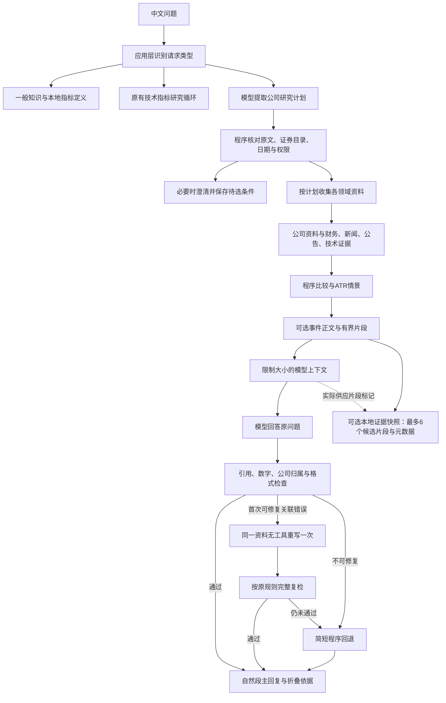
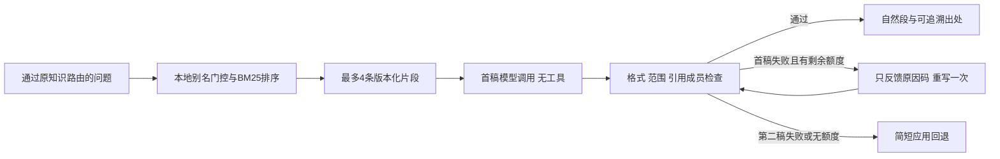

# 研究资料采集与知识检索

公司资料、新闻/公告正文、来源选择、有上限的并发采集、证券目录刷新和本地知识检索。

> 本文由多份原设计文档按主题合并而成（2026-11-16）。各节保留原文，包括当时的日期、提交号、总线消息号和命令；其中提到的早期演示模块（如 `agent_demo`）和研究意图 v2.5/v2.6 封存评测脚本已在同次清理中删除，需要时请查看 git 历史（标签 `research-intent-v2.6-freeze-valid`）。

## 目录

- [多维公司研究：流程、证据与模型切换](#多维公司研究流程证据与模型切换)
- [有上限的资料与报价并发采集（3a、3b、3c）](#有上限的资料与报价并发采集3a3b3c)
- [新闻与公告正文 A：来源、预算和回答片段](#新闻与公告正文-a来源预算和回答片段)
- [产品入口的显式行情来源选择](#产品入口的显式行情来源选择)
- [真实证券目录：显式刷新与安全保存](#真实证券目录显式刷新与安全保存)
- [有来源的交易知识问答](#有来源的交易知识问答)


## 多维公司研究：流程、证据与模型切换

2026-11-12：新闻/公告正文 A 已接入，默认关闭；用 `start.cmd --research-documents events` 才会在明确事件或原文问题中尝试有限网页正文。普通综合研究、历史研究、保存结果、纯解释和 Dev 模式不新增正文请求。只向回答提供有界片段，不归档全文；省表新闻和公告首页为部分可读，模型片段、来源面板与保存快照均保留完整性，且不额外补取。新浪 CJ 链接仍只有标题，PDF 尚未读取。新的来源盲测和真实回答验收仍待 Claude，详见[正文设计与边界](research-data-design.md#新闻与公告正文-a来源预算和回答片段)。

2026-10-29 B批：普通追问可继承最近成功公司或技术研究的核验身份，按发布序号决定先后；显式股票优先，多对象单数追问要求选对象。15分钟仅限制旧数值复用，普通新研究追问过期后重核目录并取新资料；来源/演示模式改变时不继承旧范围。技术→决策只交身份，按本轮领域和期限重建计划，不继承“只看SMA3”的旧限制。明确历史查看不重新取数，也不更新研究先后。

完整新研究可越过旧澄清，失败或停止时保留正式旧pending；知识插问不清它。候选可用当前显示序号并附一次合法条件更新。有限自然表达仍有边界，模型修正和更广泛日期/筛选放宽延期，见B处置表。

2026-10-29 A 批更新：当前公司回答统一使用[自然语言 v3 结构与局部校验](answer-design.md#自然语言公司回答与局部校验)，支持近期行情/单季财务、局部删句、一次结构修正、独立保留评级和程序事实兜底。下文逐段引用、字面数值精度及整份拒绝的描述保留为旧 v1/v2 设计记录；当前规则以上述新文档为准。路由行为本批不变。

2026-10-29新增：决策类问题现使用[结构化参考研判与ATR计划](answer-design.md#参考研判与-atr-条件计划)，同次回答产生逐股评级和方向，程序计算两档条件价位；普通研究和原v1风险情景保留。下文早期“普通方向不启用风险情景”描述仅适用于旧 `risk-scenario-v1`，新 `decision` 目标按新契约准备计划，不将模型判断当作已验证事实。

更新：2026-10-27。本文描述当前业务扩展；早期单股票日线 PRD 的历史范围仍保留，不再用它推断新增能力尚未接入。技术分析新增ADX/OBV/VWMA、互补指标组合、规则候选、已完成周线与日周核对，详细口径见[技术分析设计](technical-analysis-design.md#技术分析扩展指标信号与日周核对)；下文带日期的验证记录保留为当时结果。

### 1. 目标与参考

用户直接提出研究问题，例如“分析平安银行的走势，结合财报和新闻说说接下来关注什么”。系统先理解需求，再取得相应资料，由程序计算指标与风险情景，最后让模型用自然语言回答原问题。主回复不再用字段清单代替分析；来源和详细数据作为可展开的依据。

参考两个项目的公开设计：

- [TradingAgents](https://github.com/TauricResearch/TradingAgents)：分开处理市场、财务、新闻等领域，把工具输出交给综合阶段，并限制工具循环。
- [TradingAgents-CN](https://github.com/hsliuping/TradingAgents-CN/tree/v3.0)：中文提问、A 股数据适配、模型配置和面向使用者的研究流程。

本项目保留模块化单体和显式 Python 编排，自行实现领域数据契约与程序检查；没有复制研究员、辩论者、交易员的整套角色，也没有迁移到 LangGraph。这里更需要先解决数据覆盖、回答相关性与会话条件继承。领域拆分是一种职责划分，不要求每个领域都增加一次模型调用。

参考公开架构不等于直接复用代码许可。CN v3.0 包含混合许可，不能把整仓的应用代码及其依赖链视为统一开放许可搬入本项目；具体文件复用需另行核对。本次是独立实现，没有复制这些模块。

### 2. 当前请求流程



一般知识由 `open_knowledge.py` 处理；固定指标定义继续使用零模型快捷路径。具名股票、行情与新闻请求不借知识入口使用模型记忆补数字。保守识别的教学问题不强制加载证券目录，目录过期不会阻止解释 PE/PB。

没有公司研究续接上下文、且明确只研究技术指标时，保留 `research_workflow.py` 的有界工具循环。宽泛的个股分析、基本面、新闻、公告、最多三只明确候选的比较，以及风险情景走 `product_agent.py`；已有公司研究的“只看技术面”可沿用该公司研究路径。两条路径共享原有模型协议、研究计算、会话控制与 HTTP 服务，不是两个独立产品。

### 3. 理解需求与会话边界

`product_plan.py` 请求一次结构化意图，提取原文中的名称、代码、历史日期、未来观察期限和研究领域。模型不根据记忆把名称换成代码：程序确认这些表述确实存在于问题中，再通过证券目录核实身份；名单不能漏股，最多三只，歧义先澄清。

2026-10-30起，日期、展望和澄清原因的可空字符串兼容固定空值写法：去首尾空白、忽略大小写后的 `null`、`none`、`无` 和空字符串按空值处理，并在 `applied_defaults` 中记录 `model_null_string_normalized:N` 转换字段数；与[自然研究理解](request-understanding-design.md#自然语言研究入口理解意图核实名称展示默认值)共用规则。原始响应保留，原文没有的真实日期仍返回 `ungrounded_product_intent`，不放宽日期依据要求。

宽泛的分析或方向问题默认收集公司背景、财务、新闻、公告、技术面。明确的领域问题按计划缩小范围。历史数据截止日与“未来一个月怎么看”分别表示数据边界和回答目标，后者不会授权查询未来行情。

公司研究也透传明确指标条件。例如“分析平安银行基本面并结合RSI7”保存 `rsi(window=7)`，而不是回到默认 RSI14；`ProductPlan.indicators` 经校验后传给同一轮日线请求，股票澄清和新领域追问继续保留这组条件。解析先识别并移除指标短语，再处理日期，避免把“20日均线”误当成历史窗口。KDJ、RSI999或无效MACD参数会要求澄清，不静默替换成默认指标。

未提供明确指标时，`technical_selection.py`才按动量、量价、趋势强度或结构波动问题选互补组合；一般问题继续使用原八项默认。ADX、OBV和VWMA可明确请求，也可以由适当组合引入。选择来自应用规则，不能称为模型学习的行情分类；明确参数与否定仍优先，原有ATR风险依赖另按权限处理。

`_positive_scope()` 先处理明确否定，再决定领域与指标。例如“只看新闻，不需要技术指标”不取日线；“只看基本面，不要RSI7”不会因出现RSI这个词就新增技术研究。`只看/仅看`约束与否定领域由程序执行，模型提出的其他领域不能覆盖这些边界。当前是对已定义表达的有界解析，不等于已经理解所有自然语言否定。

待选股票条件和最近研究结果各有独立状态，默认有效期为15分钟。查看已有结果可以不重新取数；需要新领域时开展新研究，同时继承未被显式修改的历史窗口、历史模式和未来观察期限。只有明确“最新/刷新”或新日期窗口才覆盖原时间条件，不能把历史追问悄悄变成当前研究。直接“只看技术面”也可续接原公司，明确否定的领域不再加入计划。会话不是无限聊天记忆，复杂修改和更多自然表述仍需独立验证。

`turn_control.py` 为公司研究保留每轮最多6次模型调用、最多3次日线计算和共享协作期限。当前通常一次意图理解、一次无工具综合；综合遇到允许修复的关联错误时最多再调用一次。上限不是必须用满的步骤数，也不是硬中断或账单上限。内置服务把最多三家公司的非技术资料统一调度，整批最多三个领域任务，进程共用三个在途名额；公司分账与整批请求/字节总账原子更新，不能互借。全部资料先在主线程校验，再按原公司顺序执行技术计算及合并证据，模型和筛选批次保持原执行方式。不透明注入服务仍逐公司调用。

3b把3a原逐公司各默认20秒的来源窗口收紧为整批共享20秒（可信配置最多30秒）；来源缓慢时可能更早显示部分覆盖。截止保留已接纳领域，缺失项记固定超时代码，并在自然回答或兜底中明确哪些证券的哪些资料“未取得”，不增加界面或模型调用。来源超时追踪为stopped，普通故障为failed；整轮取消的未完成来源仍可保留unfinished，迟到结果不发布。详见[并发采集设计、评估指标与离线计时](research-data-design.md#有上限的资料与报价并发采集3a3b3c)。

正常服务可用 `.\.venv\Scripts\python.exe -m trading_companion.api_server --collection-workers 1` 逐领域采集，用于同来源真实评估对照或来源限流时回退；参数只接受1、2、3，默认3，只能在启动时配置，聊天和HTTP不能修改。`--demo`及独立Dev Mode继续使用人工夹具。旧的单HTTP客户端注入默认串行，自有并发任务各自创建和关闭客户端；不会共享未经证明可并发的连接会话。

### 4. 数据领域与来源

| 领域 | 当前实现 | 可以支持什么 |
| --- | --- | --- |
| 公司背景 | 东方财富公司资料 | 主营、行业、公司简介、上市日期等当前背景 |
| 财务 | 东方财富财务端点 | 当前响应中截止日可用的最近报告期：收入、归母净利润、同比与加权 ROE |
| 新闻 | 默认新浪个股资讯列表；东方财富可显式配置 | 有界标题或摘要，不能冒充已读取新闻全文 |
| 公告 | 默认东方财富；巨潮可显式配置 | 与证券对应的公告标题和时间；巨潮已核实映射范围为深市 |
| 技术面 | 启动时固定的腾讯或 AKShare/东方财富行情 | 同份日线的指标、已确认极值/价格区域候选、已完成周线与日周核对及计算依赖 |

`company_research_contracts.py` 将 request、section、evidence 分开。证据保存证券、来源、内容类型、发布时间、日期精度、报告期、采集时间与修订限制。`product_research.py` 再次检查请求、标的、领域与时间绑定，统一为 `ProductEvidence`；原始数值与单位单独保留，展示数值可以采用易读精度。

技术派生观察由`technical_insights.py`复用同一冻结日线产生，保留完整原始依赖；映射到`ProductEvidence`时仍为技术领域，用`daily_signal_derived`、`completed_week_derived`与`cross_timeframe_derived`区分时间口径。模型只接收受限的关键观察，前端按对应交易日、周线截至或日周核对日期展示，避免把周证据标成日线日期。

公司资料缺少可靠历史发布时间时，只能作为明确标记的当前背景；历史截面不拿它替代当时的公司事实。财务公告日、报告期和更新日分别判断，不能把采集时间当作历史发布时间。

适配器使用固定端点，拒绝跳转、过大响应、错误 JSONP、缺失证券关联和不合格时间。每个领域分别报告可用、空结果或失败，新闻失败不会丢弃已经取得的财务。不同来源由服务端预先配置，失败后不暗中换源。

默认新浪标题入口只读取有限一页；页面标题必须对应公司名和代码，每条保留的标题也要与证券关联。它不是完整新闻库，默认路径没有阅读全文。显式开启的正文 A 只读取 `finance.sina.com.cn` 已知文章结构，CJ 仍停留在标题；具体来源和预算见[正文设计](research-data-design.md#新闻与公告正文-a来源预算和回答片段)。原有记录中的2026-10-25中际旭创公开源小规模探测，仅说明当次公司资料、财务与公告可用，东方财富新闻 callback 异常被拒绝；不外推为长期稳定性或完整研究质量验收。

### 5. 有界候选比较

`comparison_research.py` 只比较用户已经明确的候选，不从全市场发现股票。对营收同比、归母净利润同比、加权 ROE 分别检查：

1. 每只候选都有唯一、属于本公司的有效数值证据。
2. 指标单位为统一百分数，报告期一致且不晚于研究截止日。
3. 使用原始值排序，缺项不补零、不同报告期不强行排序。

每项按数值降序排列，精确相等使用 `1、1、3` 的并列名次；展示舍入不改变顺序。比较结论保留原证据依赖，供模型解释。三项不合成为“总分”或“最值得买”，也不把高增长、高 ROE 自动等同于更好的投资标的。

### 6. 风险情景计算

`risk_research.build_risk_scenario` 接收已校验的同一份日线分析，以最新历史收盘价为假设做多参考点。默认止损距离为1.5×ATR，目标距离为原风险距离的两倍。

明确请求止盈止损或目标情景才启用该计算，普通方向展望不会自动获得这个权限。计划缺少ATR、且本轮没有明确排除ATR时，程序追加ATR14依赖，记录 `indicator_dependency:atr14_for_risk`，保留原有RSI7等明确指标。继承此前自定义指标的风险追问也会补齐依赖；这只是同次日线分析多计算一个指标，不额外取一份行情。若条件明确排除ATR或已有ATR不可用，不能靠模型编造风险水平。

本轮请求包含 ATR14 时优先使用它；ATR14 不足不能偷换更短周期。没有 ATR14 时，只有唯一明确请求的 ATR 才能形成无歧义情景。不能借用旧点、旧股票或另一轮的事实。

程序使用 Decimal，在0.01元网格上对止损向上、目标向下取整，再重新计算实际每股风险、比例与收益风险比。缺少可用 ATR、价格不合理或证据依赖不一致时返回不可用，不让模型自编目标价。

这描述假设，不读取账户、持仓或真实成本，不提交委托。费用、滑点、跳空与成交限制没有进入公式；它不能充当完整交易策略或保证止损成交。

### 7. 综合回答与依据展示

`model_research_context()` 在公司和领域之间分配有限上下文，保留风险情景与已计算关系的机会，不把完整历史序列塞给模型。每份证据分配本轮 `E` 别名，原始标识继续保留在本地。

`product_answer.py` 让模型回答原问题，通常先给主要判断，再说明关键依据、相反证据和观察条件。综合阶段没有工具，不能继续浏览、计算或执行操作。主回复采用自然段；`ProductResearch.tsx` 将资料按公司、来源与报告期折叠展示。

开启正文后，原公司证据的 `E` 编号保持不变，正文片段统一追加在其后。上下文先保护财务、技术及其他公司，只用剩余空间或同公司同领域可替换的标题槽位容纳片段；每文档最多2片、每片480字符，正文记录全轮最多3,000个 JSON 字符，仍受整体上限约束。`ResearchDocuments.tsx` 独立折叠显示实际供回答的片段及原文链接；提取成功但未供应的文档写“本次未用于回答”，不展示未供应文本。可选原句使用 `「」` 和现有 `E` 引用核对，正文中的数字继续走原数字检查，不新增回答版本。

输出检查覆盖 JSON、段落长度、引用存在性、可用上下文、公司归属、数字及单位来源、参考目标的假设措辞。纯粹说明某领域缺失的短段落可以没有引用，但不能夹带其他事实。模型失败或输出不合格时使用简短程序回退；已有技术观察和有效风险参考仍可保留，不重新展示长篇字段清单。

数值检查允许有类型依据的自然表达：`CNY/share` 数值事实中的“元/股”可以写成股票价格常用的“元”，已引用技术事实/关系中的均线、RSI、ATR、布林带和量能窗口可以写为“20日”或“20个交易日”等等价形式。已确认的“未来1个月”允许写为“未来一个月”，不换算成30天或交易日。“不构成目标价”这样的明确否定也不会被误当成在给出数值目标。这不允许金额缩放、价格换算、改动正负号/精度或借用其他段落的数值。模型上下文保留单位，ATR和收益风险比的展示采用7位有效数字，原计算与快照仍保留原始精度。

产品编排显式传入 `repair_invalid=True`：首遍完整输出只有引用关联、已提供数值未在本段绑定对应事实，或比较漏掉已有证据公司这类问题时，才允许一次无工具重写。例如模型引用了“价格与均线关系”记录，却漏引段落内收盘价的数值事实，程序不直接替模型补引用，而是让它重新生成完整答案，再执行完全相同的检查。

重写使用同一份已裁剪资料和应用固定反馈，不复制被拒绝的草稿、不再取数，也不放宽单位、精度、公司或风险标签检查。第一次构造上下文时就预留反馈空间，两次请求都必须满足工具消息协议的字符上限。未知数字、错误单位或精度、危险链接/指令、收益保证、拒答、截断、工具提议或提供方失败不进入修复；第二次仍不合格就回退。两次调用、token观察、取消和期限共用同一个 `TurnControl`，`ProductAnswerRun.responses` 保留实际返回的响应，不形成无限重试。

引用存在、数字正确，不代表自由文字中的全部因果或观点已被证明。当前检查明确不等于原文语义蕴含、所有关系方向认证或预测准确率；尤其不能仅凭新闻标题推出经营变化。真实回答需要独立质量评估。

### 8. 可选 SQLite 证据快照

启动 `api_server --snapshot-db <本地路径>` 后，服务端显式打开 SQLite；默认不创建证据库。成功取得公司研究证据时，可归档公共计划、公司证据、完整技术快照、派生观察及其原始依赖事实和风险情景，不保存原始提问、聊天、模型回答或密钥。技术观察在保存前从同份快照重建核对；这不补建供应商未保存的历史版本。

正文 A 的可选快照保存最多6个已选择候选片段和来源元数据（文档与片段摘要、父标题、段号及提取版本）；部分候选可能因上下文额度而没有送给模型，文档摘要中的片段清单标注实际供应范围。API 和前端只公开实际供应的片段，不能把快照中的全部候选说成该次回答已使用的依据。全文不进入 `raw_value` 或历史库。旧快照没有正文字段仍可读取；查看保存结果不重新抓网页。摘要可定位本次内容，但当前网页没有历史版本保证，不能冒充严格历史截面资料。

`snapshot_store.py` 使用固定 schema、参数化查询、版本与 SHA-256 摘要。内容标识让重复保存幂等，首次观察时间保持不变；事务和连接锁处理并发，单份原始 JSON 上限16MiB。错误采用固定代码，不展示数据库路径或正文。

时间分为两个边界：

- `observed_at`：这份快照第一次写入本地的时间。
- `source_retrieval`：来源资料实际采集时间的汇总；未知就保持未知。

`load/list(..., known_at=...)` 只返回在该时刻已由本地观察、且来源采集时间已知并不晚于查询时刻的快照。它不能证明供应商当时的完整版本，也不是严格 PIT、策略回测或历史新闻归档。摘要可发现损坏，不防止控制数据库的人重写正文并重新计算摘要。

归档失败只标记保存不可用，不能丢弃已经形成的研究回答。当前没有面向用户的长期聊天恢复或快照浏览器，不能把本地存储模块描述成已完成这些界面。

### 9. DeepSeek 与 OpenAI

`model_registry.configured_models()` 仅在显式启动配置阶段读取本地模型设置。默认提供方必须有效，可选提供方配置缺失或格式无效时不公开；不因为默认失败而替换为另一家。

`local_env.load_model_environment()` 保留 DeepSeek 默认行为，新增 `provider="openai"`。每家只返回自己的模型名与密钥，不插值、不修改进程环境，不接受客户端端点。

| 配置与接口 | 行为 |
| --- | --- |
| `DEEPSEEK_MODEL`、`DEEPSEEK_API_KEY` | 默认正常模式；沿用 DeepSeek 工具适配器 |
| `OPENAI_MODEL`、`OPENAI_API_KEY` | 可选 OpenAI API；型号必须显式配置 |
| `GET /health` 的 `available_providers` | 返回服务端已配置的提供方名称，绝不返回密钥 |
| `POST /v1/sessions` 的 `provider` | 从可用 DeepSeek/OpenAI 中选择；省略时使用启动默认值 |

模型在会话内固定。网页切换提供方时建立独立会话，不把原研究记录静默送给另一家；进行中或状态未确认的请求不能靠切换绕过处理。

`openai_tool_model.py` 使用固定 Chat Completions 地址、`developer` 消息、`max_completion_tokens`、`store=false` 和非流式请求；不发送 `temperature`，不跟随重定向或自动重试。它复用严格工具响应解析，统一返回 `provider="openai"`。输出预算包含所选模型可能消耗的推理 token，达到上限仍须当作不完整结果。配置方需要选择支持该消息与工具格式的模型；ChatGPT 网页订阅不等于 API 凭据。

### 10. 失败隔离与验证

关键验证入口包括：

- `test_company_research.py`、`test_company_news_sina.py`：固定 HTTP 响应、时间/单位/标的检查及领域失败隔离。
- `test_product_plan.py`、`test_product_agent.py`、`test_product_answer.py`、`test_product_answer_repair.py`：意图、歧义续接、同轮证据、自然回答、有界重写与回退。
- `test_product_indicator_scope.py`、`test_product_regressions.py`：明确指标透传、周期与日期区分、否定领域、历史追问和ATR依赖。
- `test_comparison_research.py`、`test_risk_research.py`：确定性排序、缺失值、报告期、精度与风险依赖。
- `test_snapshot_store.py`：事务、并发、摘要损坏、版本、隐私、容量与观察时间查询。
- 正文专项测试：纯解析、来源绑定、独立预算、上下文片段、原句/数字检查、集成及前端折叠；离线结果不代替真实来源与回答验收，见[正文设计](research-data-design.md#新闻与公告正文-a来源预算和回答片段)。
- `test_openai_tool_model.py`、`test_model_registry.py`、`test_local_env.py`：模拟 HTTP、请求格式、脱敏、配置隔离与无静默替代。
- API 与前端测试：会话选择、幂等/取消、自然主回复、折叠依据与新会话切换。

测试只使用合成凭据、假模型或 mock HTTP；离线契约通过不意味着真实模型解释质量通过。历史追问必须重点检查条件是否被正确继承；多候选、慢来源、新闻缺失和截断回答也需要人工复核。完整测试结果以本次实际验收输出为准，本文不预写新的通过总数。

本次最终离线结果：1791项Python测试、4个Agent契约场景、30场景×3的MVP回归、5个公司研究流程及API演示通过，无跳过；前端533项测试、TypeScript检查和生产构建通过。干净wheel安装与同源资源检查通过。它们覆盖工程契约，不是1791次真实模型或市场预测评估。

#### 2026-10-25 真实请求复核记录

这些是开发时的小样本探测，不能当作稳定通过率、预测能力或长期来源可用性报告。

| 复核 | 观察结果 | 可以说明什么 |
| --- | --- | --- |
| 五场景单遍基线，真实DeepSeek＋固定合成资料 | 当次2/5通过；财务、新闻意图与风险综合曾失败 | 单遍模型输出仍有波动；不能用离线5/5替代此结果 |
| 产品路径再次复核财务与公告新闻，真实DeepSeek＋合成资料 | 两项均2次模型调用、自然答复accepted；无额外取数 | 新编排可走通这两类问题；没有因此宣称所有场景稳定 |
| 风险情景，真实DeepSeek＋合成资料 | 曾因漏引数值事实和“元/股→元”表达被拒绝 | 促成有界重写及有类型单位别名；数值错误仍拒绝 |
| 中际旭创多领域研究，真实模型＋公开来源 | 当次公司、财务、新闻、公告和技术资料可用，2次模型调用、自然答复accepted | 一次完整公开资料研究链路可用 |
| 网页平安银行多领域方向与止盈止损，真实模型＋公开来源 | 2次模型调用、241条日线、4段自然回答及逐段折叠依据；财务缺失，保留新闻、技术与计算情景 | 领域缺失不会变成整轮拒答；回答会说明具体缺口 |
| 随后独立查询平安银行财务接口 | 当次5个财务字段可用、0条跳过 | 公开接口存在时点差异，不能将先前缺失推断为公司没有财报 |
| 最终网页中际旭创基本面、新闻、技术面与未来一个月展望 | 2次模型调用，状态已完成，4段模型自然回答；逐段展开可核对报告期、数值和来源 | 修复常见期限/周期表达与否定目标的误拦截后，当前界面可完成此问句 |

本次没有配置真实OpenAI凭据，OpenAI仅完成模拟HTTP、配置、接口及前端验证；未宣称真实OpenAI研究验收。修复机制的预算、完整复检与不重取资料由离线测试覆盖，不将其视为已完成真实模型重复质量评估。

另一次将真实旧草稿重放后进行1次实时重写、0次重新取数的探测仍回退：新草稿把新闻中的时间改写为“前一交易日”等未绑定说法。它没有因为用了第二次调用就被放行。这说明有界纠错能限制成本与发布边界，但不保证模型下一次一定合格。

`scripts/evaluate_company_research.py` 使用固定合成公司资料与日线。默认 `--provider fake` 检查代码；显式选择 `deepseek` 才会调用真实模型，仍不请求真实行情或新闻。它直接调用 `synthesize_product_answer()` 的默认单遍模式，不启用产品编排中的一次修复。因此公司研究场景预期仍为一次理解、一次综合；首遍引用错误会使该评估失败，不能把它与产品开启修复后的体验或调用次数混为一谈。纯知识场景只需一次模型调用。输出契约通过也不等于语言质量、来源蕴含或投资效果通过。

### 11. 仍未完成的能力

2026-10-26增量已增加有界样本的数值筛选、当前交易所上市背景、有生效日期的条件规则、带引用的本地知识检索，以及固定SMA下一开盘敞口回放和收益/回撤比较。参见[当前模块进度](architecture.md#当前模块交付与使用示例)。交易所背景获取失败独立进入coverage，行业不能冒充交易所板块；历史请求不会取当前状态回填。

全市场完整性、完整历史主数据与规则校验、任意来源的新闻/公告获取、PDF与完整文档语义理解、严格版本化PIT、真实成交策略模拟、美股及生产多用户部署仍未完成。正文 A 已实现受限网页提取和回答片段，但默认关闭、真实验收待做；公告 PDF（B）及季报年报 PDF（C）尚未实现，需另审。Jev只是独立实验候选，此次开启正文不启用标题排序。当前产品也没有自主下单权限。


## 有上限的资料与报价并发采集（3a、3b、3c）

### 正文 A 的独立可选阶段（2026-11-12）

新闻/公告正文由[正文采集器](../src/trading_companion/document_collection.py)在公司领域资料冻结后补充，默认关闭，明确事件或原文请求且显式启用时才执行。原公司领域每家公司最多5请求、4,048,000字节的额度不变；正文有独立账本，整轮最多额外4次 HTTP、2,048,000字节，每响应最多512,000字节。A 当前最多选3文档，每候选只请求一次，实际至多3次；没有重试、跳转或 PDF 下载。

正文逐篇提交到原共享执行器，不新增线程池；全进程仍最多3个未完成任务。阶段窗口最多12秒，单次下载任务受4秒期限约束，解析和选片在调用者线程上服从阶段预算检查，开始前至少为回答保留20秒；标题排序若开启，另保留其5秒窗口。等待共享槽位也计时；底层请求可能迟到，直到真正退出才归还槽位，迟到结果不进入正式状态。这里的窗口是程序接纳和超时控制，不能宣称底层网络会被绝对墙钟强杀。

正文失败只标记该文档不可用，不丢弃已冻结的财务、技术和标题；整轮取消或期限停止仍传播，不能被可选阶段吞掉。正文采用原有的取消、生命周期和预算基础设施，但不借用公司、报价或其他来源账本。真实正文来源延迟本轮未联网测量，本文旧的人工等待加速比不代表新增阶段提速。触发、来源核验、模型上下文和存储边界见[正文设计](research-data-design.md#新闻与公告正文-a来源预算和回答片段)。

2026-10-28：3a 同公司领域并发、3b 最多三家公司统一采集均已审核并提交；3c 腾讯报价固定批次并发已在工作区实现，待审核。公司资料、财务、新闻、公告和腾讯报价共用一个队列，全进程同时最多三个未完成任务；东方财富仍串行分页，技术计算、模型及市场背景请求的执行方式不变。实现位置是[采集执行模块](../src/trading_companion/collection_execution.py)、[公司采集器](../src/trading_companion/company_research.py)、[产品合并流程](../src/trading_companion/product_research.py)、[新浪新闻适配器](../src/trading_companion/company_news_sina.py)和[报价采集器](../src/trading_companion/screening_source.py)。

### 3c 腾讯报价批次（2026-10-28，工作区待审核）

腾讯的证券ID和批次边界在取数前已经确定，因此协调端一次生成任务表，按原五板块、板块内批次顺序编号，逐个交给共享执行器。完成顺序可以不同，全部成功后仍按原编号合并。standard保留代码前缀样本，expanded保留下标`floor(i × 板块目录数量 / 选中数量)`；不跨板块混批、不补样本。标准默认5批，扩大默认15批，50个ID一批时最多20批。

`QuoteCollectionScope`是报价单次采集的预算账本，最多20请求、总响应2,000,000字节；每个预定任务只请求一次。每个响应仍限200,000字节，实际响应块在保留前原子扣减总账，不按每任务预占200KB，失败不退款。共享生命周期只提取截止、关闭、检查点和结果接纳；公司`CollectionScope`仍最多12个任务描述、1～3家公司、每家公司最多5请求和4,048,000字节，不能借报价额度。

公司和报价、不同会话及旧迟到任务合计仍最多三个未完成Future（后台任务结果对象）。20个描述不等于排入20个后台任务，不新建报价池。腾讯来源窗口默认25秒、最多30秒，只在整次选样前起算一次；等共享名额和借用客户端锁都计入。单请求超时取原6秒上限、来源剩余和整轮剩余的最小值，可信请求配置仍最多10秒。

腾讯自有客户端或可信`session_factory`默认宽度3，每个批次创建并关闭自己的客户端。`session=`借用方式默认宽度1，同一实例跨调用也互斥，不代为关闭；单客户端与2/3宽度、客户端与工厂的冲突在取数前拒绝。服务端已有`--collection-workers`同时传给公司采集与报价配置工厂，独立`screening_cli`新增同名参数，在线默认3。CLI的`--demo`拒绝显式在线采集参数，不创建池或联网；服务端原`--demo`忽略该可信宽度，仍使用隔离人工服务。

任何批次失败、协议不合格、共享字节超限、来源截止或结果未完成，整次不构造快照、不发布部分名单。合法遗漏和`no-match`仍计为`missing_quote_records`，不混同传输失败。`TurnStopped`（整轮取消或期限信号）直接传播。停止后已运行请求可以迟到，直到真正退出才归还名额；其响应关闭，不能改写会话、候选缓存、归档或冻结追踪。发生错误时已发出的并发请求可能多于原串行的首错即停；协调端观察到错误后不再提交。成功固定响应对照的任务、请求、实际字节和覆盖完全一致。

追踪仍只有一次`screening_snapshot`逻辑来源事件，HTTP批次不冒充多个快照。每任务独立复制上下文变量，继承本轮控制器和父事件。东方财富保留原total驱动的分页、跨页总数/顺序/重复校验，所有宽度下均串行。公开源实际限流和耗时留到最终联网评估，不根据旧断连记录声称当前限流。

#77的小修已纳入：模型文字先单独核对6000字符及引用、公司覆盖，再追加程序生成的截止提示；6001字符仍拒绝，不增加重写或模型调用，保持六段上限和引用映射。

2MB精确边界验证还暴露旧腾讯协议正则搜索在大段尾部空白下反复扫描的慢路径。解析器现改为仅从已核验游标匹配，不再搜索后续位置；合法尾部空白和原严格协议反例均保持原处理。20个100KB响应分别用payload填充及尾部空白填充，两种输入都验证完整采集和精确总账，不通过延长期限回避问题。

#### 3c 验证与离线计时

[并发测试](../tests/test_screening_collection_concurrency.py)使用真实采集器、独立假HTTP客户端和事件屏障验证1/2/3宽度、5/15/20批、逆序完成、缺板块、合法遗漏、共享池、迟到占槽、客户端互斥、请求/字节竞争和2MB精确边界。[API测试](../tests/test_screening_coverage_api.py)在已有名单后中途失败、取消、整轮/来源到期，先返回再启动新轮，最后放行旧请求，核对新会话、缓存、归档和追踪不变。[追踪测试](../tests/test_turn_trace_events.py)核对5次HTTP仍只有一次逻辑读取及正确父事件；原3a/3b及35场景105轮冻结路由保持原基线。

[计时脚本](../scripts/benchmark_screening_collection.py)用人工五板块目录、人工GB18030响应、固定墙钟/来源时钟及每请求100ms等待，封锁网络和本地配置读取。相同输入下串行/宽度3各五次，逐字段比较快照、筛选结果、覆盖、请求ID批次与字节，输出选样ID的SHA256摘要（确认同一组ID）。没有加速比通过门槛。

本轮完整`python`门禁通过2211项unittest、244项pytest函数用例、全部原固定流程与依赖检查；该总数包含工作区另有的浏览器启动测试。没有修改前端、冻结路由基线或观察器，也未运行真实行情/付费模型评估。

| 离线人工场景 | 请求/任务数 | 实际响应字节 | 理论等待批数：串行→宽度3 | 串行中位数 | 宽度3中位数 |
| --- | ---: | ---: | --- | ---: | ---: |
| standard，batch_size=80 | 5 | 36,695 | 5→2 | 555.995ms | 229.962ms |
| expanded，batch_size=80 | 15 | 147,710 | 15→5 | 1639.943ms | 550.966ms |
| expanded，batch_size=50 | 20 | 147,705 | 20→7 | 2185.807ms | 767.557ms |

这里只证明人工等待可以重叠，不能代表真实腾讯来源速度或覆盖。两个扩大档的ID相同但批次边界不同，行间分隔的字节数相差5；每个配置内串行/并发字节完全相同。下面保留三次命令的完整原始输出。

```powershell
.\.venv\Scripts\python.exe -X utf8 -B scripts/benchmark_screening_collection.py --coverage standard --batch-size 80 --repeat 5 --delay-ms 100
```

```json
{
  "benchmark": "Tencent_screening_fixed_delay",
  "data_mode": "offline_artificial_http_gb18030",
  "interpretation": "structural_overlap_not_live_source_performance",
  "coverage": "standard",
  "batch_size": 80,
  "repeat": 5,
  "delay_ms_per_request": 100,
  "task_descriptions": 5,
  "pool_unfinished_limit": 3,
  "selected_ids": {
    "sse_main": {
      "count": 50,
      "first": "600000.SH",
      "last": "600049.SH",
      "sha256": "46ad180525c63158c1264096c8cb3ceb6468b70660c94a0b1186e8e9168f6c3e"
    },
    "szse_main": {
      "count": 50,
      "first": "000000.SZ",
      "last": "000049.SZ",
      "sha256": "5dfcbd28150679ea19d298b0a56655b25911d561af2960fcf851a6f1fcdcb5ba"
    },
    "star": {
      "count": 50,
      "first": "688000.SH",
      "last": "688049.SH",
      "sha256": "d088375cd6489000b2d10b024c23ea1de753f1287633d686a52bf68b16cff61c"
    },
    "chinext": {
      "count": 50,
      "first": "300000.SZ",
      "last": "300049.SZ",
      "sha256": "edf42df55d5e46045dd2af488af32ad15af8a32f755af69e0de0b9f1fc1b2045"
    },
    "bse": {
      "count": 50,
      "first": "920000.BJ",
      "last": "920049.BJ",
      "sha256": "aaa3cc9cc1d13fdba1ef1765c72ba5151e6ad7c376beca7d9e7cbbfb4a2c40d6"
    }
  },
  "series": {
    "serial": {
      "workers": 1,
      "theoretical_wait_batches": 5,
      "elapsed_ms": [
        558.492,
        554.522,
        556.452,
        554.492,
        555.995
      ],
      "median_ms": 555.995,
      "maximum_inflight": [
        1,
        1,
        1,
        1,
        1
      ],
      "requests": [
        5,
        5,
        5,
        5,
        5
      ],
      "response_bytes": [
        36695,
        36695,
        36695,
        36695,
        36695
      ]
    },
    "parallel_3c": {
      "workers": 3,
      "theoretical_wait_batches": 2,
      "elapsed_ms": [
        216.061,
        229.962,
        230.579,
        230.676,
        227.882
      ],
      "median_ms": 229.962,
      "maximum_inflight": [
        3,
        3,
        3,
        3,
        3
      ],
      "requests": [
        5,
        5,
        5,
        5,
        5
      ],
      "response_bytes": [
        36695,
        36695,
        36695,
        36695,
        36695
      ]
    }
  },
  "snapshots_results_coverage_requests_bytes_equal": true
}
```

```powershell
.\.venv\Scripts\python.exe -X utf8 -B scripts/benchmark_screening_collection.py --coverage expanded --batch-size 80 --repeat 5 --delay-ms 100
```

```json
{
  "benchmark": "Tencent_screening_fixed_delay",
  "data_mode": "offline_artificial_http_gb18030",
  "interpretation": "structural_overlap_not_live_source_performance",
  "coverage": "expanded",
  "batch_size": 80,
  "repeat": 5,
  "delay_ms_per_request": 100,
  "task_descriptions": 15,
  "pool_unfinished_limit": 3,
  "selected_ids": {
    "sse_main": {
      "count": 200,
      "first": "600000.SH",
      "last": "600398.SH",
      "sha256": "c5669106407aa5194d08b3dbb2998ba1c82de313b33bcb368cbdcbd465e92917"
    },
    "szse_main": {
      "count": 200,
      "first": "000000.SZ",
      "last": "000398.SZ",
      "sha256": "bf40125e61c405cca06b66ded696d1db8c5b392d1904282850489bbb35b303ab"
    },
    "star": {
      "count": 200,
      "first": "688000.SH",
      "last": "688398.SH",
      "sha256": "c98e034bda7c15df3b4aba287dda595f82b2e51ae9b6c7559509a8584ecde418"
    },
    "chinext": {
      "count": 200,
      "first": "300000.SZ",
      "last": "300398.SZ",
      "sha256": "90382a91b85c3e257048db306698b2cd688238eb49f4981de69ac2b464ec5935"
    },
    "bse": {
      "count": 200,
      "first": "920000.BJ",
      "last": "920398.BJ",
      "sha256": "87bacda0d3a757db23cb3de8d4cd10c7e93089b40dee877ab77ed667778ccf6a"
    }
  },
  "series": {
    "serial": {
      "workers": 1,
      "theoretical_wait_batches": 15,
      "elapsed_ms": [
        1647.95,
        1639.355,
        1639.943,
        1641.182,
        1639.789
      ],
      "median_ms": 1639.943,
      "maximum_inflight": [
        1,
        1,
        1,
        1,
        1
      ],
      "requests": [
        15,
        15,
        15,
        15,
        15
      ],
      "response_bytes": [
        147710,
        147710,
        147710,
        147710,
        147710
      ]
    },
    "parallel_3c": {
      "workers": 3,
      "theoretical_wait_batches": 5,
      "elapsed_ms": [
        548.74,
        550.966,
        551.966,
        547.073,
        551.799
      ],
      "median_ms": 550.966,
      "maximum_inflight": [
        3,
        3,
        3,
        3,
        3
      ],
      "requests": [
        15,
        15,
        15,
        15,
        15
      ],
      "response_bytes": [
        147710,
        147710,
        147710,
        147710,
        147710
      ]
    }
  },
  "snapshots_results_coverage_requests_bytes_equal": true
}
```

```powershell
.\.venv\Scripts\python.exe -X utf8 -B scripts/benchmark_screening_collection.py --coverage expanded --batch-size 50 --repeat 5 --delay-ms 100
```

```json
{
  "benchmark": "Tencent_screening_fixed_delay",
  "data_mode": "offline_artificial_http_gb18030",
  "interpretation": "structural_overlap_not_live_source_performance",
  "coverage": "expanded",
  "batch_size": 50,
  "repeat": 5,
  "delay_ms_per_request": 100,
  "task_descriptions": 20,
  "pool_unfinished_limit": 3,
  "selected_ids": {
    "sse_main": {
      "count": 200,
      "first": "600000.SH",
      "last": "600398.SH",
      "sha256": "c5669106407aa5194d08b3dbb2998ba1c82de313b33bcb368cbdcbd465e92917"
    },
    "szse_main": {
      "count": 200,
      "first": "000000.SZ",
      "last": "000398.SZ",
      "sha256": "bf40125e61c405cca06b66ded696d1db8c5b392d1904282850489bbb35b303ab"
    },
    "star": {
      "count": 200,
      "first": "688000.SH",
      "last": "688398.SH",
      "sha256": "c98e034bda7c15df3b4aba287dda595f82b2e51ae9b6c7559509a8584ecde418"
    },
    "chinext": {
      "count": 200,
      "first": "300000.SZ",
      "last": "300398.SZ",
      "sha256": "90382a91b85c3e257048db306698b2cd688238eb49f4981de69ac2b464ec5935"
    },
    "bse": {
      "count": 200,
      "first": "920000.BJ",
      "last": "920398.BJ",
      "sha256": "87bacda0d3a757db23cb3de8d4cd10c7e93089b40dee877ab77ed667778ccf6a"
    }
  },
  "series": {
    "serial": {
      "workers": 1,
      "theoretical_wait_batches": 20,
      "elapsed_ms": [
        2180.279,
        2186.693,
        2187.445,
        2183.224,
        2185.807
      ],
      "median_ms": 2185.807,
      "maximum_inflight": [
        1,
        1,
        1,
        1,
        1
      ],
      "requests": [
        20,
        20,
        20,
        20,
        20
      ],
      "response_bytes": [
        147705,
        147705,
        147705,
        147705,
        147705
      ]
    },
    "parallel_3c": {
      "workers": 3,
      "theoretical_wait_batches": 7,
      "elapsed_ms": [
        767.557,
        769.416,
        765.848,
        764.277,
        769.935
      ],
      "median_ms": 767.557,
      "maximum_inflight": [
        3,
        3,
        3,
        3,
        3
      ],
      "requests": [
        20,
        20,
        20,
        20,
        20
      ],
      "response_bytes": [
        147705,
        147705,
        147705,
        147705,
        147705
      ]
    }
  },
  "snapshots_results_coverage_requests_bytes_equal": true
}
```

### 启动配置与串行对照

正常启动默认每批公司资料采集最多同时运行三个领域任务，三家公司共同使用这三个名额。可用服务端参数收紧为一个或两个：

```powershell
.\.venv\Scripts\python.exe -m trading_companion.api_server --collection-workers 1
.\.venv\Scripts\python.exe -m trading_companion.api_server --collection-workers 2
.\.venv\Scripts\python.exe -m trading_companion.api_server --collection-workers 3
```

参数只接受1、2、3，默认3；非法值在加载配置、启动服务前被拒绝。设为1用于同一数据源的串行/并发真实评估对照，也可在来源对重叠请求敏感时手动退回逐领域获取。没有自动重试或换源。配置只来自服务端启动，聊天和HTTP请求没有修改它的字段。--demo和网页独立Dev Mode仍使用原人工夹具，不创建这些网络采集任务。

参数控制单批采集的宽度，所有默认公司和腾讯报价采集服务还共用进程级的三个在途名额。因此多个会话也不能各自放入三个任务使池膨胀；设为1是每批资料按公司、领域或报价批次依次执行，不把整个应用所有会话和所有HTTP路径改为全局串行。3b、3c只应用一次宽度，不能外层三家公司或五个板块各放入三个任务。东方财富在宽度1/2/3下均保持串行。

直接使用ResearchDataService时，内置客户端或可信session_factory默认宽度为3，可显式传max_workers=1对照。每个任务创建自己的客户端并负责关闭。旧session=注入默认宽度为1，且同一服务实例的借用客户端跨采集调用也互斥访问；客户端仍由注入者关闭。只给一个session却显式要求2/3，或同时提供session和工厂，均提前拒绝。工厂必须每次返回独立客户端；注入时钟和工厂是可信、可在线程间调用的服务端依赖。

### 生命周期与上下文

CollectionExecutor使用最多三个线程的ThreadPoolExecutor，即让现有同步网络调用在固定工作线程中重叠等待。默认实例在首次采集时创建，并由本进程复用。提交前还必须取得三个在途许可之一；Future，即后台任务的结果对象，真正完成或成功取消后才释放许可。这样线程池内部也不会无限堆积待执行任务。

协调端每隔至多20 ms的等待周期重新检查停止条件，空闲名额不足时只等待自己剩余的来源时间。超时或取消后不退出线程池的with，也不调用等待全部任务的shutdown；只关闭当前采集作用域、取消还未运行的任务。已运行的旧任务继续占名额，后续请求不能另开池补偿。测试注入专用执行器并在释放假来源后关闭；生产默认池由解释器退出机制回收。

Python无法强制结束一个已经阻塞的同步请求。生产传输保留连接/读取超时和流式检查点；无视超时的注入客户端会占住有限名额，可能影响后续采集和进程退出，但不会使线程持续增加。这个限制不能描述成硬中断或供应商侧撤销。

每次提交分别复制contextvars.copy_context()，即本调用链的上下文快照，再由任务自己的副本执行。所有副本指向同一个本轮TurnControl（单轮取消、期限和预算控制器）和追踪收集器，但不会同时进入同一个Context对象。父事件也从提交位置继承。不同轮次分别复制，不能把上一轮的控制器或事件带到下一轮。

### 同批资源账本

每批采集在协调端只建立一个CollectionScope，保存绝对截止时间、关闭标志、已接纳结果，以及请求和字节的公司分账、整批总账。账本用同一把锁保证公司和总量的检查、扣减是一个动作，锁内不做网络、磁盘、等待或外部回调。后台任务只持有所属公司的预算视图，共享关闭状态和期限，不能借用其他公司的余额。

| 资源 | 规则 |
| --- | --- |
| 来源时间 | 整批默认20秒，可信配置至多30秒；公司和领域的排队均计入时间，不能重新起算 |
| 单请求时间 | 单请求上限、来源剩余时间、整轮剩余时间取最小值；仍是协作式限制 |
| 请求次数 | 由各公司领域和来源推导，一般每领域一次，巨潮公告最多两次；每家公司完整四领域默认最多4次，巨潮配置最多5次；三家合计最多12次或15次 |
| 单响应大小 | 通常最多512,000字节，巨潮目录最多2,000,000字节 |
| 累计响应体 | 各公司所选端点上限之和；每家公司完整四领域默认最多2,048,000字节，巨潮配置最多4,048,000字节；三家最多6,144,000或12,144,000字节，子集相应收紧 |

禁止历史背景和未验证市场映射的领域不获得额外请求预算。每次尝试发送前原子预留一次；连接失败仍已消耗，不退款重用。巨潮的目录和公告各预留一次，复用该领域自己的客户端。新浪标题列表也使用同一作用域。

保留Content-Length声明校验和单响应限制，每块数据追加前再扣共享字节余额。已经处理的响应体即使解析失败也不退还；超出的块不会追加到缓存。这个账本限制应用保留/处理的响应体，不保证底层网络没有提前收到一个读取块。固定失败码为research_request_budget_exhausted、research_byte_budget_exhausted，已登记到追踪词表。

模型次数、日线计算次数和token阈值继续由原TurnControl管理，没有因为线程变多获得新额度。单次采集的截止时间也不能代替整轮截止时间。

### 多公司调度与共用窗口的取舍（3b）

内置ResearchDataService增加collect_many，即一次获取最多三家公司资料的可信内部入口。1～3个精确类型的请求、证券不重复、合法且不在未来的时间和非空无重复的领域全部在HTTP之前校验。collect委托单元素版本，原返回类型不变。

公司与领域组合压平成最多12个任务描述，由一个协调流程逐项提交；同时未完成的Future仍最多3个，不能把12个Future一次塞入线程池队列。并发时按领域轮转公司，例如A财务、B财务、C财务；宽度1保持公司优先、领域依次。没有外层“公司线程”在同一个池里等待领域子任务，因此不会出现三个外层任务占满池后无人执行子任务的死锁。

**与3a有一项明确的行为变化：** 3a外层逐公司调用，每家公司分别起算默认20秒；3家公司可能合计约60秒。3b整批只起算一次默认20秒，可信配置最多30秒，宽度1也遵守同一窗口。来源缓慢时，3b可能比原来更早只取得部分资料；没有扩大原90秒整轮期限，也没有把每家额度乘三。

资料先在主线程按请求顺序校验，任何证券、日期、领域或批次数量不匹配都在技术计算之前拒绝。随后仍按原公司、领域、证据顺序合并及分配E引用别名；技术分析在主线程逐家公司预留并执行，最多三次。仅精确的内置服务走多公司入口；不透明注入服务、子类和人工夹具保留原逐公司调用、技术计算的交替顺序，不根据属性猜测其并发能力。

来源窗口到期后，已接纳结果保留，其他领域在各公司coverage（资料覆盖状态）里标为research_data_deadline_exceeded。[回答模块](../src/trading_companion/product_answer.py)会在自然回答或兜底文字中追加简短的程序提示，指出哪个证券的哪些资料“未取得”，不增加模型调用或新界面；提示不伪造证据引用，六段上限及原引用绑定保持。普通来源失败继续仅影响对应公司/领域；缺项比较不会补零。

### 合并、停止和追踪

后台任务只返回完全读取、解析后的ResearchDataSection，即一份脱离连接的领域证据；响应和自有客户端先关闭。不返回可继续取数的生成器，不写研究会话或归档。

协调端接纳结果时再次核对作用域，最终按原kinds顺序组批。产品主流程保留原证券/领域/时间校验、公司顺序、证据顺序和E引用别名分配。正常领域失败只影响该领域。来源截止时保留已经接纳的按时结果，未接纳的领域标为research_data_deadline_exceeded；之后到达的数据不并入批次。

整轮取消或截止继续抛TurnStopped，即原上层能识别的停止信号；退出前关闭作用域。真正发布会话状态仍由既有控制器的最终发布锁决定，不由后台回调决定。回调只释放在途许可；新轮次可以开始，上一轮随后完成也不能追加到任何已返回结果或已保存追踪。

内置采集器仍按领域记录来源事件，不额外重复计整批调用，三家四领域最多12个领域事件。并发事件按实际开始先后记录，可以交错；它们的父事件和运行号必须正确。领域读取计数不等于HTTP请求数，例如巨潮一个领域可能两次请求。

来源窗口到期时，协调端将已进入但尚未完成的领域事件在逻辑上结束为stopped，代码research_data_deadline_exceeded；普通来源故障仍为failed。此操作不结束物理线程，也不释放它的在途许可。追踪事件登记与截止同时发生时也会结束到原运行号；已结束事件不会重复计数。合作式返回的截止状态同样归stopped。整轮取消仍保留未完成来源的unfinished语义，收尾冻结后迟到结束不重写文件；没有进入来源边界的排队项不虚构来源事件。格式继续使用trace-v2。

真实评估必须统计“因来源窗口到期而部分覆盖的轮数 / 实际尝试公司资料采集的轮数”，并分别报告单/多公司、领域、串行/并发配置、失败率及耗时分位数，不能只看成功。未取消、未整轮停止的公司研究轮中，sources.stopped提供来源截止信号，sources.failed提供普通来源失败计数；再按固定事件码和最终coverage核对每家公司缺项。若等待全局名额导致某领域从未进入，来源事件不会凭空补齐，因此精确的覆盖比例仍以coverage为准，详细事件截断也须报告；不要把所有stopped（包含整轮停止）直接当成来源超时比例。比例偏高时再依据同来源实测比较可信窗口20秒和30秒，当前不自动延长、不重试或换源。

### 验证与离线观测

[执行器测试](../tests/test_collection_execution.py)用事件、屏障和可控时钟验证最大在途数、各任务上下文、请求/字节原子预留、公司不能互借预算、取消/整轮截止、按时结果保留、超时后多轮不增加线程和许可恢复。[原单公司入口测试](../tests/test_company_collection_concurrency.py)保留巨潮两次预留、借用客户端互斥和3a回归；[多公司测试](../tests/test_multi_company_collection.py)运行真正的采集器，验证跨公司重叠、全批1/2/3宽度、逆序完成后证据/引用/比较一致、第三家公司部分超时、共用截止不重置、坏批次阻止后续技术取数，以及原技术额度。[API测试](../tests/test_product_api.py)覆盖真实多公司HTTP入口、自然回答和兜底的超时提示、取消后新轮继续、旧轮不发布不归档不重写追踪。[追踪事件测试](../tests/test_turn_trace_events.py)检查12来源的同父事件，以及stopped/failed/unfinished区分。

开启新默认实现后仍运行35场景、105轮冻结路由对照；旧夹具直接返回整批资料，因此该对照证明路由/状态契约，没有单独覆盖领域调度，不能替代上述真实采集器入口测试。旧观察器和两份基线文件均保持原文。

以下保留3a单公司固定延迟实验的历史记录，3b多公司对照在后文：

```powershell
.\.venv\Scripts\python.exe -X utf8 -B scripts/benchmark_company_collection.py --repeat 5 --delay-ms 100
```

以下是2026-10-27在Windows本地的原始输出。**离线固定延迟，结构性收益，不代表真实数据源**。每个请求的人工等待均为100 ms，四领域、同样的资料、每轮四次请求和489字节响应体；没有模型、网络、密钥或.env读取。串行四批等待，对应三线程两批等待，理想结构不是必然三倍；实际包含调度开销。结果完全一致，没有在单元测试中设置加速比门槛。

```json
{
  "benchmark": "company_sections_fixed_delay",
  "data_mode": "offline_artificial_http",
  "interpretation": "structural_overlap_not_live_source_performance",
  "repeat": 5,
  "delay_ms_per_request": 100,
  "sections": 4,
  "pool_unfinished_limit": 3,
  "series": {
    "serial": {
      "workers": 1,
      "elapsed_ms": [
        426.655,
        437.033,
        438.001,
        436.72,
        436.242
      ],
      "median_ms": 436.72,
      "maximum_inflight": [
        1,
        1,
        1,
        1,
        1
      ],
      "requests": [
        4,
        4,
        4,
        4,
        4
      ],
      "response_bytes": [
        489,
        489,
        489,
        489,
        489
      ]
    },
    "parallel": {
      "workers": 3,
      "elapsed_ms": [
        218.77,
        217.359,
        217.783,
        218.657,
        216.558
      ],
      "median_ms": 217.783,
      "maximum_inflight": [
        3,
        3,
        3,
        3,
        3
      ],
      "requests": [
        4,
        4,
        4,
        4,
        4
      ],
      "response_bytes": [
        489,
        489,
        489,
        489,
        489
      ]
    }
  },
  "serial_over_parallel": 2.0053,
  "results_equal": true
}
```

这只是等待重叠的本地证据。真实限流、延迟、失败率和模型成本要在后续真实评估中另测；可用上述启动参数在同来源、同模型和同问题下做对照，不能把本段比值写成线上提速承诺。


### 3b三种调度的离线固定延迟对照

2026-10-28：三种模式使用同一专用三槽执行器、每任务独立人工HTTP客户端、每请求100毫秒固定等待，各重复5次。资料按请求证券生成，全部结果逐字段完全一致；禁止网络、密钥和.env读取。没有模型或技术计算。**离线固定延迟，结构性收益，不代表真实数据源**。

```powershell
.\.venv\Scripts\python.exe -X utf8 -B scripts/benchmark_company_collection.py --companies 3 --kinds financial --repeat 5 --delay-ms 100
.\.venv\Scripts\python.exe -X utf8 -B scripts/benchmark_company_collection.py --companies 3 --kinds all --repeat 5 --delay-ms 100
.\.venv\Scripts\python.exe -X utf8 -B scripts/benchmark_company_collection.py --repeat 5 --delay-ms 100
```

| 公司/领域 | 模式 | 理论等待批数 | 中位耗时（ms） | 每轮请求/字节 | 最大在途 |
| --- | --- | --- | --- | --- | --- |
| 3家公司/财务 | serial | 3 | 325.402 | 3/792 | 1 |
| 3家公司/财务 | company_parallel_3a | 3 | 327.134 | 3/792 | 1 |
| 3家公司/财务 | batch_parallel_3b | 1 | 108.641 | 3/792 | 3 |
| 3家公司/四领域 | serial | 12 | 1304.569 | 12/1467 | 1 |
| 3家公司/四领域 | company_parallel_3a | 6 | 653.521 | 12/1467 | 3 |
| 3家公司/四领域 | batch_parallel_3b | 4 | 434.967 | 12/1467 | 3 |
| 1家公司/四领域 | serial | 4 | 435.174 | 4/489 | 1 |
| 1家公司/四领域 | company_parallel_3a | 2 | 217.523 | 4/489 | 3 |
| 1家公司/四领域 | batch_parallel_3b | 2 | 217.726 | 4/489 | 3 |

三公司单财务：3a与串行都要三批，3b一批，3a/3b中位比值3.0111；三公司四领域：串行十二批，3a六批，3b四批，3a/3b为1.5025，不能统一写成三倍。单公司3a与3b都为两批，中位比值0.9991，保留原结构。真实限流、来源失败、时间窗口及串行技术/模型都会改变整轮效果；后续真实评估同时观察覆盖率，不设置测试加速比门槛。

三份原始输出如下：

```json
{
  "benchmark": "company_candidates_fixed_delay",
  "data_mode": "offline_artificial_http",
  "interpretation": "structural_overlap_not_live_source_performance",
  "repeat": 5,
  "delay_ms_per_request": 100,
  "companies": 3,
  "kinds": [
    "financial"
  ],
  "task_descriptions": 3,
  "pool_unfinished_limit": 3,
  "series": {
    "serial": {
      "workers": 1,
      "theoretical_wait_batches": 3,
      "elapsed_ms": [
        321.573,
        324.388,
        325.402,
        325.64,
        329.312
      ],
      "median_ms": 325.402,
      "maximum_inflight": [
        1,
        1,
        1,
        1,
        1
      ],
      "requests": [
        3,
        3,
        3,
        3,
        3
      ],
      "response_bytes": [
        792,
        792,
        792,
        792,
        792
      ]
    },
    "company_parallel_3a": {
      "workers": 3,
      "theoretical_wait_batches": 3,
      "elapsed_ms": [
        327.134,
        327.72,
        326.212,
        328.06,
        325.826
      ],
      "median_ms": 327.134,
      "maximum_inflight": [
        1,
        1,
        1,
        1,
        1
      ],
      "requests": [
        3,
        3,
        3,
        3,
        3
      ],
      "response_bytes": [
        792,
        792,
        792,
        792,
        792
      ]
    },
    "batch_parallel_3b": {
      "workers": 3,
      "theoretical_wait_batches": 1,
      "elapsed_ms": [
        108.641,
        107.97,
        109.921,
        108.057,
        109.211
      ],
      "median_ms": 108.641,
      "maximum_inflight": [
        3,
        3,
        3,
        3,
        3
      ],
      "requests": [
        3,
        3,
        3,
        3,
        3
      ],
      "response_bytes": [
        792,
        792,
        792,
        792,
        792
      ]
    }
  },
  "serial_over_3b": 2.9952,
  "3a_over_3b": 3.0111,
  "results_equal": true
}
```

```json
{
  "benchmark": "company_candidates_fixed_delay",
  "data_mode": "offline_artificial_http",
  "interpretation": "structural_overlap_not_live_source_performance",
  "repeat": 5,
  "delay_ms_per_request": 100,
  "companies": 3,
  "kinds": [
    "profile",
    "financial",
    "news",
    "announcements"
  ],
  "task_descriptions": 12,
  "pool_unfinished_limit": 3,
  "series": {
    "serial": {
      "workers": 1,
      "theoretical_wait_batches": 12,
      "elapsed_ms": [
        1303.843,
        1306.651,
        1305.291,
        1304.335,
        1304.569
      ],
      "median_ms": 1304.569,
      "maximum_inflight": [
        1,
        1,
        1,
        1,
        1
      ],
      "requests": [
        12,
        12,
        12,
        12,
        12
      ],
      "response_bytes": [
        1467,
        1467,
        1467,
        1467,
        1467
      ]
    },
    "company_parallel_3a": {
      "workers": 3,
      "theoretical_wait_batches": 6,
      "elapsed_ms": [
        651.312,
        653.521,
        654.154,
        654.028,
        652.966
      ],
      "median_ms": 653.521,
      "maximum_inflight": [
        3,
        3,
        3,
        3,
        3
      ],
      "requests": [
        12,
        12,
        12,
        12,
        12
      ],
      "response_bytes": [
        1467,
        1467,
        1467,
        1467,
        1467
      ]
    },
    "batch_parallel_3b": {
      "workers": 3,
      "theoretical_wait_batches": 4,
      "elapsed_ms": [
        434.967,
        434.94,
        435.269,
        437.631,
        433.938
      ],
      "median_ms": 434.967,
      "maximum_inflight": [
        3,
        3,
        3,
        3,
        3
      ],
      "requests": [
        12,
        12,
        12,
        12,
        12
      ],
      "response_bytes": [
        1467,
        1467,
        1467,
        1467,
        1467
      ]
    }
  },
  "serial_over_3b": 2.9992,
  "3a_over_3b": 1.5025,
  "results_equal": true
}
```

```json
{
  "benchmark": "company_candidates_fixed_delay",
  "data_mode": "offline_artificial_http",
  "interpretation": "structural_overlap_not_live_source_performance",
  "repeat": 5,
  "delay_ms_per_request": 100,
  "companies": 1,
  "kinds": [
    "profile",
    "financial",
    "news",
    "announcements"
  ],
  "task_descriptions": 4,
  "pool_unfinished_limit": 3,
  "series": {
    "serial": {
      "workers": 1,
      "theoretical_wait_batches": 4,
      "elapsed_ms": [
        430.283,
        436.726,
        435.44,
        435.174,
        435.091
      ],
      "median_ms": 435.174,
      "maximum_inflight": [
        1,
        1,
        1,
        1,
        1
      ],
      "requests": [
        4,
        4,
        4,
        4,
        4
      ],
      "response_bytes": [
        489,
        489,
        489,
        489,
        489
      ]
    },
    "company_parallel_3a": {
      "workers": 3,
      "theoretical_wait_batches": 2,
      "elapsed_ms": [
        217.523,
        218.752,
        216.56,
        216.499,
        218.94
      ],
      "median_ms": 217.523,
      "maximum_inflight": [
        3,
        3,
        3,
        3,
        3
      ],
      "requests": [
        4,
        4,
        4,
        4,
        4
      ],
      "response_bytes": [
        489,
        489,
        489,
        489,
        489
      ]
    },
    "batch_parallel_3b": {
      "workers": 3,
      "theoretical_wait_batches": 2,
      "elapsed_ms": [
        217.95,
        217.726,
        217.421,
        217.911,
        216.993
      ],
      "median_ms": 217.726,
      "maximum_inflight": [
        3,
        3,
        3,
        3,
        3
      ],
      "requests": [
        4,
        4,
        4,
        4,
        4
      ],
      "response_bytes": [
        489,
        489,
        489,
        489,
        489
      ]
    }
  },
  "serial_over_3b": 1.9987,
  "3a_over_3b": 0.9991,
  "results_equal": true
}
```


## 新闻与公告正文 A：来源、预算和回答片段

更新：2026-11-12。状态：A-1来源读取层已由Claude审核、提交并推送d5701c2，三批76份真实网页中新闻32/42、公告34/34可读。A-2追加公告纯文本重排、实质句筛选和公告v3兼容后，Claude已审核、提交并推送1d6f2c7；最终原8题复测触发8/8、相关选篇8/8，实际供应15片中14片有实质内容，已超过75%目标。A-3的HTML版头与正文混排过滤已由Claude审核、提交并推送b076461；不把A-2的真实验收数字写成A-3新增验收。用户已决定在 `start.cmd` 中默认开启正文阅读，直接运行服务的默认值不变。

### 1. 开启与适用范围

`start.cmd` 正常模式默认开启；本轮关闭可运行：

```powershell
.\start.cmd --research-documents off
```

`--research-documents` 只有 `off` 和 `events`。启动脚本在用户参数前提供 `events`，用户后传 `off` 可覆盖；直接运行 `api_server.py` 或 `python -m trading_companion.api_server` 仍默认 `off`，直接构造 `ResearchApiService` 的默认值也不变。服务端启动配置决定是否接入，不接受模型或前端自行扩大权限；DeepSeek 与 OpenAI 的正常公司研究入口均可使用。`start.cmd --demo`、`start.cmd --data synthetic` 自动省略隐式正文默认值；这两类启动仍不接受显式 `events`，网页 Dev 模式也隔离正文来源。

开启后仍须本轮计划包含新闻或公告，且用户正向请求新闻、公告、事件、消息、披露、发生了什么或原文/正文/全文，或明确的通知、决议、议案、会议纪要、投资者关系活动记录、说明会等文书。报告/记录限定文书语境；内容、具体、说了什么等词不能独立授予领域。文书识别和否定规则由确定性程序共享，A-2不改意图模型提示词。明确不读正文时跳过，领域排除和已确认范围继续有效。普通综合问题即使默认带新闻领域，也不因此新增正文请求。明确历史研究、保存结果查看及纯解释不新增正文 HTTP；当前网页没有版本化历史，不能拿它回填过去。

候选只来自本轮已冻结、供应商报告的同股标题，不接收任意 URL（网页地址）或模型新给的地址。单公司最多新闻与公告各一篇；多公司先让每家公司有一篇机会，最多三篇。此次开启不启用 Jev 标题排序，也不引入长期记忆模块。

### 2. 来源与身份核验

| 类型 | 当前读取方式 | 必须满足的条件 |
| --- | --- | --- |
| 新闻 | `https://finance.sina.com.cn/…/doc-….shtml` 的已知 HTML 结构 | 唯一 `div#artibody.article` 正文、主标题、发布时间和正文结束标记；标题、日期/可用分钟精度及公司名或证券代码与父标题相符 |
| 公告 | 固定 `https://np-cnotice-stock.eastmoney.com/api/content/ann` 详情 JSON（结构化响应），由父详情链接提取公告号 | 公告号、证券、标题、日期与列表一致；市场及名称等身份字段出现时也要核对；正文内容有效 |

新浪提取器版本为 `sina-artibody-v3`，结构依据包括此前核查及 Claude 保存的本轮真实页面。新闻解码优先使用响应头 charset，再检查前2048字节的 meta charset/http-equiv 声明；没有声明时严格尝试 UTF-8，失败再尝试 GB18030。只允许 UTF-8、GB2312、GBK、GB18030，显式不支持的编码、冲突声明或坏字节拒绝，不用替换字符掩盖解码错误。`cj.sina.cn` 移动文章只保留标题，不读正文。页面改版、身份/时间不符、正文缺失或未知截断时拒绝提取，不猜测其他容器，不改抓其他来源。隐藏内容、脚本、广告及页面导航不能混入正文。

解析采集唯一正文区内可见的 `p` 段落，以及 `blockquote` 引用块内的直接文字和已知行内文字；引用块与内部段落按源顺序分段。可见最外层 `table` 整块省略，包括其中的 p，嵌套表不重复计，隐藏/推广表不计遗漏；记 `omitted_tables`，文档为部分可读，原因 `document_tables_omitted`。p/引用块之外只在 a 内的文字作为导航忽略；其他无法分类的实质文字仍整篇拒绝。省表后为空或证券身份仅出现在被省表内容中仍拒绝。

对已核查的广告注释、重复正文结束标记及二维码推广容器分别处理；可容忍常见段落和可见行内格式闭合，不推测结构容器缺失边界。上述省略不绕过栈、节点/深度上限及隐藏格式跨段校验。首个正文结束标记后，同一正文容器内的可见 p、裸文字、引用、链接或表格仍拒绝，不能利用导航或省表豁免吞掉尾段；表内出现正文结束标记也拒绝。

真实页面可见时间与列表一致，而 `article:published_time` 有时晚数分钟。优先用 `bytedance:published_time` 与可见时间、列表分钟精度严格核对；缺少该字段时才用 `article:published_time`，不放宽分钟容差。所有已知发表/更新/`lrDate_time` 字段均核验，最大时刻暂存 `ResearchDocument.metadata_at`，与发表、更新时间一起检查不晚于研究截止或正文观察时间；不把另一种发表元数据伪称更新时间，也不把该临时字段扩为公开协议。

东方财富的父链接必须是对应证券的 `data.eastmoney.com/notices/detail/{六位代码}/AN….html`。提取器版本为 `eastmoney-announcement-body-v3`；只有 PDF 链接、附件下载提示或摘要时，视为未取得正文。A 不下载或解析 PDF，也不把公告列表当作已经阅读全文。其他新闻、巨潮以及不在来源规则内的标题仍保留原路径。

公告v3只在纯文本分支把PDF视觉行拼成段落：前行以。！？；：及后随闭引号/括号结尾、下行以编号/标题标记开头或遇空行时分段。真实性声明之前的版头、“特此公告”之后的落款逐行保留；中文衔接不加空格，英文/数字跨行保留空格，不拼造新数值。原始非空视觉行400段/32000字符先检查，随后检查重排与部分裁尾后的结果，不能靠合并或裁尾绕过资源边界。HTML分支的提取行为不改，统一产出v3版本；正文散列和段号可能改变。旧v1/v2快照保留原版本、ID和段号，不迁移、不重算。

编号与小数存在保守分段的歧义：例如换行后的“1.23 亿元”仍可能按层级编号另起一段；不会合成新数字，但可能使金额与前句分开。当前不猜金额单位或跨空行补句。

公告详情使用实际的 `security` 列表，通过目标行的 `stock`、`market_uni` 及中文简称绑定证券；简称沿用目录的全半角/空格规范化，不猜新别名。只有代码等于目标代码的行严格要求名称齐全、一致且匹配目录；非目标行只核代码/市场结构，可带不同历史名称，其合法名称仅用于核对顶层聚合名，不能替代或补足目标行身份。顶层聚合名仍须匹配某行可用名称或目标名称，目标行缺失、错市场或名称冲突仍拒绝。第三批 a5/a6 的港股历史行分别带“天成控股(旧)”和“世纪集团国际-旧”，不影响同列表内正确的目标A股行。

`notice_date` 只核日期：同日允许；晚1自然日仅在父标题有精确时刻且上海时间不早于15:00时允许，其他差值、上午+1、仅日期父标题+1仍拒绝。发表时刻始终只来自父标题；eitime 入库时间不参与发表判断，详情 display_time 若有则额外核对父标题分钟，不能借跨日豁免放过冲突。

前两批18份公告同日7份、+1自然日11份；这11份均在16:00后发布，最早16:47，初版据此设置16:00。第三批a8父标题为2026-11-05T15:32:07.327000+08:00，notice_date为11月6日，说明本供应商收盘后日期标注也出现在15点时段，按#603修订为≥15:00。同日晚间也存在，所以不能要求收盘后必须+1。第二批a5/a6/a9是周五11月6日晚发布、notice_date为周六11月7日，按自然日处理，不改成下一交易日。

`page_size` 缺省1，出现时必须是正整数且不能是布尔值；大于1只读取本响应第一页，不新增请求，记 `page_count`、`complete=false` 和 `document_first_page_only`。公告可见正文中 U+E000–U+F8FF 私用字形替换为空格并计 `private_use_characters_replaced`，防止直接删除粘连数字；不猜符号含义，不改属性、标题或身份。其他非普通空白的控制字符仍拒绝，实体在可见文字处理时检查，不能先被空白折叠吞掉。

省表或仅首页的部分文档，在原提取字符/段数上限检查后，删除最后可信句末之后的整个后缀，记录 `omitted_trailing_characters`，再生成段号和散列。句末限 。！？!? 及紧随的闭引号/括号；括号/引号尚未闭合时不接受内部句号，链接查询中的 ASCII 问叹号也不作为句末。ASCII点、分号、冒号不当作可信句末，不切开小数或同句条件。无完整句仍拒绝；完整单页不一律删落款。裁尾后还要核验不是仅标题、摘要或附件提示。段落不跨被省表内容拼接。后页仍可能有独立限定，所以部分标志只表达覆盖范围，不保证语义完整。

所有正文均是不可信资料。固定端点、禁止重定向、不重试同篇或同URL、内容类型及响应大小检查在读取阶段执行；失败后只允许下述有界候选替换，不换来源、不沿正文链接抓取。提取后的正文只能成为文字证据，不能改变系统规则、请求工具或执行操作。失败原因使用固定码，前端只显示普通中文，不回显异常正文或底层路径。

### 3. 独立预算与停止

| 边界 | A 的上限与处理 |
| --- | --- |
| 额外 HTTP | 整轮独立最多4次；保留最多3个最终文档名额，各名额首选失败时至多尝试1篇同股同类备用，全部公司首尝试优先；失败消耗不退回，原每公司最多5次领域请求不变 |
| 响应字节 | 每响应512,000字节；正文阶段合计2,048,000字节；流式读取逐块计量，失败不退回已消费额度 |
| 时间 | 阶段窗口最多12秒；单次下载任务受4秒期限约束，解析和选片服从阶段预算检查；为回答保留至少20秒，标题排序若开启再额外保留5秒 |
| 提取正文 | 新闻最多16,000字符/128段；公告最多32,000字符/400段；原提取上限在部分文档截尾前检查，超限拒绝 |
| 片段 | 每文档最多2片、每片最多480字符；使用完整段落或完整句子，不在数字中间截断 |
| 模型上下文 | 正文记录全轮最多3,000个 JSON 字符；继续服从总上下文14,500字符及工具消息协议20,000字符上限 |

正文逐篇提交到现有共享执行器，所有来源和会话合计仍最多三个未完成任务，不新建线程池。等候槽位计入窗口；来源请求超时后底层工作可能迟到，实际结束前仍占槽。窗口限制结果接纳和调度，不承诺操作系统绝对墙钟终止网络调用。

同股同类标题按去除公司名、证券代码和泛问词后的问题关键词重合度排序，同分按发表时间及原列表稳定顺序，全无命中才取最新。首选有命中时，备用也须有命中；仅附件或读取/解析失败可换篇，成功部分正文、全为噪声或模型容量不足不换篇。备用替换原名额而不追加文档，实际标题/URL和父标题依赖始终指向读到的那篇；原全部标题及E编号不变。trace记录实际尝试与备用次数，不把最终条目数当请求数。

来源或某篇文档失败仅使该篇不可用，保留已有财务、技术与标题；时间不足时跳过可选阶段。`TurnStopped` 是整轮取消或期限信号，继续向外传播。阶段关闭后旧任务不得写入正式会话、归档或冻结追踪。更多共享生命周期约束见[并发采集设计](research-data-design.md#有上限的资料与报价并发采集3a3b3c)。

### 4. 从全文到回答的证据链

1. `ResearchDocument` 是只在当轮存在的有界提取正文对象，记录规范化段落、来源身份、采集时间、提取版本、完整性和内容 SHA-256（内容摘要，用于检验文本一致性）。散列只针对已提取且声明过空白/私用字形规范化的文字，不代表未读取的全文；文档标识同时绑定覆盖元数据。当前网页与采集时间不等于历史发布版本。
2. 根据问题每文档选择最多两片原文候选，整轮最多六片，保留从1开始的段号、原文位置与片段摘要。候选至少30字符且以句末标点结尾或含数字；含议案、审议通过、表决、同意N票的实质短行例外。排除重复标题、无句末的标题子串标签、独立公司全称、短编号小标题、少于40字的来源署名行及空格切碎的表头；完整业务句不因接近标题或金额间有空格而误删。另排除纯会议程序前言、无事实的决议引导句、重复点线页码目录，以及明确备查区域内的编号文献清单。纯声明按句过滤，混排段中只选实质句的连续原文区间，不能跨被删句拼接。评分去除公司名/代码和泛问词，按命中数及原文顺序选，无命中取最早两个实质候选，全噪声不凑片。DocumentExcerpt内部按来源限制段号（新闻128、公告400）；快照和前端仍核对片段段号不超过实际段数。位置与散列对应重排后的规范化正文，不冒充原始PDF页面位置；候选仍不等于实际供应片段。
3. 每个候选转为 `body_excerpt` 证据，依赖原父标题，全文不进入 `raw_value`。嵌套 `document.document_complete` 将完整性随片段传入最终模型请求，提示词不变；新增元数据在现有预算内计量。原全部公司证据之后才追加 `supplemental_evidence`（补充证据列表），因此既有 `E` 编号保持不变；候选随后仍受上下文筛选。
4. 上下文先按原规则选基线，保护财务、技术和其他公司。正文只使用余量或同公司同领域可替换的其他标题槽位；父标题必须实际在上下文中。选中的较旧父标题被基线裁掉时，只能替换同股同类尚未支持其他正文的标题，保留其原E号；父标题与片段整体放不下则两者都不替换。先供应各文档第一片，再考虑第二片，不能绕过总额度。
5. 模型仍进行原综合回答与至多一次原有修正，不新增模型调用；增加的输入 token 可能提高费用，不能把调用次数不变写成费用为零。当前文档契约版本为 `research-documents-v1`，回答继续使用已有 v1/v2/v3，不新增回答 v4。
6. 可选原句写在 `「」` 内并引用实际供应的同股 `E` 片段；片段须为上述规范化提取段落的连续子串，原句逐字检查不变。正文数字只兼容完整数字与已识别单位间的空格，如“1 类”与“1类”；正文专用识别新增“类”计数单位，不开放任意裸数字。数值、符号、小数写法和单位仍须相同，不舍入、换单位或合并数字，不能用被省表或未读尾页的数字作依据。引用存在与文字相同不证明因果推理、来源事实或完整文档理解。

A-3补充混排版头句识别：正确证券身份字段后，只接受与已供应标题精确相同的标题及标准真实性声明，不剥除任意公司名称来猜标题。句首1–4位独立数字与身份字段之间有空白时，可仅在分类副本中忽略该页码；连续数字不作页码猜测。正文、散列和位置不改，夹有担保人、交易对方等业务信息的句子继续保留。

上下文筛选后的文档对象只公开实际供给模型的片段。提取成功但没有片段进入上下文时，元数据可以说明成功提取，公开片段为空。不能用未进入模型的全文证明回答，也不能在最终 API 数据中重新覆盖为未裁剪的片段集合。

### 5. 界面、快照与兼容

主回答保持自然段。前端“正文片段”默认折叠，每篇再展开片段与核验后的原文链接，并标明“供回答的正文片段，非全文”；没有实际供应片段则显示“本次未用于回答”。来源失败显示“正文未取得，仍可参考标题”，不展示工程原因码。文本按普通文字渲染，不执行网页 HTML。

可用来源条目仍用 available，complete=false 与两个固定原因严格配对；集合包含部分文档时用 partial。来源面板固定显示“只读取了第 1 页”或“表格未读取”，未供应片段时也显示覆盖告知。完整性五字段 complete、omitted_tables、page_count、private_use_characters_replaced、omitted_trailing_characters 成组输出并验证，原因沿用 code，不再复制数组；计数排除布尔值、固定边界并核对来源。运行追踪只记录完整/部分及省略计数，不收正文、地址或散列。

公开接口和前端只暴露实际给模型的片段及元数据。可选 SQLite 快照则可保存最多6个已选择候选片段，包括因上下文额度而没有供应的候选；文档摘要中的片段清单标注实际供应范围。保存候选有助于保留本轮有界资料，但不能把它们全算作该次回答已使用的依据。全文和原始网页都不保存。

快照校验父标题与证券/来源绑定、文档/片段摘要和段号。保留 research-documents-v1：代码明确接受旧精确字段组或完整新字段组，不放开任意字段；摘要 complete 与全部候选的 document_complete 严格配套，固定原因与来源、表数/页数一致。旧字段组仅对应新浪v2/公告v1，新组对应新浪v3、公告v2/v3，不能删除完整性后把新提取结果伪装成旧完整格式，也不能互换来源版本。保留字符与裁尾字符之和仍须在新闻16K/公告32K内。旧正文记录及旧无正文快照读取时不补写字段或重算内容标识；不承诺旧程序识别新字段。查看保存结果不联网补正文；若使用已存候选重新形成回答，仍按该次上下文额度筛选，公开输出只给该次实际供应片段。摘要用于一致性检查，不能防止有人同时改写存储内容与摘要，也不能产生供应商历史版本。见[公司研究快照边界](research-data-design.md#8-可选-sqlite-证据快照)。

### 6. 实现位置与验收边界

| 职责 | 位置 |
| --- | --- |
| 全文与片段契约、大小和来源规则 | [research_documents.py](../src/trading_companion/research_documents.py) |
| 新浪纯解析、东方财富详情纯解析 | [company_news_body.py](../src/trading_companion/company_news_body.py)、[company_announcement_body.py](../src/trading_companion/company_announcement_body.py) |
| 触发、预算、共享执行与公开片段裁剪 | [document_collection.py](../src/trading_companion/document_collection.py) |
| 全局证据与上下文分配 | [product_research.py](../src/trading_companion/product_research.py) |
| 配置和各研究入口接入 | [api_server.py](../src/trading_companion/api_server.py)、[api_service.py](../src/trading_companion/api_service.py)、[product_agent.py](../src/trading_companion/product_agent.py)、[research_intent_adapter.py](../src/trading_companion/research_intent_adapter.py)、[screening_followup.py](../src/trading_companion/screening_followup.py) |
| 回答与界面 | [product_answer.py](../src/trading_companion/product_answer.py)、[ResearchDocuments.tsx](../frontend/src/ResearchDocuments.tsx)、[ProductResearch.tsx](../frontend/src/ProductResearch.tsx) |

专项离线测试使用固定页面、JSON、假 HTTP 与假模型，覆盖来源/证券/标题/时间错配、附件和超限拒绝、事件触发与直接服务默认关闭、请求/字节/时间额度、取消和迟到隔离、上下文取舍、原句与数字、历史/保存/Dev 路径及前端兼容。具体运行结果以本次验证与审核消息为准，不预写全量测试数字。

A-2已提交的意图规则基线版本为 `intent-research-documents-v2`。A-3已提交b076461的基线为 `intent-research-documents-v3`，父版为v2；完整v2 current源码指纹追加历史一次，A-3提交时历史共30条，开发中间态不追加历史。不将新基线的离线通过写成真实意图准确率结论；历史题库和旧报告不改写，旧付费评估资格不转移。意图模型提示词、公开正文契约不变，公告及新浪提取器均仍为v3。

Claude已完成三批独立网页实查及原8题最终复测：触发8/8、相关选篇8/8，实际送入最终模型的实质片段14/15，达到至少75%的目标；每轮6.3–14.5秒，共20次模型尝试。Claude执行 `verify.py all` 退出0，3,849项unittest、244项pytest、884项前端及构建、bundle均通过。此前Codex沙箱全量Python检查的一项pytest函数通道错误未在Claude环境复现，不能把该次沙箱检查写成完整通过。Codex没有新增真实调用，仅离线回放已保存字节。B公告PDF与C季报年报PDF尚未实现，来源、解析器依赖、大小/页数预算和引用定位均需单独方案与审核。旧4a stash原样保留，仅手工复用了纯解析、散列与测试思路，不将历史半成品视为本轮验收结果。

后续顺序：A-3已审核、提交推送b076461；线程#589按#594选择形成的记忆第3层自选实施方案#614已获#615批准，自选模块实施与审核状态见[个人记忆设计](memory-design.md#本机个人记忆自选股持仓与偏好)。不因A-2验收或自选模块实施自动打开正文或Jev排序。

### 7. 已知限制与本地回放

Claude 本轮采集的229条新浪标题中，83条（约36%）来自 `cj.sina.cn/articles/view/...` 移动页，当前只保留标题；这只是该批样本比例，不代表新浪全部新闻的长期分布。移动正文支持作为可选后续改进，未在本次扩展来源范围。

按 #601 批准的结构假设，p/引用块之外仅在 a 内的可见文字被当作导航省略；若未来页面把实质限制条件放在这种链接里，当前解析器无法区分其语义。此规则不涵盖链接外相邻裸文字，也不扩展至结束标记之后；真实新网页盲测仍应核查该假设，不把结构匹配当作完整语义理解。

可只读回放被忽略目录中的调试样本，不联网、不输出原文：

```powershell
.\.venv\Scripts\python.exe -X utf8 -B scripts/replay_research_documents.py --samples .agentbus/tmp/document-probe-2026-11-12
.\.venv\Scripts\python.exe -X utf8 -B scripts/replay_research_documents.py --samples .agentbus/tmp/document-probe-2026-11-12b
.\.venv\Scripts\python.exe -X utf8 -B scripts/replay_research_documents.py --samples .agentbus/tmp/document-probe-2026-11-12c
```

每次命令接受一个 `--samples` 目录，按上面三条分批运行，再按各批固定结果和完整/部分计数汇总，不在同一条命令重复该参数。目录不存在时明确跳过，不作为 `verify` 门禁的外部数据依赖。输出逐文件的固定结果码和有界计数；观察时刻来自本地文件修改时间，或显式 `--retrieved-at`，只服务本地诊断，不证明下载或发表时间。仓库回归夹具仅提炼真实标签、注释和字段层级，正文改用短合成句子；原始整篇样本不提交。

修订后两批40份本地样本共35份可读：新闻17/22（13完整、4省表部分），公告18/18（11完整、7仅首页部分）。分页为 ann3/ann4/ann5/ann6/a5/a6/a9，裁尾528/2612/128/0/0/0/472字符；ann4因未闭合引号保守回退到更早完整段，不保留引号内半句；a8替换1枚PUA，其余0。首批新闻8/8、公告8/8；第二批新闻9/14、公告10/10。

第二批剩余 n2/n4/n7/n9/n11 都在表格之外还有直接挂根容器的实质判断句，分别32/40/32/32/34字，按未知段外正文拒绝，不按文件名或模板特判。短而实质完整的52字披露仍保留，不能按长度一概当附件提示。回放只输出固定码、完整性及计数，前两批目标新闻≥17/22、公告≥14/18已达到；第三批结果见下。来源可读不等同回答质量，真实回答结果见A-2最终复测。

第三批修订后新闻15/20（6完整、9省表部分）、公告16/16（9完整、7仅首页部分）。其中公告a0原始4721字符、152个非空行，提取后3648字符，400段新上限可完整保留；a5正确目标A股行不再被非目标港股旧名牵连，a6为部分文档，a8保留父15:32发表时刻。公告部分为a6/a7/a9/a10/a13/a14/a15，a10/a15为3页，其余2页，均只读取第一页。

第三批新闻n4/n6/n7/n16仍为未知段外文字的融资融券模板，n5为“【推荐】”推广稿，均拒绝，不改新闻规则。三批合计新闻32/42、公告34/34，总66/76可读（39完整、27部分），10份拒绝均为上述已确认新闻；前两批不退步。第三批公告≥15/16目标已达到。

首轮8题真实回答由Claude在临时会话/快照/trace库中执行，共23次模型尝试、8次正文请求，每轮6.6–13.0秒，无超时。6/8题触发、12片仅4片有用；上汽问董事会决议却选最新高管离任，中信公告仅附件没有备用，工商银行临时股东会通知与澜起投资者关系活动记录未触发。以上保留为A-2修复前的历史依据，最终复测结果见下。

A-2首轮复测（#609）：同8题触发与选篇均8/8相关，7.1–13.7秒、22次模型尝试、各轮均≤4正文请求。16候选片段实际供应15片，仅4–5片含实质内容；公告视觉行导致标题、半句与表头入选，恒瑞批准上市核心段反而落选。随后修复只离线回放已有原始样本并核对对应原题的片段前60字；不匹配的原始网页样本明确标缺，不用旧已供应片段假装整篇重选。恒瑞式来源/公司全称/批准1类新药上市核心段另有合成回归。

A-2最终复测（#611）：同8题触发8/8、相关选篇8/8，实际供应15片中14片有实质内容，恒瑞重新选中了“批准1类新药上市”核心段；每轮6.3–14.5秒，共20次模型尝试。Claude完整门禁通过后已提交并推送1d6f2c7。剩余HTML混排版头过滤随后作为A-3由Claude审核、提交并推送b076461；A-2的通过结论不是A-3新增真实验收。用户于2026-11-12决定在 `start.cmd` 默认开启；本次仅调整启动层，不增加真实验收结论。


## 产品入口的显式行情来源选择

### 目的与边界

产品启动时可选择 `synthetic`、`tencent` 或 `akshare_eastmoney`。每个后端服务的会话使用该服务启动时固定的可信来源配置；用户问题、模型工具建议和 HTTP 请求体都不能修改它。同一 Web 进程可另外预配独立的离线 Dev Mode 服务，这不意味着在原会话内自由换源。

这一步补齐已经存在的 AKShare 适配器与产品入口之间的连接，不增加新的行情接口，也不声称上游接口当前可用。没有自动重试、自动换源或将多个供应商数据混在一起的流程。

| 启动模式 | 实际研究来源 | 数据性质 | 身份目录 |
| --- | --- | --- | --- |
| `synthetic` | 可信配置绑定的 `csv` | 固定人工样例，非真实行情 | 固定开发夹具，不接受自选目录 |
| `tencent` | `tencent` | 供应商历史日线，不复权，未独立核实 | 本地目录，逐轮重查；运行期间不自动刷新，Windows 启动按需刷新默认目录 |
| `akshare_eastmoney` | `akshare_eastmoney` | AKShare / 东方财富历史日线，不复权，未独立核实 | 与腾讯模式相同的本地目录规则 |

Web 启动器 `api_server` 无参数默认 DeepSeek + 腾讯历史日线、端口8765，并按原规则读取根目录 `.env`。`--demo` 仍是完全离线、不读 `.env` 的显式入口。终端 `agent_cli` 保持原行为：无参数帮助、真实模式显式选择提供方与数据；它没有网页 Dev Mode 切换。模型调用额度和证券身份校验不变。

`start.cmd` 显式传入 `--refresh-stale-directory`：仅正常真实数据模式、未显式指定 `--directory` 时，默认名单缺失、过期或日期在未来才在启动阶段刷新一次。有效名单不联网，格式/读取错误不触发刷新。新名单校验后才原子替换旧文件，重新加载通过后才读取 `.env`；失败停止启动、不退回旧名单或人工数据。运行中不刷新，名单过期仍按原规则拒绝研究。直接 Python 入口默认关闭此参数；终端入口不支持自动刷新。

### 启动方式

在项目根目录安装所需依赖：

```powershell
.\.venv\Scripts\python.exe -m pip install -e '.[api,model,data]'
```

AKShare 包可选，腾讯和人工模式不要求安装它。选择 AKShare 时先检查包是否存在；缺失会输出固定的 `data_dependency_missing`，提示安装 `.[data]`，不会先读取模型密钥、发起模型请求或悄悄改用腾讯。

包存在检查不导入 AKShare、不访问网络，也不证明所有传递依赖、网络环境或上游响应可用。后续实际行情失败仍由适配器与受控工具返回受限结果，不自动换源。

Web / API 正常启动：

```powershell
.\.venv\Scripts\python.exe -m trading_companion.api_server
```

正常后端仍可显式覆盖来源，例如选择 AKShare：

```powershell
.\.venv\Scripts\python.exe -m trading_companion.api_server --provider deepseek --data akshare_eastmoney --directory data/security_directory_live.json
```

终端启动示例：

```powershell
.\.venv\Scripts\python.exe -m trading_companion.agent_cli --provider deepseek --data akshare_eastmoney --directory data/security_directory_live.json
```

正常启动及上述显式命令均启用可能计费的 DeepSeek；实际运行前需自行配置有效模型凭据和当前可用的本地证券目录。上述直接 Python 命令仅检查本地依赖、配置和目录，不调用模型、不请求行情或自动刷新目录；`start.cmd` 只增加前述按需名单刷新，缺配置不退回人工模式。用户提交研究后才执行所需模型或行情请求。不要把密钥写进命令、问题、测试文件或 Git。本文中的命令不是自动验收的一部分，开发测试不执行真实模型或行情请求。

`--demo` 仍只使用固定人工夹具，不能与 `--data`、自选目录或真实来源混用。

### 数据如何流动

1. `api_server.py` 或 `agent_cli.py` 将白名单启动参数解析为可信配置，并检查 AKShare 可选依赖。
2. `ResearchApiService` 将该配置同时传给每轮 `run_natural_research_turn` 和已保存结果的重查。终端入口同样传入所选来源。
3. Agent 用该来源构建并核对请求；原有工具执行器按请求选择适配器。模型如果建议了不匹配的来源，不会获得绕过请求绑定的权限。
4. 已确认参数、报告和图表保留实际来源；历史查看按同一来源重新校验原快照，不会重新取数。
5. 每个服务的 health 和创建会话响应都返回同一个 `data_mode`。网页在同一入口两次响应来源不一致时拒绝建立会话；Dev Mode 还必须匹配预配的 `fake + synthetic`。

人工模式在 Agent 内通过显式开发数据配置绑定 `csv`；它不是用户可自由选择路径的入口。API 服务仍不接受每请求的 `source`、`data_mode`、目录路径或任意 CSV 路径。

### 页面与会话行为

- 侧栏显示所选服务的提供方与数据模式，AKShare 明确标为“AKShare / 东方财富历史日线”；人工数据不得包装为真实行情。
- 用户明确发送即提交问题，不再显示额外的 DeepSeek 许可卡。正常研究的原问题、参数和证据可能发送给模型；股票与日期用于查询正常后端启动时选定的行情源。页面载入与写草稿不调用模型。
- 每份报告展示自己的已确认来源，图表继续校验来源绑定。
- 正常后端及终端的来源由启动固定，失败不自动切换；更换腾讯/AKShare或模型配置须重新启动对应服务/终端。自然语言切源不受支持。
- 网页 Dev Mode 是不同的操作：不用重启，选择同进程预配的独立离线后端，而不是修改正常后端来源。仅空闲、无未确认请求时切换；原会话清理成功即选择目标并清聊天/草稿，再检查目标 health。目标不可用则留在目标断连状态，不恢复已删内容或自动回退；清理失败保留原内容，刷新回正常模式。两边的令牌、会话和预算不混用。详情见[模式设计](agent-runtime-design.md#正常模式与-dev-mode)。

选择行情来源不等于选择证券状态来源。真实模式不会自动加载人工市场上下文，也不会自动查询证券状态或交易所日历；可选市场上下文仍只能在服务启动时配置本地快照，且真实性隔离规则保持不变。

### 验证范围

`tests/test_source_selection.py` 使用固定假模型与人工日线，模拟被选中供应商的接口契约，覆盖：

- AKShare 依赖缺失、错误信息脱敏及其他模式不受影响。
- 显式启动、来源一致性、禁止人工与真实模式混用。
- 同一来源完成分析、报告、图表及零调用历史查看。
- 被选中来源失败后不重试、不换源。
- HTTP 拒绝每请求自由配置来源，真实市场上下文保持显式可选。

最初的 `frontend/tests/sourceSelection.test.tsx` 覆盖三种来源的运行时校验、健康检查与会话来源不一致、当时的同意提示、报告来源展示，以及请求体不加入自由来源配置；旧许可提示已移除，模式切换另按[模式设计](agent-runtime-design.md#正常模式与-dev-mode)验证。此处不把历史用例数量当作新改动验收。

这些测试证明程序选源与安全边界，不证明真实 AKShare 请求成功、供应商数据质量或投资建议有效性。


## 真实证券目录：显式刷新与安全保存

更新：2026-10-28（America/Los_Angeles）

### 1. 这一步解决什么问题

[自然语言入口](request-understanding-design.md#自然语言研究入口理解意图核实名称展示默认值) 已能提取用户原文中的名称，再由可信目录核实代码，但原演示只有4条人工记录。本步增加真实交易所列表读取和本地快照保存，不改模型理解、行情计算或下单权限。

刷新与查询分开：

```text
显式刷新 → 上海主板JSON＋科创板JSON＋深圳Excel导出
         → 校验全部必要分片 → 生成带获取时间的目录
         → 同目录临时文件 → 读回验证 → 原子替换本地快照

用户提问 → 加载本地快照 → 模型提取原文 → 目录身份匹配
         → 新鲜度/歧义/研究参数检查 → 原有研究流程
```

对话不会自动刷新目录。Windows `start.cmd` 会显式开启启动阶段的按需刷新：默认真实名单缺失、超过上海日期下 0–7 天范围或日期在未来时才刷新一次，名单可用时不联网。直接 `api_server` 默认不开启，须显式传入 `--refresh-stale-directory` 才有相同行为；`--demo`、`--data synthetic` 或任意显式 `--directory` 均跳过。格式无效、人工名单和读取失败直接报错，不自动覆盖修复。刷新不调用模型、不读凭据，也不请求个股日线；启动检查通过后才加载 `.env`。运行期间名单过期仍由既有研究检查拒绝，不在运行中刷新。

### 2. 文件职责

| 文件 | 职责 |
| --- | --- |
| [exchange_directory.py](../src/trading_companion/exchange_directory.py) | 固定交易所URL、限量HTTP读取、JSON/Excel解析和必要分片合并 |
| [security_directory.py](../src/trading_companion/security_directory.py) | 原有身份与时效规则；新增输出路径检查、快照序列化及原子保存 |
| [security_directory_refresh.py](../src/trading_companion/security_directory_refresh.py) | 独立刷新函数与显式 `--live` CLI |
| [api_server.py](../src/trading_companion/api_server.py) / [start.cmd](../start.cmd) | 默认关闭的启动刷新开关；Windows 脚本显式开启，只处理默认真实名单 |
| [test_security_directory_refresh.py](../tests/test_security_directory_refresh.py) | 模拟HTTP、内存Excel、失败时文件保留及自然入口衔接测试 |
| [test_startup_directory.py](../tests/test_startup_directory.py) | 启动刷新、模式绕过、旧文件保留、不提前读取配置及错误脱敏的离线测试 |

`data/security_directory_live.json` 是运行生成的本地快照，已加入 `.gitignore`，不替换人工夹具、不提交数千条易过期的数据。自定义输出路径需自行决定是否忽略。

### 3. 来源与真实接口发现

- 上海：`https://query.sse.com.cn/sseQuery/commonQuery.do`，固定查询 `COMMON_SSE_CP_GPJCTPZ_GPLB_GP_L`。`STOCK_TYPE=1` 为主板A股，`8` 为科创板列表。
- 深圳：`https://www.szse.cn/api/report/ShowReport`，参数 `SHOWTYPE=xlsx`、`CATALOGID=1110`、`TABKEY=tab1`，读取A股列表导出。
- 路由和字段参考本地AKShare 1.19.1实现，再以真实HTTP返回核对；不直接调用无完整超时约束的全市场SDK函数。
- 深圳JSON候选接口实测未可用，最终实现固定使用Excel，不在运行中试探接口、重试或自动换源。

深圳Excel把工作表维度误写为 `A1:A1`。因此用 openpyxl 只读加载后调用 `reset_dimensions()`，再扫描实际行；不能把错误维度当作只有一条记录。`openpyxl>=3.1,<4` 明确列入 `data` 依赖，既有AKShare环境已包含该库。

科创板列表实际含 `689009.SH`（九号公司，CDR）；深圳列表实际含 `302132.SZ`（中航成飞）。目录保留这些有来源的身份，不把当前腾讯行情白名单当作证券存在性的定义。腾讯研究范围保持原样：这两类尚未支持的参数会在研究请求校验处阻断，不查询行情。目录能识别不等于行情能分析。

### 4. 数据校验与覆盖边界

共同规则：代码必须是六位ASCII字符串，不把整数、缺值或 `000001.0` 猜成代码；交易所和代码命名空间须一致；名称非空、可打印；记录非空、无重复代码，合并最多10,000条。ST、科创板和新上市名称不因风险标签或历史长度被过滤。不从名称推断历史风险或可交易状态。

上海检查查询标识、错误字段、分板类型、总条数和分页信息；只有第1页、共1页且实际条数等于声明总数才接收。虽然请求 `pageSize=10000`，服务端实测返回的有效页大小为2000，不能盲信请求参数。本步**不实现多页下载**：如果来源以后需要多页，刷新明确失败，必须先更新适配器，不能保存截断列表。

深圳按唯一列名读取 `A股代码`、`A股简称`，不固定列位置、不跳过坏行。导出不提供独立的总量元数据，所以只能验证取得的表格及记录，**不能证明上游没有遗漏证券**。即使三个分片都通过，也不声称全市场完整性已独立证实。当前不接入北交所，不包含历史退市目录和历史名称版本。

别名全部为空：本步未接入可验证别名源。“茅台”等部分名称依然遵守原有确认规则，不因模型熟悉这个简称就自动执行。目录的 `source` 和 `retrieved_at` 说明获取路径和完成时间，不是密码学证明，也不是交易所原始发布/版本时间。

### 5. 网络与保存的失败行为

- 固定HTTPS地址，不跟随重定向，不接受模型提供URL或保存路径。
- 单次HTTP解码后的响应最多10MB；Excel的ZIP条目最多1,000个、声明解压大小合计最多32MB；Excel扫描最多10,000条证券。它们是保守资源保护，不是完整的文件解析沙箱。
- 默认每次连接/读取等待15秒，可用 `--timeout` 调整；它不是完整刷新总截止时间。三个请求串行，没有自动重试或源回退。
- 任意分片失败，不进入保存阶段，不返回“部分成功”，也不为旧数据换上新时间。
- 启动入口传入检查基准日期，刷新函数先执行 `assert_usable(..., development=False)`，拒绝过期、未来日期和人工的新名单，再进入保存阶段。手动刷新 CLI 的既有默认行为不变。
- 保存只接受 `.json` 路径，拒绝符号链接、已有人工夹具及非目录JSON文件。已有目录可过期，因为刷新正是为了替换它。
- 完整结果先写目标同一文件夹的临时文件，`flush`/`fsync` 后用原加载器读回比较，最后 `os.replace()`。替换前失败保留旧文件；成功才替换。正常失败会清理临时文件，清理本身失败则明确报错。
- 原子替换避免读者看到半份文件，不提供旧版本备份、并发刷新锁或所有崩溃情况下的持久性保证。当前按单个刷新进程使用。

CLI失败返回非零码与错误类别，不把底层网络错误、凭据或本地错误路径直接输出。失败后不会自动把旧快照作为“本次成功”返回；应用若加载旧文件，仍必须通过上海日期下0–7天的 `assert_usable()` 检查，不能静默使用过期目录。

启动器先显示缺失或过期原因及刷新进度，成功后显示条数和日期，并从正式文件重新加载、再次检查；失败输出固定的 `directory_refresh_failed` 中文提示和手动刷新命令，不读取 `.env`，不启动研究服务。错误分类详见[本地配置与启动](operations.md#启动错误原因)。API 安装依赖包含深圳 Excel 解析器，腾讯模式无需为刷新安装完整 AKShare。

### 6. 如何运行

在项目根目录的PowerShell终端：

```powershell
$env:PYTHONPATH='src'
.\.venv\Scripts\python.exe -m pip install -e ".[data]"
.\.venv\Scripts\python.exe -B -m trading_companion.security_directory_refresh
.\.venv\Scripts\python.exe -B -m trading_companion.security_directory_refresh --live --timeout 15
```

不加 `--live` 只返回 `live_refresh_not_enabled`，不联网、不写文件。加上后成功生成 `data/security_directory_live.json`；可通过可信应用参数 `--output` 指定另一个目录快照路径。

在Python中加载生成的文件即可交给既有自然语言入口，不需要重写Agent：

```python
from trading_companion.security_directory import load_security_directory

directory = load_security_directory("data/security_directory_live.json")
print(directory.lookup("平安银行"))
print(directory.lookup("平安"))
# Pass directory=directory to run_natural_research_turn(...).
```

`lookup()` 本身只查本地身份，不检查时效、不授权行情；自然入口会调用 `assert_usable()` 并校验研究来源。单独使用目录的应用也必须执行对应检查。

### 7. 验证记录

2026-10-20，Windows / Python 3.11.9：新增46项离线测试，全量455项通过。内存Excel测试包含错误维度、字段变化、代码类型及重复行；模拟HTTP检查超时、非200、流中断和后续分片失败；文件测试验证写入/替换失败、过期时间不续期及自然入口衔接。所有测试隔离真实网络和模型凭据。

另行真实刷新成功：UTC `2026-10-20T23:41:06.775810+00:00`（上海日期为2026-10-21），主板1,700条、科创板列表含CDR共618条、深圳2,906条，合计5,224条。来源返回量不等于独立认证的市场总量。名称查询中，“平安银行”唯一匹配 `000001.SZ`；“平安”出现平安银行、平安电工、中国平安三个候选，仍保留歧义。

未读取真实模型凭据，未请求模型或个股行情。本次不证明真实模型的自然语言质量，也不等于自然语言研究全链路真实验收。

后续实施更新：已另行完成有限[股票身份澄清续接](request-understanding-design.md#股票澄清续接保留条件不依赖模型记忆)，该阶段新增44项测试，全量499项通过；再增加[程序事实报告](answer-design.md#安全回答展示程序事实摘要与模型草稿分离)，当时全量539项通过；再补[受限指标关系检查](answer-design.md#受限指标解读结构化论断证据核对与安全回退)，当前全量593项通过。上文455项保留为目录刷新阶段的历史验证记录。通用参数修改/结果追问、任意自由文本语义检查与完整产品入口仍待开发。


## 有来源的交易知识问答

更新：2026-11-10。一般交易问答默认先检索本地知识片段，再用无工具模型调用解释；检查失败时，可在整轮剩余额度内重写一次。此次放宽来自2026-11-09真实诊断与用户“错误率高就放宽”的原则（总线消息#543）。原有指标定义快捷路径保持零模型调用。

### 1. 解决的问题与流程

原来的`open_knowledge.py`只把问题交给模型，虽然限制了格式和范围，但无法指出回答参考了什么。现在使用随Python包发布的24条维护者说明，先选相关片段，再要求模型逐段引用本轮片段别名。



`knowledge_data.py`保存内容与参考元数据；`knowledge_retrieval.py`负责确定性检索；`open_knowledge.py`组织上下文、检查输出和生成公开答复。没有新增向量服务、数据库、抓取任务或模型提供方，也不自动访问片段里的链接。

### 2. 知识范围与来源含义

| 分类 | 当前内容 |
| --- | --- |
| A股交易概念 | T+1、申报数量、板块/新股涨跌幅差异、ST、停牌与缺失行情、除权复权 |
| 财务概念 | 报表关系、PE、PB、ROE、利润与现金流、报告期及披露时点 |
| 风险与计划 | 理论仓位、分散与相关性、回撤、止损与成交风险、胜率/盈亏比/成本 |
| 技术指标 | MACD位置与交叉、RSI、ADX、OBV、VWMA、布林带/ATR及指标相关性 |
| 研究方法 | 前视偏差、幸存者偏差、过拟合与历史可得性 |

所有中文片段均为`content_origin=maintainer_explanation`，并非官方原文引述：

- `source_type=official_reference`：维护者说明附有交易所或监管机构的参考页面。例如上交所交易规则发布页、SEC/Investor.gov投资者教育、AMF及印度尼西亚交易所的通用财务概念说明。引用外国投教不表示将外国交易规则移植到A股。
- `source_type=project_reference`：维护者说明引用本项目的计算实现或设计文档。例如MACD柱值、OBV起点、仓位教学公式与历史研究边界。

每条保留本地内容版本、维护日期、标题、说明片段、参考标题、发布方、链接和参考版本说明。外部网页未存全文或完整历史版本；项目链接指向可变的`main`分支。`live_verified=false`明确表示本次问答没有实时核验链接或规则有效性，维护日期也不是外部资料采集时间。

片段避免给所有A股套用同一个涨跌幅百分比或最小申报量。具体证券、板块、生效日和订单能力仍需另行核实；本模块不执行这些核实。

### 3. 检索为何这样实现

24条内容无需先引入外部向量库。当前算法为`alias-gated-cjk-bigram-bm25-v1`：

1. NFKC归一化全角字符，统一大小写、`P/E`与`PE`、`T + 1`等写法。
2. 先匹配精选主题别名，避免把弱相关的字词当成出处。例如未收录DCF时，不因问题里也有一个泛化词就提供无关片段。
3. 中文使用相邻双字词元，英文保留词元，按BM25及命中别名排序；同分用稳定内容ID排序。
4. 最多返回4条，绑定本轮`K1`等别名。若真实序列化后的模型消息超过既有协议限额，按排名移除整条低优先片段，不截断一句解释或悄悄扩大限额。

这是可解释的词法检索，不是语义召回或规则自动更新。没有匹配时仍可做一次通用概念解释，但由应用在正文开头明确提示本地知识库未覆盖；不补造来源。自定义`KnowledgeRetriever(())`可用于测试这种路径。

### 4. 模型与公开接口

旧调用保持兼容：

```python
answer_general_knowledge(question, model=model, directory=directory, mentions=())
```

可选`retriever`用于注入本地语料。可选`repair_invalid=False`保留直接调用的单稿行为；生产Agent入口及诊断脚本显式启用重写，且必须使用现有`ControlledToolModel`（统一计量调用、时间及用量的模型包装器）并有剩余额度。原有知识路由仍先拒绝个股数值查询、保存结果追问和交易执行请求，不赋予浏览或市场权限。

消息顺序保持现有协议：系统指令、原始用户问题、`LOCAL_KNOWLEDGE_CONTEXT\n`开头的应用资料、最终格式请求。资料以数据处理，不作为新的系统指令；模型不能执行其中内容。

输出仍使用`general-knowledge-answer-v1`和字符串段落，新增逐段引用：

```json
{
  "version": "general-knowledge-answer-v1",
  "paragraphs": ["PE与PB观察不同分母，比较时需要统一口径。"],
  "citations": [{"paragraph": 0, "sources": ["K1", "K2"]}]
}
```

命中资料时，保留下来的正文中至少一段引用本轮资料即可；未引用段落照常显示，不给它补挂来源。索引从0开始，未知别名、重复引用、非法索引、额外字段和正文内另造的链接或引文标记仍拒绝。没有命中时引用必须为空；旧的无`citations`模型JSON仅在这个路径兼容。

首稿系统指令、资料和格式请求保持原样；校验边界做以下局部放宽：

- 超过6段时，先检查全部原始段落，再把第7段起的内容按顺序、用空格并入第6段。合并后最多800字；遇到放不下的整段时，从那里截掉剩余尾段，不截半句话。诊断分别记录`knowledge_paragraphs_merged`、`knowledge_paragraphs_truncated`。空段、超长原始段、段内换行和总响应6500字上限不变。
- 引用先按原始索引检查，再映射到合并后的段落，合并产生的同一来源同一位置去重；被截掉段落的引用不再显示。引用记录数量上限为6与原始段落数的较大值，使7段各有引用的正常回答也能合并；原始重复索引仍拒绝。若唯一引用随尾段被截掉，仍按`citation_missing`失败。
- 当前数字规则只放行同一分句、时点词之前带“假设、假如、例如、比如、举例、设、若”的算例。“假设当前股价为20元”通过，“今日股价为20元”仍拒绝；前一分句的假设不能覆盖后一分句的真实行情断言。
- 普通标题【计算步骤】和公式EMA[12]通过；【K1】【1】【来源】【资料1】、[K1]、独立[1]等引用标记仍拒绝。数字方括号必须紧挨英文字母才按公式处理。

仍不通过时，生产入口最多重写一稿：在最后的格式请求内附上固定原因码和重写说明，不带首稿原文，不新增工具或重新取数。两稿均完整校验，第二稿再次违反行情数字、实时访问声明、收益保证、链接、HTML等红线即失败。两稿响应都计入用量及响应元数据。共享整轮、时间、token和会话额度不扩大；独立知识轮的默认1次额度保持，只有剩余额度时才能重写。重写遇到会话额度不足、模型错误或拒答时保留原来的校验失败；取消、期限和token停止信号继续向外传递。

`GeneralKnowledgeAnswer`原位置参数及`to_dict()`的版本、状态、正文、段落、无行情/无交易字段继续存在。公开`citations`从空列表扩展为维护者片段与可信元数据，按片段聚合`paragraph_indices`；可选`retrieval`给出语料版本、分类、命中情况和无网络标记，不暴露原始问题或模型内部响应。

公开答复的`validation_scope`为`format_scope_and_citation_membership_not_prose_semantics`。引用链接和片段只能来自程序已知资料，不能由模型生成。返回字典和列表均与内部冻结对象分离，客户端修改不会改动保存结果。

### 5. 验证与边界

验证覆盖主题检索、别名和全角写法、未知主题、稳定排序、不可变结果、版本/来源区分、逐段引用、未知或重复别名、无匹配路径、协议容量、取消、共享调用预算及既有API/启动/快照路径。只使用假模型和本地内容，不新增真实模型或行情请求。

仍有明确边界：成员检查只证明引用确实在本次检索结果中，不能证明自由文字的每个结论由片段推出。假设算例没有全面数值推导认证，词法召回也可能漏掉近义表达。现有24条内容并非完整知识库、实时法规服务或基于全文的检索系统；真实回答相关性与解释质量需要独立抽查。

扩充语料时应逐条核对参考链接与解释，区分维护日期和外部发布时间，修改内容版本，并给重要近义问题补检索案例。不要通过给所有主题添加泛化别名来提高表面的命中率。

### 6. 仅记录类别的拒绝诊断

知识结果的 `to_dict()` 新增 `diagnostics` 字段，既有回答版本、状态、大类错误码和失败提示保持不变。例如：

```json
{
  "version": "knowledge-validation-v2",
  "state": "rejected",
  "reason": "knowledge_bracket_reference",
  "first_reason": "knowledge_json_invalid",
  "rewrite_attempts": 1,
  "acceptance": null,
  "adjustments": []
}
```

`state=accepted`表示输出检查通过；`rejected`表示失败；`not_run`表示还没有检查输出，例如检索失败或首稿不完整。非拒绝状态的`reason`为`null`。`first_reason`保留首稿拒绝类别，`reason`为最终拒绝类别；`rewrite_attempts`为0或1，统计是否尝试提交重写（会话可能在下层拒绝转发）。成功时`acceptance=first_pass`或`after_rewrite`，其他状态为`null`。`adjustments`只含上述合并/截尾固定标记，描述最后接受检查的稿件。所有类别走固定白名单，陌生原因归`other`，不返回问题、模型正文、引用别名、命中字词或异常详情。返回的字典与列表均与内部对象分离。

每个原因均以 `knowledge_` 开头，后缀如下：

| 类别 | 固定原因后缀 |
| --- | --- |
| 响应文本 | `response_type_invalid`、`response_too_long` |
| JSON 解析 | `json_invalid`、`json_too_deep`、`json_duplicate_key`、`json_nonfinite_number` |
| 顶层结构 | `payload_type_invalid`、`payload_keys_invalid`、`version_invalid`、`paragraphs_type_invalid`、`paragraph_count_invalid` |
| 段落格式 | `paragraph_type_invalid`、`paragraph_empty`、`paragraph_too_long`、`paragraph_nonprintable` |
| 内容范围 | `html_forbidden`、`link_forbidden`、`claimed_access`、`guaranteed_return`、`current_number_claim`、`bracket_reference` |
| 引用集合 | `citations_type_invalid`、`citation_count_invalid`、`citation_shape_invalid` |
| 段落索引 | `citation_index_invalid`、`citation_index_duplicate` |
| 引用来源 | `citation_sources_type_invalid`、`citation_source_count_invalid`、`citation_source_unknown`、`citation_source_duplicate`、`citation_missing` |
| 无匹配声明 | `no_match_notice_too_long` |

共32类，每稿只报告首次拒绝点，不能据此认为其余规则都已通过。重复JSON键与非有限数字的原因不会被通用解析错误覆盖。`check/knowledge_answer`追踪事件使用同一原因类别，重写复用`repair/model_rewrite`事件；追踪记录只含执行类别，格式及旧记录读取方式不变。

2026-11-09首轮真实诊断共14次：MACD四种问法12次中失败3次，分别为7段超限、漏引一段和当前数字规则；ETF两次通过。报告未保存原文，因此第三类是否确为假设算例只能推测。此次按#543放宽形式要求并增加一次重写，实际成功率仍需Claude复测。12/26/9、DIF/DEA及普通EMA递推式原本就不触发当前行情数字规则；引用成员检查始终不证明自由文字的真实性。

#### 有界真实诊断

`scripts/diagnose_general_knowledge.py` 默认仅输出包含公开测试问题的计划，不读取模型配置、不联网、不创建目录或会话数据：

```powershell
.\.venv\Scripts\python.exe -X utf8 -B scripts/diagnose_general_knowledge.py
```

固定批次是四种 MACD 问法各三次，加“ETF是什么”两次，共 14 题。只调用生产的通用知识实现，使用现有 DeepSeek 回答模型配置、提示词与知识资料；不调用意图模型、不改提示词、不保存对话、不创建行情数据源。该诊断不能替代新旧入口的完整验收，也不评价解释质量。

首轮诊断按#541执行后，#543授权在本次审核、提交后由Claude用总共14次真实请求复测。输出目录必须全新且位于`.agentbus/tmp/`内，每个批次另取目录名，保留run1历史报告：

```powershell
.\.venv\Scripts\python.exe -X utf8 -B scripts/diagnose_general_knowledge.py --live --max-calls 14 --output .agentbus/tmp/macd-diagnostic-run2
```

`--live`必须同时给出`--max-calls`和`--output`；上限只能是1–14，首稿、重写和失败尝试都计数。每题最多2次且不超过全局剩余额度，连接错误不重发，全局请求观察器在发请求前扣数。重写可能使14题无法全测，剩余题目标为`not_measured`；中断或启动失败也保留完整14题分母，不自动追加调用。

批次目录里的`report.json`（版本`general-knowledge-diagnostic-report-v2`）仅保存case_id、重复序号、状态、安全诊断、调用次数、用量、耗时及run_id，不保存问题、任何模型正文或reasoning、引用别名、请求消息、凭据或异常原文。`summary.acceptance_counts`分别统计首次通过和重写后通过；`first_reason_by_case`保留包括修复成功在内的首稿拒绝原因，`reason_by_case`只统计最终拒绝；`case_counts`保留计划数、通过数、失败数和未测数。缺失token用量保留`null`，不当作零。

同目录 `trace/` 仅保存现有的无正文追踪元数据，可用终端工具汇总原因：

```powershell
.\.venv\Scripts\python.exe -X utf8 -B -m trading_companion.trace_cli --trace-dir .agentbus/tmp/macd-diagnostic-run2/trace --format json
```

小批次未复现失败时，只能报告“本批未复现”；后续修复与追加真实调用另行讨论。诊断材料不会写入 Git。

当前源码登记更新为`intent-knowledge-rewrite-v1`，上一版`intent-knowledge-diagnostics-v1`完整移入历史登记。既有冻结题目、观察器、快照和历史报告不改写；当前回归测试先严格核对v2诊断契约，再仅移除这一已核对字段，与原始快照比较其余全部结果、状态和调用数。额外字段、错误诊断状态或正文变化仍会让测试失败。
