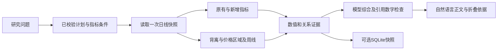

# 技术分析与指标设计

日线技术分析、各项指标（SMA/EMA/MACD 等）、多指标组合与修改、数值依据、共享叙述和历史回放。

> 本文由多份原设计文档按主题合并而成（2026-11-16）。各节保留原文，包括当时的日期、提交号、总线消息号和命令；其中提到的早期演示模块（如 `agent_demo`）和研究意图 v2.5/v2.6 封存评测脚本已在同次清理中删除，需要时请查看 git 历史（标签 `research-intent-v2.6-freeze-valid`）。

## 目录

- [技术分析扩展：指标、信号与日周核对](#技术分析扩展指标信号与日周核对)
- [RSI、BOLL、ATR 与量能：纯计算设计](#rsibollatr-与量能纯计算设计)
- [EMA计算：本轮小设计](#ema计算本轮小设计)
- [MACD计算：本轮小设计](#macd计算本轮小设计)
- [多指标分析服务与证据契约](#多指标分析服务与证据契约)
- [指标修改与条件继承：小范围、可检查的多轮状态](#指标修改与条件继承小范围可检查的多轮状态)
- [技术回答数字核对与日期参数边界](#技术回答数字核对与日期参数边界)
- [自然技术研究共用自然语言回答流程](#自然技术研究共用自然语言回答流程)
- [历史回放与本地归档读取](#历史回放与本地归档读取)


## 技术分析扩展：指标、信号与日周核对

更新：2026-10-26。本文描述本轮已接入的能力；原指标算法和八项默认组合保持不变。

### 1. 设计与数据流

核心仍是程序计算、模型解释。参考 [TradingAgents](https://github.com/TauricResearch/TradingAgents) 的互补指标选择、[TradingAgents-CN](https://github.com/hsliuping/TradingAgents-CN) 的程序化信号及 [ValueCell](https://github.com/ValueCell-ai/valuecell) 的多周期特征组织，结合本项目契约独立实现；没有复制这些项目的框架或切换到产品多 Agent 架构。



主要位置：`indicators.py`、`multi_contracts.py`、`multi_analysis.py`、`technical_selection.py`、`technical_insights.py`。`product_research.py` 接入公司研究，`product_answer.py` 综合；原技术工作流保留有界工具循环。

### 2. 新增三类指标

| 指标 | 口径与字段 | 首次可用及特殊情况 |
| --- | --- | --- |
| ADX(n)，默认14 | Wilder平滑；`value`、`plus_di`、`minus_di`，单位为点 | DI需要n+1条，ADX需要2n条；完全平盘输出0，强度与方向分别解释 |
| OBV，无周期参数 | 首条为0；收盘上涨加当日股数、下跌减股数、持平不变；`value`为有符号整数 | 首条即可用；绝对值依赖本次快照起点，不能解释为真实资金金额 |
| VWMA(n)，默认20 | 窗口内收盘价按成交股数加权；`value`单位为元/股 | 需要完整n条；总量为0时返回`undefined/zero_window_volume`，不补零 |

算法版本分别为 `adx-wilder-double-smoothed-v1`、`obv-snapshot-zero-seed-v1`、`vwma-close-volume-weighted-v1`。OBV保留Python整数；VWMA权重运算使用Decimal，避免先把大股数转成浮点数。

同名指标不保证跨库读数一致。原EMA继续使用SMA种子，RSI和ATR继续使用Wilder平滑，BOLL继续采用总体标准差，MACD柱值继续为`2*(DIF-DEA)`。本轮不为匹配其他库而改动这些口径。

图表同步校验新算法、参数、字段和单位。VWMA叠加到价格区；ADX和OBV进入独立面板。超过浏览器安全范围的OBV数值让图表局部不可用，证据文本保留整数，不以浮点舍入冒充精确值。

### 3. 按研究任务选择互补指标

`technical_selection.py` 的选择是小型、可解释的应用规则，不是模型训练或自动策略优化。公司研究计划在未提供明确指标时使用它：

| Profile | 典型问题 | 组合 |
| --- | --- | --- |
| `balanced` | 一般公司或走势分析 | 原八项：SMA20/60、EMA20、MACD、RSI14、BOLL、ATR14、量能20 |
| `momentum` | 动能、乏力、背离、超买超卖 | SMA20、MACD、RSI14、ADX14、量能20、ATR14 |
| `volume_price` | 放量、缩量、量价配合 | SMA20、VWMA20、OBV、量能20、MACD、ATR14 |
| `trend_strength` | 趋势强度、趋势还是震荡 | SMA20/60、MACD、ADX14、ATR14、量能20 |
| `structure_volatility` | 支撑、压力、波动风险 | SMA20、BOLL、ATR14、量能20、ADX14 |

用户明确参数优先，例如“只看RSI7”不能被profile换回RSI14或默认组合；明确否定也先过滤。既有风险情景的ATR依赖仍按原权限规则补齐。普通问题保留八项默认，不因新增指标就全部堆入每轮。

### 4. 背离与支撑压力规则

`technical_insights.py` 从同一冻结日线重算有需要的历史依赖，不再次请求行情。

- 极值采用严格比较：候选点必须高于或低于左右各2条记录；平顶、平底不任意指定一个转折点。
- 背离比较最近120条范围内最后两个已确认收盘价极值，以及同日期的RSI或MACD DIF。价格创新高、指标降低形成顶背离规则候选；价格创新低、指标提高形成底背离候选。
- 最新比较极值超过20条记录时标记陈旧；极值或指标历史不足时保留未知。不使用尚无右侧确认的最新转折点。
- 支撑压力使用已确认高低点，按价格排序，以簇首价格为基准进行1%范围聚类；选择当前价下方最近支撑候选和上方最近压力候选。
- 聚类内极值数量单独记录，不能称为有效触及次数。历史区域不是已验证支撑，也不会自动成为止损或目标价。

这些是固定规则观察，不覆盖全部K线形态，也不提供反转概率或预测胜率。

### 5. 完整周线与日周方向

周线按周一至周日的日历边界聚合已有记录：开盘取首条、最高取最大、最低取最小、收盘取末条、量额求和。排除尚未到周日边界的周，也排除请求起点截断的首周；周线日期保留该周最后实际记录的日期。

“日历边界完整”不等于交易记录已由交易所日历证明完整。这里不补周末、缺失行情或停牌，不推断缺失原因；复权口径沿用日线。

只对本次请求中的SMA、EMA、RSI、MACD计算同参数周指标。例如日线SMA20对应20根周线的SMA20，不把周期缩成4周；周线SMA60历史不足就保持缺失。日周核对使用最短的可用同参数SMA/EMA，比较各自收盘价处于各自均线哪一侧，结果为同向、分歧、边界或不足；没有把一致性解释成两份独立证据。

### 6. 证据、归档与回答边界

每条派生事实保留原始依赖：极值确认包含左右记录，递推指标包含计算前缀，周指标依赖周收盘及对应日线。依赖按先后构建为无环图，拒绝跨请求、跨证券和晚于派生日期的依赖。

公司研究只把有界的观察与数值映射为`ProductEvidence`，不把整份历史依赖图塞给模型。技术依据统一使用`kind=technical`，通过`daily_signal_derived`、`completed_week_derived`、`cross_timeframe_derived`区分口径；前端分别显示交易日、周线截至和日周核对日期。

启用原有`--snapshot-db`后，SQLite归档完整技术快照、观察与依赖事实；保存前可从同份日线重建核对。默认不创建证据库，不保存聊天或模型草稿，也不能恢复供应商未保存的历史修订版本。

模型负责围绕原问题解释关键依据与冲突。输出检查仍主要覆盖引用成员、证券归属、数值、单位和格式；引用通过不代表自由文字的因果关系已被证明。程序化信号也不自动赋予全文语义验证、策略收益或预测准确率。

### 7. 预算与验证方法

新增指标和周线计算不引入新行情来源、模型角色或额外远程请求；仍受现有单轮期限、调用次数和上下文上限约束。技术循环最多6次工具、6次模型和2次分析，补充指标复用原快照；公司研究最多3次日线分析、6次模型调用。它们是执行上限，不要求用满，也不是远端强制中断或账单上限。

验证重点是独立公式参考、预热边界、零量、精确大整数、前缀不变性、极值右侧确认、周聚合及排除规则、依赖图、上下文裁剪和图表契约。测试结果以实际验收输出为准；离线契约与固定合成数据不能代替真实回答质量和投资效果评估。

相关文档：[多指标契约](technical-analysis-design.md#多指标分析服务与证据契约)、[公司研究](research-data-design.md#多维公司研究流程证据与模型切换)、[有界工具循环](agent-runtime-design.md#有界研究工作流设计)。

### 8. 本轮验收记录

2026-10-26 在 Windows 本地运行 `.\.venv\Scripts\python.exe scripts\verify.py all`，随后补齐完整中文周指标路由并重跑 `python` 验收：最终 1833 项 Python 测试、549 项前端测试、4 个 Agent 场景、90 次 MVP 场景、5 个公司研究流程及 API 演练通过，无跳过项。TypeScript、生产构建、ASGI 静态资源、干净 wheel 的资源包含与依赖一致性检查也通过。本轮没有新增人工浏览器走查。

另外通过网页使用的 `configured_models()` 配置调用真实 DeepSeek，分别询问量价与完整周线、趋势强度与反证。两轮均使用明确标记的合成日线和固定证券目录，均为 `company_research_completed / accepted`，各调用模型 2 次、计算 1 次、行情快照读取 1 次，没有请求真实市场数据。它们验证自然语言回答与引用数字检查能共同完成，不代表真实市场回答质量、收益或预测准确率。

调试时直接构造适配器的 512-token 默认配置曾导致 JSON 被截断；改用网页原有的 1500-token 配置后完成。没有放宽输出验证或提高产品既有调用、上下文预算。


## RSI、BOLL、ATR 与量能：纯计算设计

日期：2026-10-16（America/Los_Angeles）

### 范围与接口

补齐 PRD M1a 的剩余四类指标，保留原 SMA/EMA/MACD、`analyze_daily_bars()` 与行情 CLI。计算函数不联网、不调用模型、不修改输入，不新增第三方依赖。多组 SMA 可对同一份已加载日线分别调用现有 `sma_close`；本轮不新增批量分析服务。

| 数值函数 | 日期结果点函数 | 默认参数与输出 |
| --- | --- | --- |
| `rsi_close` | `rsi_close_points` | `window=14`；标量或 `RsiPoint.value` |
| `boll_close` | `boll_close_points` | `window=20, stddev_multiplier=2.0`；`middle/upper/lower` |
| `atr` | `atr_points` | `window=14`；标量或 `AtrPoint.value`，单位元/股 |
| `volume_activity` | `volume_activity_points` | `window=20`；当日股数、含当日均量、此前均量、倍率及倍率状态 |

所有函数都接收同一股票、日期严格递增的 `DailyBar` 序列，输出与输入等长；日期点绑定股票、日期与参数。空输入返回空列表；不足记录处保留 `None`。不排序，不为日期间断补零或复制价格。截止日由调用方先用 `bars_as_of_close` 筛选。

即使历史不足，也检查整个输入的类型、股票和日期。非法输入抛 `ValueError`，不伪装成无数据或历史不足。

计算层延续 EMA/MACD 的正整数周期约定，拒绝布尔值，支持周期 1。BOLL 倍数接受有限正数。PRD 中 RSI/ATR/BOLL 周期 2–120、BOLL 倍数不超过 4 等产品限制留给未来请求/工具层；不把本轮纯函数直接当成模型工具。

### 固定算法口径

#### RSI

1. 相邻收盘差分成非负上涨值与下跌绝对值；首条没有变化值。
2. 前 n 个上涨/下跌值各自取均值初始化，最早第 n+1 条日线可用。
3. 后续使用 Wilder 平滑：`average = previous + (current - previous) / n`。
4. RSI 等价于 `100 × average_gain / (average_gain + average_loss)`；实现先缩放以避免大数相加溢出。
5. 双均值为 0 时固定为 50；只有上涨时为 100；只有下跌时为 0。这些是项目算法约定。

#### BOLL

- 中轨是最近 n 个收盘价的算术均值；上下轨为中轨 ± 倍数 × 总体标准差，固定 `ddof=0`。
- 使用标准库 `statistics.mean` 和 `statistics.pstdev`，逐个窗口计算，避免原始平方和相减导致的精度抵消。
- 第 n 条起可用；常量价格三轨重合。下轨可以为负，不能把指标结果重新套入正价格日线校验。
- 任何轨道无法表示为有限浮点数时抛出计算错误，不输出无穷大。

#### ATR

- 从第二条开始，TR 取 `high-low`、`abs(high-previous_close)`、`abs(low-previous_close)` 的最大值。
- 首条没有前收盘，TR 不可用，不能用首条高低差代替。
- 前 n 个 TR 平均初始化，最早第 n+1 条日线可用；后续同样采用权重 `1/n` 的 Wilder 平滑。
- 单位是元/股；ATR=0 合法，不生成涨跌方向或止损价。

#### 量能

| 字段 | 含义与首个可用位置 |
| --- | --- |
| `volume_shares` | 当日成交股数；每条可用 |
| `volume_ma` | 含当日在内的最近 n 条均量；第 n 条起 |
| `previous_volume_ma` | 严格在当日前的 n 条均量；第 n+1 条起 |
| `relative_volume` | 当日股数除以前述基准；基准非零时可用 |
| `relative_volume_status` | `available` / `insufficient_history` / `undefined` |

历史不足时，基准及倍率为 `None`，状态为 `insufficient_history`。此前均量为 0 时，基准保留合法的 0，倍率为 `None`，状态为 `undefined`。基准为正且当日零成交时，倍率是可用的 0。

滚动股数总和使用 Python 整数，避免先转换浮点后丢失小股数或产生滚动抵消。只在返回均量和倍率时做除法；不可表示的结果抛 `ValueError`。该倍率没有分钟级成交节奏信息，不称为盘中“量比”。

### 实现取舍与后续边界

- 日线验证提取为共享内部函数；收盘 EMA/MACD 及新指标复用校验，旧公开接口保持兼容。
- RSI 与 ATR 共用独立 Wilder 平滑，不将其误用成 EMA 的 `2/(n+1)` 权重。
- 以 m 条输入、周期 n 计，RSI/ATR/量能按记录线性处理；BOLL 逐窗为 O(m×n)，不足一个窗口时只作 O(m) 的输入检查和空值输出。当前日线规模优先选择清晰稳定的计算。
- 所有包装函数包含结果数组，空间至少 O(m)；不宣称整套函数是常数空间。
- 计算不舍入；展示格式化留上层。递推指标改变计算起点可能改变结果。
- 本轮量能倍率状态用于区分不足与零基准。后续M1b已在[独立多指标服务](technical-analysis-design.md#多指标分析服务与证据契约)接入逐字段可用性、计算起始日/种子元数据、关系、交叉与证据。
- 原 `analyze_daily_bars` 和行情 CLI 仍只输出单 SMA；新增多指标服务不等于模型Agent已完成。

### 验证与试用

测试采用已知人工样本与独立 Decimal 参考，覆盖默认和短周期初始化、首次递推、恒定/单向价格、零成交、日期对齐、非法输入、不同起点及未来数据隔离。普通价格的绝对误差容限为 `1e-10`；极大数单独检查有限性或相对误差。

2026-10-16 验证记录：Windows / Python 3.12.10，新增 47 项指标测试通过；UserProxy 独立执行全量 193 项离线测试，0 失败、0 错误。README 四指标样例、旧 CSV 行情 CLI 与 Fake 模型 CLI 均退出 0。初次全量测试遇到沙箱临时文件权限限制，经自动审核批准在沙箱外原样运行后通过；未修改业务代码规避测试，也未联网或调用真实模型。

```powershell
$env:PYTHONPATH='src'
python -m unittest discover -s tests -p test_technical_indicators.py -v
python -m unittest discover -s tests -v
```

启动已配置好环境的 Python 后，可用人工 CSV 缩短周期演示：

```python
from trading_companion.csv_loader import load_daily_bars
from trading_companion.indicators import (
    rsi_close_points, boll_close_points, atr_points, volume_activity_points,
)

bars = load_daily_bars("data/sample_daily_bars_synthetic.csv")
print(rsi_close_points(bars, window=3)[-1])
print(boll_close_points(bars, window=3)[-1])
print(atr_points(bars, window=3)[-1])
print(volume_activity_points(bars, window=3)[-1])
```

该文件只有五条人工记录，默认周期的指标字段不足；缩短周期仅用于展示算法接口，不是真实行情或推荐参数。测试不调用外部行情或真实模型。


## EMA计算：本轮小设计

日期：2026-10-13

### 范围

只新增纯计算函数与带股票/日期的结果点，不联网、不调用模型、不修改原SMA、分析结果结构或行情CLI。EMA是未来分析工具的底层能力，还不是Agent。没有新增依赖。

### 输入与输出

- `ema_close(bars, window)`：输入同一股票、日期严格递增的`DailyBar`序列和正整数周期；输出等长的`float | None`列表。
- `ema_close_points(bars, window)`：相同计算，输出`EmaPoint`，包含股票、日期、周期和值，避免脱离日期解释指标。
- 空输入返回空列表；不足周期时全部为`None`。非法周期（含布尔值）、混合股票、重复/逆序日期和非`DailyBar`项抛出`ValueError`，即使历史不足也校验。
- 周期数的是已有日线记录，不是自然日；日期间断不补零，不复制收盘。函数不负责截止日筛选，调用方先用`bars_as_of_close`截取。
- 计算层与现有SMA一样接受正整数。PRD中建议的1–120产品限制留给之后的请求/工具层，不在这一轮改旧接口。

### 固定计算口径

1. 前`window - 1`项不可用。
2. 第`window`项是前`window`条收盘价的算术平均，不用首条收盘直接初始化。
3. 后续使用`alpha = 2 / (window + 1)`，递推`EMA = alpha × close + (1 − alpha) × previous_EMA`。
4. 代码用等价式`previous_EMA + alpha × (close − previous_EMA)`递推；种子平均值逐步更新，避免有限大数先求和而溢出。周期1直接返回当条收盘价，避免相减抵消导致错误。
5. 计算过程不舍入，测试正常价格时用绝对误差`1e-10`对照独立Decimal公式；展示格式化留给上层。

人工示例：收盘`10、12、14、20、18、16`，周期3；结果`None、None、12、16、17、16.5`。这是测试数据，不是真实报价。

每条记录只访问当前收盘价与此前状态，时间复杂度O(m)。修改/追加未来记录不得改变已有日期的结果。更改计算起始位置可能改变EMA，不等同于使用未来数据。

后续MACD步骤提取了内部数值EMA：`ema_close`保留原签名、校验和种子口径，先提取经验证的收盘列表，再调用共享内核。数值内核不计返回列表时额外状态O(1)，包含收盘列表的日线包装层空间为O(m)。这是为了清晰复用输入而接受的中间数组开销，不宣称整个包装函数仍是O(1)额外空间。

### 验证

测试覆盖空/不足/恰好够用、默认EMA20、连续递推、周期1、常量与大数、Decimal对照、未来变化、逐前缀一致性、输入校验、日期间断、输入不变和结果日期绑定；另验证截止日筛选后再计算EMA。

```powershell
$env:PYTHONPATH='src'
.\.venv\Scripts\python.exe -m unittest discover -s tests -p test_indicators.py -v
```

### 后续接入边界

当前`analyze_daily_bars`与原行情CLI仍只输出SMA。多指标结果契约、计算起始日/递推次数和起点影响提示，留到多指标服务阶段集中接入；本轮不宣称PRD里的EMA展示功能全部完成。后续独立MACD计算与DEA数值平滑已实现，见[MACD设计](technical-analysis-design.md#macd计算本轮小设计)，尚未接入分析服务。

2026-10-16后续更新：上述多指标服务阶段现已新增独立入口，返回初始化与起点信息，见[多指标设计](technical-analysis-design.md#多指标分析服务与证据契约)。原SMA分析函数和CLI继续兼容，尚未接入模型Agent。


## MACD计算：本轮小设计

日期：2026-10-13

### 问题与范围

EMA价格函数接收`DailyBar`，但DEA要平滑的是可能为负数或0的DIF。不能把DIF伪装成价格，也不能重复实现一份EMA算法。

本轮提取内部通用数值EMA，保留`ema_close`的原签名和SMA种子口径，新增独立MACD计算与日期结果点。只改计算层、测试和说明，不改原分析接口/CLI、不取行情、不调用模型，不实现交叉事件或买卖结论。

### 数据流与技术判断

1. `_close_values`校验同一股票、严格递增日期和日线类型；提取一份收盘列表供快慢EMA复用。
2. `_ema_values`只处理有限数值，允许负数和0，不接受`None`、布尔值或非数值。它是内部函数，不是给模型开放的工具。
3. `DIF = EMA(fast) − EMA(slow)`；任一EMA尚未初始化则该日期DIF为`None`。
4. DEA使用最初`signal`个有效DIF的算术平均初始化，之后用`2 / (signal + 1)`递推。只移除连续的前置不可用位置，计算后补回同样数量的`None`，不能丢掉日期对齐或合法的0。
5. 柱值口径固定为`histogram = 2 × (DIF − DEA)`；任一字段不可用则柱值为`None`。数值溢出报错，不返回无穷值。

没有在数值内核中使用股票价格校验，因为它会错误拒绝负DIF。日线校验仍由外层执行。EMA对正负极大数采用等价加权式作为相减溢出时的后备；普通数值仍使用原来的递推形式，周期1直接保留当前值。

### 输入与结果

- `macd_close(bars, fast=12, slow=26, signal=9)`返回等长`MacdValue`列表，逐项含`dif`、`dea`、`histogram`。
- `macd_close_points`附上股票、日期和三项周期，返回`MacdPoint`。
- 三项周期须为正整数，且`fast < slow`；空输入仍校验参数。与EMA计算层一样，产品上限/最小建议范围留给未来请求层。计算层支持周期1，但不代表产品会开放这个参数。
- 默认DIF从第26条日线开始；DEA和柱值从第34条开始。只有30条时保留5个有效DIF，不填充DEA/柱值。
- 周期数的是已有记录，日期间断不补数据；截止日由调用方先用`bars_as_of_close`筛选。
- 时间复杂度O(m)，包含中间数组与结果的空间复杂度O(m)。明确收盘列表便于复用和检查；不为少量日线增加复杂的流式状态接口。

### 人工核对与测试

收盘`10、12、14、20、18、16`，参数`(2,3,2)`：

| 第几条记录 | DIF | DEA | 柱值 |
| --- | --- | --- | --- |
| 1–2 | 不可用 | 不可用 | 不可用 |
| 3 | 1 | 不可用 | 不可用 |
| 4 | 5/3 | 4/3 | 2/3 |
| 5 | 8/9 | 28/27 | −8/27 |
| 6 | 7/54 | 35/81 | −49/81 |

这是人工测试数据和缩短参数，不是行情或交易建议。独立Decimal公式核对种子、递推和柱值，普通数值绝对误差容限`1e-10`；另外检查默认初始化边界、负DIF、合法0、输入错误、日期对齐、未来变化和逐前缀一致性。原EMA与SMA测试必须回归通过。

### 尚未接入

现有行情CLI与`analyze_daily_bars`仍只输出SMA。逐指标状态、起点影响说明和交叉事实将在多指标服务阶段实现；本轮MACD的数值计算不是完整PRD功能或产品Agent。

2026-10-16后续更新：独立多指标服务现已接入MACD分字段状态、快慢EMA/DEA初始化元数据、确定性交叉与证据引用，见[多指标设计](technical-analysis-design.md#多指标分析服务与证据契约)。原行情CLI仍只输出SMA，模型工具执行与解释检查留M2。


## 多指标分析服务与证据契约

日期：2026-10-16（America/Los_Angeles）

### 本轮范围

M1b 将已经完成的七类纯计算组合为一个可独立调用的研究服务：验证请求、取一次历史序列、计算、返回逐字段状态、初始化信息、确定性关系及事实标识。新增契约独立于原 `AnalysisResult`，保留单 SMA API 和行情 CLI 的默认值、状态含义与输出。

本轮不调用真实模型，不实现自然语言路由、模型工具循环、自由文本回答检查、会话或总截止时间。服务接收由应用构建的数据源对象；这不是允许模型传 Python 对象、文件路径或 URL 的工具接口。随后新增的[受控工具层](agent-runtime-design.md#受控日线指标工具执行器)只接收受限结构参数，由程序构建数据源；本服务接口保持不变。

开发分工延续 ProductManager 明确范围、Engineer 实现与单元测试、CodeReviewer 只读复审、UserProxy 独立运行验收。协作子智能体不改变产品采用单个受控研究 Agent 的架构。

### 接口与请求校验

公开入口为：

```python
from trading_companion.multi_analysis import (
    IndicatorSpec, MultiIndicatorRequest, analyze_indicators,
)

spec = IndicatorSpec("sma", window=20)
request = MultiIndicatorRequest(
    instrument_id="000001.SZ",
    start_date=...,
    as_of_date=...,
    indicators=(spec,),
    source="tencent",
)
result = analyze_indicators(source, request)
payload = result.to_dict()
```

契约放在 `multi_contracts.py`，服务放在 `multi_analysis.py`；服务模块重新导出常用公开类型。只读工具注册与供应商工厂留给下一阶段。

默认指标为 SMA20、SMA60、EMA20、MACD(12,26,9)、RSI14、BOLL(20,2)、ATR14、量能20，共8个实例。显式只请求 SMA3 就只计算该项，不附加默认组合。内部依赖不重复占用实例名额。

在读取数据之前检查：

- 完整股票标识与所选数据源的代码覆盖，日期类型及先后顺序。
- 区间含首尾最多366个自然日；不静默截断，也不隐式读取区间外预热。
- SMA/EMA 周期1–120；RSI/ATR/BOLL周期2–120；MACD满足 `2≤fast<slow≤120`、`2≤signal≤60`；BOLL倍数有限且 `0<k≤4`。量能周期本轮服务层选择1–120，与均量的正整数口径一致；这是对PRD未明确列出范围的实施补充。
- 指标参数不能包含布尔值、非有限数或不属于该类的字段。规范化后去重，最多12个不同实例，保留用户首次指定顺序。
- 请求来源与配置来源一致；配置中的股票和在线日期范围必须匹配，避免实际读入另一股票或额外历史。
- CSV 需要由开发者显式启用 `allow_development_csv=True`，仅用于开发测试。真实生产工具不开放该模式。默认标签是开发样例、真实性/复权未知；本仓库人工样例额外用受信配置 `CsvDailyBarSource(path, is_synthetic=True)`，输出醒目标识“人工样例/非真实行情”。该标记是开发者配置，不是程序自动验证了文件的真实性或合成来源。

本服务要求显式日期；自然语言入口的“默认截止上海前一天”和“含截止日365个自然日”留给后续应用层，不能让模型自行确定日期。对应365日区间的起点应是截止日减364天。

### 数据读取与失败边界

每个请求只执行一次 `read_daily_bars()`，全部指标使用同一份选定日线。适配器内部跨年可能产生多次 HTTP 请求；一次数据源读取不等于一次网络请求。开发CSV可以包含更多日期，读取后严格按请求区间截取，不使用区间外记录初始化指标。

行情类型、数值、股票和时序未通过校验时，整体返回无效行情；不拼接部分行冒充成功。空来源与没有匹配记录分别记录原因。数据源错误不自动重试、不切换供应商，结果不复制原始供应商错误体、路径或凭证。

计算仅使用请求区间内的日线，不排序、不补日期、不把过去值填到当前缺项。日期过滤不等于严格历史时点可得；获取时间不等于历史发布时间。不复权跳变、腾讯上游量额舍入等限制进入结果警告。

某个指标出现可预期的数值计算错误时，仅该实例标记计算错误，其他有效实例保留；不将错误伪装成历史不足。未知编程错误不能被一个兜底 `except Exception` 隐藏为正常业务结果。

### 多层状态与日期对齐

| 层次 | 含义 |
| --- | --- |
| 数据状态 | 行情有效、无数据、来源失败或无效数据 |
| 计算状态 | 请求的数值字段全部可用、部分可用、全部不可用或未执行 |
| 字段与关系状态 | `available`、`insufficient_history`、`undefined`、`calculation_error` |

每个字段包含日期、值、单位、状态、原因、所需/实际记录数及适用的缺少数量。结果保留完整对齐序列，最新结果严格取实际最后一条日线；不能悄悄使用更早的有效字段。数据状态使用 `ok/no_data/source_error/invalid_data`，计算状态使用 `complete/limited/unavailable`；源失败或无数据时没有计算结果。

计算完成情况按请求的数值字段判断；自动生成的关系独立表达可用性。例如 SMA3 第3条首次有值，价格比较可以成立，均线斜率或交叉仍可能缺少前一点。`synthesis_allowed`只表达至少一个计算字段可用，排除单独的原始成交股数；它不是买卖评级或任意推断的授权。任何后续解释都必须检查具体字段和关系状态，而不是只看总体完成。

关键场景：

- 30条请求默认组合：SMA60缺30条，MACD的DEA/柱缺4条；DIF及其他就绪字段仍可用。
- RSI14/ATR14最早第15条可用，BOLL20/含当日均量第20条可用，相对前20条均量倍率第21条可用。
- 前均量为0时倍率为 `undefined`；正常分母下当日0量为可用的0。
- 全部请求指标不可用时仍能展示可信行情及缺项，不生成综合趋势结论。模型解释能力本轮尚未接入。

### 初始化元数据

递推指标提供实际计算起始日、种子方式、首个可用日、初始化后递推次数和相关周期。EMA 使用前n条SMA；RSI/ATR使用n个变化或TR均值加Wilder递推。

`required_bars`表达最早可能就绪的记录门槛，`first_available_date`表达本次序列里字段实际首次为 `available` 的日期，二者不等同。量能倍率即使已有n+1条，若此前均量为0仍未定义；直到某条基准为正才产生实际首个可用日，没有有效倍率时该日期保持 `None`。

MACD分别描述快EMA、慢EMA、DEA三个组件：默认首个慢EMA/DIF是第26条，首个DEA/柱是第34条。30条时慢EMA已递推4次，DEA尚未初始化；34条时DEA递推0次，35条才递推1次。不能用同一个次数描述所有组件。

组件保留各自递推次数；起点提示按其相关最长周期3倍判断，MACD的DEA还需表达快慢EMA等依赖，而不能只看signal周期。该阈值不是数学收敛证明或指标可靠性保证；计算起点改变仍可能改变结果。算法版本与参数都属于计算身份的一部分。

### 确定性关系与最小证据

关系由程序使用未舍入数值生成：

- 收盘价与SMA/EMA位置、均线变化、价格与均线交叉；不同请求均线之间的位置与交叉。
- MACD的DIF/DEA关系及交叉、柱值相对前一点的变化。
- RSI相对30/70区间，BOLL相对三轨的位置和相等边界。
- ATR只比较波幅增减或不变，不给涨跌方向。
- 相对量能与1的比较；不把它解释为资金净流入、机构买入或盘中量比。

上穿需要前一差值≤0且当前>0；下穿需要前一差值≥0且当前<0。只有当前点有效时交叉缺项；当前仅等于基准时不算穿越。

数值事实与关系事实使用请求内唯一标识，能够定位请求、股票、日线日期、指标实例/参数与字段。关系保存具体依赖，涉及变化或交叉时包含相邻前一点的事实，所有依赖都能在事实集合中解析。不可用字段不伪造数值事实。跨均线关系能够定位两个不同指标实例。

完整历史字段留在 `indicators[].series`，证据集合只保留最新和紧邻前一条的数值，以及本次最新关系的依赖；`evidence_scope`明确为 `latest_and_immediately_previous_record`。`to_dict()`必须可用严格JSON序列化，不留下 `date` 对象、NaN或Infinity。事实引用存在不等于已验证模型文字含义；未来M2仍需约束解释类型并检查方向、数字和日期。

### 验收

1. 默认30条、显式SMA3、各初始化边界、不同起点、量能零值与未定义。
2. 单次读取；全部非法请求在读取前拒绝；同源同区间，不隐式预热或换源。
3. 交叉边界、全精度比较、缺前点、跨均线以及关系依赖完整性。
4. 源失败、空数据、损坏数据、单项计算异常与脱敏返回。
5. 截止日与实际最新日分离，追加或修改未来日线不改变截面结果。
6. 严格JSON、开发CSV提示、README可运行示例和原SMA API/CLI回归。

2026-10-16最终验证：Windows / Python 3.12.10，新增43项M1b正式测试通过；UserProxy独立运行全量236项离线测试（原193项加43项），0失败、0错误。CodeReviewer最终复审无剩余问题。

UserProxy另验证默认30条、SMA3单项、状态与日期、证据依赖和错误边界等场景。最后核对量能实际首次可用日、矛盾不足状态以及README原样示例：示例输出 `ok complete`，7个缩短周期实例全部数值字段可用，人工样例标识正确。原CSV行情CLI与Fake模型CLI均退出0。完整测试曾受沙箱临时目录权限影响，经自动审核批准后在沙箱外原样执行离线命令通过，没有修改业务代码规避测试，也未联网或调用真实模型。

```powershell
$env:PYTHONPATH='src'
python -m unittest discover -s tests -p test_multi_analysis.py -v
python -m unittest discover -s tests -v
```


## 指标修改与条件继承：小范围、可检查的多轮状态

日期：2026-10-21（America/Los_Angeles）

状态：已实现并通过离线验证；本步未调用真实模型、行情或目录网络。

后续2026-10-22已增加[明确条件修改](answer-design.md#会话内研究条件修改)：股票、ISO日期及单个指标增删走独立分支，与本模块共享基准检查及实例解析。本文722项记录为指标替换子步骤的历史验证，最新全量813项离线通过。

### 1. 本步解决什么

在同一 `ResearchSession` 内完成一轮有可信事实的研究后，可以输入：

> 把SMA3改成5日，其他不变。

程序只替换那一个指标实例，保留股票、原起止日期、其他指标及来源，生成新请求并重新取数计算。原日期即使来自“最近一个月”或默认区间，也不因跨午夜而重新计算。

指标修改本身不从聊天记录或旧模型草稿恢复条件，也不支持股票/日期/来源修改、添加删除指标或“看最新的”。后续同日已增加独立[成功结果快照、追问与历史查看](answer-design.md#研究结果保存追问与指标知识)，不会改变新查询必须重算的规则。本步完成M3的一小部分，不把M3整体标为完成。

### 2. 为什么先采用明确表达

初始研究问题仍由模型提取意图、程序核对目录和条件。本步的修改分支采用有限整句语法，不新增意图模型调用：这是把确定的状态修改交给程序，不是让模型自由重建旧参数。

支持“把/将 X 改成/改为/换成/换为/调整为 Y”，允许有限礼貌前缀、全角写法和“其他不变”后缀；必须完整消费整句话。它不是任意中文改写器。带修改/继承线索但不能按本步规则理解时先澄清，避免落回新查询默认值；完整独立问题可用“新问题：”明确重置。

| 示例 | 行为 |
| --- | --- |
| `把SMA3改成5日，其他不变` | 仅改变原SMA3的窗口 |
| `把20日均线改成5日均线` | 在此明确写法中，均线指SMA |
| `把RSI改成3日` | 只有原组合中恰有一个RSI实例才可继续，不使用默认RSI14寻找目标 |
| `把均线改成5日` | 在SMA/EMA中查找；不唯一则要求重述完整修改句并写出原参数 |
| `把BOLL(3,2.5)改成5日` | 保留倍率2.5，只改窗口 |
| `把MACD(2,3,2)改成MACD(3,5,2)` | 使用完整参数；只说“MACD改5日”不猜具体周期 |
| `把SMA3改成5日，另外换成中国平安` | 整句拒绝，不先做前半句 |

七类指标均支持同类实例的明确替换。参数复用现有 `IndicatorSpec` 校验；目标不存在、跨指标种类修改、无变化、重复实例或多项修改不执行，不静默添加、合并或删除。遇到歧义目前要求用户重述完整修改句，不另存一个指标待选任务。

### 3. 状态与数据流

```text
初始完整问题 / 股票身份续接
  → 原研究执行器
  → 有可解释事实 + 事实报告完整性检查通过
  → 保存不可变 ConfirmedResearch（只含条件和身份）

明确指标修改
  → 检查基准有效期、当前目录、来源、日期和契约
  → 整句检查 + 解析原指标 + 唯一匹配 + 参数校验
  → 构造新的 MultiIndicatorRequest（新request_id）
  → 执行前消费旧基准
  → 原提议绑定、执行器、计算、事实报告及关系检查
  → 本轮有可信事实才保存新基准，否则保持无基准
```

本步增加两个职责独立的条件槽；后续另有结果槽，三者不混用：

- `pending`：尚未确认股票的条件和候选。
- `confirmed`：最近一轮具有可解释、通过完整性检查的事实所对应的请求、条件、证券及确认时间，不包含结果本身。

待确认候选不覆盖原已确认条件，处理顺序仍优先股票待选；待选时不能用修改句绕过股票确认。“取消”只清待选请求；`/reset`、“新对话”、“重新开始”、“清空会话”及“新问题：”清除条件与后续结果槽。退出、EOF、Ctrl+C同样清除全部状态，不补调用额度。

`session_state.state=idle`表示没有待选股票，不保证`confirmed`为空；可编辑基准由单独的`confirmed`字段表示。导出是脱离内部对象的元数据快照，没有CSV路径、原始问题或模型响应。它仍不是用户认证或生产脱敏日志方案。

### 4. 保存、失效和失败规则

| 情况 | 是否可成为/保留修改基准 |
| --- | --- |
| 完整研究，事实报告通过 | 保存本轮条件 |
| 部分指标不足，但仍有可解释且通过检查的事实 | 保存；不把缺项称为成功计算 |
| 模型解读失败/超时，但本轮事实有效 | 保存事实对应条件；不保存错误解读 |
| 无数据、全部不可解释、取数失败或事实完整性失败 | 不保存 |
| 修改有歧义、参数无效、包含额外要求 | 不执行，保留原基准且不延长有效期 |
| 明确修改已进入执行，随后提议不符、取数失败或中断 | 执行前旧基准已消费；无本轮可信事实则不恢复 |
| 待选股票尚未确定 | 单独保存pending，原confirmed不被覆盖 |

基准15分钟有效，以该研究轮传入的可信起始时刻计时；不是行情新鲜度或整轮执行截止时间。无效回复不续期，真实终端时钟与人工数据参考日分开。时间倒退、来源/开发CSV配置变化、证券消失/更名、目录不可用或原日期不再符合在线限制时清除基准，要求完整新问题。

修改前重查当前目录和原条件的当前可执行性；原日期锚点仍保留用于说明最初相对日期的解释。构造新请求自动生成新 `request_id`，不继承旧证据命名空间；旧模型JSON即使论断看似相近，也不能通过本轮请求绑定。

一轮有效修改最多2次模型调用、1次分析；本地无效修改为0/0，不自动重试、不换源。终端仍最多5条问题和15次模型转发，失败调用不退款，超长/非空修改问题也计入输入次数。完整token、费用和总截止时间预算仍待做。

### 5. 代码职责与验证

| 文件 | 作用 |
| --- | --- |
| [research_edit.py](../src/trading_companion/research_edit.py) | 无I/O的整句检查、目标唯一匹配、参数替换及新请求构造 |
| [research_session.py](../src/trading_companion/research_session.py) | 不可变基准、时效、当前身份/来源/日期核验，与pending隔离 |
| [agent.py](../src/trading_companion/agent.py) | 分流修改请求、执行前消费、事实通过后记录；复用原执行链 |
| [agent_cli.py](../src/trading_companion/agent_cli.py) | 帮助、局部修改口径展示和完整重置；不另做参数合并 |
| [test_research_edit.py](../tests/test_research_edit.py) | 34项替换、状态与真实离线计算测试 |
| [test_agent_cli.py](../tests/test_agent_cli.py) | 新增6项交互、展示、重置、过期、中断与失败测试 |

2026-10-21，Windows / Python 3.11.9：本步新增40项，全量722项离线测试通过。包括七类指标替换、重复/越界/额外指令、日期保留、目录变化、会话隔离、旧解读跨请求拒绝、模型/数据失败及终端清理。HTTP、凭据读取和在线源构造均被测试桩阻断；有实际CSV/指标计算，但不证明真实模型对任意中文的表现或真实市场质量。

### 6. 如何尝试

沿用终端入口，在已配置模型的同一PowerShell中：

```powershell
$env:PYTHONPATH='src'
.\.venv\Scripts\python.exe -X utf8 -B -m trading_companion.agent_cli --provider deepseek --data synthetic
```

依次输入完整问题 `分析平安银行，2026-09-21 至 2026-09-25，只看SMA3和RSI2`，获得可信事实后，再输入 `把SMA3改成5日，其他不变`。此命令会显式使用真实DeepSeek，可能计费；行情仍为人工数据。本步没有代用户运行这条付费路径。

只检查离线实现：

```powershell
$env:PYTHONPATH='src'
.\.venv\Scripts\python.exe -X utf8 -B -m unittest discover -s tests -p test_research_edit.py -v
```

后续同日已完成[可信结果追问](answer-design.md#研究结果保存追问与指标知识)，使用独立深复制结果槽而不是把本步条件槽当缓存。新研究开始将旧成功结果标为非当前；执行失败后只能显式历史查看，不能恢复旧修改基准或用于隐式当前追问。新增47项后，全量769项离线通过；本节722项仍是指标修改子步骤的历史记录。


## 技术回答数字核对与日期参数边界

2026-10-30 审核意见#251：同股同日结构化收盘事实，只有精确等于已提供计划的reference_entry（入场参考价）时，允许用于“作为入场参考”的表述。数值不等仍拒绝；止损和目标价继续要求对应计划字段，不因与收盘相等而放宽。这条等价核对不使用普通数字舍入容差。历史回放报告保持原版本与结果，新规则须独立重跑；不能把回放恢复率写成真实重跑质量。

本批承接任务 #226、方案 #227 与批准 #228。修复误删时继续使用原数字容差、评级和价位公式；不增加模型调用、行情请求或领域权限。

2026-10-30 用户授权 #243，经方案 #246 / 批准 #247 放宽普通标注和技术表述核对。以下按新规则更新；文末 #230 的回放和测试成绩保留为历史记录。新规则有意覆盖 #227/#234 的“坏普通标注不可降级”要求，计划价位、跨股、虚构概率、收益保证和严格指标范围的底线继续有效。

### 正文标注恢复与引用清理

`answer_claim_recovery.py`在分句和定位数字片段之前，仅恢复正文中完整、严格合法的数字标注数组：以标注的text替换数组，将标注移入该块numbers。仍受1800字符、80个标注限制；重复键、非法常量、混合或残缺项、嵌套歧义不恢复，原文硬性拒绝内容不能被恢复掩盖。

恢复后仍核对证券归属、单位、数值、重叠及计划用途。MA20参数或“顶背离”等没有实际数据数字的标注可忽略；同text的重复标注全部合法才接受。普通不存在field可忽略；已有字段的值矛盾不能换字段。普通不存在、格式错误或无数字的ref可按实际送模同股证据重新匹配，原容差和唯一候选要求不变。已解析跨股、已解析值错、派生结构错和计划引用不降级。提示词要求text只写可读正文，numbers是同级字段。

提示词仍要求ref原样复制已提供编号，不添加前缀、不合并编号，text不放编号或JSON。普通“L:E49”视作无效标注后独立匹配，不推断E49或L49；计划数字使用它仍拒绝。不存在的标准L编号不降级。止损、止盈、入场/退出价、目标价及上下观察位要求匹配程序计划角色和来源，不能借相同收盘值绕过；同分句并列的历史低点仍按普通数字检查。

独立的E/L引用编号先核对存在与同股，再从正文清理；不把编号当数据。清理保留分句和位置，纯引用括号消失，只剩标点或空白的句子删除并计入删句。金额、证券代码和其他数据数字仍逐一核对。

`inline_binding_recoveries`统计已完成的块内数组迁移次数，不表示迁移后的数字已经通过。只在发生时增加公开质量字段，版本化运行记录保留已知零值，两套评估读取并汇总。原有整份JSON恢复计数含义不变。新增检查模块纳入两套评估的实现摘要。

### 指标参数与RSI关系

`answer_technical_validation.py`从确认计划、已校验日线及完整周线事实构造本地核对资料，不发送额外资料给模型，不写入公开保存协议。仅本轮领域内的指标可确认，未启用技术面的默认指标不因留在计划字段中而生效。

默认组合没有显式指定指标时，已有价格背景可能提供MA20、MA60。重新计算并核对这些背景记录的身份、股票、日期、原值、单位和标签后，只有实际送模的记录才能补充对应日线`sma(window=20/60)`许可；参数集合在检查时还会按当前证据重新筛选。裁剪后不能继续许可，严格“只看SMA3”不补背景均线，日线背景也不能代替周线证据。

SMA3、SMA(3)、RSI(14)、MACD(12,26,9)以及3日均线、14日RSI等前置参数必须与确认实例一致。参数先于一般日期/时段遮蔽核对，避免把“6日RSI”的6当作时段跳过。未确认的RSI6、错误MACD信号参数、残缺或多余参数直接拒绝，不能借用恰好相同的价格数字。显式周线还要求该周期的可用事实。真实读数仍核对原始值，index_points使用独立数值单位，不冒充价格。

“MA60（28.60元）”的括号读数和“ATR（1.5倍）”的计划倍数有明确单位，按普通数据检查，不当作指标窗口，也不跳过数字。“SMA(3)(29.7)”等额外无单位参数仍拒绝；“60日均线28.60元”也先核对窗口60，再核对价格。

“日线与最近完整周线均在EMA20上方”等有限的跨周期均线表达，必须匹配已重新计算、实际送模的同参数日周方向记录，且上方/下方与记录方向一致；条件表达、错参数、反向、错股、旧日或被裁掉的记录均拒绝。该关系记录只证明方向，不能替代单独的周线读数或RSI证据。

RSI（相对强弱指标）的30/50/70在核实关系后遮蔽，也允许不声称当前状态的常用参考阈值介绍。支持高于/低于、区间内、超买/超卖及中线/中轴。关系可使用本轮已验证、同股同参数同周期最新RSI，即使该值被送模预算裁掉；本地资料记录原事实身份，诊断标记local_computed_rsi，不伪造悬空E编号。普通数字候选范围不扩张。真缺值、旧日、跨股或错参数仍拒绝。裸RSI要求所选周期只有一个可用实例。

未明示周期先按日线完整核对，失败可用同参数最近完整周线；明确日线/周线和周参数不可互救。同一指标提及的读数及所有关系必须使用一个周期，不拼接日线读数和周线关系。SMA(5)63.102元、ATR 24.4380元等紧跟读数不当作额外参数，仍检查真实值。

低于/高于为严格比较，超卖小于30、超买大于70；区间内包含两端。实际42时低于50且在30至70内成立，实际45时低于30不成立；多项关系逐项核对。反向、否定、区间外、模糊靠拢和未来条件继续严格拒绝。关系检查先于普通数字匹配，其他价格、百分比等仍全部核对。

RSI条件和否定限制收窄到所在分句：前一分句“趋势可能反复”不污染后一分句；“若RSI低于30”“RSI不低于30”仍不当作无条件关系。实际45低于30必须失败，“仅供参考”不能洗掉假关系。

### 分句保留与计量v2

仅普通数字匹配错误可删掉错误独立分句，保留其他通过部分并整体复核。括号内逗号、千位逗号不切分；全角文本使用原NFKC（统一字符形态）定位。条件、否定、因果或对比依赖、只剩数字/连接词时整句删除。计划、跨股、假技术关系等不救援。数字计数只记初次检查，复查不重复计数；引用汇总实际保留片段的合法数字来源。

`numeric_validation_version=source-bindings-v2`、`sentence_count_version=sentence-counts-v2`。整句消失才计deleted_sentences，部分保留计partially_retained_sentences；同时公开generated_clauses、retained_clauses、deleted_clauses和分句删除率。忽略非数字标注、忽略字段、无效引用回退成功/失败、本地RSI及参考介绍各自计数。去重删除仍单列，不当作普通数字分句删除。

**删句统计由v1变为v2，不能直接比较历史17.5%、26.9%和当前整句率。** 两套报告同时显示整句率、分句率、部分保留数，旧字段缺失保留未知。117轮差异单独封存于新覆盖层，历史v1～v6和三个观察器不变。

可复用回放入口为`scripts/replay_answer_validation.py`，输入诊断及对应正式报告，默认旧规则b5d77eb，以独立源码副本比较相同草稿。输入摘要、逐字段原句/保留句/拒绝位置、逐稿与首稿/修正稿统计只写`.agentbus/tmp/`。无法证明同轮公开事实对应关系的项目列replay_context_unavailable；不从被测正文推导参数或补取行情，不等同真实重跑删句率或完整评级形成率。

### 日期和指标参数

| 原文 | 日期 | 指标 |
| --- | --- | --- |
| 最近20天RSI6 | 最近20个自然日 | RSI6 |
| 近60日SMA3 | 最近60个自然日 | SMA3 |
| 近20日RSI | 最近20个自然日 | 默认RSI14 |
| 近20日均线 | 最近20个自然日 | 原默认SMA20、SMA60组合 |
| 20日RSI | 原日期默认值 | RSI20 |
| 20日均线 | 原日期默认值 | SMA20 |

“近/最近/过去”决定相对日数归日期，指标名后的显式数字或括号决定参数。提取前遮蔽相对日区间但保留位置，旧结构化研究与产品计划共用该政策。模型吞入日期时，仅纠正与原文唯一指标重叠、受该日期边界影响的短语；不补原文外指标、不忽略其他未提取指标。截止日、包含端点、自然日换算和不支持日期的澄清规则不变。

### 评估与历史记录

本批#243/#247的离线回放、固定模型评估和117轮基线结果见[放宽结果记录](evaluation-design.md#回答核对放宽的离线结果243--247)。下文#230的回放与测试数字为历史记录，不能作为本批v2实测。

技术检查器的正文与结构化levels均要求肯定的数值计划声明，使用相同价位检测及否定判断。“SMA5本身不提供目标价”不违规；真正的止损/目标价、中文数值、结构化目标价标签仍违规。检查器独立于产品解析器。

2a登记`technical-parameter-grounding-v1`，父版本`technical-shared-narrative-v1`的完整身份和源码摘要保留在previous_rules。304题、标签、划分及历史成绩不改，旧阈值锁和跨版本参考报告拒绝复用。

v1～v6及原观察器不重写，按现有117轮逐字段比较；新增日期/参数问法另作正反例。离线技术10题及决策20题只验证程序契约。真实目标为技术删句率≤10%、范围违规0、原20题不退步，由Claude合入后运行并分别报告目标轮、准备轮和全部轮次，实测前不宣称达标。

审核#230要求的历史回放关联live4/5/6诊断中的实际送模上下文和对应报告的最终结构化正文，按原分句规则检查，不重复计算聚合全文。三个20题批次分别有19、19、20个非空最终回答；live4的D05、live5的D20在进入正文合成前失败，无已接受句子。准备轮没有保存最终正文，不计入本次回放。

历史报告不含完整计划和行情快照，因此回放从已保存技术事实的结构化ID恢复实际执行的完整参数，逐项核对E编号与公开证据的股票、标签、日期、原值、单位、时段对应关系。数值和背景均线只取实际送模证据；日周方向使用保存的同参数结构化关系。没有从被测正文推断参数，也不把全量公开证据补进裁剪后的上下文。该回放不重算行情，不证明新模型回答质量。

最终回放检查913句模型正文、215个模型标题、7句程序正文、314个程序价位标签，共1449项，新增技术检查拒绝数为0。初次回放发现的live4 D19一句日周EMA20判断、live6 D19一句同类判断和一句ATR倍数说明均已按上述真实证据边界修复。可复现脚本为`.agentbus/tmp/replay-technical-mask-230.py`，逐句、汇总和输入文件摘要保存在`.agentbus/tmp/technical-mask-replay-230/`；这些诊断材料不进入版本库。

本批自测结果：`scripts/verify.py python`通过2618个unittest、244个pytest函数用例及既有验收；技术离线10/10形成、范围违规0、26次脚本模型转发；决策离线20/20形成、44次转发。这里的“模型转发”使用人工脚本，不产生真实模型调用。`tests.test_routing_baseline`、`tests.test_decision_routing_baseline`逐字段核对117轮，全部与v6一致，未新增差异覆盖层；2a旧版本锁和参考报告的拒绝测试通过。


## 自然技术研究共用自然语言回答流程

后续数字核对与日期参数修复见[边界设计](technical-analysis-design.md#技术回答数字核对与日期参数边界)：当前2a规则版本为`technical-parameter-grounding-v1`，下述`technical-shared-narrative-v1`是共用流程落地时的父版本。

本批承接用户同意的定稿 #214、方案 #215 与批准 #216。规则版本为 `technical-shared-narrative-v1`。自然技术问题使用已有公司研究执行器的取数、证据与 v3 自然语言正文；用户意图仍记为 `technical_research`。真实模型技术回答质量尚未在新增10题上评估。

### 入口与保存

具名技术问题、最近成功研究对象的技术追问、名单单只技术研究和共用结果的指标编辑进入相同流程。路由只选择执行器，不授予取数或发布权限；trace（本地运行元数据记录）分别保存意图与实际入口，允许 `technical_research` / `company_research` 组合。2a意图评估按意图分类，不因执行器共用而改成公司意图。

公司服务未配置时，自然技术和名单技术仍使用旧执行器。原结构化 Python、CLI、技术 API、已存在的技术身份/指标待澄清任务和旧保存记录保留；知识、取消、重置、冲突及完整新任务仍按原优先级处理。

研究主体的语义类型与保存载体分开：仅技术领域的主体为 `technical`，其 `scope` 可携带 `ProductPlan`（程序确认的研究条件）。历史查看、继续研究与编辑按实际载体取结果，不假定 technical 必须对应旧 `confirmed`。过期后，核对当前目录、来源通过才继承条件重新取数，不复用旧行情。失败或取消后的当前结果失效，不能恢复更早的结果。

### 程序保存的范围限制

`product_scope.py` 收拢领域肯定/否定、“只看”及技术请求判断。`ProductScope` 保存领域限制、严格指标组合和排除项，随计划和待澄清条件传递，取数前再校验；默认空约束兼容原构造，公开计划只在受限制时增加 `scope`。

| 问法 | 程序约束 |
| --- | --- |
| 只看SMA3 / 只看RSI和MACD | 仅用明确组合，不为参考计划自动增加ATR |
| 只看技术面 / 仅技术 / 纯技术面 | 不读取公司资料、财报、新闻和公告；未指定指标时仍可使用原默认组合 |
| 不是只看技术面，还要基本面 | 按新的肯定范围扩大，不把否定的“只看”当成限制 |
| 无限定的RSI7并计算止盈止损 | 保留原ATR14依赖、公式和预算 |
| 再加RSI2 | 继承股票、日期、期限及其他限制，仅授权新增指标；非技术结果首次新增时不激活尚未研究的默认指标 |

已请求具体指标或排除均线时，价格背景不额外提供MA20/MA60，只保留原始价格事实及明确请求的均线。最新收盘、涨跌幅和原始高低点使用同一份已校验日线，不增加行情获取。

`coverage`只列实际研究领域；公开`excluded_domains`与网页“按要求未研究”单独说明排除范围，不能把排除财报说成财报缺失。明确请求的指标部分不可用时，技术覆盖为`limited`，保留有效证据和指标缺项；未指定指标的旧默认组合覆盖口径保留。

### 指标编辑与澄清

`product_indicator_edit.py`复用原完整命令解析、参数和重复检查，不复制指标公式。“再加”仅归一为完整添加命令，不截取合法前缀而吞掉其他要求。

唯一目标修改后重新取数，分配新请求编号，再进行一次正文合成；不再调用模型理解编辑。多个窗口目标先给`indicator_edit_ambiguous`，编辑上下文放入原`product_pending`，不新增顶层待澄清类型。选择须完整匹配，证券、来源、目录和15分钟有效期仍核对。重复、非法参数、删除最后指标和未支持复合命令不查询、不回默认组合。

### 正文、研判、计划分别接收

纯读数和历史关系使用v3正文，不强制评级；方向、未来走势和买卖问题沿用现有决策识别。引用归属、数字来源绑定、逐句删除、至多一次修正及程序事实兜底全部复用。

严格SMA3没有ATR时，合法正文和有证据的评级可保留；计划返回`risk_atr_not_requested`。失效说明仍须通过原检查，没有合法说明时不能靠缺失计划补位。无计划证据的“止损10元”即使等于本轮收盘也删除，A3数字核对规则不放宽。

### 基线和评估

v6以冻结v5为父，同39场景117轮逐字段核对：31轮、382条字段变化，其余86轮不变，见逐轮差异。v1～v5、A2/A3差异及三个原观察器不改。独立技术目标在实现前编写，脚本支持共用工具后才形成差异，不把脚本失败录为成功。

原40场景59步新增版本差异，保留问题、质量和安全要求，固定模型调用68次。原20题离线研判仍20/20、44次调用（两题准备各省一次）。这些仅证明人工脚本契约。原304题2a语料和标签不改；规则登记保留B2历史摘要，新规则拒绝旧阈值锁及跨版本参照。

人工演示支持原五日技术问题的共用正文、原图表和保存结果解释，固定HTTP演示从4次模型方法调用降为3次。决策演示继续展示完整v3结构；严格范围缺MA20时用已有收盘参考，不要求执行器扩范围。数据与研判均为人工设定。

本批不发起付费调用；10题技术真实评估按第二批另开方案。不接入模型路由分类器，不改变评级、ATR公式、数值容差、期限或调用预算。

### 第二批：技术题评估和小修

新增独立的 [technical-answer-v1 评估](evaluation-design.md#技术回答评估technical-answer-v1)，10题、14轮、4道多轮题，题库和人工标注为草稿。每轮6次、整题6乘轮数，总上限84次；可接受显式90次额度并把有效预算收紧到84次。取数入口逐领域记账，包括失败尝试；准备轮同样检查范围。正文、删句、完整逐稿失败码、截断、调用及费用分开记录，未知不填零。真实质量仍待 Claude 合入后运行及人工复核。

v3组装对同股重复驱动因素作保守去重，计入删除句数并单列去重数量；提示要求不同驱动讲不同因素。指标编辑不会把临时依赖ATR14变成用户指定；自动移除后，范围允许的后续买卖问题可重新计算ATR，严格指标仍不补。证券匹配变化时补齐中文提示。评级、价位公式、A3数字容差及路由不变。


## 历史回放与本地归档读取

本模块提供一个可复核的基础策略比较，用于检查数据、时序和评估代码。实现位于 `historical_replay.py`，自然语言公司研究通过 `product_research.py` 接入，不另外请求行情或模型。

### 方法与数据流

只实现一个明确方法：前一条已完成日线的收盘价高于同日 SMA 时，在下一条记录开盘采用多头敞口，否则持有现金。收益区间使用该开盘至下一条开盘，末条开盘结束，并扣除最终退出成本。基准是在完全相同起止开盘之间持续持有。不能使用信号日收盘价成交，也不能先看当天收盘再选择当天开盘的仓位。

默认 SMA20、单次敞口切换成本 5 基点；支持明确指定单个 SMA 和成本，例如“回测平安银行 SMA7，交易成本 0.1%”。不搜索最优参数，不把 RSI 或多条均线请求悄悄换成另一个策略。不支持的条件保留技术分析结果并说明没有执行回放。

输出净收益、同期持有收益、相对差值、两条曲线最大回撤、敞口切换次数及逐期时序。完整路径留在程序结果或可选归档中，模型只接收有界的方法、区间与指标证据，并受原来的数值和引用检查。

这是标准化敞口收益比较，不模拟实际订单、手数、资金账户、涨跌停、流动性、跳空成交或准确券商费率。数据复权、人工真实性与原快照一致；不复权价格的公司行动可能造成跳变。没有年度化、夏普率、胜率承诺或样本外有效性结论。

### 使用方法

正常网页可询问“回测平安银行 SMA20，和同期持有比较收益与回撤”。使用同轮已经校验的日线，保持单次读取；原有股票、日期、来源和整轮预算继续生效。当前只覆盖最多366个自然日的请求，不自动扩大历史。

启用服务端 `--snapshot-db` 后，归档也保存完整回放路径，保存前从原快照重新计算核对。已保存的归档可以离线查看和回放：

```powershell
.\.venv\Scripts\python.exe -m trading_companion.replay_cli --db .\data\research_snapshots.sqlite3 list
.\.venv\Scripts\python.exe -m trading_companion.replay_cli --db .\data\research_snapshots.sqlite3 show <snapshot_id>
.\.venv\Scripts\python.exe -m trading_companion.replay_cli --db .\data\research_snapshots.sqlite3 replay <snapshot_id> --stock 000001.SZ --window 20 --cost-bps 5
```

`--known-at` 使用带时区时间，限定本地实际观察与原采集时间；不能把今天首次取得的旧行情当作过去已经存下的数据。命令仅读取已有文件，不请求行情和模型，也不自动创建一个不存在的数据库。`show` 输出公共证据，不包含聊天或原始模型草稿。

### 验证重点

独立手算收益、相同基准区间、下一开盘时序、未来记录不改变已计算前缀、成本与最终退出、路径回撤、股票/日期绑定、归档完整重算及自然语言单次行情读取。真实市场的成交可行性和历史修订版本不由这些测试证明。
