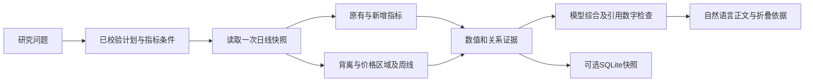

# 技术分析扩展：指标、信号与日周核对

更新：2026-10-26。本文描述本轮已接入的能力；原指标算法和八项默认组合保持不变。

## 1. 设计与数据流

核心仍是程序计算、模型解释。参考 [TradingAgents](https://github.com/TauricResearch/TradingAgents) 的互补指标选择、[TradingAgents-CN](https://github.com/hsliuping/TradingAgents-CN) 的程序化信号及 [ValueCell](https://github.com/ValueCell-ai/valuecell) 的多周期特征组织，结合本项目契约独立实现；没有复制这些项目的框架或切换到产品多 Agent 架构。

主要位置：`indicators.py`、`multi_contracts.py`、`multi_analysis.py`、`technical_selection.py`、`technical_insights.py`。`product_research.py` 接入公司研究，`product_answer.py` 综合；原技术工作流保留有界工具循环。

## 2. 新增三类指标

| 指标 | 口径与字段 | 首次可用及特殊情况 |
| --- | --- | --- |
| ADX(n)，默认14 | Wilder平滑；`value`、`plus_di`、`minus_di`，单位为点 | DI需要n+1条，ADX需要2n条；完全平盘输出0，强度与方向分别解释 |
| OBV，无周期参数 | 首条为0；收盘上涨加当日股数、下跌减股数、持平不变；`value`为有符号整数 | 首条即可用；绝对值依赖本次快照起点，不能解释为真实资金金额 |
| VWMA(n)，默认20 | 窗口内收盘价按成交股数加权；`value`单位为元/股 | 需要完整n条；总量为0时返回`undefined/zero_window_volume`，不补零 |

算法版本分别为 `adx-wilder-double-smoothed-v1`、`obv-snapshot-zero-seed-v1`、`vwma-close-volume-weighted-v1`。OBV保留Python整数；VWMA权重运算使用Decimal，避免先把大股数转成浮点数。

同名指标不保证跨库读数一致。原EMA继续使用SMA种子，RSI和ATR继续使用Wilder平滑，BOLL继续采用总体标准差，MACD柱值继续为`2*(DIF-DEA)`。本轮不为匹配其他库而改动这些口径。

图表同步校验新算法、参数、字段和单位。VWMA叠加到价格区；ADX和OBV进入独立面板。超过浏览器安全范围的OBV数值让图表局部不可用，证据文本保留整数，不以浮点舍入冒充精确值。

## 3. 按研究任务选择互补指标

`technical_selection.py` 的选择是小型、可解释的应用规则，不是模型训练或自动策略优化。公司研究计划在未提供明确指标时使用它：

| Profile | 典型问题 | 组合 |
| --- | --- | --- |
| `balanced` | 一般公司或走势分析 | 原八项：SMA20/60、EMA20、MACD、RSI14、BOLL、ATR14、量能20 |
| `momentum` | 动能、乏力、背离、超买超卖 | SMA20、MACD、RSI14、ADX14、量能20、ATR14 |
| `volume_price` | 放量、缩量、量价配合 | SMA20、VWMA20、OBV、量能20、MACD、ATR14 |
| `trend_strength` | 趋势强度、趋势还是震荡 | SMA20/60、MACD、ADX14、ATR14、量能20 |
| `structure_volatility` | 支撑、压力、波动风险 | SMA20、BOLL、ATR14、量能20、ADX14 |

用户明确参数优先，例如“只看RSI7”不能被profile换回RSI14或默认组合；明确否定也先过滤。既有风险情景的ATR依赖仍按原权限规则补齐。普通问题保留八项默认，不因新增指标就全部堆入每轮。

## 4. 背离与支撑压力规则

`technical_insights.py` 从同一冻结日线重算有需要的历史依赖，不再次请求行情。

- 极值采用严格比较：候选点必须高于或低于左右各2条记录；平顶、平底不任意指定一个转折点。
- 背离比较最近120条范围内最后两个已确认收盘价极值，以及同日期的RSI或MACD DIF。价格创新高、指标降低形成顶背离规则候选；价格创新低、指标提高形成底背离候选。
- 最新比较极值超过20条记录时标记陈旧；极值或指标历史不足时保留未知。不使用尚无右侧确认的最新转折点。
- 支撑压力使用已确认高低点，按价格排序，以簇首价格为基准进行1%范围聚类；选择当前价下方最近支撑候选和上方最近压力候选。
- 聚类内极值数量单独记录，不能称为有效触及次数。历史区域不是已验证支撑，也不会自动成为止损或目标价。

这些是固定规则观察，不覆盖全部K线形态，也不提供反转概率或预测胜率。

## 5. 完整周线与日周方向

周线按周一至周日的日历边界聚合已有记录：开盘取首条、最高取最大、最低取最小、收盘取末条、量额求和。排除尚未到周日边界的周，也排除请求起点截断的首周；周线日期保留该周最后实际记录的日期。

“日历边界完整”不等于交易记录已由交易所日历证明完整。这里不补周末、缺失行情或停牌，不推断缺失原因；复权口径沿用日线。

只对本次请求中的SMA、EMA、RSI、MACD计算同参数周指标。例如日线SMA20对应20根周线的SMA20，不把周期缩成4周；周线SMA60历史不足就保持缺失。日周核对使用最短的可用同参数SMA/EMA，比较各自收盘价处于各自均线哪一侧，结果为同向、分歧、边界或不足；没有把一致性解释成两份独立证据。

## 6. 证据、归档与回答边界

每条派生事实保留原始依赖：极值确认包含左右记录，递推指标包含计算前缀，周指标依赖周收盘及对应日线。依赖按先后构建为无环图，拒绝跨请求、跨证券和晚于派生日期的依赖。

公司研究只把有界的观察与数值映射为`ProductEvidence`，不把整份历史依赖图塞给模型。技术依据统一使用`kind=technical`，通过`daily_signal_derived`、`completed_week_derived`、`cross_timeframe_derived`区分口径；前端分别显示交易日、周线截至和日周核对日期。

启用原有`--snapshot-db`后，SQLite归档完整技术快照、观察与依赖事实；保存前可从同份日线重建核对。默认不创建证据库，不保存聊天或模型草稿，也不能恢复供应商未保存的历史修订版本。

模型负责围绕原问题解释关键依据与冲突。输出检查仍主要覆盖引用成员、证券归属、数值、单位和格式；引用通过不代表自由文字的因果关系已被证明。程序化信号也不自动赋予全文语义验证、策略收益或预测准确率。

## 7. 预算与验证方法

新增指标和周线计算不引入新行情来源、模型角色或额外远程请求；仍受现有单轮期限、调用次数和上下文上限约束。技术循环最多6次工具、6次模型和2次分析，补充指标复用原快照；公司研究最多3次日线分析、6次模型调用。它们是执行上限，不要求用满，也不是远端强制中断或账单上限。

验证重点是独立公式参考、预热边界、零量、精确大整数、前缀不变性、极值右侧确认、周聚合及排除规则、依赖图、上下文裁剪和图表契约。测试结果以实际验收输出为准；离线契约与固定合成数据不能代替真实回答质量和投资效果评估。

相关文档：[多指标契约](multi-indicator-design.md)、[公司研究](company-research-design.md)、[有界工具循环](bounded-research-workflow-design.md)。

## 8. 本轮验收记录

2026-10-26 在 Windows 本地运行 `.\.venv\Scripts\python.exe scripts\verify.py all`，随后补齐完整中文周指标路由并重跑 `python` 验收：最终 1833 项 Python 测试、549 项前端测试、4 个 Agent 场景、90 次 MVP 场景、5 个公司研究流程及 API 演练通过，无跳过项。TypeScript、生产构建、ASGI 静态资源、干净 wheel 的资源包含与依赖一致性检查也通过。本轮没有新增人工浏览器走查。

另外通过网页使用的 `configured_models()` 配置调用真实 DeepSeek，分别询问量价与完整周线、趋势强度与反证。两轮均使用明确标记的合成日线和固定证券目录，均为 `company_research_completed / accepted`，各调用模型 2 次、计算 1 次、行情快照读取 1 次，没有请求真实市场数据。它们验证自然语言回答与引用数字检查能共同完成，不代表真实市场回答质量、收益或预测准确率。

调试时直接构造适配器的 512-token 默认配置曾导致 JSON 被截断；改用网页原有的 1500-token 配置后完成。没有放宽输出验证或提高产品既有调用、上下文预算。
